# Thinking & General Note Formats

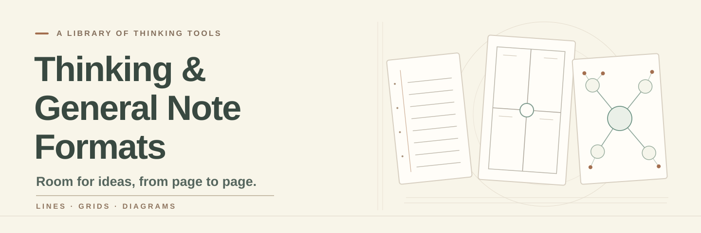

[繁體中文](README.md) · [English](README.en.md) · [日本語](README.ja.md)

Lines, grids, and diagrams. Browse by purpose, see worked examples, and download wordless or English-titled PDFs.

A planner habit started this project. AI catches ideas faster than I can find a pen, but I still like thinking in lines, grids, and diagrams. These printable, editable pages are a souvenir for the planner—and a new job for it.

144 downloadable formats · 127 distinct geometries. [Shared geometry](docs/GEOMETRY-GROUPS.md)

## Start here

- [Quick start](QUICKSTART.md)
- [Choose by task](docs/en/choose.md)
- [Full catalog](docs/en/catalog.md)
- [Print](docs/en/print.md)
- [Customize](docs/en/customize.md)
- [Contribute](docs/en/contribute.md)
- [Glossary](docs/en/glossary.md)

## All formats: expand a family

Expand a family to browse. Open a name for instructions and provenance, or an image for a larger view.

<strong>Basic writing</strong> · 8

### [Blank page](templates/blank/README.en.md) · `blank`

Leave every mark and spatial relationship to the writer or sketcher.

**Worked example：** A fictional community garden idea places plants, tools, and care times in separate areas, then connects them. The blank download itself has no words.

<a href="templates/blank/examples/en.svg">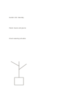</a>

[Wordless PDF](templates/blank/exports/a5-draft/blank.pdf) · [English-titled PDF](templates/blank/exports/a5-draft/titled.pdf) · [SVG](templates/blank/exports/a5-draft/blank.svg) · [Darker PDF](templates/blank/exports/a5-contrast/blank.pdf)

### [Narrow ruled notes](templates/ruled-narrow/README.en.md) · `ruled-narrow`

<a href="templates/ruled-narrow/previews/a5-draft.png">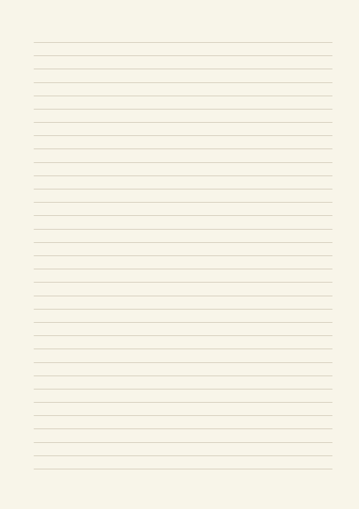</a>

Record continuous sentences at a steady line spacing while keeping the page open to free writing. Geometry change: ruled line spacing: 5.5 mm.

**Worked example：** The example follows a fictional neighborhood reading group: its aim, venue, sequence, equipment still to confirm, and a question for the next meeting. The fictional entries indicate where short notes belong; they are neither measured data nor a complete research conclusion.

<a href="templates/ruled-narrow/examples/en.svg">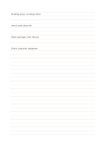</a>

[Wordless PDF](templates/ruled-narrow/exports/a5-draft/blank.pdf) · [English-titled PDF](templates/ruled-narrow/exports/a5-draft/titled.pdf) · [SVG](templates/ruled-narrow/exports/a5-draft/blank.svg) · [Darker PDF](templates/ruled-narrow/exports/a5-contrast/blank.pdf)

### [Ruled notes](templates/ruled-standard/README.en.md) · `ruled-standard`

Record continuous sentences at a steady line spacing while keeping the page open to free writing.

**Worked example：** The example follows a fictional neighborhood reading group: its aim, venue, sequence, equipment still to confirm, and a question for the next meeting.

<a href="templates/ruled-standard/examples/en.svg">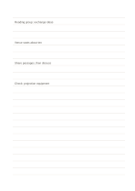</a>

[Wordless PDF](templates/ruled-standard/exports/a5-draft/blank.pdf) · [English-titled PDF](templates/ruled-standard/exports/a5-draft/titled.pdf) · [SVG](templates/ruled-standard/exports/a5-draft/blank.svg) · [Darker PDF](templates/ruled-standard/exports/a5-contrast/blank.pdf)

### [Wide ruled notes](templates/ruled-wide/README.en.md) · `ruled-wide`

<a href="templates/ruled-wide/previews/a5-draft.png">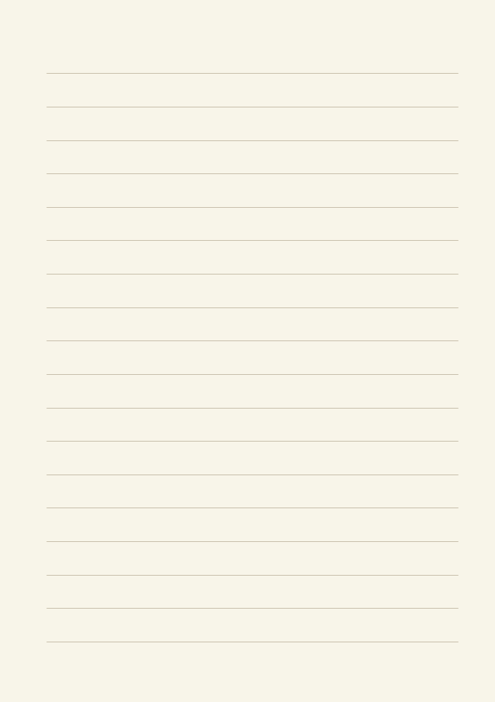</a>

Record continuous sentences at a steady line spacing while keeping the page open to free writing. Geometry change: ruled line spacing: 10 mm.

**Worked example：** The example follows a fictional neighborhood reading group: its aim, venue, sequence, equipment still to confirm, and a question for the next meeting. The fictional entries indicate where short notes belong; they are neither measured data nor a complete research conclusion.

<a href="templates/ruled-wide/examples/en.svg">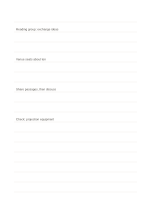</a>

[Wordless PDF](templates/ruled-wide/exports/a5-draft/blank.pdf) · [English-titled PDF](templates/ruled-wide/exports/a5-draft/titled.pdf) · [SVG](templates/ruled-wide/exports/a5-draft/blank.svg) · [Darker PDF](templates/ruled-wide/exports/a5-contrast/blank.pdf)

### [Double-ruled writing](templates/ruled-double/README.en.md) · `ruled-double`

Pairs of lines form writing bands for practicing consistent height and spacing.

**Worked example：** Three fictional plant-observation phrases are written in separate bands to compare height and spacing.

<a href="templates/ruled-double/examples/en.svg">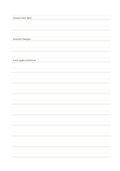</a>

[Wordless PDF](templates/ruled-double/exports/a5-draft/blank.pdf) · [English-titled PDF](templates/ruled-double/exports/a5-draft/titled.pdf) · [SVG](templates/ruled-double/exports/a5-draft/blank.svg) · [Darker PDF](templates/ruled-double/exports/a5-contrast/blank.pdf)

### [Segmented ruled notes](templates/ruled-segmented/README.en.md) · `ruled-segmented`

Split each row into three short writing lanes for related brief entries.

**Worked example：** A fictional plant observation uses the three lanes for time, visible condition, and a follow-up question.

<a href="templates/ruled-segmented/examples/en.svg">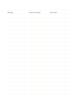</a>

[Wordless PDF](templates/ruled-segmented/exports/a5-draft/blank.pdf) · [English-titled PDF](templates/ruled-segmented/exports/a5-draft/titled.pdf) · [SVG](templates/ruled-segmented/exports/a5-draft/blank.svg) · [Darker PDF](templates/ruled-segmented/exports/a5-contrast/blank.pdf)

### [Ruled notes with margin](templates/ruled-margin/README.en.md) · `ruled-margin`

Keep a narrow cue or reference margin beside a continuous writing area.

**Worked example：** The margin names a page of a fictional article, while the main area records an observation and a question to check.

<a href="templates/ruled-margin/examples/en.svg">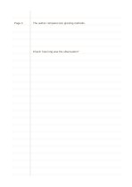</a>

[Wordless PDF](templates/ruled-margin/exports/a5-draft/blank.pdf) · [English-titled PDF](templates/ruled-margin/exports/a5-draft/titled.pdf) · [SVG](templates/ruled-margin/exports/a5-draft/blank.svg) · [Darker PDF](templates/ruled-margin/exports/a5-contrast/blank.pdf)

### [Sketch above, notes below](templates/ruled-sketch-top/README.en.md) · `ruled-sketch-top`

Draw a concept in the large upper area, then explain it on ruled lines beneath.

**Worked example：** The upper space roughly depicts a fictional rainwater collector, while the lower lines note the inlet, filter, and capacity to test.

<a href="templates/ruled-sketch-top/examples/en.svg">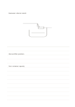</a>

[Wordless PDF](templates/ruled-sketch-top/exports/a5-draft/blank.pdf) · [English-titled PDF](templates/ruled-sketch-top/exports/a5-draft/titled.pdf) · [SVG](templates/ruled-sketch-top/exports/a5-draft/blank.svg) · [Darker PDF](templates/ruled-sketch-top/exports/a5-contrast/blank.pdf)

<strong>Grids and dots</strong> · 8

### [Fine square grid](templates/grid-fine/README.en.md) · `grid-fine`

<a href="templates/grid-fine/previews/a5-draft.png">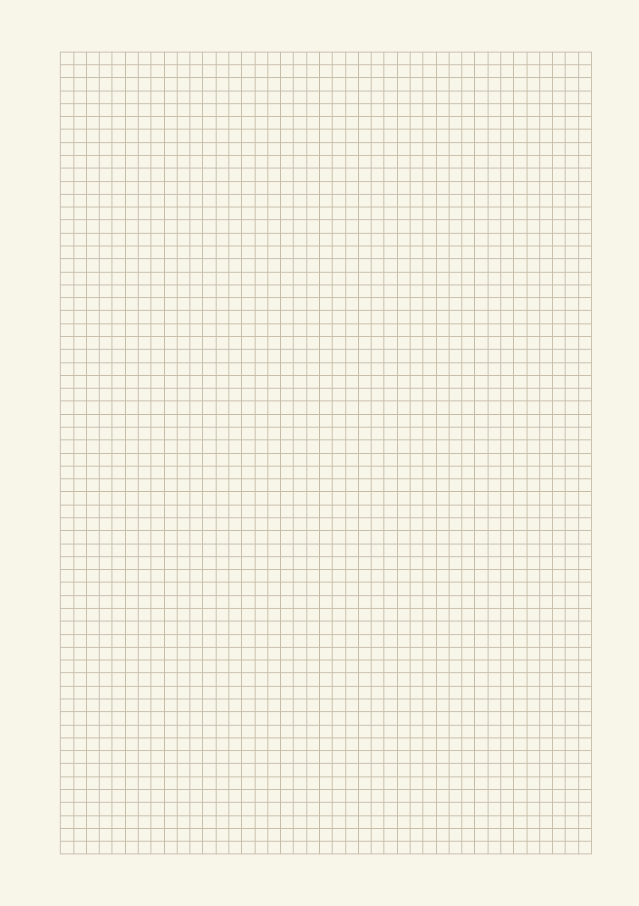</a>

Align short notes, simple drawings, and proportional drafts on equal squares. Geometry change: grid pitch: 3 mm.

**Worked example：** A fictional reading corner uses cells for a table, chairs, and passage, with a width still to measure. The fictional entries indicate where short notes belong; they are neither measured data nor a complete research conclusion.

<a href="templates/grid-fine/examples/en.svg">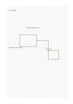</a>

[Wordless PDF](templates/grid-fine/exports/a5-draft/blank.pdf) · [English-titled PDF](templates/grid-fine/exports/a5-draft/titled.pdf) · [SVG](templates/grid-fine/exports/a5-draft/blank.svg) · [Darker PDF](templates/grid-fine/exports/a5-contrast/blank.pdf)

### [Square grid](templates/grid-standard/README.en.md) · `grid-standard`

Align short notes, simple drawings, and proportional drafts on equal squares.

**Worked example：** A fictional reading corner uses cells for a table, chairs, and passage, with a width still to measure.

<a href="templates/grid-standard/examples/en.svg">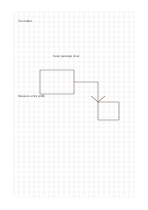</a>

[Wordless PDF](templates/grid-standard/exports/a5-draft/blank.pdf) · [English-titled PDF](templates/grid-standard/exports/a5-draft/titled.pdf) · [SVG](templates/grid-standard/exports/a5-draft/blank.svg) · [Darker PDF](templates/grid-standard/exports/a5-contrast/blank.pdf)

### [Large square grid](templates/grid-large/README.en.md) · `grid-large`

Align short notes, simple drawings, and proportional drafts on equal squares. Geometry change: grid pitch: 8 mm.

**Worked example：** A fictional reading corner uses cells for a table, chairs, and passage, with a width still to measure. The fictional entries indicate where short notes belong; they are neither measured data nor a complete research conclusion.

<a href="templates/grid-large/examples/en.svg">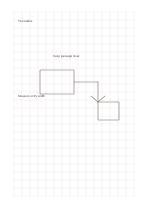</a>

[Wordless PDF](templates/grid-large/exports/a5-draft/blank.pdf) · [English-titled PDF](templates/grid-large/exports/a5-draft/titled.pdf) · [SVG](templates/grid-large/exports/a5-draft/blank.svg) · [Darker PDF](templates/grid-large/exports/a5-contrast/blank.pdf)

### [Fine dot grid](templates/dot-fine/README.en.md) · `dot-fine`

<a href="templates/dot-fine/previews/a5-draft.png">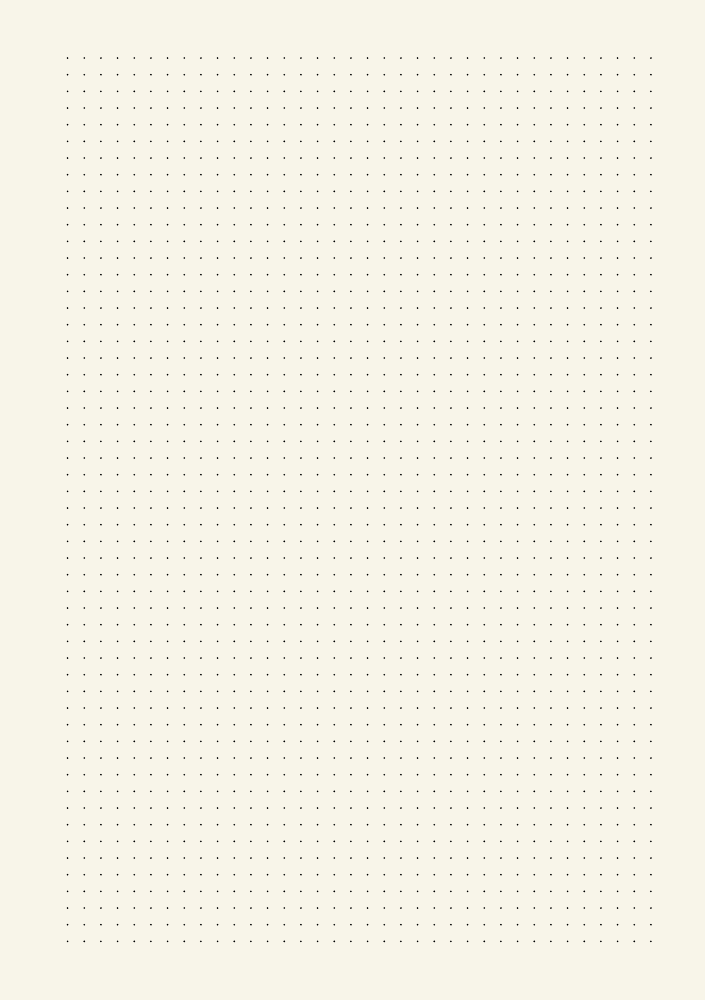</a>

Use faint dots for alignment while leaving writing more open than a full square grid. Geometry change: dot pitch: 3.5 mm.

**Worked example：** Three aligned blocks describe the venue, materials, and people for a fictional neighborhood event. The fictional entries indicate where short notes belong; they are neither measured data nor a complete research conclusion.

<a href="templates/dot-fine/examples/en.svg">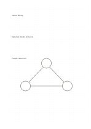</a>

[Wordless PDF](templates/dot-fine/exports/a5-draft/blank.pdf) · [English-titled PDF](templates/dot-fine/exports/a5-draft/titled.pdf) · [SVG](templates/dot-fine/exports/a5-draft/blank.svg) · [Darker PDF](templates/dot-fine/exports/a5-contrast/blank.pdf)

### [Dot grid](templates/dot-standard/README.en.md) · `dot-standard`

Use faint dots for alignment while leaving writing more open than a full square grid.

**Worked example：** Three aligned blocks describe the venue, materials, and people for a fictional neighborhood event.

<a href="templates/dot-standard/examples/en.svg">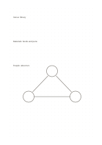</a>

[Wordless PDF](templates/dot-standard/exports/a5-draft/blank.pdf) · [English-titled PDF](templates/dot-standard/exports/a5-draft/titled.pdf) · [SVG](templates/dot-standard/exports/a5-draft/blank.svg) · [Darker PDF](templates/dot-standard/exports/a5-contrast/blank.pdf)

### [Staggered dot grid](templates/dot-staggered/README.en.md) · `dot-staggered`

Offset alternate rows of dots to guide diagonal and triangular arrangements.

**Worked example：** Three display rows in a fictional exhibition are staggered, with an opening left for passage.

<a href="templates/dot-staggered/examples/en.svg">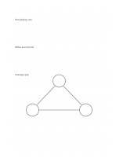</a>

[Wordless PDF](templates/dot-staggered/exports/a5-draft/blank.pdf) · [English-titled PDF](templates/dot-staggered/exports/a5-draft/titled.pdf) · [SVG](templates/dot-staggered/exports/a5-draft/blank.svg) · [Darker PDF](templates/dot-staggered/exports/a5-contrast/blank.pdf)

### [Overview and detail grid](templates/grid-hierarchical/README.en.md) · `grid-hierarchical`

Use large cells for the whole plan and a localized finer grid for one important area.

**Worked example：** A fictional reading corner is divided into seating, shelves, and passage; the center grid expands the tabletop arrangement.

<a href="templates/grid-hierarchical/examples/en.svg">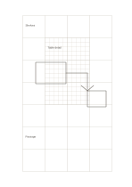</a>

[Wordless PDF](templates/grid-hierarchical/exports/a5-draft/blank.pdf) · [English-titled PDF](templates/grid-hierarchical/exports/a5-draft/titled.pdf) · [SVG](templates/grid-hierarchical/exports/a5-draft/blank.svg) · [Darker PDF](templates/grid-hierarchical/exports/a5-contrast/blank.pdf)

### [Dots beside grid](templates/dot-grid-split/README.en.md) · `dot-grid-split`

Place an open dot field beside a regular square grid on the same page.

**Worked example：** The left side explores plants in a fictional garden; the right aligns the number and placement of pots.

<a href="templates/dot-grid-split/examples/en.svg">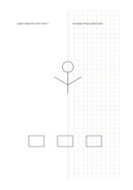</a>

[Wordless PDF](templates/dot-grid-split/exports/a5-draft/blank.pdf) · [English-titled PDF](templates/dot-grid-split/exports/a5-draft/titled.pdf) · [SVG](templates/dot-grid-split/exports/a5-draft/blank.svg) · [Darker PDF](templates/dot-grid-split/exports/a5-contrast/blank.pdf)

<strong>Geometry paper</strong> · 8

### [Triangular grid](templates/triangular-grid/README.en.md) · `triangular-grid`

Use three equally spaced line directions to draft diagonal structures and triangular divisions.

**Worked example：** A fictional display stand marks three support points and a diagonal brace, leaving its dimensions to measure.

<a href="templates/triangular-grid/examples/en.svg">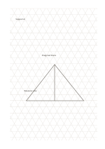</a>

[Wordless PDF](templates/triangular-grid/exports/a5-draft/blank.pdf) · [English-titled PDF](templates/triangular-grid/exports/a5-draft/titled.pdf) · [SVG](templates/triangular-grid/exports/a5-draft/blank.svg) · [Darker PDF](templates/triangular-grid/exports/a5-contrast/blank.pdf)

### [Isometric triangular grid](templates/isometric-grid/README.en.md) · `isometric-grid`

Use the three-direction lattice to sketch equal-angle objects; verify actual dimensions separately.

**Worked example：** Entries in example-position order; each number identifies one entry:

1. Support A
2. Diagonal brace
3. Measure size

[Wordless PDF](templates/isometric-grid/exports/a5-draft/blank.pdf) · [English-titled PDF](templates/isometric-grid/exports/a5-draft/titled.pdf) · [SVG](templates/isometric-grid/exports/a5-draft/blank.svg) · [Darker PDF](templates/isometric-grid/exports/a5-contrast/blank.pdf)

### [Hexagonal grid](templates/hex-grid/README.en.md) · `hex-grid`

Use neighboring hexagonal cells to show adjacency, clusters, and routes.

**Worked example：** A fictional exhibition puts an entrance, displays, and rest area in adjacent cells, then sketches a visitor route.

<a href="templates/hex-grid/examples/en.svg">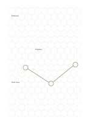</a>

[Wordless PDF](templates/hex-grid/exports/a5-draft/blank.pdf) · [English-titled PDF](templates/hex-grid/exports/a5-draft/titled.pdf) · [SVG](templates/hex-grid/exports/a5-draft/blank.svg) · [Darker PDF](templates/hex-grid/exports/a5-contrast/blank.pdf)

### [Rhombus grid](templates/rhombus-grid/README.en.md) · `rhombus-grid`

Cross two diagonal line families to study diamond cells and rotated square arrangements.

**Worked example：** A fictional floor-tile layout uses diamonds for its angled repeat and marks the entrance and turning point.

<a href="templates/rhombus-grid/examples/en.svg">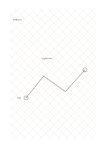</a>

[Wordless PDF](templates/rhombus-grid/exports/a5-draft/blank.pdf) · [English-titled PDF](templates/rhombus-grid/exports/a5-draft/titled.pdf) · [SVG](templates/rhombus-grid/exports/a5-draft/blank.svg) · [Darker PDF](templates/rhombus-grid/exports/a5-contrast/blank.pdf)

### [Banded diagonal guides](templates/diagonal-guides/README.en.md) · `diagonal-guides`

Use a diagonal in each of four broad bands to draft direction, slope, or change.

**Worked example：** Four fictional exhibition routes are compared by drawing where each begins and ends.

<a href="templates/diagonal-guides/examples/en.svg">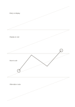</a>

[Wordless PDF](templates/diagonal-guides/exports/a5-draft/blank.pdf) · [English-titled PDF](templates/diagonal-guides/exports/a5-draft/titled.pdf) · [SVG](templates/diagonal-guides/exports/a5-draft/blank.svg) · [Darker PDF](templates/diagonal-guides/exports/a5-contrast/blank.pdf)

### [Radial polar paper](templates/radial-polar/README.en.md) · `radial-polar`

Use rings and rays to arrange directions and levels of distance from a center.

**Worked example：** A fictional small plaza sits in the center, with an entrance, seats, planting, and path shown in approximate directions.

<a href="templates/radial-polar/examples/en.svg">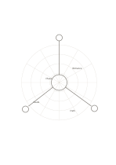</a>

[Wordless PDF](templates/radial-polar/exports/a5-draft/blank.pdf) · [English-titled PDF](templates/radial-polar/exports/a5-draft/titled.pdf) · [SVG](templates/radial-polar/exports/a5-draft/blank.svg) · [Darker PDF](templates/radial-polar/exports/a5-contrast/blank.pdf)

### [Unnumbered coordinate axes](templates/coordinate-grid/README.en.md) · `coordinate-grid`

Use two central axes and ticks to explore the direction and relative position of two quantities.

**Worked example：** Four fictional event ideas are positioned by preparation time and attendance, to be checked against real figures later.

<a href="templates/coordinate-grid/examples/en.svg">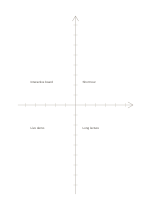</a>

[Wordless PDF](templates/coordinate-grid/exports/a5-draft/blank.pdf) · [English-titled PDF](templates/coordinate-grid/exports/a5-draft/titled.pdf) · [SVG](templates/coordinate-grid/exports/a5-draft/blank.svg) · [Darker PDF](templates/coordinate-grid/exports/a5-contrast/blank.pdf)

### [Engineering grid](templates/engineering-grid/README.en.md) · `engineering-grid`

<a href="templates/engineering-grid/previews/a5-draft.png">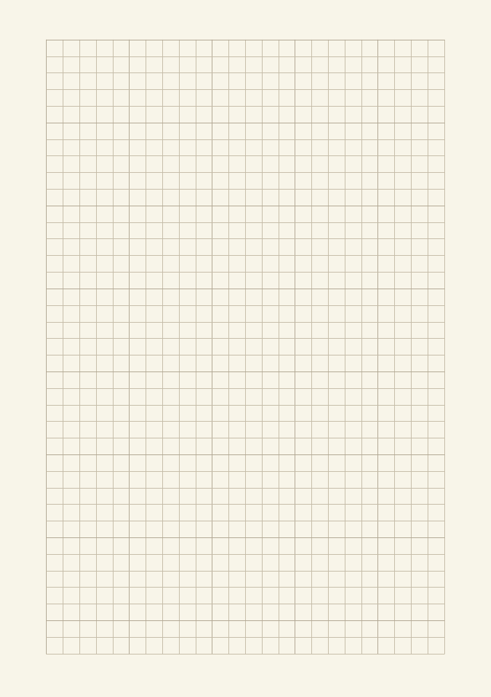</a>

Align short notes, simple drawings, and proportional drafts on equal squares. Geometry change: Every fifth grid line is emphasized.

**Worked example：** A fictional reading corner uses cells for a table, chairs, and passage, with a width still to measure. The fictional entries indicate where short notes belong; they are neither measured data nor a complete research conclusion.

<a href="templates/engineering-grid/examples/en.svg">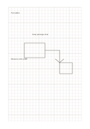</a>

[Wordless PDF](templates/engineering-grid/exports/a5-draft/blank.pdf) · [English-titled PDF](templates/engineering-grid/exports/a5-draft/titled.pdf) · [SVG](templates/engineering-grid/exports/a5-draft/blank.svg) · [Darker PDF](templates/engineering-grid/exports/a5-contrast/blank.pdf)

<strong>Columns</strong> · 8

### [Equal two columns](templates/two-equal-columns/README.en.md) · `two-equal-columns`

Place two equally important streams side by side for rowwise or whole-page comparison.

**Worked example：** A fictional exhibition's paper and spoken guides are compared by what visitors can learn and ask.

[Wordless PDF](templates/two-equal-columns/exports/a5-draft/blank.pdf) · [English-titled PDF](templates/two-equal-columns/exports/a5-draft/titled.pdf) · [SVG](templates/two-equal-columns/exports/a5-draft/blank.svg) · [Darker PDF](templates/two-equal-columns/exports/a5-contrast/blank.pdf)

### [Narrow left reference column](templates/two-left-narrow/README.en.md) · `two-left-narrow`

Keep brief references on the left and leave the wide area for continuous notes or drawings.

**Worked example：** A fictional interview uses a venue cue at left and a description of entrances and seating at right.

[Wordless PDF](templates/two-left-narrow/exports/a5-draft/blank.pdf) · [English-titled PDF](templates/two-left-narrow/exports/a5-draft/titled.pdf) · [SVG](templates/two-left-narrow/exports/a5-draft/blank.svg) · [Darker PDF](templates/two-left-narrow/exports/a5-contrast/blank.pdf)

### [Narrow right column](templates/two-right-narrow/README.en.md) · `two-right-narrow`

Put short references and open questions in the narrow right column, leaving the left for continuous notes or sketches.

**Worked example：** Entries in example-position order; each number identifies one entry:

1. Venue
2. Entrance near shelves; seats by window.

[Wordless PDF](templates/two-right-narrow/exports/a5-draft/blank.pdf) · [English-titled PDF](templates/two-right-narrow/exports/a5-draft/titled.pdf) · [SVG](templates/two-right-narrow/exports/a5-draft/blank.svg) · [Darker PDF](templates/two-right-narrow/exports/a5-contrast/blank.pdf)

### [Three equal columns](templates/three-columns/README.en.md) · `three-columns`

Compare three parallel streams while preserving each one's vertical context.

**Worked example：** Three fictional reading-group venues are compared: a library, community center, and outdoor pavilion.

<a href="templates/three-columns/examples/en.svg">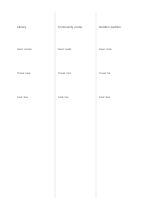</a>

[Wordless PDF](templates/three-columns/exports/a5-draft/blank.pdf) · [English-titled PDF](templates/three-columns/exports/a5-draft/titled.pdf) · [SVG](templates/three-columns/exports/a5-draft/blank.svg) · [Darker PDF](templates/three-columns/exports/a5-contrast/blank.pdf)

### [Cornell notes](templates/cornell/README.en.md) · `cornell`

Separate recall cues, detailed notes, and a closing summary so the page can be reviewed actively.

**Worked example：** A fictional plant observation lesson uses the main area for light and leaf observations, the cue column for a question about leaf color, and the bottom for a cautious conclusion.

<a href="templates/cornell/examples/en.svg">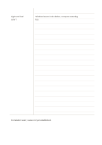</a>

[Wordless PDF](templates/cornell/exports/a5-draft/blank.pdf) · [English-titled PDF](templates/cornell/exports/a5-draft/titled.pdf) · [SVG](templates/cornell/exports/a5-draft/blank.svg) · [Darker PDF](templates/cornell/exports/a5-contrast/blank.pdf)

### [Mirrored Cornell notes](templates/cornell-mirrored/README.en.md) · `cornell-mirrored`

Move the Cornell cue column to the right, keeping main notes on the left and a summary below for recall.

**Worked example：** Entries in example-position order; each number identifies one entry:

1. Light and leaf color?
2. Window leaves look darker; compare watering too.
3. Correlation seen; cause not yet established.

<a href="templates/cornell-mirrored/examples/en.svg">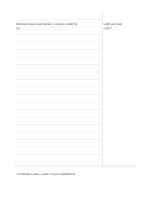</a>

[Wordless PDF](templates/cornell-mirrored/exports/a5-draft/blank.pdf) · [English-titled PDF](templates/cornell-mirrored/exports/a5-draft/titled.pdf) · [SVG](templates/cornell-mirrored/exports/a5-draft/blank.svg) · [Darker PDF](templates/cornell-mirrored/exports/a5-contrast/blank.pdf)

### [Ruled cue rail and dot field](templates/column-dot-main/README.en.md) · `column-dot-main`

List cues on narrow rules at left and draw their structure in the dot field at right.

**Worked example：** A fictional garden's entrance and seats are listed at left, positioned at right, and joined by a route.

<a href="templates/column-dot-main/examples/en.svg">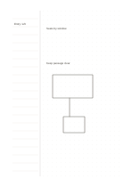</a>

[Wordless PDF](templates/column-dot-main/exports/a5-draft/blank.pdf) · [English-titled PDF](templates/column-dot-main/exports/a5-draft/titled.pdf) · [SVG](templates/column-dot-main/exports/a5-draft/blank.svg) · [Darker PDF](templates/column-dot-main/exports/a5-contrast/blank.pdf)

### [Two columns with synthesis](templates/two-columns-summary/README.en.md) · `two-columns-summary`

Keep two viewpoints distinct above, then write a combined conclusion across the bottom.

**Worked example：** Indoor and outdoor venues for a fictional reading group are compared; weather and a backup plan remain the synthesis question.

<a href="templates/two-columns-summary/examples/en.svg">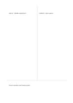</a>

[Wordless PDF](templates/two-columns-summary/exports/a5-draft/blank.pdf) · [English-titled PDF](templates/two-columns-summary/exports/a5-draft/titled.pdf) · [SVG](templates/two-columns-summary/exports/a5-draft/blank.svg) · [Darker PDF](templates/two-columns-summary/exports/a5-contrast/blank.pdf)

<strong>Cards</strong> · 8

### [Two stacked cards](templates/two-stacked-cards/README.en.md) · `two-stacked-cards`

Use two separate vertical cards for two stages or viewpoints.

**Worked example：** A fictional exhibition uses the top card for arrival observations and the bottom for questions left afterward.

<a href="templates/two-stacked-cards/examples/en.svg">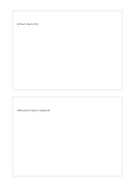</a>

[Wordless PDF](templates/two-stacked-cards/exports/a5-draft/blank.pdf) · [English-titled PDF](templates/two-stacked-cards/exports/a5-draft/titled.pdf) · [SVG](templates/two-stacked-cards/exports/a5-draft/blank.svg) · [Darker PDF](templates/two-stacked-cards/exports/a5-contrast/blank.pdf)

### [Three stacked cards](templates/three-stacked-cards/README.en.md) · `three-stacked-cards`

Keep before, during, and after entries in three separate stacked cards. Geometry change: stacked cards: 3.

**Worked example：** Entries in example-position order; each number identifies one entry:

1. Arrival: clear entry
2. During: find books
3. Afterward: review feedback

<a href="templates/three-stacked-cards/examples/en.svg">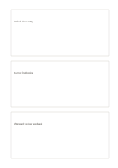</a>

[Wordless PDF](templates/three-stacked-cards/exports/a5-draft/blank.pdf) · [English-titled PDF](templates/three-stacked-cards/exports/a5-draft/titled.pdf) · [SVG](templates/three-stacked-cards/exports/a5-draft/blank.svg) · [Darker PDF](templates/three-stacked-cards/exports/a5-contrast/blank.pdf)

### [Four separate cards](templates/four-cards/README.en.md) · `four-cards`

Give four small topics independent bordered areas with visible gaps between them.

**Worked example：** A fictional neighborhood event separates venue, materials, invitations, and schedule into four cards.

<a href="templates/four-cards/examples/en.svg">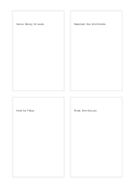</a>

[Wordless PDF](templates/four-cards/exports/a5-draft/blank.pdf) · [English-titled PDF](templates/four-cards/exports/a5-draft/titled.pdf) · [SVG](templates/four-cards/exports/a5-draft/blank.svg) · [Darker PDF](templates/four-cards/exports/a5-contrast/blank.pdf)

### [Six separate cards](templates/six-cards/README.en.md) · `six-cards`

<a href="templates/six-cards/previews/a5-draft.png">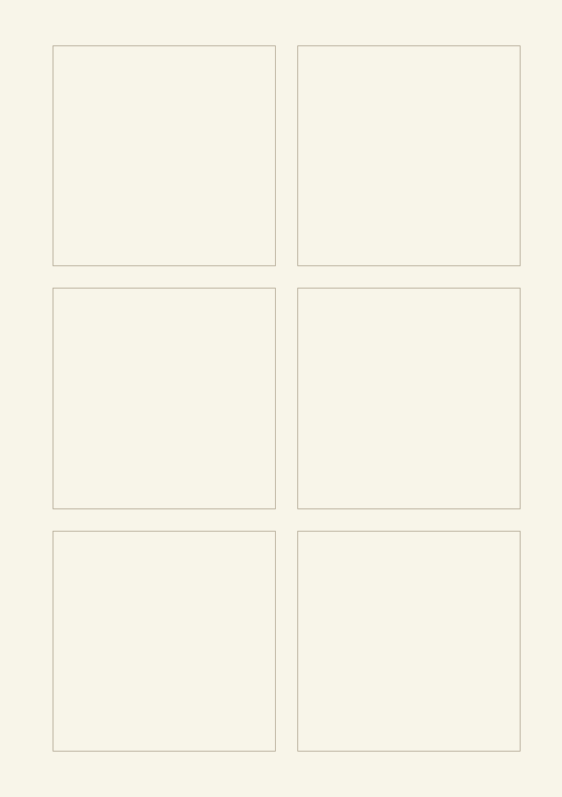</a>

Give each candidate idea its own card before comparing or ordering them. Geometry change: separate cards: 6.

**Worked example：** Entries in example-position order; each number identifies one entry:

1. Library, ten seats
2. Four short books
3. Invite by Friday
4. Saturday afternoon
5. Two facilitators
6. Collect feedback

<a href="templates/six-cards/examples/en.svg">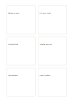</a>

[Wordless PDF](templates/six-cards/exports/a5-draft/blank.pdf) · [English-titled PDF](templates/six-cards/exports/a5-draft/titled.pdf) · [SVG](templates/six-cards/exports/a5-draft/blank.svg) · [Darker PDF](templates/six-cards/exports/a5-contrast/blank.pdf)

### [Eight separate cards](templates/eight-cards/README.en.md) · `eight-cards`

Give each candidate idea its own card before comparing or ordering them. Geometry change: separate cards: 8.

**Worked example：** Entries in example-position order; each number identifies one entry:

1. Library, ten seats
2. Four short books
3. Invite by Friday
4. Saturday afternoon
5. Two facilitators
6. Check budget
7. Clear passage
8. Collect feedback

<a href="templates/eight-cards/examples/en.svg">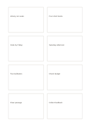</a>

[Wordless PDF](templates/eight-cards/exports/a5-draft/blank.pdf) · [English-titled PDF](templates/eight-cards/exports/a5-draft/titled.pdf) · [SVG](templates/eight-cards/exports/a5-draft/blank.svg) · [Darker PDF](templates/eight-cards/exports/a5-contrast/blank.pdf)

### [Center with four satellites](templates/center-four-satellites/README.en.md) · `center-four-satellites`

Place one central topic among four linked directional factors.

**Worked example：** A fictional reading group sits at the center with venue, time, books, and invitations around it.

<a href="templates/center-four-satellites/examples/en.svg">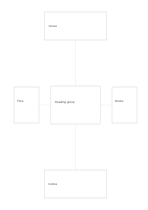</a>

[Wordless PDF](templates/center-four-satellites/exports/a5-draft/blank.pdf) · [English-titled PDF](templates/center-four-satellites/exports/a5-draft/titled.pdf) · [SVG](templates/center-four-satellites/exports/a5-draft/blank.svg) · [Darker PDF](templates/center-four-satellites/exports/a5-contrast/blank.pdf)

### [Hero card with three supports](templates/hero-three-cards/README.en.md) · `hero-three-cards`

Give one main idea a large area and reserve three smaller supporting areas below.

**Worked example：** A fictional rainwater collector occupies the large card; materials, users, and a risk to test sit below.

<a href="templates/hero-three-cards/examples/en.svg">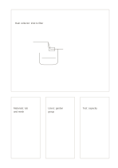</a>

[Wordless PDF](templates/hero-three-cards/exports/a5-draft/blank.pdf) · [English-titled PDF](templates/hero-three-cards/exports/a5-draft/titled.pdf) · [SVG](templates/hero-three-cards/exports/a5-draft/blank.svg) · [Darker PDF](templates/hero-three-cards/exports/a5-contrast/blank.pdf)

### [Asymmetric mosaic cards](templates/mosaic-cards/README.en.md) · `mosaic-cards`

Separate a main item, supporting information, and short notes in four unequal cards.

**Worked example：** A fictional reading-corner sketch is the main card; lighting, seats, and an untested route occupy the others.

<a href="templates/mosaic-cards/examples/en.svg">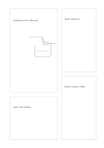</a>

[Wordless PDF](templates/mosaic-cards/exports/a5-draft/blank.pdf) · [English-titled PDF](templates/mosaic-cards/exports/a5-draft/titled.pdf) · [SVG](templates/mosaic-cards/exports/a5-draft/blank.svg) · [Darker PDF](templates/mosaic-cards/exports/a5-contrast/blank.pdf)

<strong>Comparison</strong> · 8

### [T comparison](templates/t-comparison/README.en.md) · `t-comparison`

State one question above and place two possible answers in the columns below.

**Worked example：** A fictional reading group asks where to meet, comparing a library with an outdoor pavilion.

<a href="templates/t-comparison/examples/en.svg">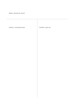</a>

[Wordless PDF](templates/t-comparison/exports/a5-draft/blank.pdf) · [English-titled PDF](templates/t-comparison/exports/a5-draft/titled.pdf) · [SVG](templates/t-comparison/exports/a5-draft/blank.svg) · [Darker PDF](templates/t-comparison/exports/a5-contrast/blank.pdf)

### [Three-way comparison](templates/three-way-comparison/README.en.md) · `three-way-comparison`

Compare three answers beneath one shared question.

**Worked example：** Three fictional reading-group venues are compared: library, community center, and pavilion.

<a href="templates/three-way-comparison/examples/en.svg">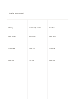</a>

[Wordless PDF](templates/three-way-comparison/exports/a5-draft/blank.pdf) · [English-titled PDF](templates/three-way-comparison/exports/a5-draft/titled.pdf) · [SVG](templates/three-way-comparison/exports/a5-draft/blank.svg) · [Darker PDF](templates/three-way-comparison/exports/a5-contrast/blank.pdf)

### [Two-circle Venn diagram](templates/venn-two/README.en.md) · `venn-two`

Separate features belonging to either group from those shared by both.

**Worked example：** Indoor and outdoor versions of a fictional reading group have chairs and shade separately, while a discussion question is shared.

<a href="templates/venn-two/examples/en.svg">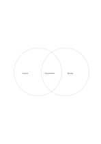</a>

[Wordless PDF](templates/venn-two/exports/a5-draft/blank.pdf) · [English-titled PDF](templates/venn-two/exports/a5-draft/titled.pdf) · [SVG](templates/venn-two/exports/a5-draft/blank.svg) · [Darker PDF](templates/venn-two/exports/a5-contrast/blank.pdf)

### [Three-circle Venn diagram](templates/venn-three/README.en.md) · `venn-three`

Inspect exclusive, pairwise-shared, and three-way-shared items across three groups.

**Worked example：** For a fictional lecture, workshop, and tour, speaker/tools/route are exclusive; seats, Q&A, and hands-on activity are pairwise; signup is shared by all three.

<a href="templates/venn-three/examples/en.svg">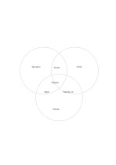</a>

[Wordless PDF](templates/venn-three/exports/a5-draft/blank.pdf) · [English-titled PDF](templates/venn-three/exports/a5-draft/titled.pdf) · [SVG](templates/venn-three/exports/a5-draft/blank.svg) · [Darker PDF](templates/venn-three/exports/a5-contrast/blank.pdf)

### [Double-bubble comparison](templates/double-bubble/README.en.md) · `double-bubble`

Connect two central subjects to shared and exclusive short traits.

**Worked example：** Paper and spoken guides both offer route and information; keeping a copy and asking questions are unique traits.

<a href="templates/double-bubble/examples/en.svg">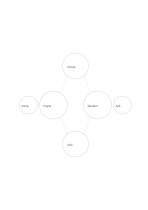</a>

[Wordless PDF](templates/double-bubble/exports/a5-draft/blank.pdf) · [English-titled PDF](templates/double-bubble/exports/a5-draft/titled.pdf) · [SVG](templates/double-bubble/exports/a5-draft/blank.svg) · [Darker PDF](templates/double-bubble/exports/a5-contrast/blank.pdf)

### [Bridge analogy](templates/bridge-analogy/README.en.md) · `bridge-analogy`

Put two domains at the ends of a bridge and map selected aspects between them.

**Worked example：** Borrowing at a library and online lending sit at opposite ends; entry, search, and receipt are mapped between them.

<a href="templates/bridge-analogy/examples/en.svg">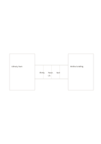</a>

[Wordless PDF](templates/bridge-analogy/exports/a5-draft/blank.pdf) · [English-titled PDF](templates/bridge-analogy/exports/a5-draft/titled.pdf) · [SVG](templates/bridge-analogy/exports/a5-draft/blank.svg) · [Darker PDF](templates/bridge-analogy/exports/a5-contrast/blank.pdf)

### [Paired comparison cards](templates/mirrored-compare-cards/README.en.md) · `mirrored-compare-cards`

Pair four cards to compare two venues.

**Worked example：** Entries in example-position order; each number identifies one entry:

1. Library: free
2. Pavilion: open
3. Library: dry
4. Pavilion: weather risk

<a href="templates/mirrored-compare-cards/examples/en.svg">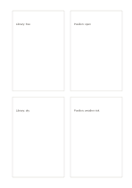</a>

[Wordless PDF](templates/mirrored-compare-cards/exports/a5-draft/blank.pdf) · [English-titled PDF](templates/mirrored-compare-cards/exports/a5-draft/titled.pdf) · [SVG](templates/mirrored-compare-cards/exports/a5-draft/blank.svg) · [Darker PDF](templates/mirrored-compare-cards/exports/a5-contrast/blank.pdf)

### [Cross comparison](templates/cross-compare/README.en.md) · `cross-compare`

Place four options on two chosen criteria and compare their tradeoffs across the cross.

**Worked example：** Entries in example-position order; each number identifies one entry:

1. Q&A: high value, low prep
2. Poster: low value, low prep
3. Hands-on: high value, high prep
4. Long handout: low value, high prep

[Wordless PDF](templates/cross-compare/exports/a5-draft/blank.pdf) · [English-titled PDF](templates/cross-compare/exports/a5-draft/titled.pdf) · [SVG](templates/cross-compare/exports/a5-draft/blank.svg) · [Darker PDF](templates/cross-compare/exports/a5-contrast/blank.pdf)

<strong>Matrices and quadrants</strong> · 8

### [Four-quadrant notes](templates/quadrant/README.en.md) · `quadrant`

Sort ideas into four areas defined by two dimensions you choose, then inspect the pattern.

**Worked example：** For a fictional small workshop, a live demonstration, a complete interactive lesson, question time, and a long handout are provisionally sorted by value and effort.

[Wordless PDF](templates/quadrant/exports/a5-draft/blank.pdf) · [English-titled PDF](templates/quadrant/exports/a5-draft/titled.pdf) · [SVG](templates/quadrant/exports/a5-draft/blank.svg) · [Darker PDF](templates/quadrant/exports/a5-contrast/blank.pdf)

### [Four sectors with central synthesis](templates/quadrant-center-circle/README.en.md) · `quadrant-center-circle`

Sort four perspectives and place a shared conclusion in the center circle.

**Worked example：** A fictional reading group puts venue, materials, people, and timing outside, with a shared decision to run a small trial in the middle.

[Wordless PDF](templates/quadrant-center-circle/exports/a5-draft/blank.pdf) · [English-titled PDF](templates/quadrant-center-circle/exports/a5-draft/titled.pdf) · [SVG](templates/quadrant-center-circle/exports/a5-draft/blank.svg) · [Darker PDF](templates/quadrant-center-circle/exports/a5-contrast/blank.pdf)

### [Two-by-three matrix](templates/matrix-2x3/README.en.md) · `matrix-2x3`

Use six adjoining cells for the intersection of two criteria and three options.

**Worked example：** A fictional reading group compares library, community center, and pavilion across equipment and travel access.

[Wordless PDF](templates/matrix-2x3/exports/a5-draft/blank.pdf) · [English-titled PDF](templates/matrix-2x3/exports/a5-draft/titled.pdf) · [SVG](templates/matrix-2x3/exports/a5-draft/blank.svg) · [Darker PDF](templates/matrix-2x3/exports/a5-contrast/blank.pdf)

### [Two-by-three comparison matrix](templates/matrix-3x2/README.en.md) · `matrix-3x2`

Define options along one direction and criteria along the other, then fill their intersections. Geometry change: matrix columns by rows: 2×3.

**Worked example：** Entries in example-position order; each number identifies one entry:

1. Library: projector
2. Center: audio
3. Library: 5 min walk
4. Center: 15 min ride
5. Library: free
6. Center: low fee

[Wordless PDF](templates/matrix-3x2/exports/a5-draft/blank.pdf) · [English-titled PDF](templates/matrix-3x2/exports/a5-draft/titled.pdf) · [SVG](templates/matrix-3x2/exports/a5-draft/blank.svg) · [Darker PDF](templates/matrix-3x2/exports/a5-contrast/blank.pdf)

### [Three-by-three comparison matrix](templates/matrix-3x3/README.en.md) · `matrix-3x3`

Use nine equal adjoining cells for three options crossed with three criteria, without a mandala's center-outward idea behavior.

**Worked example：** A fictional library, community center, and pavilion are checked across equipment, travel, and cost, with each cell holding a short item to verify.

[Wordless PDF](templates/matrix-3x3/exports/a5-draft/blank.pdf) · [English-titled PDF](templates/matrix-3x3/exports/a5-draft/titled.pdf) · [SVG](templates/matrix-3x3/exports/a5-draft/blank.svg) · [Darker PDF](templates/matrix-3x3/exports/a5-contrast/blank.pdf)

### [Axis comparison matrix](templates/axis-matrix/README.en.md) · `axis-matrix`

Plot options on two ticked axes and check their direction and relative position.

**Worked example：** Entries in example-position order; each number identifies one entry:

1. Short tour
2. Interactive board
3. Live demo
4. Long lecture

[Wordless PDF](templates/axis-matrix/exports/a5-draft/blank.pdf) · [English-titled PDF](templates/axis-matrix/exports/a5-draft/titled.pdf) · [SVG](templates/axis-matrix/exports/a5-draft/blank.svg) · [Darker PDF](templates/axis-matrix/exports/a5-contrast/blank.pdf)

### [Quadrants with rings](templates/quadrant-rings/README.en.md) · `quadrant-rings`

Classify by direction and by two levels of distance or priority at once.

**Worked example：** A fictional community garden uses four directions; inner cells hold near-term tasks and outer cells matters requiring coordination.

[Wordless PDF](templates/quadrant-rings/exports/a5-draft/blank.pdf) · [English-titled PDF](templates/quadrant-rings/exports/a5-draft/titled.pdf) · [SVG](templates/quadrant-rings/exports/a5-draft/blank.svg) · [Darker PDF](templates/quadrant-rings/exports/a5-contrast/blank.pdf)

### [Weighted-size matrix](templates/weighted-matrix/README.en.md) · `weighted-matrix`

Allow unequal writing space while comparing options against the same criteria. Geometry change: Three columns by two rows with unequal widths and heights.

**Worked example：** Entries in example-position order; each number identifies one entry:

1. Library: projector
2. Center: audio
3. Pavilion: none
4. Library: free
5. Center: low fee
6. Pavilion: free

[Wordless PDF](templates/weighted-matrix/exports/a5-draft/blank.pdf) · [English-titled PDF](templates/weighted-matrix/exports/a5-draft/titled.pdf) · [SVG](templates/weighted-matrix/exports/a5-draft/blank.svg) · [Darker PDF](templates/weighted-matrix/exports/a5-contrast/blank.pdf)

<strong>Mandala and flower</strong> · 8

### [3×3 idea expansion](templates/mandala-3x3/README.en.md) · `mandala-3x3`

Put one question in the center and explore eight distinct aspects around it.

**Worked example：** A fictional neighborhood reading group is placed in the center, surrounded by time, venue, books, invitations, discussion, materials, access, and follow-up.

[Wordless PDF](templates/mandala-3x3/exports/a5-draft/blank.pdf) · [English-titled PDF](templates/mandala-3x3/exports/a5-draft/titled.pdf) · [SVG](templates/mandala-3x3/exports/a5-draft/blank.svg) · [Darker PDF](templates/mandala-3x3/exports/a5-contrast/blank.pdf)

### [81-cell idea expansion](templates/mandala-9x9/README.en.md) · `mandala-9x9`

Use nine grouped three-by-three blocks to extend a central topic into short keywords.

**Worked example：** A fictional reading group begins with venue, time, books, participation, materials, discussion, budget, and follow-up; only representative cells are filled.

[Wordless PDF](templates/mandala-9x9/exports/a5-draft/blank.pdf) · [English-titled PDF](templates/mandala-9x9/exports/a5-draft/titled.pdf) · [SVG](templates/mandala-9x9/exports/a5-draft/blank.svg) · [Darker PDF](templates/mandala-9x9/exports/a5-contrast/blank.pdf)

### [Center with eight separate cards](templates/center-eight-boxes/README.en.md) · `center-eight-boxes`

Keep eight independent aspects around one stronger central topic card.

**Worked example：** A fictional neighborhood exhibition is surrounded by venue, works, volunteers, tour, access, materials, schedule, and feedback.

[Wordless PDF](templates/center-eight-boxes/exports/a5-draft/blank.pdf) · [English-titled PDF](templates/center-eight-boxes/exports/a5-draft/titled.pdf) · [SVG](templates/center-eight-boxes/exports/a5-draft/blank.svg) · [Darker PDF](templates/center-eight-boxes/exports/a5-contrast/blank.pdf)

### [Diamond center with eight rays](templates/diamond-eight-rays/README.en.md) · `diamond-eight-rays`

Extend eight brief directions from one central diamond topic.

**Worked example：** A fictional public reading corner branches to light, seating, books, movement, noise, upkeep, hours, and signage.

[Wordless PDF](templates/diamond-eight-rays/exports/a5-draft/blank.pdf) · [English-titled PDF](templates/diamond-eight-rays/exports/a5-draft/titled.pdf) · [SVG](templates/diamond-eight-rays/exports/a5-draft/blank.svg) · [Darker PDF](templates/diamond-eight-rays/exports/a5-contrast/blank.pdf)

### [Eight-petal idea flower](templates/flower-eight/README.en.md) · `flower-eight`

Collect short ideas around one central topic in eight circular petals.

**Worked example：** A fictional community garden branches into planting, rest, learning, sharing, upkeep, tools, rainwater, and paths.

[Wordless PDF](templates/flower-eight/exports/a5-draft/blank.pdf) · [English-titled PDF](templates/flower-eight/exports/a5-draft/titled.pdf) · [SVG](templates/flower-eight/exports/a5-draft/blank.svg) · [Darker PDF](templates/flower-eight/exports/a5-contrast/blank.pdf)

### [Six-petal idea flower](templates/flower-six/README.en.md) · `flower-six`

Expand one central topic into six distinct surrounding idea bubbles. Geometry change: outer bubbles: 6.

**Worked example：** Entries in example-position order; each number identifies one entry:

1. Garden
2. Planting
3. Rest
4. Learning
5. Sharing
6. Upkeep
7. Tools

[Wordless PDF](templates/flower-six/exports/a5-draft/blank.pdf) · [English-titled PDF](templates/flower-six/exports/a5-draft/titled.pdf) · [SVG](templates/flower-six/exports/a5-draft/blank.svg) · [Darker PDF](templates/flower-six/exports/a5-contrast/blank.pdf)

### [Two-ring idea flower](templates/flower-two-rings/README.en.md) · `flower-two-rings`

Write six main directions in the inner ring and one concrete detail for each in the outer ring.

**Worked example：** A fictional reading group has venue, books, time, invitation, materials, and discussion inside, each with one example outside.

[Wordless PDF](templates/flower-two-rings/exports/a5-draft/blank.pdf) · [English-titled PDF](templates/flower-two-rings/exports/a5-draft/titled.pdf) · [SVG](templates/flower-two-rings/exports/a5-draft/blank.svg) · [Darker PDF](templates/flower-two-rings/exports/a5-contrast/blank.pdf)

### [Nine cells with four extensions](templates/mandala-extended/README.en.md) · `mandala-extended`

Expand in a central nine-cell square, then reserve four outside cards for the next pass.

**Worked example：** A fictional neighborhood exhibition uses nine cells for resources and people, and outer cards for venue, budget, volunteers, and publicity to check.

[Wordless PDF](templates/mandala-extended/exports/a5-draft/blank.pdf) · [English-titled PDF](templates/mandala-extended/exports/a5-draft/titled.pdf) · [SVG](templates/mandala-extended/exports/a5-draft/blank.svg) · [Darker PDF](templates/mandala-extended/exports/a5-contrast/blank.pdf)

<strong>Concept networks</strong> · 8

### [Six-branch concept map](templates/mindmap-six/README.en.md) · `mindmap-six`

Expand one central topic into six distinct angles to see the breadth of an idea.

**Worked example：** A fictional neighborhood exhibition branches into audience, venue, works, budget, volunteers, and publicity; venue constraints are checked next.

[Wordless PDF](templates/mindmap-six/exports/a5-draft/blank.pdf) · [English-titled PDF](templates/mindmap-six/exports/a5-draft/titled.pdf) · [SVG](templates/mindmap-six/exports/a5-draft/blank.svg) · [Darker PDF](templates/mindmap-six/exports/a5-contrast/blank.pdf)

### [Eight-branch mind map](templates/mindmap-eight/README.en.md) · `mindmap-eight`

Connect a central topic to eight distinct branches and mark where subtopics are needed. Geometry change: mind-map spokes: 8.

**Worked example：** Entries in example-position order; each number identifies one entry:

1. Exhibit
2. Audience
3. Venue
4. Works
5. Budget
6. Helpers
7. Publicity
8. Access
9. Timing

[Wordless PDF](templates/mindmap-eight/exports/a5-draft/blank.pdf) · [English-titled PDF](templates/mindmap-eight/exports/a5-draft/titled.pdf) · [SVG](templates/mindmap-eight/exports/a5-draft/blank.svg) · [Darker PDF](templates/mindmap-eight/exports/a5-contrast/blank.pdf)

### [Uneven branch map](templates/asymmetric-branches/README.en.md) · `asymmetric-branches`

Let three lines of inquiry receive different numbers of details according to need.

**Worked example：** A fictional talk splits into content, venue, and publicity; content and venue each get two details, while publicity starts with one.

[Wordless PDF](templates/asymmetric-branches/exports/a5-draft/blank.pdf) · [English-titled PDF](templates/asymmetric-branches/exports/a5-draft/titled.pdf) · [SVG](templates/asymmetric-branches/exports/a5-draft/blank.svg) · [Darker PDF](templates/asymmetric-branches/exports/a5-contrast/blank.pdf)

### [Two-center concept map](templates/double-center-mindmap/README.en.md) · `double-center-mindmap`

Keep two related topics connected while giving each its own set of surrounding ideas.

**Worked example：** A fictional workshop has online and in-person centers: platform, recording, interaction, and support above; venue, seats, paper, and movement below.

[Wordless PDF](templates/double-center-mindmap/exports/a5-draft/blank.pdf) · [English-titled PDF](templates/double-center-mindmap/exports/a5-draft/titled.pdf) · [SVG](templates/double-center-mindmap/exports/a5-draft/blank.svg) · [Darker PDF](templates/double-center-mindmap/exports/a5-contrast/blank.pdf)

### [Three-core relationship map](templates/triple-core-network/README.en.md) · `triple-core-network`

Inspect three interacting core factors together with their outer conditions.

**Worked example：** A fictional reading event uses content, helpers, and space as cores, with topic, host, seating, time, and materials outside.

[Wordless PDF](templates/triple-core-network/exports/a5-draft/blank.pdf) · [English-titled PDF](templates/triple-core-network/exports/a5-draft/titled.pdf) · [SVG](templates/triple-core-network/exports/a5-draft/blank.svg) · [Darker PDF](templates/triple-core-network/exports/a5-contrast/blank.pdf)

### [Cluster ring](templates/cluster-ring/README.en.md) · `cluster-ring`

Gather loose material into four clusters before naming their shared theme.

**Worked example：** Fictional community-event notes form transport, space, program, and food clusters, with 'participant experience' at the center.

[Wordless PDF](templates/cluster-ring/exports/a5-draft/blank.pdf) · [English-titled PDF](templates/cluster-ring/exports/a5-draft/titled.pdf) · [SVG](templates/cluster-ring/exports/a5-draft/blank.svg) · [Darker PDF](templates/cluster-ring/exports/a5-contrast/blank.pdf)

### [Constellation relationship map](templates/constellation-network/README.en.md) · `constellation-network`

Record irregular links among elements without assuming a single center or rank.

**Worked example：** A fictional story connects a bookshop, readers, author, editor, event, library, students, and teachers as possible interactions.

[Wordless PDF](templates/constellation-network/exports/a5-draft/blank.pdf) · [English-titled PDF](templates/constellation-network/exports/a5-draft/titled.pdf) · [SVG](templates/constellation-network/exports/a5-draft/blank.svg) · [Darker PDF](templates/constellation-network/exports/a5-contrast/blank.pdf)

### [Two-set link map](templates/bipartite-network/README.en.md) · `bipartite-network`

Compare many-to-many relationships between two kinds of element, with no within-set links.

**Worked example：** Four fictional community events sit left, four resources right; edges show needs for projection, seating, audio, or helpers.

[Wordless PDF](templates/bipartite-network/exports/a5-draft/blank.pdf) · [English-titled PDF](templates/bipartite-network/exports/a5-draft/titled.pdf) · [SVG](templates/bipartite-network/exports/a5-draft/blank.svg) · [Darker PDF](templates/bipartite-network/exports/a5-contrast/blank.pdf)

<strong>Hierarchy</strong> · 8

### [Top-down hierarchy tree](templates/top-down-tree/README.en.md) · `top-down-tree`

Break a whole into two levels of smaller categories while keeping parent-child relations clear.

**Worked example：** A fictional exhibition splits into content and site: works and captions under content, route and lighting under site.

[Wordless PDF](templates/top-down-tree/exports/a5-draft/blank.pdf) · [English-titled PDF](templates/top-down-tree/exports/a5-draft/titled.pdf) · [SVG](templates/top-down-tree/exports/a5-draft/blank.svg) · [Darker PDF](templates/top-down-tree/exports/a5-contrast/blank.pdf)

### [Bottom-up tree](templates/bottom-up-tree/README.en.md) · `bottom-up-tree`

Build upward from details toward a broader conclusion. Geometry change: The hierarchy is mirrored for bottom-up reading.

**Worked example：** Entries in example-position order; each number identifies one entry:

1. Exhibit
2. Content
3. Site
4. Works
5. Captions
6. Route
7. Lighting

[Wordless PDF](templates/bottom-up-tree/exports/a5-draft/blank.pdf) · [English-titled PDF](templates/bottom-up-tree/exports/a5-draft/titled.pdf) · [SVG](templates/bottom-up-tree/exports/a5-draft/blank.svg) · [Darker PDF](templates/bottom-up-tree/exports/a5-contrast/blank.pdf)

### [Stepped hierarchy notes](templates/stepped-hierarchy/README.en.md) · `stepped-hierarchy`

Turn an abstract intention into increasingly concrete, actionable levels.

**Worked example：** A fictional reading circle moves from 'share reading' to 'monthly meeting', 'rotating questions', and 'book a room'.

[Wordless PDF](templates/stepped-hierarchy/exports/a5-draft/blank.pdf) · [English-titled PDF](templates/stepped-hierarchy/exports/a5-draft/titled.pdf) · [SVG](templates/stepped-hierarchy/exports/a5-draft/blank.svg) · [Darker PDF](templates/stepped-hierarchy/exports/a5-contrast/blank.pdf)

### [Brace decomposition](templates/brace-decomposition/README.en.md) · `brace-decomposition`

Show a whole and three distinct components in one concise view.

**Worked example：** A fictional workshop breaks into materials, space, and helpers as preparation needs, with no order implied.

[Wordless PDF](templates/brace-decomposition/exports/a5-draft/blank.pdf) · [English-titled PDF](templates/brace-decomposition/exports/a5-draft/titled.pdf) · [SVG](templates/brace-decomposition/exports/a5-draft/blank.svg) · [Darker PDF](templates/brace-decomposition/exports/a5-contrast/blank.pdf)

### [Three-tier pyramid](templates/pyramid-three/README.en.md) · `pyramid-three`

Arrange a concept as a broad base, a middle practice, and a concise top goal.

**Worked example：** A fictional exhibition has works and venue at the base, curatorial planning in the middle, and community exchange at the top.

[Wordless PDF](templates/pyramid-three/exports/a5-draft/blank.pdf) · [English-titled PDF](templates/pyramid-three/exports/a5-draft/titled.pdf) · [SVG](templates/pyramid-three/exports/a5-draft/blank.svg) · [Darker PDF](templates/pyramid-three/exports/a5-contrast/blank.pdf)

### [Five-tier pyramid](templates/pyramid-five/README.en.md) · `pyramid-five`

Arrange foundations, actions, and the goal into five tiers and inspect their support. Geometry change: pyramid levels: 5.

**Worked example：** Entries in example-position order; each number identifies one entry:

1. Exchange
2. Planning
3. Works
4. Venue
5. Materials

[Wordless PDF](templates/pyramid-five/exports/a5-draft/blank.pdf) · [English-titled PDF](templates/pyramid-five/exports/a5-draft/titled.pdf) · [SVG](templates/pyramid-five/exports/a5-draft/blank.svg) · [Darker PDF](templates/pyramid-five/exports/a5-contrast/blank.pdf)

### [Nested scope rectangles](templates/nested-rectangles/README.en.md) · `nested-rectangles`

Use four containing regions to narrow a topic from broad context to a specific object.

**Worked example：** A fictional event narrows from city to neighborhood to library to reading room, making the venue discussion specific.

[Wordless PDF](templates/nested-rectangles/exports/a5-draft/blank.pdf) · [English-titled PDF](templates/nested-rectangles/exports/a5-draft/titled.pdf) · [SVG](templates/nested-rectangles/exports/a5-draft/blank.svg) · [Darker PDF](templates/nested-rectangles/exports/a5-contrast/blank.pdf)

### [Eight-sector classification wheel](templates/classification-wheel/README.en.md) · `classification-wheel`

Place up to eight categories around one subject to notice gaps and overlap.

**Worked example：** A fictional community talk considers speaker, venue, seats, material, publicity, sign-ups, equipment, and feedback.

[Wordless PDF](templates/classification-wheel/exports/a5-draft/blank.pdf) · [English-titled PDF](templates/classification-wheel/exports/a5-draft/titled.pdf) · [SVG](templates/classification-wheel/exports/a5-draft/blank.svg) · [Darker PDF](templates/classification-wheel/exports/a5-contrast/blank.pdf)

<strong>Flows</strong> · 8

### [Four-step horizontal flow](templates/flow-four-horizontal/README.en.md) · `flow-four-horizontal`

Show one process as four actions from left to right.

**Worked example：** A fictional library loan moves through search, pickup, checkout, and departure.

[Wordless PDF](templates/flow-four-horizontal/exports/a5-draft/blank.pdf) · [English-titled PDF](templates/flow-four-horizontal/exports/a5-draft/titled.pdf) · [SVG](templates/flow-four-horizontal/exports/a5-draft/blank.svg) · [Darker PDF](templates/flow-four-horizontal/exports/a5-contrast/blank.pdf)

### [Five-step vertical flow](templates/flow-five-vertical/README.en.md) · `flow-five-vertical`

Trace five consecutive steps from top to bottom and check each transition. Geometry change: vertical steps: 5.

**Worked example：** Entries in example-position order; each number identifies one entry:

1. Search
2. Find
3. Register
4. Borrow
5. Return

[Wordless PDF](templates/flow-five-vertical/exports/a5-draft/blank.pdf) · [English-titled PDF](templates/flow-five-vertical/exports/a5-draft/titled.pdf) · [SVG](templates/flow-five-vertical/exports/a5-draft/blank.svg) · [Darker PDF](templates/flow-five-vertical/exports/a5-contrast/blank.pdf)

### [Six-step snake flow](templates/flow-six-snake/README.en.md) · `flow-six-snake`

Follow six steps across two rows with a turn at the right edge.

**Worked example：** A fictional community workshop moves from idea and venue to invitation, materials, event, and feedback.

[Wordless PDF](templates/flow-six-snake/exports/a5-draft/blank.pdf) · [English-titled PDF](templates/flow-six-snake/exports/a5-draft/titled.pdf) · [SVG](templates/flow-six-snake/exports/a5-draft/blank.svg) · [Darker PDF](templates/flow-six-snake/exports/a5-contrast/blank.pdf)

### [Four-stage cycle](templates/cycle-four/README.en.md) · `cycle-four`

Show a repeatable process that returns from the fourth stage to the first.

**Worked example：** A fictional neighborhood activity moves through observe, propose, pilot, and review before observing again.

[Wordless PDF](templates/cycle-four/exports/a5-draft/blank.pdf) · [English-titled PDF](templates/cycle-four/exports/a5-draft/titled.pdf) · [SVG](templates/cycle-four/exports/a5-draft/blank.svg) · [Darker PDF](templates/cycle-four/exports/a5-contrast/blank.pdf)

### [Six-stage cycle](templates/cycle-six/README.en.md) · `cycle-six`

Arrange six stages as a repeatable loop and record what changes on the next pass. Geometry change: cycle nodes: 6.

**Worked example：** Entries in example-position order; each number identifies one entry:

1. Observe
2. Propose
3. Prepare
4. Pilot
5. Review
6. Adjust

[Wordless PDF](templates/cycle-six/exports/a5-draft/blank.pdf) · [English-titled PDF](templates/cycle-six/exports/a5-draft/titled.pdf) · [SVG](templates/cycle-six/exports/a5-draft/blank.svg) · [Darker PDF](templates/cycle-six/exports/a5-contrast/blank.pdf)

### [Two-level decision tree](templates/decision-tree/README.en.md) · `decision-tree`

Branch one question into two checks and four possible actions.

**Worked example：** A fictional outdoor reading group branches by weather and venue availability, ending in four arrangements.

[Wordless PDF](templates/decision-tree/exports/a5-draft/blank.pdf) · [English-titled PDF](templates/decision-tree/exports/a5-draft/titled.pdf) · [SVG](templates/decision-tree/exports/a5-draft/blank.svg) · [Darker PDF](templates/decision-tree/exports/a5-contrast/blank.pdf)

### [Three-lane handoff flow](templates/swimlane-flow/README.en.md) · `swimlane-flow`

Separate three roles into horizontal lanes and follow their handoffs with arrows.

**Worked example：** A fictional organizer requests a venue, staff confirm a time, and volunteers prepare materials in sequence.

[Wordless PDF](templates/swimlane-flow/exports/a5-draft/blank.pdf) · [English-titled PDF](templates/swimlane-flow/exports/a5-draft/titled.pdf) · [SVG](templates/swimlane-flow/exports/a5-draft/blank.svg) · [Darker PDF](templates/swimlane-flow/exports/a5-contrast/blank.pdf)

### [Three inputs converge](templates/converging-flow/README.en.md) · `converging-flow`

Bring three inputs together toward one shared result or provisional decision.

**Worked example：** People, book choices, and venue feed a small trial plan for a fictional reading group.

[Wordless PDF](templates/converging-flow/exports/a5-draft/blank.pdf) · [English-titled PDF](templates/converging-flow/exports/a5-draft/titled.pdf) · [SVG](templates/converging-flow/exports/a5-draft/blank.svg) · [Darker PDF](templates/converging-flow/exports/a5-contrast/blank.pdf)

<strong>Causal hypotheses</strong> · 8

### [Four-branch fishbone](templates/fishbone-four/README.en.md) · `fishbone-four`

Separate an observed problem from several groups of possible causes and their subcauses. Geometry change: cause branches per side: 2.

**Worked example：** Entries in example-position order; each number identifies one entry:

1. Timing
2. Notices
3. Process
4. Location
5. Low sign-ups

[Wordless PDF](templates/fishbone-four/exports/a5-draft/blank.pdf) · [English-titled PDF](templates/fishbone-four/exports/a5-draft/titled.pdf) · [SVG](templates/fishbone-four/exports/a5-draft/blank.svg) · [Darker PDF](templates/fishbone-four/exports/a5-contrast/blank.pdf)

### [Fishbone diagram](templates/fishbone/README.en.md) · `fishbone`

Work backward from an observed outcome to possible causes instead of settling on the first explanation.

**Worked example：** A fictional event with low sign-ups has branches for timing, notices, process, location, topic, and the registration page, all awaiting checks.

[Wordless PDF](templates/fishbone/exports/a5-draft/blank.pdf) · [English-titled PDF](templates/fishbone/exports/a5-draft/titled.pdf) · [SVG](templates/fishbone/exports/a5-draft/blank.svg) · [Darker PDF](templates/fishbone/exports/a5-contrast/blank.pdf)

### [Causal hypothesis chain](templates/causal-chain/README.en.md) · `causal-chain`

Link four untested cause-and-effect hypotheses in one path.

**Worked example：** Entries in example-position order; each number identifies one entry:

1. Late notice?
2. Few see it?
3. Few sign up?
4. Few attend?

[Wordless PDF](templates/causal-chain/exports/a5-draft/blank.pdf) · [English-titled PDF](templates/causal-chain/exports/a5-draft/titled.pdf) · [SVG](templates/causal-chain/exports/a5-draft/blank.svg) · [Darker PDF](templates/causal-chain/exports/a5-contrast/blank.pdf)

### [One problem, three responses](templates/problem-solution-three/README.en.md) · `problem-solution-three`

Branch one observed problem toward three distinct possible actions, with arrows pointing from the question to the responses.

**Worked example：** A fictional reading group has low sign-ups; earlier notice, a different time, and partners are three untested responses.

[Wordless PDF](templates/problem-solution-three/exports/a5-draft/blank.pdf) · [English-titled PDF](templates/problem-solution-three/exports/a5-draft/titled.pdf) · [SVG](templates/problem-solution-three/exports/a5-draft/blank.svg) · [Darker PDF](templates/problem-solution-three/exports/a5-contrast/blank.pdf)

### [Five-whys chain](templates/five-why-chain/README.en.md) · `five-why-chain`

Ask why repeatedly from an observed problem, recording each answer as a hypothesis to check.

**Worked example：** Entries in example-position order; each number identifies one entry:

1. Few sign-ups
2. Late notice?
3. Late plan?
4. Late data?
5. No owner?

[Wordless PDF](templates/five-why-chain/exports/a5-draft/blank.pdf) · [English-titled PDF](templates/five-why-chain/exports/a5-draft/titled.pdf) · [SVG](templates/five-why-chain/exports/a5-draft/blank.svg) · [Darker PDF](templates/five-why-chain/exports/a5-contrast/blank.pdf)

### [Cross-linked cause network](templates/causal-network/README.en.md) · `causal-network`

Map several possible factors and their cross-influences instead of forcing one cause chain.

**Worked example：** A fictional event links notices, timing, sign-up page, venue, and attendance as candidates, without claiming the causes are established.

[Wordless PDF](templates/causal-network/exports/a5-draft/blank.pdf) · [English-titled PDF](templates/causal-network/exports/a5-draft/titled.pdf) · [SVG](templates/causal-network/exports/a5-draft/blank.svg) · [Darker PDF](templates/causal-network/exports/a5-contrast/blank.pdf)

### [Hypothesis and three evidence cards](templates/hypothesis-evidence/README.en.md) · `hypothesis-evidence`

State a testable hypothesis, examine three observations or counterexamples, and update the assessment.

**Worked example：** A fictional reading group asks whether short reminders increase attendance, considering sign-ups, arrivals, and nonresponses before noting a missing baseline.

[Wordless PDF](templates/hypothesis-evidence/exports/a5-draft/blank.pdf) · [English-titled PDF](templates/hypothesis-evidence/exports/a5-draft/titled.pdf) · [SVG](templates/hypothesis-evidence/exports/a5-draft/blank.svg) · [Darker PDF](templates/hypothesis-evidence/exports/a5-contrast/blank.pdf)

### [Converging root-cause tree](templates/root-cause-tree/README.en.md) · `root-cause-tree`

Bring four candidate causes through two groups toward one observed outcome, keeping each causal link open to checking.

**Worked example：** Late notice, few details, a time clash, and a long trip are grouped as publicity and access hypotheses before pointing to low sign-ups.

[Wordless PDF](templates/root-cause-tree/exports/a5-draft/blank.pdf) · [English-titled PDF](templates/root-cause-tree/exports/a5-draft/titled.pdf) · [SVG](templates/root-cause-tree/exports/a5-draft/blank.svg) · [Darker PDF](templates/root-cause-tree/exports/a5-contrast/blank.pdf)

<strong>Learning and recall</strong> · 8

### [Frayer concept map](templates/frayer/README.en.md) · `frayer`

Put a concept in the center, then separate meaning, traits, example, and nonexample.

**Worked example：** Entries in example-position order; each number identifies one entry:

1. Water cycle
2. Meaning: water moves
3. Trait: repeats
4. Example: rain
5. Nonexample: pipe

[Wordless PDF](templates/frayer/exports/a5-draft/blank.pdf) · [English-titled PDF](templates/frayer/exports/a5-draft/titled.pdf) · [SVG](templates/frayer/exports/a5-draft/blank.svg) · [Darker PDF](templates/frayer/exports/a5-contrast/blank.pdf)

### [Cue and answer](templates/cue-answer/README.en.md) · `cue-answer`

Put a retrieval cue in the narrow column and a checkable answer in the wide one.

**Worked example：** Entries in example-position order; each number identifies one entry:

1. Light and leaf color?
2. Window leaves darker; control watering too.

[Wordless PDF](templates/cue-answer/exports/a5-draft/blank.pdf) · [English-titled PDF](templates/cue-answer/exports/a5-draft/titled.pdf) · [SVG](templates/cue-answer/exports/a5-draft/blank.svg) · [Darker PDF](templates/cue-answer/exports/a5-contrast/blank.pdf)

### [Three question-answer pairs](templates/question-answer-triples/README.en.md) · `question-answer-triples`

Keep three checkable questions beside space for fuller answers.

**Worked example：** A fictional exhibition leaflet prompts 'When is it open?', 'Who can join?', and 'What to bring?', with answers checked against the leaflet.

[Wordless PDF](templates/question-answer-triples/exports/a5-draft/blank.pdf) · [English-titled PDF](templates/question-answer-triples/exports/a5-draft/titled.pdf) · [SVG](templates/question-answer-triples/exports/a5-draft/blank.svg) · [Darker PDF](templates/question-answer-triples/exports/a5-contrast/blank.pdf)

### [Cornell notes with recall strip](templates/recall-strip/README.en.md) · `recall-strip`

Add a separate recall strip below Cornell notes for a cover-and-recall check. Geometry change: A separate recall strip is added below the Cornell zones.

**Worked example：** A fictional plant observation lesson uses the main area for light and leaf observations, the cue column for a question about leaf color, and the bottom for a cautious conclusion. The fictional entries indicate where short notes belong; they are neither measured data nor a complete research conclusion.

[Wordless PDF](templates/recall-strip/exports/a5-draft/blank.pdf) · [English-titled PDF](templates/recall-strip/exports/a5-draft/titled.pdf) · [SVG](templates/recall-strip/exports/a5-draft/blank.svg) · [Darker PDF](templates/recall-strip/exports/a5-contrast/blank.pdf)

### [Concept, text, and diagram](templates/concept-text-diagram/README.en.md) · `concept-text-diagram`

Pair a written explanation with a sketch under one concept and check that the two agree.

**Worked example：** For a fictional library circulation process, the left describes borrowing and returning, while the right traces a book from shelf to reader and back.

[Wordless PDF](templates/concept-text-diagram/exports/a5-draft/blank.pdf) · [English-titled PDF](templates/concept-text-diagram/exports/a5-draft/titled.pdf) · [SVG](templates/concept-text-diagram/exports/a5-draft/blank.svg) · [Darker PDF](templates/concept-text-diagram/exports/a5-contrast/blank.pdf)

### [Indented outline notes](templates/outline-notes/README.en.md) · `outline-notes`

Show topics, subtopics, and examples with three visible indent levels.

**Worked example：** A fictional talk has background, demonstration, and discussion sections, each with a point and an example below it.

[Wordless PDF](templates/outline-notes/exports/a5-draft/blank.pdf) · [English-titled PDF](templates/outline-notes/exports/a5-draft/titled.pdf) · [SVG](templates/outline-notes/exports/a5-draft/blank.svg) · [Darker PDF](templates/outline-notes/exports/a5-contrast/blank.pdf)

### [Concept and six examples](templates/concept-examples-six/README.en.md) · `concept-examples-six`

Put one concept at the center and a concrete example on each of six branches.

**Worked example：** Entries in example-position order; each number identifies one entry:

1. Mammal
2. Cat
3. Dog
4. Whale
5. Bat
6. Seal
7. Human

[Wordless PDF](templates/concept-examples-six/exports/a5-draft/blank.pdf) · [English-titled PDF](templates/concept-examples-six/exports/a5-draft/titled.pdf) · [SVG](templates/concept-examples-six/exports/a5-draft/blank.svg) · [Darker PDF](templates/concept-examples-six/exports/a5-contrast/blank.pdf)

### [Concept and recall area](templates/concept-recall/README.en.md) · `concept-recall`

Keep a new concept and notes separate from a final attempt to recall it in your own words.

**Worked example：** A fictional talk studies accessible design; notes cover entry and information, and the bottom recalls 'more people can participate' before checking.

[Wordless PDF](templates/concept-recall/exports/a5-draft/blank.pdf) · [English-titled PDF](templates/concept-recall/exports/a5-draft/titled.pdf) · [SVG](templates/concept-recall/exports/a5-draft/blank.svg) · [Darker PDF](templates/concept-recall/exports/a5-contrast/blank.pdf)

<strong>Sources and research</strong> · 8

### [Quotation with side notes](templates/quote-side-notes/README.en.md) · `quote-side-notes`

Keep a short quotation in the wide column and source questions at its side.

**Worked example：** Entries in example-position order; each number identifies one entry:

1. Check date
2. Fictional poster: 'Open Saturday afternoon.'

[Wordless PDF](templates/quote-side-notes/exports/a5-draft/blank.pdf) · [English-titled PDF](templates/quote-side-notes/exports/a5-draft/titled.pdf) · [SVG](templates/quote-side-notes/exports/a5-draft/blank.svg) · [Darker PDF](templates/quote-side-notes/exports/a5-contrast/blank.pdf)

### [Excerpt above, thoughts below](templates/top-excerpt-bottom-thoughts/README.en.md) · `top-excerpt-bottom-thoughts`

Keep a quotation or observation above and personal questions and interpretations below.

**Worked example：** A fictional notice says 'Open on weekends' above; below, the reader asks whether transit makes it useful for workers.

[Wordless PDF](templates/top-excerpt-bottom-thoughts/exports/a5-draft/blank.pdf) · [English-titled PDF](templates/top-excerpt-bottom-thoughts/exports/a5-draft/titled.pdf) · [SVG](templates/top-excerpt-bottom-thoughts/exports/a5-draft/blank.svg) · [Darker PDF](templates/top-excerpt-bottom-thoughts/exports/a5-contrast/blank.pdf)

### [Quotation and comment](templates/quote-comment-parallel/README.en.md) · `quote-comment-parallel`

Place a fictional quotation beside a separate checkable comment.

**Worked example：** Entries in example-position order; each number identifies one entry:

1. Quote: 'Open Saturday'
2. Note: verify date and source

[Wordless PDF](templates/quote-comment-parallel/exports/a5-draft/blank.pdf) · [English-titled PDF](templates/quote-comment-parallel/exports/a5-draft/titled.pdf) · [SVG](templates/quote-comment-parallel/exports/a5-draft/blank.svg) · [Darker PDF](templates/quote-comment-parallel/exports/a5-contrast/blank.pdf)

### [Observation and interpretation](templates/observation-interpretation/README.en.md) · `observation-interpretation`

Separate direct observation from a tentative interpretation.

**Worked example：** Entries in example-position order; each number identifies one entry:

1. Observed: three late
2. Possible reason: time; ask them

[Wordless PDF](templates/observation-interpretation/exports/a5-draft/blank.pdf) · [English-titled PDF](templates/observation-interpretation/exports/a5-draft/titled.pdf) · [SVG](templates/observation-interpretation/exports/a5-draft/blank.svg) · [Darker PDF](templates/observation-interpretation/exports/a5-contrast/blank.pdf)

### [One claim, four evidence areas](templates/claim-four-evidence/README.en.md) · `claim-four-evidence`

Separate a testable claim from four supporting, opposing, or missing pieces of information.

**Worked example：** A fictional plan claims reminders improve attendance; cards record sign-ups, arrivals, nonresponses, and the missing no-reminder comparison.

[Wordless PDF](templates/claim-four-evidence/exports/a5-draft/blank.pdf) · [English-titled PDF](templates/claim-four-evidence/exports/a5-draft/titled.pdf) · [SVG](templates/claim-four-evidence/exports/a5-draft/blank.svg) · [Darker PDF](templates/claim-four-evidence/exports/a5-contrast/blank.pdf)

### [Source card and three notes](templates/source-large-plus-cards/README.en.md) · `source-large-plus-cards`

Name a source in the large card and use three smaller cards for claim, evidence, and question.

**Worked example：** Entries in example-position order; each number identifies one entry:

1. Fictional event poster
2. Claim: open Saturday
3. Evidence: poster text
4. Check: actual date

[Wordless PDF](templates/source-large-plus-cards/exports/a5-draft/blank.pdf) · [English-titled PDF](templates/source-large-plus-cards/exports/a5-draft/titled.pdf) · [SVG](templates/source-large-plus-cards/exports/a5-draft/blank.svg) · [Darker PDF](templates/source-large-plus-cards/exports/a5-contrast/blank.pdf)

### [Linked source notes](templates/source-network-notes/README.en.md) · `source-network-notes`

Compare notes from three sources and flag observations supported across sources.

**Worked example：** Fictional sources A, B, and C discuss shared space; notes cover opening hours, seating, and booking rules, while dates need checking.

[Wordless PDF](templates/source-network-notes/exports/a5-draft/blank.pdf) · [English-titled PDF](templates/source-network-notes/exports/a5-draft/titled.pdf) · [SVG](templates/source-network-notes/exports/a5-draft/blank.svg) · [Darker PDF](templates/source-network-notes/exports/a5-contrast/blank.pdf)

### [Four research index cards](templates/research-index-cards/README.en.md) · `research-index-cards`

Record three distinct sources and one unresolved conflict on four cards.

**Worked example：** Entries in example-position order; each number identifies one entry:

1. Source A: poster
2. Source B: interview
3. Source C: web page
4. Check: date conflict

[Wordless PDF](templates/research-index-cards/exports/a5-draft/blank.pdf) · [English-titled PDF](templates/research-index-cards/exports/a5-draft/titled.pdf) · [SVG](templates/research-index-cards/exports/a5-draft/blank.svg) · [Darker PDF](templates/research-index-cards/exports/a5-contrast/blank.pdf)

<strong>Ideation</strong> · 8

### [Crazy eight idea sketch](templates/crazy-eight/README.en.md) · `crazy-eight`

Sketch one quick idea in each of eight cells, preserving differences before selection.

**Worked example：** Entries in example-position order; each number identifies one entry:

1. Poster
2. Audio
3. Tour
4. Book desk
5. Route
6. Q&A
7. Reading
8. Online

[Wordless PDF](templates/crazy-eight/exports/a5-draft/blank.pdf) · [English-titled PDF](templates/crazy-eight/exports/a5-draft/titled.pdf) · [SVG](templates/crazy-eight/exports/a5-draft/blank.svg) · [Darker PDF](templates/crazy-eight/exports/a5-contrast/blank.pdf)

### [Six-bubble idea map](templates/idea-bubbles-six/README.en.md) · `idea-bubbles-six`

Keep six distinct possibilities around one topic without ranking them yet.

**Worked example：** Entries in example-position order; each number identifies one entry:

1. Garden
2. Planting
3. Rest
4. Learning
5. Sharing
6. Upkeep
7. Tools

[Wordless PDF](templates/idea-bubbles-six/exports/a5-draft/blank.pdf) · [English-titled PDF](templates/idea-bubbles-six/exports/a5-draft/titled.pdf) · [SVG](templates/idea-bubbles-six/exports/a5-draft/blank.svg) · [Darker PDF](templates/idea-bubbles-six/exports/a5-contrast/blank.pdf)

### [Hero idea with seven variations](templates/hero-idea-seven-variations/README.en.md) · `hero-idea-seven-variations`

Keep one main proposal in the center and test seven variations around it. Geometry change: outer variation cards: 7.

**Worked example：** Entries in example-position order; each number identifies one entry:

1. Venue
2. Works
3. Volunteers
4. Tour
5. Exhibition
6. Access
7. Materials
8. Schedule

[Wordless PDF](templates/hero-idea-seven-variations/exports/a5-draft/blank.pdf) · [English-titled PDF](templates/hero-idea-seven-variations/exports/a5-draft/titled.pdf) · [SVG](templates/hero-idea-seven-variations/exports/a5-draft/blank.svg) · [Darker PDF](templates/hero-idea-seven-variations/exports/a5-contrast/blank.pdf)

### [Many-to-one idea funnel](templates/many-to-one-funnel/README.en.md) · `many-to-one-funnel`

Collect six ideas, group them twice, and state one small synthesis to try.

**Worked example：** Six fictional reading-group ideas form online and in-person clusters, then a small hybrid trial is proposed below.

[Wordless PDF](templates/many-to-one-funnel/exports/a5-draft/blank.pdf) · [English-titled PDF](templates/many-to-one-funnel/exports/a5-draft/titled.pdf) · [SVG](templates/many-to-one-funnel/exports/a5-draft/blank.svg) · [Darker PDF](templates/many-to-one-funnel/exports/a5-contrast/blank.pdf)

### [Three sketch proposals](templates/three-sketch-proposals/README.en.md) · `three-sketch-proposals`

Draw three distinct approaches and keep a short evaluation beside each.

**Worked example：** A fictional exhibition considers straight, loop, and branched visitor paths, noting visibility and congestion beside each.

[Wordless PDF](templates/three-sketch-proposals/exports/a5-draft/blank.pdf) · [English-titled PDF](templates/three-sketch-proposals/exports/a5-draft/titled.pdf) · [SVG](templates/three-sketch-proposals/exports/a5-draft/blank.svg) · [Darker PDF](templates/three-sketch-proposals/exports/a5-contrast/blank.pdf)

### [Two-input synthesis](templates/dual-input-synthesis/README.en.md) · `dual-input-synthesis`

Bring two different inputs toward one provisional synthesis. Geometry change: converging inputs: 2.

**Worked example：** Entries in example-position order; each number identifies one entry:

1. People
2. Books
3. Small trial

[Wordless PDF](templates/dual-input-synthesis/exports/a5-draft/blank.pdf) · [English-titled PDF](templates/dual-input-synthesis/exports/a5-draft/titled.pdf) · [SVG](templates/dual-input-synthesis/exports/a5-draft/blank.svg) · [Darker PDF](templates/dual-input-synthesis/exports/a5-contrast/blank.pdf)

### [Seven ideation cards](templates/seven-ideation-cards/README.en.md) · `seven-ideation-cards`

Give each candidate idea its own card before comparing or ordering them. Geometry change: separate cards: 7.

**Worked example：** Entries in example-position order; each number identifies one entry:

1. Poster
2. Audio
3. Tour
4. Book desk
5. Route
6. Q&A
7. Reading

[Wordless PDF](templates/seven-ideation-cards/exports/a5-draft/blank.pdf) · [English-titled PDF](templates/seven-ideation-cards/exports/a5-draft/titled.pdf) · [SVG](templates/seven-ideation-cards/exports/a5-draft/blank.svg) · [Darker PDF](templates/seven-ideation-cards/exports/a5-contrast/blank.pdf)

### [Abstraction ladder](templates/abstraction-ladder/README.en.md) · `abstraction-ladder`

Move between concrete cases and general principles one rung at a time to catch jumps in reasoning.

**Worked example：** A fictional reading group moves from too few chairs to seating capacity and participation barriers, then considers seat reservations.

[Wordless PDF](templates/abstraction-ladder/exports/a5-draft/blank.pdf) · [English-titled PDF](templates/abstraction-ladder/exports/a5-draft/titled.pdf) · [SVG](templates/abstraction-ladder/exports/a5-draft/blank.svg) · [Darker PDF](templates/abstraction-ladder/exports/a5-contrast/blank.pdf)

<strong>Storyboards and sketches</strong> · 8

### [Three-panel storyboard](templates/storyboard-three/README.en.md) · `storyboard-three`

Show successive changes in one event, with a short action cue for every frame. Geometry change: storyboard frames: 3.

**Worked example：** Entries in example-position order; each number identifies one entry:

1. Enter
2. Find book
3. Discuss

[Wordless PDF](templates/storyboard-three/exports/a5-draft/blank.pdf) · [English-titled PDF](templates/storyboard-three/exports/a5-draft/titled.pdf) · [SVG](templates/storyboard-three/exports/a5-draft/blank.svg) · [Darker PDF](templates/storyboard-three/exports/a5-contrast/blank.pdf)

### [Four-panel storyboard](templates/storyboard-four/README.en.md) · `storyboard-four`

Show successive changes in one event, with a short action cue for every frame. Geometry change: storyboard frames: 4.

**Worked example：** Entries in example-position order; each number identifies one entry:

1. Enter
2. Find book
3. Read
4. Discuss

[Wordless PDF](templates/storyboard-four/exports/a5-draft/blank.pdf) · [English-titled PDF](templates/storyboard-four/exports/a5-draft/titled.pdf) · [SVG](templates/storyboard-four/exports/a5-draft/blank.svg) · [Darker PDF](templates/storyboard-four/exports/a5-contrast/blank.pdf)

### [Six-panel storyboard](templates/storyboard-6/README.en.md) · `storyboard-6`

Sketch a sequence in six frames and add one short action note beneath each image.

**Worked example：** A fictional library visit moves from entering, browsing, checking the catalog, finding a book, borrowing it, and leaving; the caption strips name each action.

[Wordless PDF](templates/storyboard-6/exports/a5-draft/blank.pdf) · [English-titled PDF](templates/storyboard-6/exports/a5-draft/titled.pdf) · [SVG](templates/storyboard-6/exports/a5-draft/blank.svg) · [Darker PDF](templates/storyboard-6/exports/a5-contrast/blank.pdf)

### [Mixed-scale eight-panel storyboard](templates/storyboard-eight-mixed/README.en.md) · `storyboard-eight-mixed`

Use broad frames for scenes, four small beats for action, and broad frames for the close.

**Worked example：** A fictional film enters a library and finds a book, then turns pages, writes, asks, exchanges, discusses, and leaves.

[Wordless PDF](templates/storyboard-eight-mixed/exports/a5-draft/blank.pdf) · [English-titled PDF](templates/storyboard-eight-mixed/exports/a5-draft/titled.pdf) · [SVG](templates/storyboard-eight-mixed/exports/a5-draft/blank.svg) · [Darker PDF](templates/storyboard-eight-mixed/exports/a5-contrast/blank.pdf)

### [Main sketch with side notes](templates/main-sketch-side-notes/README.en.md) · `main-sketch-side-notes`

Reserve a large drawing field and keep observations and revisions in a narrow side column.

**Worked example：** A fictional exhibition sketch places an entry and tables on the left; the right asks about accessible width and possible glare.

[Wordless PDF](templates/main-sketch-side-notes/exports/a5-draft/blank.pdf) · [English-titled PDF](templates/main-sketch-side-notes/exports/a5-draft/titled.pdf) · [SVG](templates/main-sketch-side-notes/exports/a5-draft/blank.svg) · [Darker PDF](templates/main-sketch-side-notes/exports/a5-contrast/blank.pdf)

### [Two sketch notes](templates/two-sketch-notes/README.en.md) · `two-sketch-notes`

Show successive changes in one event, with a short action cue for every frame. Geometry change: storyboard frames: 2.

**Worked example：** Entries in example-position order; each number identifies one entry:

1. Entrance sketch
2. Interior sketch

[Wordless PDF](templates/two-sketch-notes/exports/a5-draft/blank.pdf) · [English-titled PDF](templates/two-sketch-notes/exports/a5-draft/titled.pdf) · [SVG](templates/two-sketch-notes/exports/a5-draft/blank.svg) · [Darker PDF](templates/two-sketch-notes/exports/a5-contrast/blank.pdf)

### [Main and detail sketch](templates/detail-sketch/README.en.md) · `detail-sketch`

Draw an overall idea and enlarge one area that needs discussion, with notes alongside.

**Worked example：** A fictional exhibition plan circles its entrance; the inset shows a sign, while notes ask about height and sightlines.

[Wordless PDF](templates/detail-sketch/exports/a5-draft/blank.pdf) · [English-titled PDF](templates/detail-sketch/exports/a5-draft/titled.pdf) · [SVG](templates/detail-sketch/exports/a5-draft/blank.svg) · [Darker PDF](templates/detail-sketch/exports/a5-contrast/blank.pdf)

### [Mixed-scale four-panel storyboard](templates/mixed-storyboard/README.en.md) · `mixed-storyboard`

Establish a scene in one large frame, then show three subsequent beats in smaller frames. Geometry change: One large scene leads to three smaller sequential frames.

**Worked example：** Entries in example-position order; each number identifies one entry:

1. Entering scene
2. Find book
3. Read
4. Discuss

[Wordless PDF](templates/mixed-storyboard/exports/a5-draft/blank.pdf) · [English-titled PDF](templates/mixed-storyboard/exports/a5-draft/titled.pdf) · [SVG](templates/mixed-storyboard/exports/a5-draft/blank.svg) · [Darker PDF](templates/mixed-storyboard/exports/a5-contrast/blank.pdf)

<strong>Special writing paper</strong> · 8

### [Blank music staff](templates/music-staff/README.en.md) · `music-staff`

Six five-line staves provide room for handwritten pitch, rhythm, and short melody drafts.

**Worked example：** The first staff shows editable vector notation: a quarter note, two beamed eighth notes, a half note, and a barline. Without a clef, the example does not claim note names.

[Wordless PDF](templates/music-staff/exports/a5-draft/blank.pdf) · [English-titled PDF](templates/music-staff/exports/a5-draft/titled.pdf) · [SVG](templates/music-staff/exports/a5-draft/blank.svg) · [Darker PDF](templates/music-staff/exports/a5-contrast/blank.pdf)

### [Six-line guitar tablature](templates/guitar-tablature/README.en.md) · `guitar-tablature`

Use six string lines to jot fret positions and short playing patterns.

**Worked example：** The first system uses editable 0, 2, and 3 as an illustrative fret sequence; actual pitches depend on tuning.

[Wordless PDF](templates/guitar-tablature/exports/a5-draft/blank.pdf) · [English-titled PDF](templates/guitar-tablature/exports/a5-draft/titled.pdf) · [SVG](templates/guitar-tablature/exports/a5-draft/blank.svg) · [Darker PDF](templates/guitar-tablature/exports/a5-contrast/blank.pdf)

### [Tian character practice grid](templates/hanzi-tian/README.en.md) · `hanzi-tian`

Use a vertical and horizontal center guide to inspect balance within one character square.

**Worked example：** The first three cells show the editable character 永 repeated for balance comparison; the other cells stay blank.

[Wordless PDF](templates/hanzi-tian/exports/a5-draft/blank.pdf) · [English-titled PDF](templates/hanzi-tian/exports/a5-draft/titled.pdf) · [SVG](templates/hanzi-tian/exports/a5-draft/blank.svg) · [Darker PDF](templates/hanzi-tian/exports/a5-contrast/blank.pdf)

### [Mi character practice grid](templates/hanzi-mi/README.en.md) · `hanzi-mi`

Use a center cross and diagonals to inspect slanted strokes and visual balance.

**Worked example：** The first three cells repeat editable 大 to compare how its left and right strokes spread.

[Wordless PDF](templates/hanzi-mi/exports/a5-draft/blank.pdf) · [English-titled PDF](templates/hanzi-mi/exports/a5-draft/titled.pdf) · [SVG](templates/hanzi-mi/exports/a5-draft/blank.svg) · [Darker PDF](templates/hanzi-mi/exports/a5-contrast/blank.pdf)

### [Nine-section character grid](templates/hanzi-nine/README.en.md) · `hanzi-nine`

Divide each character square into nine guide regions to inspect component placement.

**Worked example：** The first three large cells repeat editable 語 to compare left and right components; the nine subcells are guides only.

[Wordless PDF](templates/hanzi-nine/exports/a5-draft/blank.pdf) · [English-titled PDF](templates/hanzi-nine/exports/a5-draft/titled.pdf) · [SVG](templates/hanzi-nine/exports/a5-draft/blank.svg) · [Darker PDF](templates/hanzi-nine/exports/a5-contrast/blank.pdf)

### [Seyès-style ruled draft](templates/seyes-ruled/README.en.md) · `seyes-ruled`

Use closely spaced guides to practice letter height and baseline placement.

**Worked example：** Editable a, b, and g on the first guide group illustrate ascender and descender positions.

[Wordless PDF](templates/seyes-ruled/exports/a5-draft/blank.pdf) · [English-titled PDF](templates/seyes-ruled/exports/a5-draft/titled.pdf) · [SVG](templates/seyes-ruled/exports/a5-draft/blank.svg) · [Darker PDF](templates/seyes-ruled/exports/a5-contrast/blank.pdf)

### [Two-point perspective guides](templates/perspective-guides/README.en.md) · `perspective-guides`

Use a horizon and two vanishing points to draft rough two-point perspective.

**Worked example：** Original editable vector lines show a fictional display table's top, sides, and front among the pale rays; they indicate direction, not measured size.

[Wordless PDF](templates/perspective-guides/exports/a5-draft/blank.pdf) · [English-titled PDF](templates/perspective-guides/exports/a5-draft/titled.pdf) · [SVG](templates/perspective-guides/exports/a5-draft/blank.svg) · [Darker PDF](templates/perspective-guides/exports/a5-contrast/blank.pdf)

### [Pixel and stitch grid](templates/pixel-stitch-grid/README.en.md) · `pixel-stitch-grid`

Plan pixel or stitch color blocks on the grid and note a material question.

**Worked example：** Entries in example-position order; each number identifies one entry:

1. Four blue cells
2. Leave white gaps
3. Check yarn count

[Wordless PDF](templates/pixel-stitch-grid/exports/a5-draft/blank.pdf) · [English-titled PDF](templates/pixel-stitch-grid/exports/a5-draft/titled.pdf) · [SVG](templates/pixel-stitch-grid/exports/a5-draft/blank.svg) · [Darker PDF](templates/pixel-stitch-grid/exports/a5-contrast/blank.pdf)

<strong>Mixed surfaces</strong> · 8

### [Dot field and open field](templates/dot-and-blank/README.en.md) · `dot-and-blank`

Use dots for spatial planning above and leave an open area below for free notes.

**Worked example：** A fictional display uses four table positions above and notes below that outlet and path width need checking.

[Wordless PDF](templates/dot-and-blank/exports/a5-draft/blank.pdf) · [English-titled PDF](templates/dot-and-blank/exports/a5-draft/titled.pdf) · [SVG](templates/dot-and-blank/exports/a5-draft/blank.svg) · [Darker PDF](templates/dot-and-blank/exports/a5-contrast/blank.pdf)

### [Ruled notes above sketch](templates/ruled-and-sketch/README.en.md) · `ruled-and-sketch`

Write key notes above and test placement and proportion in a sketch below. Geometry change: Ruled notes sit above an open sketch area.

**Worked example：** Entries in example-position order; each number identifies one entry:

1. Inlet and filter position
2. Rain collector sketch

[Wordless PDF](templates/ruled-and-sketch/exports/a5-draft/blank.pdf) · [English-titled PDF](templates/ruled-and-sketch/exports/a5-draft/titled.pdf) · [SVG](templates/ruled-and-sketch/exports/a5-draft/blank.svg) · [Darker PDF](templates/ruled-and-sketch/exports/a5-contrast/blank.pdf)

### [Concept map with ruled notes](templates/mindmap-and-ruled/README.en.md) · `mindmap-and-ruled`

Explore four directions above, then explain one in readable prose below.

**Worked example：** A fictional local-history talk maps interviews, photos, maps, and sharing, then describes one trial interview below.

[Wordless PDF](templates/mindmap-and-ruled/exports/a5-draft/blank.pdf) · [English-titled PDF](templates/mindmap-and-ruled/exports/a5-draft/titled.pdf) · [SVG](templates/mindmap-and-ruled/exports/a5-draft/blank.svg) · [Darker PDF](templates/mindmap-and-ruled/exports/a5-contrast/blank.pdf)

### [Center with four note regions](templates/center-with-notes/README.en.md) · `center-with-notes`

Keep one topic at the center while giving four surrounding angles room for longer notes.

**Worked example：** A fictional library service sits at the center, with notes about readers, hours, equipment, and upkeep around it.

[Wordless PDF](templates/center-with-notes/exports/a5-draft/blank.pdf) · [English-titled PDF](templates/center-with-notes/exports/a5-draft/titled.pdf) · [SVG](templates/center-with-notes/exports/a5-draft/blank.svg) · [Darker PDF](templates/center-with-notes/exports/a5-contrast/blank.pdf)

### [Three cards with ruled synthesis](templates/three-cards-and-ruled/README.en.md) · `three-cards-and-ruled`

Compare three short ideas above and write the reasoning or choice below.

**Worked example：** A fictional event compares a talk, reading, and hands-on session; the notes propose a reading trial but flag venue uncertainty.

[Wordless PDF](templates/three-cards-and-ruled/exports/a5-draft/blank.pdf) · [English-titled PDF](templates/three-cards-and-ruled/exports/a5-draft/titled.pdf) · [SVG](templates/three-cards-and-ruled/exports/a5-draft/blank.svg) · [Darker PDF](templates/three-cards-and-ruled/exports/a5-contrast/blank.pdf)

### [Flow with open detail area](templates/flow-and-free/README.en.md) · `flow-and-free`

Set a four-step main path above and draw exceptions or field notes freely below.

**Worked example：** A fictional loan path goes find, borrow, read, return; below it a missing-book or late-return branch is sketched.

[Wordless PDF](templates/flow-and-free/exports/a5-draft/blank.pdf) · [English-titled PDF](templates/flow-and-free/exports/a5-draft/titled.pdf) · [SVG](templates/flow-and-free/exports/a5-draft/blank.svg) · [Darker PDF](templates/flow-and-free/exports/a5-contrast/blank.pdf)

### [Mixed-texture quadrants](templates/mixed-quadrant/README.en.md) · `mixed-quadrant`

Combine ruled, dotted, and open regions so prose and sketches can share one four-part page.

**Worked example：** A fictional workshop records arrivals, table layout, an interaction sketch, and a process change in the four areas.

[Wordless PDF](templates/mixed-quadrant/exports/a5-draft/blank.pdf) · [English-titled PDF](templates/mixed-quadrant/exports/a5-draft/titled.pdf) · [SVG](templates/mixed-quadrant/exports/a5-draft/blank.svg) · [Darker PDF](templates/mixed-quadrant/exports/a5-contrast/blank.pdf)

### [Three cards, main sketch, conclusion](templates/hybrid-multi-zone/README.en.md) · `hybrid-multi-zone`

List three conditions, draw one overall idea, and state a conclusion supported by the sketch.

**Worked example：** A fictional exhibit lists entry, seating, and light, sketches tables, then proposes keeping the entrance open while checking light on site.

[Wordless PDF](templates/hybrid-multi-zone/exports/a5-draft/blank.pdf) · [English-titled PDF](templates/hybrid-multi-zone/exports/a5-draft/titled.pdf) · [SVG](templates/hybrid-multi-zone/exports/a5-draft/blank.svg) · [Darker PDF](templates/hybrid-multi-zone/exports/a5-contrast/blank.pdf)

## Files and license

Wordless SVG/PDF contain only geometry; the English name appears only in the titled PDF. Warm paper color is for previews, not a full-page print fill.

[Build & verify](docs/BUILD-AND-VERIFY.md) · [MIT](LICENSE) · [License scope](LICENSE-SCOPE.md) · [Sources and rights](docs/SOURCES-AND-RIGHTS.md)

[Contributing](CONTRIBUTING.md) · [Security](SECURITY.md) · [Changelog](CHANGELOG.md)
