# 思考と汎用のノートフォーマット

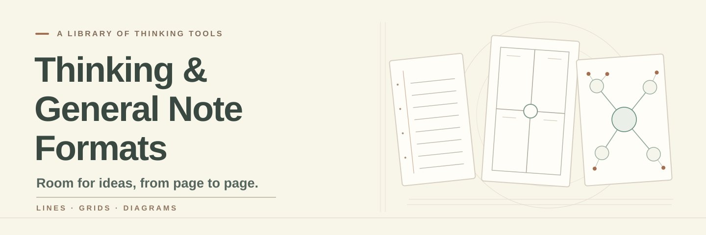

[繁體中文](README.md) · [English](README.en.md) · [日本語](README.ja.md)

線・グリッド・図。用途から形式を探し、記入例を見て、文字なしPDFか英語名付きPDFをダウンロードできます。

手帳を使う習慣から生まれました。AI時代、ペンを探すより先に考えが入力欄へ飛び込みます。それでも線や方眼、図で考えるのが好き。印刷・編集できる形にして、手帳に記念写真と次の仕事を用意しました。

144形式・127種類の図形。[共通の図形](docs/GEOMETRY-GROUPS.md)

## 使い始める

- [はじめに](QUICKSTART.md)
- [用途から選ぶ](docs/ja/choose.md)
- [全フォーマット一覧](docs/ja/catalog.md)
- [印刷](docs/ja/print.md)
- [変更](docs/ja/customize.md)
- [協力](docs/ja/contribute.md)
- [用語集](docs/ja/glossary.md)

## 全形式：分類を開く

分類を開いて探せます。名前から使い方と由来へ、画像から拡大表示へ進めます。

<strong>基本の書き方</strong> · 8

### [無地のページ](templates/blank/README.ja.md) · `blank`

文字、絵、配置の関係をすべて書き手が決められる形式です。

**記入例：** 架空の地域菜園について、植物、道具、世話の時間を別の位置に書き、関係を結ぶ例です。空白版には文字がありません。

<a href="templates/blank/examples/ja.svg">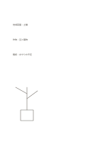</a>

[文字なしPDF](templates/blank/exports/a5-draft/blank.pdf) · [英語名付きPDF](templates/blank/exports/a5-draft/titled.pdf) · [SVG](templates/blank/exports/a5-draft/blank.svg) · [濃い線PDF](templates/blank/exports/a5-contrast/blank.pdf)

### [細い横罫ノート](templates/ruled-narrow/README.ja.md) · `ruled-narrow`

<a href="templates/ruled-narrow/previews/a5-draft.png">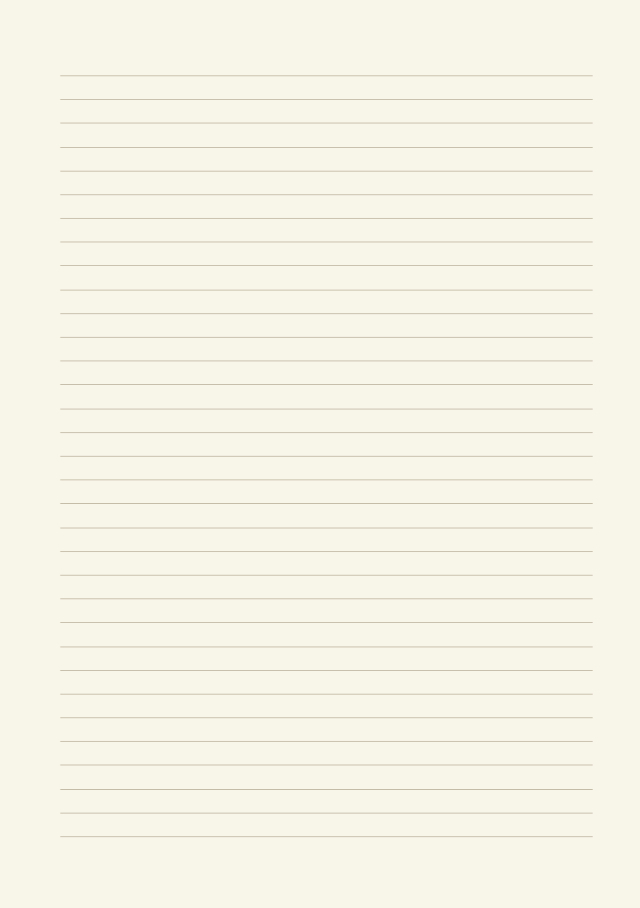</a>

一定の行間で文章を順に記録しながら、ページ全体を自由に使える形式です。 図形の変更： 横罫の間隔: 5.5 mm.

**記入例：** 架空の地域読書会を例に、目的、会場、進行、未確認の設備、次回の問いを順に記入しています。 架空の短い記入で各領域の使い方を示します。実測データや完全な調査結果ではありません。

<a href="templates/ruled-narrow/examples/ja.svg">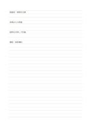</a>

[文字なしPDF](templates/ruled-narrow/exports/a5-draft/blank.pdf) · [英語名付きPDF](templates/ruled-narrow/exports/a5-draft/titled.pdf) · [SVG](templates/ruled-narrow/exports/a5-draft/blank.svg) · [濃い線PDF](templates/ruled-narrow/exports/a5-contrast/blank.pdf)

### [横罫ノート](templates/ruled-standard/README.ja.md) · `ruled-standard`

<a href="templates/ruled-standard/previews/a5-draft.png">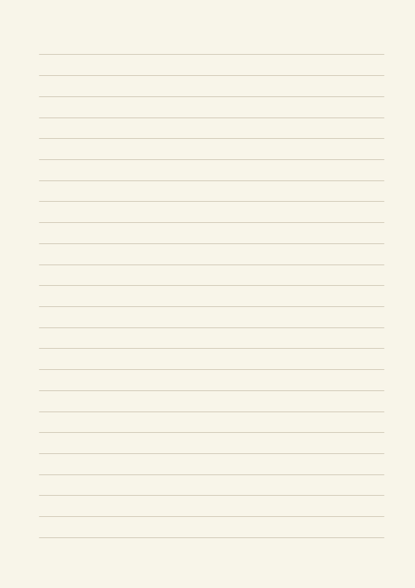</a>

一定の行間で文章を順に記録しながら、ページ全体を自由に使える形式です。

**記入例：** 架空の地域読書会を例に、目的、会場、進行、未確認の設備、次回の問いを順に記入しています。

<a href="templates/ruled-standard/examples/ja.svg">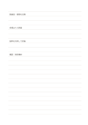</a>

[文字なしPDF](templates/ruled-standard/exports/a5-draft/blank.pdf) · [英語名付きPDF](templates/ruled-standard/exports/a5-draft/titled.pdf) · [SVG](templates/ruled-standard/exports/a5-draft/blank.svg) · [濃い線PDF](templates/ruled-standard/exports/a5-contrast/blank.pdf)

### [広い横罫ノート](templates/ruled-wide/README.ja.md) · `ruled-wide`

<a href="templates/ruled-wide/previews/a5-draft.png">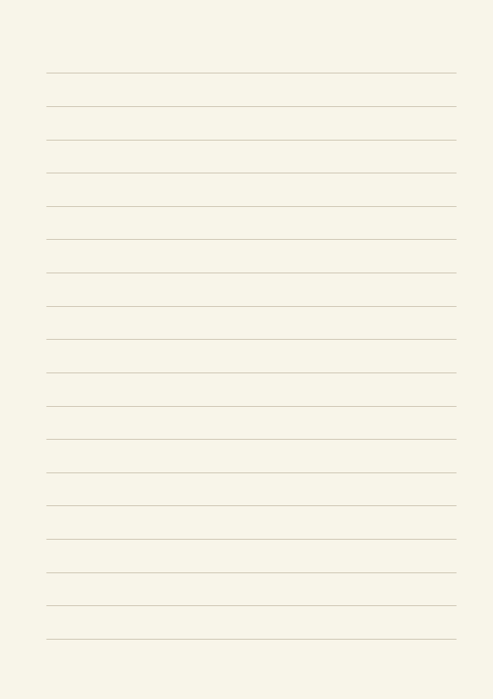</a>

一定の行間で文章を順に記録しながら、ページ全体を自由に使える形式です。 図形の変更： 横罫の間隔: 10 mm.

**記入例：** 架空の地域読書会を例に、目的、会場、進行、未確認の設備、次回の問いを順に記入しています。 架空の短い記入で各領域の使い方を示します。実測データや完全な調査結果ではありません。

<a href="templates/ruled-wide/examples/ja.svg">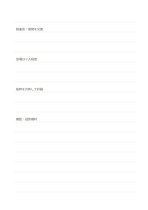</a>

[文字なしPDF](templates/ruled-wide/exports/a5-draft/blank.pdf) · [英語名付きPDF](templates/ruled-wide/exports/a5-draft/titled.pdf) · [SVG](templates/ruled-wide/exports/a5-draft/blank.svg) · [濃い線PDF](templates/ruled-wide/exports/a5-contrast/blank.pdf)

### [二本線の書字用紙](templates/ruled-double/README.ja.md) · `ruled-double`

<a href="templates/ruled-double/previews/a5-draft.png">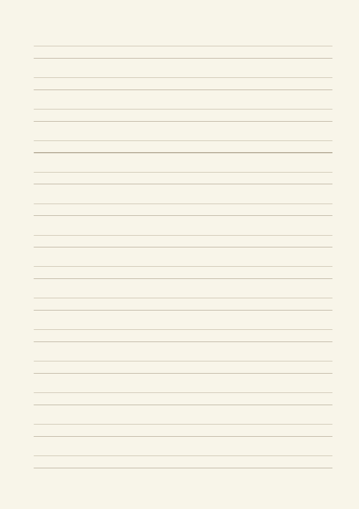</a>

二本一組の横線を書字帯として使い、字の高さと間隔を見比べます。

**記入例：** 架空の植物観察を三つの短い文にし、書字帯ごとの高さと間隔を比べる例です。

<a href="templates/ruled-double/examples/ja.svg">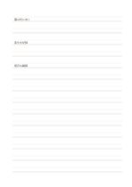</a>

[文字なしPDF](templates/ruled-double/exports/a5-draft/blank.pdf) · [英語名付きPDF](templates/ruled-double/exports/a5-draft/titled.pdf) · [SVG](templates/ruled-double/exports/a5-draft/blank.svg) · [濃い線PDF](templates/ruled-double/exports/a5-contrast/blank.pdf)

### [三分割の横罫](templates/ruled-segmented/README.ja.md) · `ruled-segmented`

<a href="templates/ruled-segmented/previews/a5-draft.png">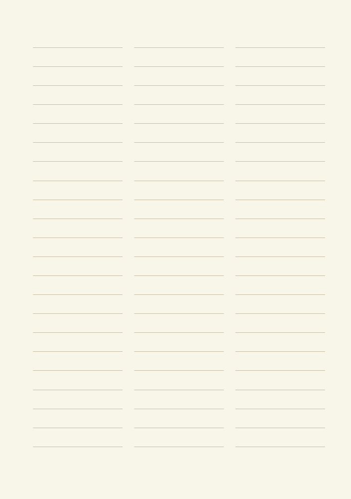</a>

各行を三つの短い記入欄に分け、関連する語句を横並びで残します。

**記入例：** 架空の植物観察で、三欄に時刻、見えた状態、次の問いを並べています。

<a href="templates/ruled-segmented/examples/ja.svg">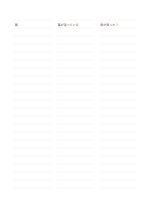</a>

[文字なしPDF](templates/ruled-segmented/exports/a5-draft/blank.pdf) · [英語名付きPDF](templates/ruled-segmented/exports/a5-draft/titled.pdf) · [SVG](templates/ruled-segmented/exports/a5-draft/blank.svg) · [濃い線PDF](templates/ruled-segmented/exports/a5-contrast/blank.pdf)

### [余白付き横罫](templates/ruled-margin/README.ja.md) · `ruled-margin`

<a href="templates/ruled-margin/previews/a5-draft.png">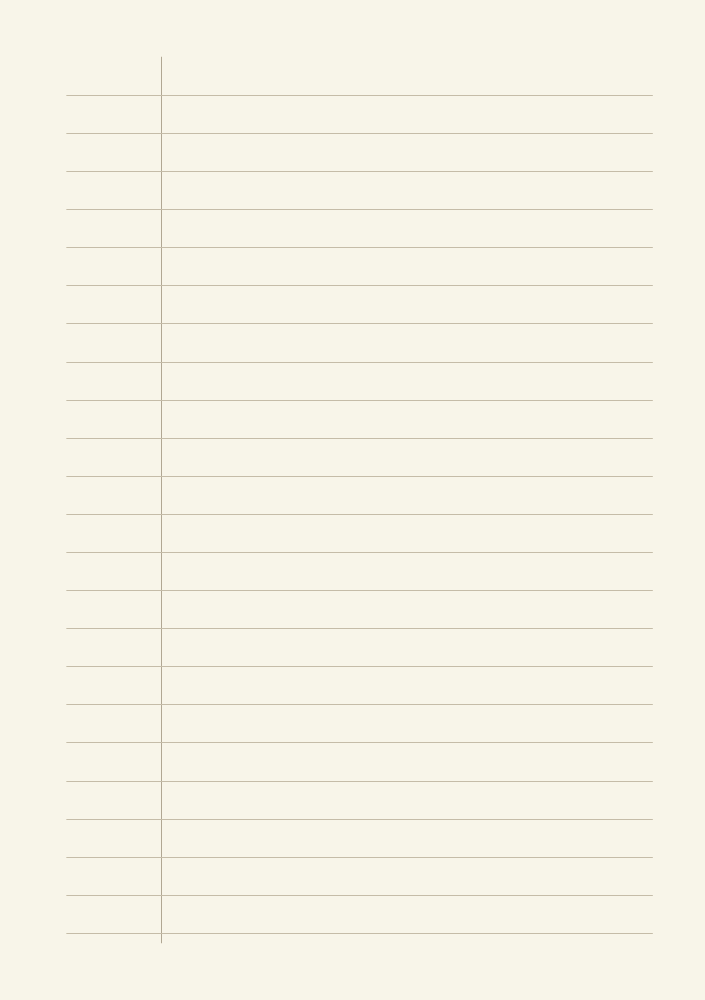</a>

狭い側欄に参照や印を置き、主な領域には文章を続けて書けます。

**記入例：** 架空の記事のページを側欄に、筆者の観察と確認したい問いを主領域に書いています。

<a href="templates/ruled-margin/examples/ja.svg">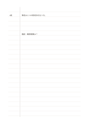</a>

[文字なしPDF](templates/ruled-margin/exports/a5-draft/blank.pdf) · [英語名付きPDF](templates/ruled-margin/exports/a5-draft/titled.pdf) · [SVG](templates/ruled-margin/exports/a5-draft/blank.svg) · [濃い線PDF](templates/ruled-margin/exports/a5-contrast/blank.pdf)

### [上図下文のノート](templates/ruled-sketch-top/README.ja.md) · `ruled-sketch-top`

<a href="templates/ruled-sketch-top/previews/a5-draft.png">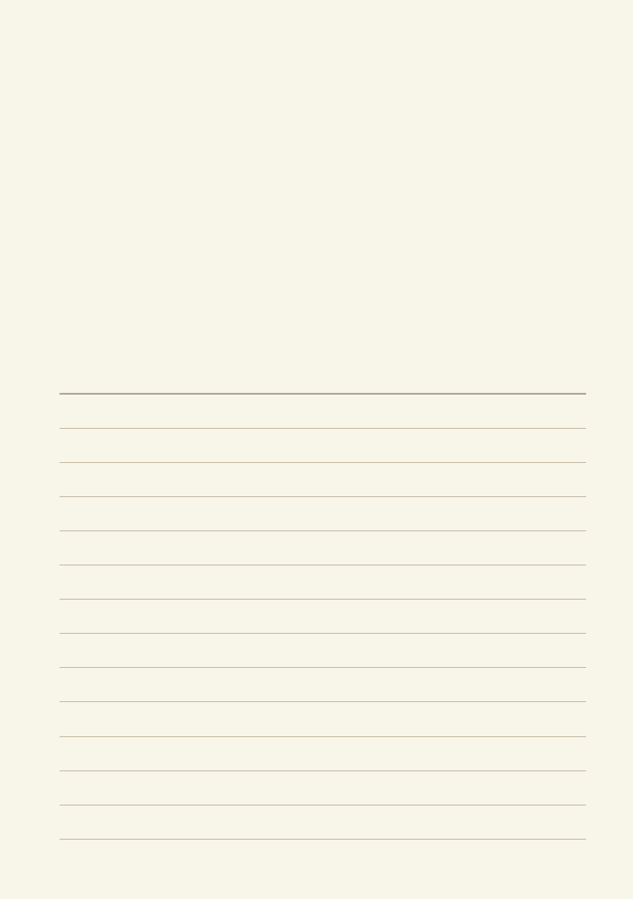</a>

上の広い余白に考えを描き、下の横罫に説明を加えます。

**記入例：** 上に架空の雨水収集器を大まかに描き、下に入口、フィルター、試したい容量を記しています。

<a href="templates/ruled-sketch-top/examples/ja.svg">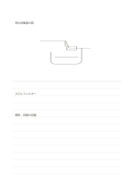</a>

[文字なしPDF](templates/ruled-sketch-top/exports/a5-draft/blank.pdf) · [英語名付きPDF](templates/ruled-sketch-top/exports/a5-draft/titled.pdf) · [SVG](templates/ruled-sketch-top/exports/a5-draft/blank.svg) · [濃い線PDF](templates/ruled-sketch-top/exports/a5-contrast/blank.pdf)

<strong>方眼とドット</strong> · 8

### [細かい方眼](templates/grid-fine/README.ja.md) · `grid-fine`

<a href="templates/grid-fine/previews/a5-draft.png">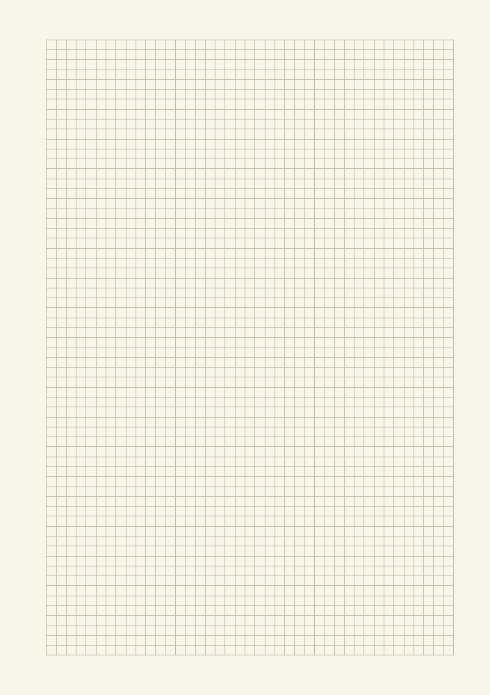</a>

等間隔のマスで短い語句、簡単な図、比率の下描きをそろえます。 図形の変更： 方眼の間隔: 3 mm.

**記入例：** 架空の読書コーナーについて、机、椅子、通路をマスで表し、幅を後で測る例です。 架空の短い記入で各領域の使い方を示します。実測データや完全な調査結果ではありません。

<a href="templates/grid-fine/examples/ja.svg">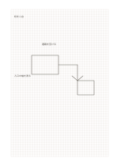</a>

[文字なしPDF](templates/grid-fine/exports/a5-draft/blank.pdf) · [英語名付きPDF](templates/grid-fine/exports/a5-draft/titled.pdf) · [SVG](templates/grid-fine/exports/a5-draft/blank.svg) · [濃い線PDF](templates/grid-fine/exports/a5-contrast/blank.pdf)

### [方眼ノート](templates/grid-standard/README.ja.md) · `grid-standard`

等間隔のマスで短い語句、簡単な図、比率の下描きをそろえます。

**記入例：** 架空の読書コーナーについて、机、椅子、通路をマスで表し、幅を後で測る例です。

<a href="templates/grid-standard/examples/ja.svg">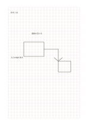</a>

[文字なしPDF](templates/grid-standard/exports/a5-draft/blank.pdf) · [英語名付きPDF](templates/grid-standard/exports/a5-draft/titled.pdf) · [SVG](templates/grid-standard/exports/a5-draft/blank.svg) · [濃い線PDF](templates/grid-standard/exports/a5-contrast/blank.pdf)

### [大きい方眼](templates/grid-large/README.ja.md) · `grid-large`

<a href="templates/grid-large/previews/a5-draft.png">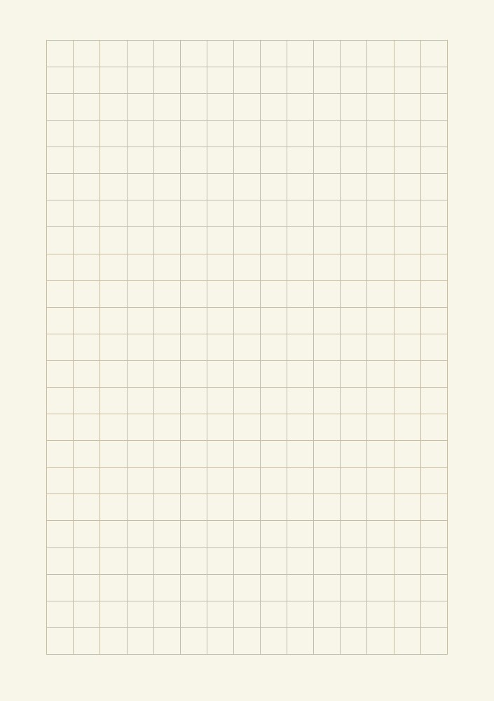</a>

等間隔のマスで短い語句、簡単な図、比率の下描きをそろえます。 図形の変更： 方眼の間隔: 8 mm.

**記入例：** 架空の読書コーナーについて、机、椅子、通路をマスで表し、幅を後で測る例です。 架空の短い記入で各領域の使い方を示します。実測データや完全な調査結果ではありません。

<a href="templates/grid-large/examples/ja.svg">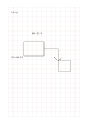</a>

[文字なしPDF](templates/grid-large/exports/a5-draft/blank.pdf) · [英語名付きPDF](templates/grid-large/exports/a5-draft/titled.pdf) · [SVG](templates/grid-large/exports/a5-draft/blank.svg) · [濃い線PDF](templates/grid-large/exports/a5-contrast/blank.pdf)

### [細かいドット方眼](templates/dot-fine/README.ja.md) · `dot-fine`

<a href="templates/dot-fine/previews/a5-draft.png">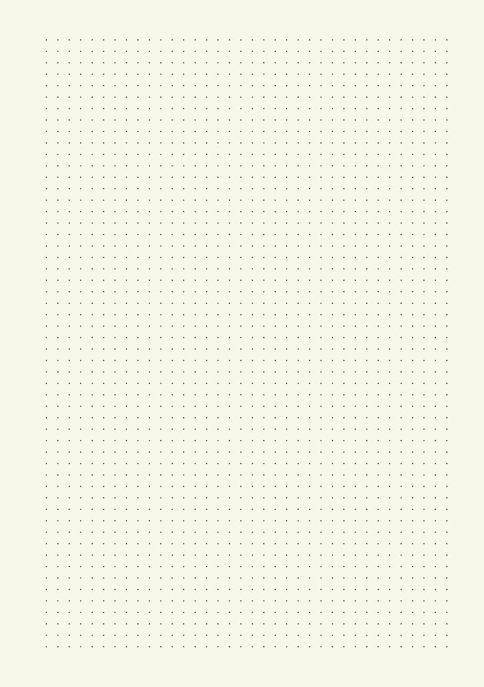</a>

薄い点で位置をそろえながら、方眼より自由な書き心地を残します。 図形の変更： ドットの間隔: 3.5 mm.

**記入例：** 架空の地域イベントの会場、材料、担当者を三つのそろった区画で示しています。 架空の短い記入で各領域の使い方を示します。実測データや完全な調査結果ではありません。

<a href="templates/dot-fine/examples/ja.svg">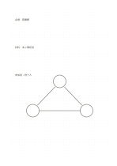</a>

[文字なしPDF](templates/dot-fine/exports/a5-draft/blank.pdf) · [英語名付きPDF](templates/dot-fine/exports/a5-draft/titled.pdf) · [SVG](templates/dot-fine/exports/a5-draft/blank.svg) · [濃い線PDF](templates/dot-fine/exports/a5-contrast/blank.pdf)

### [等間隔ドット方眼](templates/dot-standard/README.ja.md) · `dot-standard`

<a href="templates/dot-standard/previews/a5-draft.png">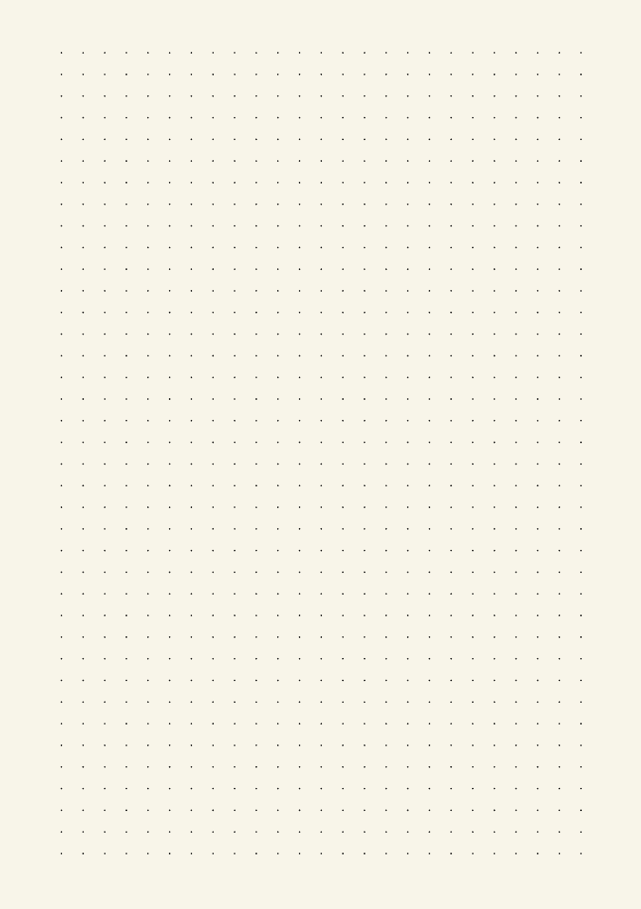</a>

薄い点で位置をそろえながら、方眼より自由な書き心地を残します。

**記入例：** 架空の地域イベントの会場、材料、担当者を三つのそろった区画で示しています。

<a href="templates/dot-standard/examples/ja.svg">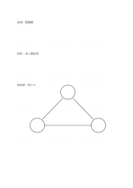</a>

[文字なしPDF](templates/dot-standard/exports/a5-draft/blank.pdf) · [英語名付きPDF](templates/dot-standard/exports/a5-draft/titled.pdf) · [SVG](templates/dot-standard/exports/a5-draft/blank.svg) · [濃い線PDF](templates/dot-standard/exports/a5-contrast/blank.pdf)

### [千鳥配置のドット方眼](templates/dot-staggered/README.ja.md) · `dot-staggered`

<a href="templates/dot-staggered/previews/a5-draft.png">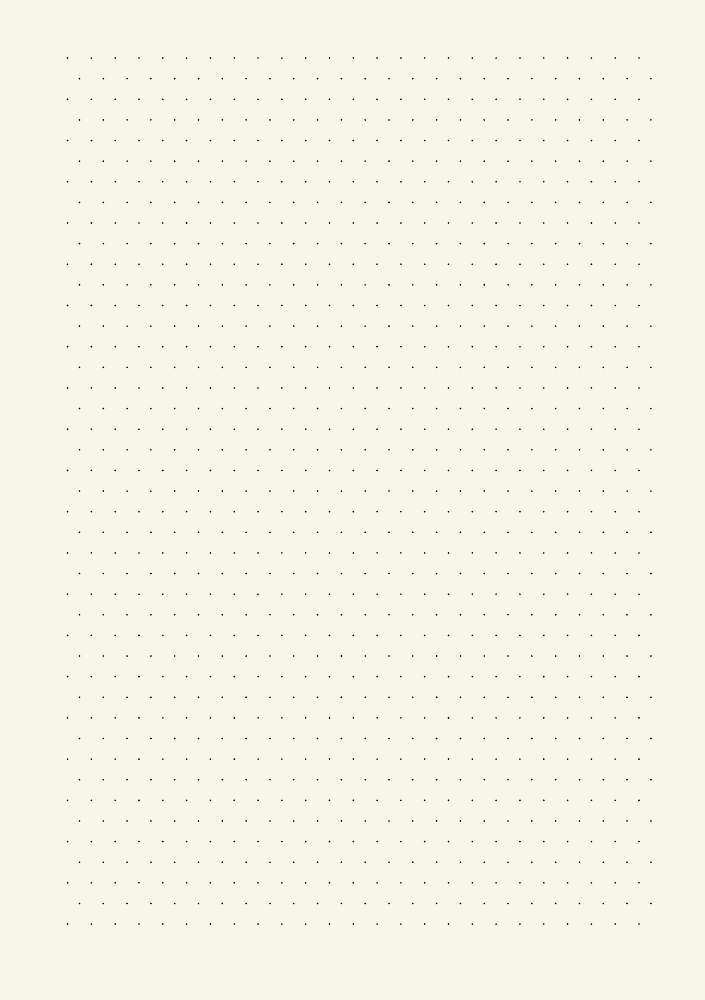</a>

隣の点列を半マスずらし、斜めや三角形の配置を描きやすくします。

**記入例：** 架空の展示会場で展示台を千鳥に三列並べ、通路のための隙間を残しています。

<a href="templates/dot-staggered/examples/ja.svg">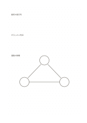</a>

[文字なしPDF](templates/dot-staggered/exports/a5-draft/blank.pdf) · [英語名付きPDF](templates/dot-staggered/exports/a5-draft/titled.pdf) · [SVG](templates/dot-staggered/exports/a5-draft/blank.svg) · [濃い線PDF](templates/dot-staggered/exports/a5-contrast/blank.pdf)

### [全体と細部の方眼](templates/grid-hierarchical/README.ja.md) · `grid-hierarchical`

<a href="templates/grid-hierarchical/previews/a5-draft.png">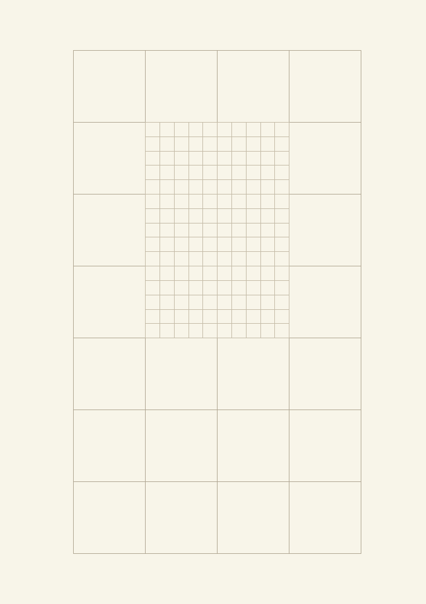</a>

大きなマスで全体を考え、中央の細かい格子で一部分を詳しく描きます。

**記入例：** 架空の読書コーナーを座席、棚、通路に分け、中央で机の配置を詳しく描く例です。

<a href="templates/grid-hierarchical/examples/ja.svg">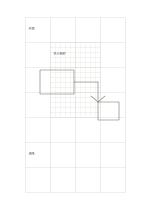</a>

[文字なしPDF](templates/grid-hierarchical/exports/a5-draft/blank.pdf) · [英語名付きPDF](templates/grid-hierarchical/exports/a5-draft/titled.pdf) · [SVG](templates/grid-hierarchical/exports/a5-draft/blank.svg) · [濃い線PDF](templates/grid-hierarchical/exports/a5-contrast/blank.pdf)

### [左ドット・右方眼](templates/dot-grid-split/README.ja.md) · `dot-grid-split`

<a href="templates/dot-grid-split/previews/a5-draft.png">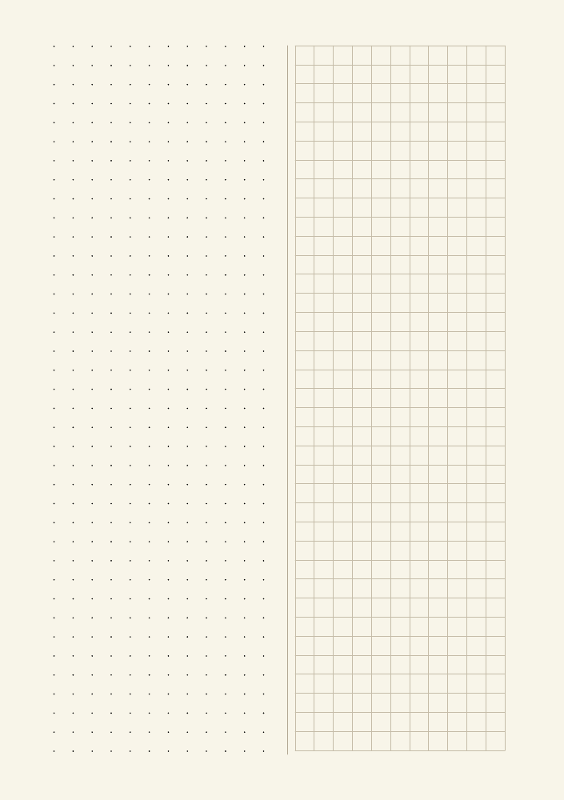</a>

自由につなげる点の領域と、整然と並べる方眼を一枚に置きます。

**記入例：** 架空の庭で左に植物の関係、右に鉢の数と配置を記入しています。

<a href="templates/dot-grid-split/examples/ja.svg">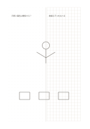</a>

[文字なしPDF](templates/dot-grid-split/exports/a5-draft/blank.pdf) · [英語名付きPDF](templates/dot-grid-split/exports/a5-draft/titled.pdf) · [SVG](templates/dot-grid-split/exports/a5-draft/blank.svg) · [濃い線PDF](templates/dot-grid-split/exports/a5-contrast/blank.pdf)

<strong>幾何ガイド</strong> · 8

### [三角方眼](templates/triangular-grid/README.ja.md) · `triangular-grid`

<a href="templates/triangular-grid/previews/a5-draft.png">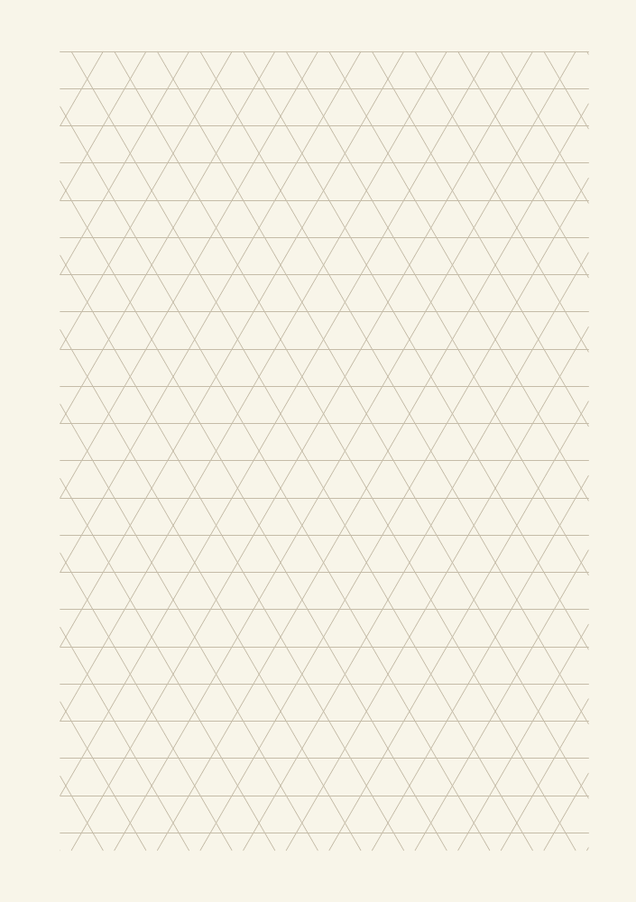</a>

三方向の等間隔線で斜めの構造や三角形の分割を下描きします。

**記入例：** 架空の展示台で三つの支点と斜めの補強を描き、寸法は後で測る例です。

<a href="templates/triangular-grid/examples/ja.svg">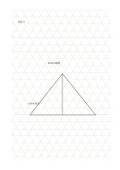</a>

[文字なしPDF](templates/triangular-grid/exports/a5-draft/blank.pdf) · [英語名付きPDF](templates/triangular-grid/exports/a5-draft/titled.pdf) · [SVG](templates/triangular-grid/exports/a5-draft/blank.svg) · [濃い線PDF](templates/triangular-grid/exports/a5-contrast/blank.pdf)

### [等角三角グリッド](templates/isometric-grid/README.ja.md) · `isometric-grid`

三方向の等間隔線で等角の物を下書きし、実寸は別に測ります。

**記入例：** 図の記入位置の順に示します。番号一つが一つの記入例です：

1. 支点 A
2. 斜めの補強
3. 寸法を測る

[文字なしPDF](templates/isometric-grid/exports/a5-draft/blank.pdf) · [英語名付きPDF](templates/isometric-grid/exports/a5-draft/titled.pdf) · [SVG](templates/isometric-grid/exports/a5-draft/blank.svg) · [濃い線PDF](templates/isometric-grid/exports/a5-contrast/blank.pdf)

### [六角形の格子](templates/hex-grid/README.ja.md) · `hex-grid`

<a href="templates/hex-grid/previews/a5-draft.png">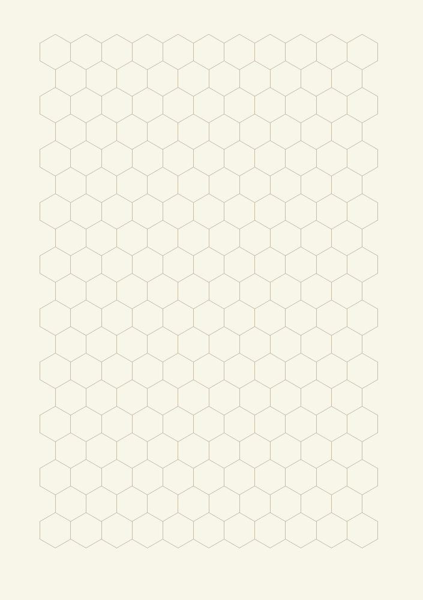</a>

隣り合う六角形で接続、まとまり、通る道を表します。

**記入例：** 架空の展示会で入口、展示台、休憩場所を隣接したマスに置き、見学経路を描く例です。

<a href="templates/hex-grid/examples/ja.svg">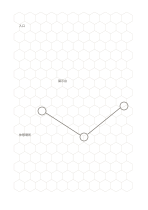</a>

[文字なしPDF](templates/hex-grid/exports/a5-draft/blank.pdf) · [英語名付きPDF](templates/hex-grid/exports/a5-draft/titled.pdf) · [SVG](templates/hex-grid/exports/a5-draft/blank.svg) · [濃い線PDF](templates/hex-grid/exports/a5-contrast/blank.pdf)

### [ひし形方眼](templates/rhombus-grid/README.ja.md) · `rhombus-grid`

<a href="templates/rhombus-grid/previews/a5-draft.png">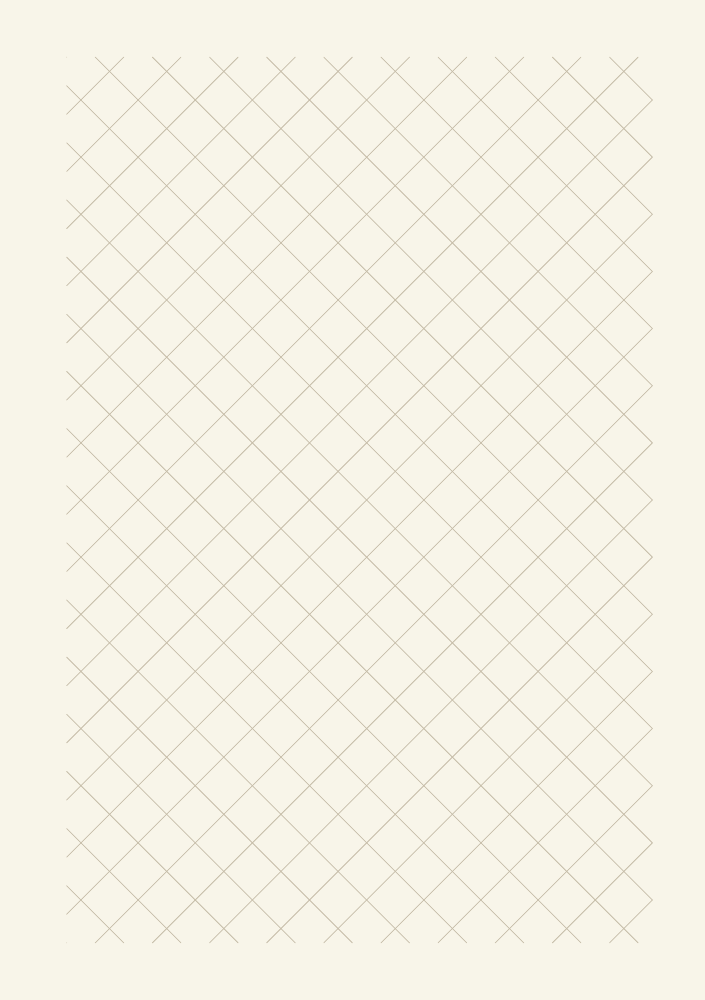</a>

交差する二組の斜線でひし形を作り、傾けた配置を考えます。

**記入例：** 架空の床タイルを斜めに並べ、入口と曲がる位置を示しています。

<a href="templates/rhombus-grid/examples/ja.svg">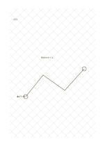</a>

[文字なしPDF](templates/rhombus-grid/exports/a5-draft/blank.pdf) · [英語名付きPDF](templates/rhombus-grid/exports/a5-draft/titled.pdf) · [SVG](templates/rhombus-grid/exports/a5-draft/blank.svg) · [濃い線PDF](templates/rhombus-grid/exports/a5-contrast/blank.pdf)

### [帯状の斜めガイド](templates/diagonal-guides/README.ja.md) · `diagonal-guides`

<a href="templates/diagonal-guides/previews/a5-draft.png">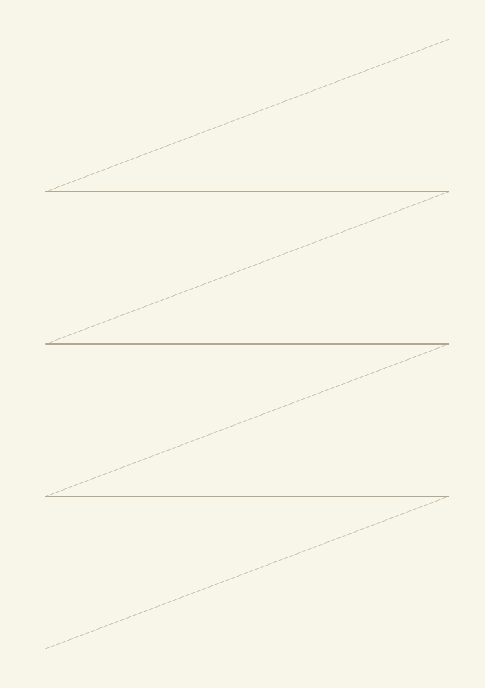</a>

四つの広い帯の斜線を使い、方向や傾きの案を描きます。

**記入例：** 架空の展示会場で四つの誘導経路を比べ、それぞれの始点と終点を記しています。

<a href="templates/diagonal-guides/examples/ja.svg">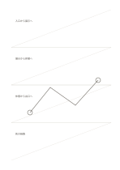</a>

[文字なしPDF](templates/diagonal-guides/exports/a5-draft/blank.pdf) · [英語名付きPDF](templates/diagonal-guides/exports/a5-draft/titled.pdf) · [SVG](templates/diagonal-guides/exports/a5-draft/blank.svg) · [濃い線PDF](templates/diagonal-guides/exports/a5-contrast/blank.pdf)

### [放射・極座標用紙](templates/radial-polar/README.ja.md) · `radial-polar`

<a href="templates/radial-polar/previews/a5-draft.png">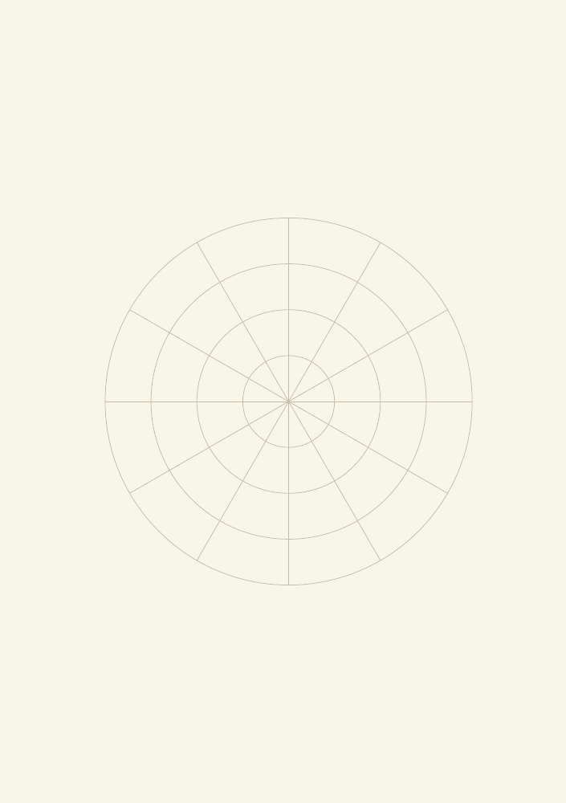</a>

同心円と放射線で中心からの方向と距離の段階を整理します。

**記入例：** 架空の小広場を中心に、入口、席、植栽、道の大まかな方向を示します。

<a href="templates/radial-polar/examples/ja.svg">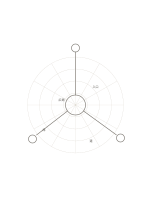</a>

[文字なしPDF](templates/radial-polar/exports/a5-draft/blank.pdf) · [英語名付きPDF](templates/radial-polar/exports/a5-draft/titled.pdf) · [SVG](templates/radial-polar/exports/a5-draft/blank.svg) · [濃い線PDF](templates/radial-polar/exports/a5-contrast/blank.pdf)

### [数字なしの座標軸](templates/coordinate-grid/README.ja.md) · `coordinate-grid`

<a href="templates/coordinate-grid/previews/a5-draft.png">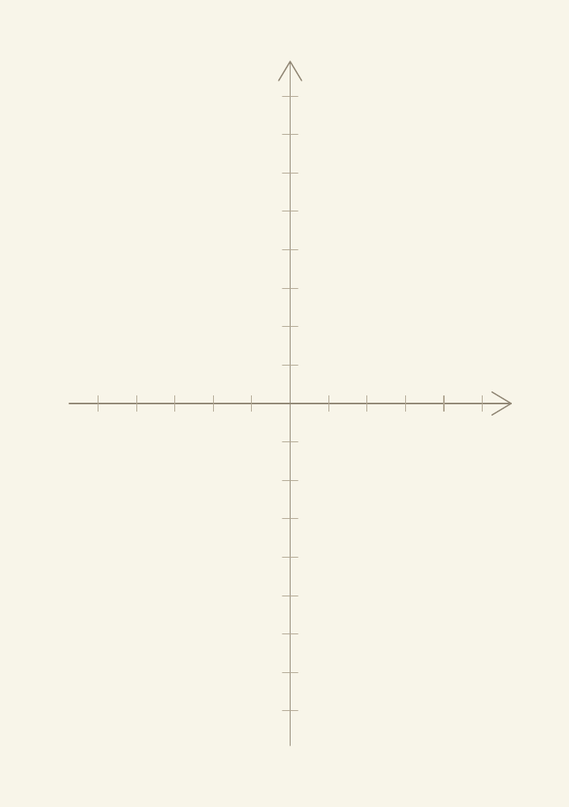</a>

中央の二軸と目盛りで、二つの量の方向と相対的な位置を考えます。

**記入例：** 架空の催し四案を準備時間と参加人数で仮に置き、あとで実数を調べる例です。

[文字なしPDF](templates/coordinate-grid/exports/a5-draft/blank.pdf) · [英語名付きPDF](templates/coordinate-grid/exports/a5-draft/titled.pdf) · [SVG](templates/coordinate-grid/exports/a5-draft/blank.svg) · [濃い線PDF](templates/coordinate-grid/exports/a5-contrast/blank.pdf)

### [主線つき方眼](templates/engineering-grid/README.ja.md) · `engineering-grid`

<a href="templates/engineering-grid/previews/a5-draft.png">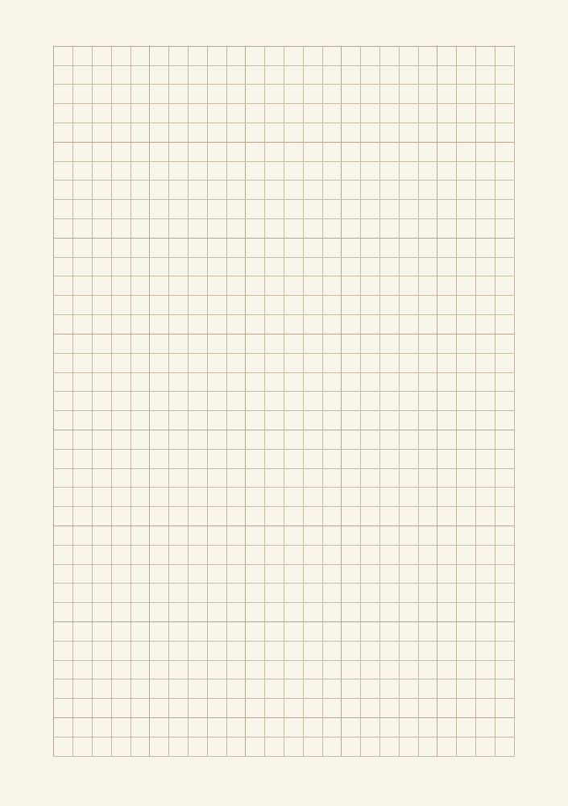</a>

等間隔のマスで短い語句、簡単な図、比率の下描きをそろえます。 図形の変更： 五マスごとに主線を強調しました。

**記入例：** 架空の読書コーナーについて、机、椅子、通路をマスで表し、幅を後で測る例です。 架空の短い記入で各領域の使い方を示します。実測データや完全な調査結果ではありません。

<a href="templates/engineering-grid/examples/ja.svg">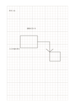</a>

[文字なしPDF](templates/engineering-grid/exports/a5-draft/blank.pdf) · [英語名付きPDF](templates/engineering-grid/exports/a5-draft/titled.pdf) · [SVG](templates/engineering-grid/exports/a5-draft/blank.svg) · [濃い線PDF](templates/engineering-grid/exports/a5-contrast/blank.pdf)

<strong>欄分け</strong> · 8

### [等幅の二段組](templates/two-equal-columns/README.ja.md) · `two-equal-columns`

同じ重みの二種類の内容を左右に置き、行ごとや全体で比べます。

**記入例：** 架空の展示会の紙の案内と口頭案内を並べ、得られる情報や質問のしやすさを比べています。

<a href="templates/two-equal-columns/examples/ja.svg">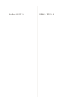</a>

[文字なしPDF](templates/two-equal-columns/exports/a5-draft/blank.pdf) · [英語名付きPDF](templates/two-equal-columns/exports/a5-draft/titled.pdf) · [SVG](templates/two-equal-columns/exports/a5-draft/blank.svg) · [濃い線PDF](templates/two-equal-columns/exports/a5-contrast/blank.pdf)

### [左に狭い参照欄](templates/two-left-narrow/README.ja.md) · `two-left-narrow`

左に短い参照を置き、広い右側を文章や図に使います。

**記入例：** 架空の聞き取りで左に会場という語、右に入口と座席の配置の説明を置いています。

<a href="templates/two-left-narrow/examples/ja.svg">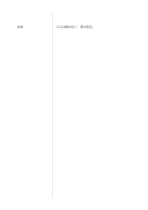</a>

[文字なしPDF](templates/two-left-narrow/exports/a5-draft/blank.pdf) · [英語名付きPDF](templates/two-left-narrow/exports/a5-draft/titled.pdf) · [SVG](templates/two-left-narrow/exports/a5-draft/blank.svg) · [濃い線PDF](templates/two-left-narrow/exports/a5-contrast/blank.pdf)

### [右側が細い二段組](templates/two-right-narrow/README.ja.md) · `two-right-narrow`

<a href="templates/two-right-narrow/previews/a5-draft.png">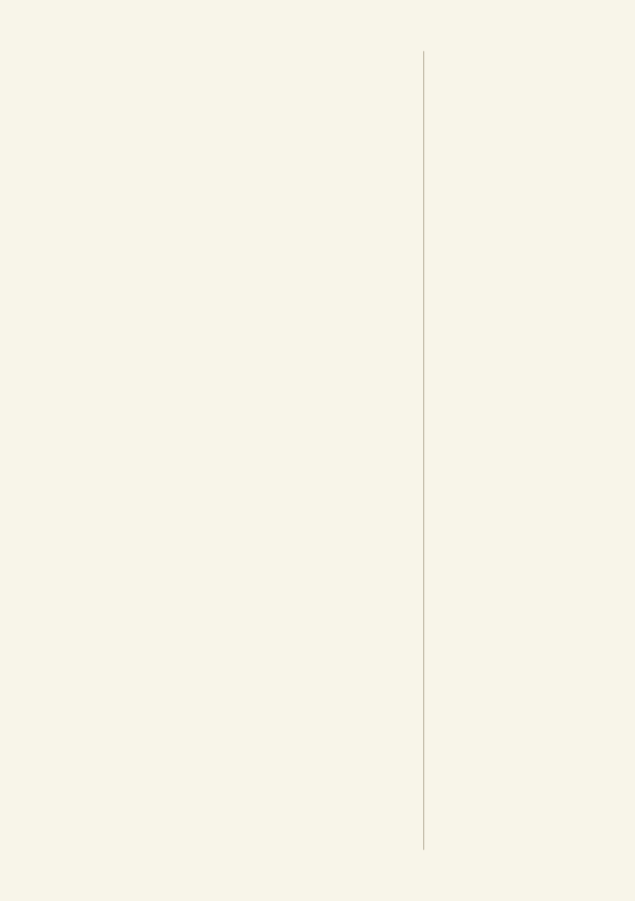</a>

右の細い欄に短い出典や確認点を置き、左に本文や下書きを残します。

**記入例：** 図の記入位置の順に示します。番号一つが一つの記入例です：

1. 会場
2. 入口は棚の近く、席は窓辺。

<a href="templates/two-right-narrow/examples/ja.svg">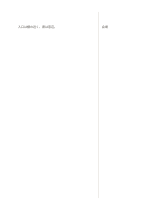</a>

[文字なしPDF](templates/two-right-narrow/exports/a5-draft/blank.pdf) · [英語名付きPDF](templates/two-right-narrow/exports/a5-draft/titled.pdf) · [SVG](templates/two-right-narrow/exports/a5-draft/blank.svg) · [濃い線PDF](templates/two-right-narrow/exports/a5-contrast/blank.pdf)

### [等幅の三段組](templates/three-columns/README.ja.md) · `three-columns`

三つの並行する情報を比べ、それぞれの縦の流れも保ちます。

**記入例：** 架空の読書会で図書館、地域センター、屋外の東屋という三つの会場を比べています。

<a href="templates/three-columns/examples/ja.svg">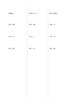</a>

[文字なしPDF](templates/three-columns/exports/a5-draft/blank.pdf) · [英語名付きPDF](templates/three-columns/exports/a5-draft/titled.pdf) · [SVG](templates/three-columns/exports/a5-draft/blank.svg) · [濃い線PDF](templates/three-columns/exports/a5-contrast/blank.pdf)

### [コーネル式ノート](templates/cornell/README.ja.md) · `cornell`

<a href="templates/cornell/previews/a5-draft.png">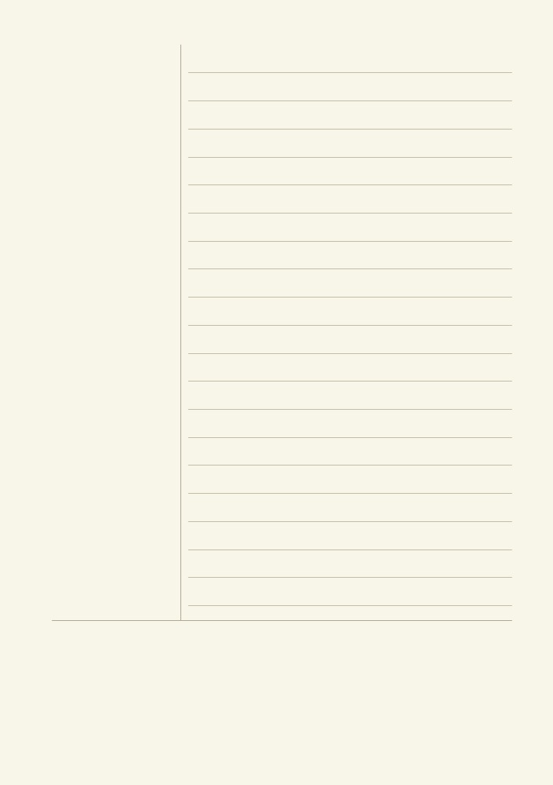</a>

手がかり、詳しい記録、最後の要約を分け、後から思い出しながら復習する形式です。

**記入例：** 架空の植物観察授業を例に、右欄へ日照と葉の変化、左欄へ葉色の問い、下欄へ慎重な結論を書いています。

[文字なしPDF](templates/cornell/exports/a5-draft/blank.pdf) · [英語名付きPDF](templates/cornell/exports/a5-draft/titled.pdf) · [SVG](templates/cornell/exports/a5-draft/blank.svg) · [濃い線PDF](templates/cornell/exports/a5-contrast/blank.pdf)

### [右に手がかり欄のコーネル式](templates/cornell-mirrored/README.ja.md) · `cornell-mirrored`

コーネル式の手がかり欄を右に移し、左に本文、下に想起用のまとめを残します。

**記入例：** 図の記入位置の順に示します。番号一つが一つの記入例です：

1. 日照と葉色？
2. 窓辺の葉が濃い。水やりも比較する。
3. 関連は見えるが、原因はまだ不明。

[文字なしPDF](templates/cornell-mirrored/exports/a5-draft/blank.pdf) · [英語名付きPDF](templates/cornell-mirrored/exports/a5-draft/titled.pdf) · [SVG](templates/cornell-mirrored/exports/a5-draft/blank.svg) · [濃い線PDF](templates/cornell-mirrored/exports/a5-contrast/blank.pdf)

### [左罫線・右ドット](templates/column-dot-main/README.ja.md) · `column-dot-main`

左欄に手がかりを一行ずつ並べ、右の点で対応する構造を描きます。

**記入例：** 架空の庭の入口と席を左に並べ、右でその位置と通り道を描いています。

[文字なしPDF](templates/column-dot-main/exports/a5-draft/blank.pdf) · [英語名付きPDF](templates/column-dot-main/exports/a5-draft/titled.pdf) · [SVG](templates/column-dot-main/exports/a5-draft/blank.svg) · [濃い線PDF](templates/column-dot-main/exports/a5-contrast/blank.pdf)

### [二欄とまとめ](templates/two-columns-summary/README.ja.md) · `two-columns-summary`

上で二つの見方を分け、下の全幅欄で統合した考えを書きます。

**記入例：** 架空の読書会で屋内と屋外を比べ、天候と代替場所の確認を下欄にまとめています。

[文字なしPDF](templates/two-columns-summary/exports/a5-draft/blank.pdf) · [英語名付きPDF](templates/two-columns-summary/exports/a5-draft/titled.pdf) · [SVG](templates/two-columns-summary/exports/a5-draft/blank.svg) · [濃い線PDF](templates/two-columns-summary/exports/a5-contrast/blank.pdf)

<strong>カード</strong> · 8

### [上下二枚のカード](templates/two-stacked-cards/README.ja.md) · `two-stacked-cards`

上下の独立した枠に二つの段階や見方を分けて書きます。

**記入例：** 架空の展示会で上に入場時の観察、下に退出後に残った問いを書いています。

[文字なしPDF](templates/two-stacked-cards/exports/a5-draft/blank.pdf) · [英語名付きPDF](templates/two-stacked-cards/exports/a5-draft/titled.pdf) · [SVG](templates/two-stacked-cards/exports/a5-draft/blank.svg) · [濃い線PDF](templates/two-stacked-cards/exports/a5-contrast/blank.pdf)

### [縦に三枚のカード](templates/three-stacked-cards/README.ja.md) · `three-stacked-cards`

前・中・後の情報を三枚の縦のカードに分け、順序を確かめます。 図形の変更： 縦のカード数: 3.

**記入例：** 図の記入位置の順に示します。番号一つが一つの記入例です：

1. 入場：案内を明確に
2. 活動中：本を探す
3. 終了後：感想を確認

[文字なしPDF](templates/three-stacked-cards/exports/a5-draft/blank.pdf) · [英語名付きPDF](templates/three-stacked-cards/exports/a5-draft/titled.pdf) · [SVG](templates/three-stacked-cards/exports/a5-draft/blank.svg) · [濃い線PDF](templates/three-stacked-cards/exports/a5-contrast/blank.pdf)

### [四枚の独立カード](templates/four-cards/README.ja.md) · `four-cards`

四つの小さな主題を余白で離した枠に分けます。

**記入例：** 架空の地域活動について、会場、材料、案内、進行を四枚に分けています。

[文字なしPDF](templates/four-cards/exports/a5-draft/blank.pdf) · [英語名付きPDF](templates/four-cards/exports/a5-draft/titled.pdf) · [SVG](templates/four-cards/exports/a5-draft/blank.svg) · [濃い線PDF](templates/four-cards/exports/a5-contrast/blank.pdf)

### [六枚の独立カード](templates/six-cards/README.ja.md) · `six-cards`

候補の考えを一枚ずつ独立したカードに置き、比べたり並べたりします。 図形の変更： 独立カード数: 6.

**記入例：** 図の記入位置の順に示します。番号一つが一つの記入例です：

1. 図書館の十席
2. 短い本を四冊
3. 金曜までに案内
4. 土曜の午後
5. 進行役を二人
6. 感想を集める

[文字なしPDF](templates/six-cards/exports/a5-draft/blank.pdf) · [英語名付きPDF](templates/six-cards/exports/a5-draft/titled.pdf) · [SVG](templates/six-cards/exports/a5-draft/blank.svg) · [濃い線PDF](templates/six-cards/exports/a5-contrast/blank.pdf)

### [八枚の独立カード](templates/eight-cards/README.ja.md) · `eight-cards`

候補の考えを一枚ずつ独立したカードに置き、比べたり並べたりします。 図形の変更： 独立カード数: 8.

**記入例：** 図の記入位置の順に示します。番号一つが一つの記入例です：

1. 図書館の十席
2. 短い本を四冊
3. 金曜までに案内
4. 土曜の午後
5. 進行役を二人
6. 予算を確認
7. 通路を空ける
8. 感想を集める

[文字なしPDF](templates/eight-cards/exports/a5-draft/blank.pdf) · [英語名付きPDF](templates/eight-cards/exports/a5-draft/titled.pdf) · [SVG](templates/eight-cards/exports/a5-draft/blank.svg) · [濃い線PDF](templates/eight-cards/exports/a5-contrast/blank.pdf)

### [中心と四つの衛星カード](templates/center-four-satellites/README.ja.md) · `center-four-satellites`

中心の主題に対して四方向に異なる要素を置きます。

**記入例：** 架空の読書会を中心に置き、会場、時間、本、案内を周囲に配置しています。

[文字なしPDF](templates/center-four-satellites/exports/a5-draft/blank.pdf) · [英語名付きPDF](templates/center-four-satellites/exports/a5-draft/titled.pdf) · [SVG](templates/center-four-satellites/exports/a5-draft/blank.svg) · [濃い線PDF](templates/center-four-satellites/exports/a5-contrast/blank.pdf)

### [主カードと三つの補助カード](templates/hero-three-cards/README.ja.md) · `hero-three-cards`

主な考えに広い枠を与え、下に三つの支える観点を置きます。

**記入例：** 架空の雨水収集器を大きな枠に置き、下に材料、利用者、試すべきリスクを書いています。

[文字なしPDF](templates/hero-three-cards/exports/a5-draft/blank.pdf) · [英語名付きPDF](templates/hero-three-cards/exports/a5-draft/titled.pdf) · [SVG](templates/hero-three-cards/exports/a5-draft/blank.svg) · [濃い線PDF](templates/hero-three-cards/exports/a5-contrast/blank.pdf)

### [不等幅のモザイクカード](templates/mosaic-cards/README.ja.md) · `mosaic-cards`

大きさの異なる四枠で主内容、補足情報、短い注記を分けます。

**記入例：** 架空の読書コーナーの図を主枠に、照明、席、未検証の動線を他の枠に置きます。

[文字なしPDF](templates/mosaic-cards/exports/a5-draft/blank.pdf) · [英語名付きPDF](templates/mosaic-cards/exports/a5-draft/titled.pdf) · [SVG](templates/mosaic-cards/exports/a5-draft/blank.svg) · [濃い線PDF](templates/mosaic-cards/exports/a5-contrast/blank.pdf)

<strong>比較</strong> · 8

### [T字比較](templates/t-comparison/README.ja.md) · `t-comparison`

上に共通の問いを書き、下の左右に二つの答えを分けます。

**記入例：** 架空の読書会の会場を問い、図書館と屋外の東屋を左右で比べています。

[文字なしPDF](templates/t-comparison/exports/a5-draft/blank.pdf) · [英語名付きPDF](templates/t-comparison/exports/a5-draft/titled.pdf) · [SVG](templates/t-comparison/exports/a5-draft/blank.svg) · [濃い線PDF](templates/t-comparison/exports/a5-contrast/blank.pdf)

### [三案の比較](templates/three-way-comparison/README.ja.md) · `three-way-comparison`

一つの問いの下で三つの答えを並べて比べます。

**記入例：** 架空の読書会について図書館、地域センター、東屋の三会場を比べています。

[文字なしPDF](templates/three-way-comparison/exports/a5-draft/blank.pdf) · [英語名付きPDF](templates/three-way-comparison/exports/a5-draft/titled.pdf) · [SVG](templates/three-way-comparison/exports/a5-draft/blank.svg) · [濃い線PDF](templates/three-way-comparison/exports/a5-contrast/blank.pdf)

### [二円のベン図](templates/venn-two/README.ja.md) · `venn-two`

二つの円でそれぞれだけの特徴と共通部分を分けます。

**記入例：** 架空の読書会の屋内・屋外案で、椅子と日よけは片側ずつ、討論の問いは共通部に置きます。

[文字なしPDF](templates/venn-two/exports/a5-draft/blank.pdf) · [英語名付きPDF](templates/venn-two/exports/a5-draft/titled.pdf) · [SVG](templates/venn-two/exports/a5-draft/blank.svg) · [濃い線PDF](templates/venn-two/exports/a5-contrast/blank.pdf)

### [三円のベン図](templates/venn-three/README.ja.md) · `venn-three`

三組の固有部分、二組の共通部分、三組すべての共通部分を見ます。

**記入例：** 架空の講演・実習・見学で、講師・道具・経路は固有、座席・質問・体験は二組ずつ、申込は三組に共通します。

[文字なしPDF](templates/venn-three/exports/a5-draft/blank.pdf) · [英語名付きPDF](templates/venn-three/exports/a5-draft/titled.pdf) · [SVG](templates/venn-three/exports/a5-draft/blank.svg) · [濃い線PDF](templates/venn-three/exports/a5-contrast/blank.pdf)

### [二中心のバブル比較](templates/double-bubble/README.ja.md) · `double-bubble`

二つの主題を共通の特徴と固有の特徴につなげます。

**記入例：** 紙の案内と口頭案内は経路と情報を共有し、保存できることと質問できることがそれぞれの特徴です。

[文字なしPDF](templates/double-bubble/exports/a5-draft/blank.pdf) · [英語名付きPDF](templates/double-bubble/exports/a5-draft/titled.pdf) · [SVG](templates/double-bubble/exports/a5-draft/blank.svg) · [濃い線PDF](templates/double-bubble/exports/a5-contrast/blank.pdf)

### [橋渡しの類比](templates/bridge-analogy/README.ja.md) · `bridge-analogy`

異なる二つの主題を橋の両端に置き、対応する部分を順に考えます。

**記入例：** 図書館での貸出とオンライン貸出を両端に置き、入口、検索、受け取りを橋に並べます。

[文字なしPDF](templates/bridge-analogy/exports/a5-draft/blank.pdf) · [英語名付きPDF](templates/bridge-analogy/exports/a5-draft/titled.pdf) · [SVG](templates/bridge-analogy/exports/a5-draft/blank.svg) · [濃い線PDF](templates/bridge-analogy/exports/a5-contrast/blank.pdf)

### [対になる比較カード](templates/mirrored-compare-cards/README.ja.md) · `mirrored-compare-cards`

四枚のカードで二会場を対にして比べます。

**記入例：** 図の記入位置の順に示します。番号一つが一つの記入例です：

1. 図書館：無料
2. 東屋：開放的
3. 図書館：雨を避ける
4. 東屋：天候の影響

[文字なしPDF](templates/mirrored-compare-cards/exports/a5-draft/blank.pdf) · [英語名付きPDF](templates/mirrored-compare-cards/exports/a5-draft/titled.pdf) · [SVG](templates/mirrored-compare-cards/exports/a5-draft/blank.svg) · [濃い線PDF](templates/mirrored-compare-cards/exports/a5-contrast/blank.pdf)

### [交差比較の四区画](templates/cross-compare/README.ja.md) · `cross-compare`

二つの基準で四案を交差する領域に置き、取捨を比べます。

**記入例：** 図の記入位置の順に示します。番号一つが一つの記入例です：

1. 質問：高価値・低準備
2. 掲示：低価値・低準備
3. 実習：高価値・高準備
4. 長い資料：低価値・高準備

[文字なしPDF](templates/cross-compare/exports/a5-draft/blank.pdf) · [英語名付きPDF](templates/cross-compare/exports/a5-draft/titled.pdf) · [SVG](templates/cross-compare/exports/a5-draft/blank.svg) · [濃い線PDF](templates/cross-compare/exports/a5-contrast/blank.pdf)

<strong>行列と象限</strong> · 8

### [4象限ノート](templates/quadrant/README.ja.md) · `quadrant`

自分で決めた二つの観点で考えを四つに分け、偏りや抜けを見ます。

**記入例：** 架空の小規模ワークショップについて、実演、教材、質問時間、長い配布資料を参加価値と準備の手間で仮に分けています。

[文字なしPDF](templates/quadrant/exports/a5-draft/blank.pdf) · [英語名付きPDF](templates/quadrant/exports/a5-draft/titled.pdf) · [SVG](templates/quadrant/exports/a5-draft/blank.svg) · [濃い線PDF](templates/quadrant/exports/a5-contrast/blank.pdf)

### [中心で統合する四象限](templates/quadrant-center-circle/README.ja.md) · `quadrant-center-circle`

四つの観点を分け、共通する結論を中央の円に置きます。

**記入例：** 架空の読書会で会場、材料、人、時間を外に置き、中央に小規模で試すという共通決定を書いています。

[文字なしPDF](templates/quadrant-center-circle/exports/a5-draft/blank.pdf) · [英語名付きPDF](templates/quadrant-center-circle/exports/a5-draft/titled.pdf) · [SVG](templates/quadrant-center-circle/exports/a5-draft/blank.svg) · [濃い線PDF](templates/quadrant-center-circle/exports/a5-contrast/blank.pdf)

### [二行三列のマトリクス](templates/matrix-2x3/README.ja.md) · `matrix-2x3`

二つの条件と三つの選択肢が交わる六つのマスに記録します。

**記入例：** 架空の読書会で図書館、地域センター、東屋を三列に、設備と交通を二行に置いています。

[文字なしPDF](templates/matrix-2x3/exports/a5-draft/blank.pdf) · [英語名付きPDF](templates/matrix-2x3/exports/a5-draft/titled.pdf) · [SVG](templates/matrix-2x3/exports/a5-draft/blank.svg) · [濃い線PDF](templates/matrix-2x3/exports/a5-contrast/blank.pdf)

### [二列三行の比較表](templates/matrix-3x2/README.ja.md) · `matrix-3x2`

一方に案、もう一方に条件を決め、交差するマスを埋めます。 図形の変更： 行列の列数×行数: 2×3.

**記入例：** 図の記入位置の順に示します。番号一つが一つの記入例です：

1. 図書館：投影
2. 施設：音響
3. 図書館：徒歩5分
4. 施設：車で15分
5. 図書館：無料
6. 施設：低料金

[文字なしPDF](templates/matrix-3x2/exports/a5-draft/blank.pdf) · [英語名付きPDF](templates/matrix-3x2/exports/a5-draft/titled.pdf) · [SVG](templates/matrix-3x2/exports/a5-draft/blank.svg) · [濃い線PDF](templates/matrix-3x2/exports/a5-contrast/blank.pdf)

### [三行三列の比較表](templates/matrix-3x3/README.ja.md) · `matrix-3x3`

九つの同じ大きさのマスで三案と三条件を交差させ、中心から広げる九宮の使い方とは分けます。

**記入例：** 架空の図書館、地域施設、東屋について、設備、交通、費用の各マスに確かめる短い記録を置きます。

[文字なしPDF](templates/matrix-3x3/exports/a5-draft/blank.pdf) · [英語名付きPDF](templates/matrix-3x3/exports/a5-draft/titled.pdf) · [SVG](templates/matrix-3x3/exports/a5-draft/blank.svg) · [濃い線PDF](templates/matrix-3x3/exports/a5-contrast/blank.pdf)

### [座標軸の比較表](templates/axis-matrix/README.ja.md) · `axis-matrix`

目盛りのある二軸に案を置き、方向と相対位置を確かめます。

**記入例：** 図の記入位置の順に示します。番号一つが一つの記入例です：

1. 短い案内
2. 対話型展示
3. 実演
4. 長い講演

[文字なしPDF](templates/axis-matrix/exports/a5-draft/blank.pdf) · [英語名付きPDF](templates/axis-matrix/exports/a5-draft/titled.pdf) · [SVG](templates/axis-matrix/exports/a5-draft/blank.svg) · [濃い線PDF](templates/axis-matrix/exports/a5-contrast/blank.pdf)

### [環状の四象限](templates/quadrant-rings/README.ja.md) · `quadrant-rings`

方向による四分類と中心からの二段階を同時に使います。

**記入例：** 架空の地域菜園で四方向に分け、内側に近く行う作業、外側に調整待ちの事項を置きます。

[文字なしPDF](templates/quadrant-rings/exports/a5-draft/blank.pdf) · [英語名付きPDF](templates/quadrant-rings/exports/a5-draft/titled.pdf) · [SVG](templates/quadrant-rings/exports/a5-draft/blank.svg) · [濃い線PDF](templates/quadrant-rings/exports/a5-contrast/blank.pdf)

### [幅の異なる比較表](templates/weighted-matrix/README.ja.md) · `weighted-matrix`

書く量に応じて幅を変えながら、同じ条件で案を比べます。 図形の変更： 三列二行で、列幅と行高を異なる比率にしました。

**記入例：** 図の記入位置の順に示します。番号一つが一つの記入例です：

1. 図書館：投影
2. 施設：音響
3. 東屋：設備なし
4. 図書館：無料
5. 施設：低料金
6. 東屋：無料

[文字なしPDF](templates/weighted-matrix/exports/a5-draft/blank.pdf) · [英語名付きPDF](templates/weighted-matrix/exports/a5-draft/titled.pdf) · [SVG](templates/weighted-matrix/exports/a5-draft/blank.svg) · [濃い線PDF](templates/weighted-matrix/exports/a5-contrast/blank.pdf)

<strong>九宮と花形</strong> · 8

### [3×3のアイデア展開](templates/mandala-3x3/README.ja.md) · `mandala-3x3`

中心に一つの問いを置き、周囲の八方向へ異なる観点を広げます。

**記入例：** 架空の地域読書会を中心に置き、時間、会場、本、案内、討論、資料、参加しやすさ、後日の連絡を周囲に書いています。

[文字なしPDF](templates/mandala-3x3/exports/a5-draft/blank.pdf) · [英語名付きPDF](templates/mandala-3x3/exports/a5-draft/titled.pdf) · [SVG](templates/mandala-3x3/exports/a5-draft/blank.svg) · [濃い線PDF](templates/mandala-3x3/exports/a5-contrast/blank.pdf)

### [81マスのアイデア展開](templates/mandala-9x9/README.ja.md) · `mandala-9x9`

九つの3×3区画を使い、中心の主題から短い語を段階的に広げます。

**記入例：** 架空の読書会から会場、時間、本、参加、資料、討論、予算、次回へ広げ、代表的なマスだけを埋めています。

[文字なしPDF](templates/mandala-9x9/exports/a5-draft/blank.pdf) · [英語名付きPDF](templates/mandala-9x9/exports/a5-draft/titled.pdf) · [SVG](templates/mandala-9x9/exports/a5-draft/blank.svg) · [濃い線PDF](templates/mandala-9x9/exports/a5-contrast/blank.pdf)

### [中心と八枚の独立カード](templates/center-eight-boxes/README.ja.md) · `center-eight-boxes`

強調した中心の主題の周りに、離れた八つの観点を置きます。

**記入例：** 架空の地域展示会を中心に、会場、作品、手伝い、案内、交通、材料、日程、意見を周囲に置きます。

[文字なしPDF](templates/center-eight-boxes/exports/a5-draft/blank.pdf) · [英語名付きPDF](templates/center-eight-boxes/exports/a5-draft/titled.pdf) · [SVG](templates/center-eight-boxes/exports/a5-draft/blank.svg) · [濃い線PDF](templates/center-eight-boxes/exports/a5-contrast/blank.pdf)

### [ひし形中心の八方向](templates/diamond-eight-rays/README.ja.md) · `diamond-eight-rays`

中央のひし形から八方向に伸ばし、各線に短い観点を置きます。

**記入例：** 架空の公共読書コーナーから照明、席、本、動線、音、維持、時間、表示へ広げます。

[文字なしPDF](templates/diamond-eight-rays/exports/a5-draft/blank.pdf) · [英語名付きPDF](templates/diamond-eight-rays/exports/a5-draft/titled.pdf) · [SVG](templates/diamond-eight-rays/exports/a5-draft/blank.svg) · [濃い線PDF](templates/diamond-eight-rays/exports/a5-contrast/blank.pdf)

### [八枚花びらの発想図](templates/flower-eight/README.ja.md) · `flower-eight`

中心の主題を囲む八つの丸い花びらに短い考えを集めます。

**記入例：** 架空の地域菜園から栽培、休憩、学習、共有、維持、道具、雨水、通路へ広げます。

[文字なしPDF](templates/flower-eight/exports/a5-draft/blank.pdf) · [英語名付きPDF](templates/flower-eight/exports/a5-draft/titled.pdf) · [SVG](templates/flower-eight/exports/a5-draft/blank.svg) · [濃い線PDF](templates/flower-eight/exports/a5-contrast/blank.pdf)

### [六つの花びらの発想図](templates/flower-six/README.ja.md) · `flower-six`

中心の話題から周囲の六つの吹き出しへ考えを広げます。 図形の変更： 外側の円数: 6.

**記入例：** 図の記入位置の順に示します。番号一つが一つの記入例です：

1. 地域菜園
2. 栽培
3. 休憩
4. 学習
5. 共有
6. 維持
7. 道具

[文字なしPDF](templates/flower-six/exports/a5-draft/blank.pdf) · [英語名付きPDF](templates/flower-six/exports/a5-draft/titled.pdf) · [SVG](templates/flower-six/exports/a5-draft/blank.svg) · [濃い線PDF](templates/flower-six/exports/a5-contrast/blank.pdf)

### [二重の発想花](templates/flower-two-rings/README.ja.md) · `flower-two-rings`

内側に六つの大きな方向、外側に対応する具体例を一つずつ置きます。

**記入例：** 架空の読書会を中心に、会場、本、時間、案内、資料、討論を内側に、各一例を外側に置きます。

[文字なしPDF](templates/flower-two-rings/exports/a5-draft/blank.pdf) · [英語名付きPDF](templates/flower-two-rings/exports/a5-draft/titled.pdf) · [SVG](templates/flower-two-rings/exports/a5-draft/blank.svg) · [濃い線PDF](templates/flower-two-rings/exports/a5-contrast/blank.pdf)

### [九マスと四方向の拡張](templates/mandala-extended/README.ja.md) · `mandala-extended`

中央の九マスで広げたあと、外側の四枠に次の検討方向を残します。

**記入例：** 架空の地域展示会を九マスで考え、会場、予算、手伝い、周知などを外に残して調べます。

[文字なしPDF](templates/mandala-extended/exports/a5-draft/blank.pdf) · [英語名付きPDF](templates/mandala-extended/exports/a5-draft/titled.pdf) · [SVG](templates/mandala-extended/exports/a5-draft/blank.svg) · [濃い線PDF](templates/mandala-extended/exports/a5-contrast/blank.pdf)

<strong>概念のネットワーク</strong> · 8

### [六方向のコンセプトマップ](templates/mindmap-six/README.ja.md) · `mindmap-six`

中心のテーマから六つの異なる観点を広げ、考えの幅を見ます。

**記入例：** 架空の地域展示を中心に、来場者、会場、作品、予算、手伝い、広報を置き、次に会場の制約を調べます。

[文字なしPDF](templates/mindmap-six/exports/a5-draft/blank.pdf) · [英語名付きPDF](templates/mindmap-six/exports/a5-draft/titled.pdf) · [SVG](templates/mindmap-six/exports/a5-draft/blank.svg) · [濃い線PDF](templates/mindmap-six/exports/a5-contrast/blank.pdf)

### [八枝のマインドマップ](templates/mindmap-eight/README.ja.md) · `mindmap-eight`

中心から八つの異なる枝を広げ、下位の話題が必要な枝を見つけます。 図形の変更： マップの枝数: 8.

**記入例：** 図の記入位置の順に示します。番号一つが一つの記入例です：

1. 地域展示
2. 来場者
3. 会場
4. 作品
5. 予算
6. 協力
7. 周知
8. 動線
9. 時間

[文字なしPDF](templates/mindmap-eight/exports/a5-draft/blank.pdf) · [英語名付きPDF](templates/mindmap-eight/exports/a5-draft/titled.pdf) · [SVG](templates/mindmap-eight/exports/a5-draft/blank.svg) · [濃い線PDF](templates/mindmap-eight/exports/a5-contrast/blank.pdf)

### [非対称の枝分かれ図](templates/asymmetric-branches/README.ja.md) · `asymmetric-branches`

三つの方向に、必要に応じて異なる数の細目をつなぎます。

**記入例：** 架空の講演準備を内容、会場、広報に分け、前二者に二項目ずつ、広報に一項目を書きます。

[文字なしPDF](templates/asymmetric-branches/exports/a5-draft/blank.pdf) · [英語名付きPDF](templates/asymmetric-branches/exports/a5-draft/titled.pdf) · [SVG](templates/asymmetric-branches/exports/a5-draft/blank.svg) · [濃い線PDF](templates/asymmetric-branches/exports/a5-contrast/blank.pdf)

### [二つの中心を持つ概念図](templates/double-center-mindmap/README.ja.md) · `double-center-mindmap`

関係する二つのテーマをつなぎつつ、それぞれの周辺項目を分けます。

**記入例：** 架空の講座で上はオンラインの配信、録画、対話、支援、下は対面の会場、座席、用紙、動線を整理します。

[文字なしPDF](templates/double-center-mindmap/exports/a5-draft/blank.pdf) · [英語名付きPDF](templates/double-center-mindmap/exports/a5-draft/titled.pdf) · [SVG](templates/double-center-mindmap/exports/a5-draft/blank.svg) · [濃い線PDF](templates/double-center-mindmap/exports/a5-contrast/blank.pdf)

### [三つの核の関係図](templates/triple-core-network/README.ja.md) · `triple-core-network`

相互に関係する三つの中心要因と、それぞれの外部条件を見ます。

**記入例：** 架空の読書会で内容、手伝い、会場を核にし、題材、司会、座席、時間、資料を外へ置きます。

[文字なしPDF](templates/triple-core-network/exports/a5-draft/blank.pdf) · [英語名付きPDF](templates/triple-core-network/exports/a5-draft/titled.pdf) · [SVG](templates/triple-core-network/exports/a5-draft/blank.svg) · [濃い線PDF](templates/triple-core-network/exports/a5-contrast/blank.pdf)

### [輪状のグループ分け](templates/cluster-ring/README.ja.md) · `cluster-ring`

散らばった材料を四群にまとめてから、共通の主題を中心に置きます。

**記入例：** 架空の地域催事のメモを交通、会場、催し、食事に分け、中央に『参加体験』と書きます。

[文字なしPDF](templates/cluster-ring/exports/a5-draft/blank.pdf) · [英語名付きPDF](templates/cluster-ring/exports/a5-draft/titled.pdf) · [SVG](templates/cluster-ring/exports/a5-draft/blank.svg) · [濃い線PDF](templates/cluster-ring/exports/a5-contrast/blank.pdf)

### [星座型の関係図](templates/constellation-network/README.ja.md) · `constellation-network`

中心や順位を決めず、要素間の不規則なつながりを書きます。

**記入例：** 架空の物語に出る書店、読者、著者、編集者、催し、図書館、学生、教師の接点を探します。

[文字なしPDF](templates/constellation-network/exports/a5-draft/blank.pdf) · [英語名付きPDF](templates/constellation-network/exports/a5-draft/titled.pdf) · [SVG](templates/constellation-network/exports/a5-draft/blank.svg) · [濃い線PDF](templates/constellation-network/exports/a5-contrast/blank.pdf)

### [二集合の対応図](templates/bipartite-network/README.ja.md) · `bipartite-network`

異なる二種類の要素の多対多対応を比べ、同じ種類同士は結びません。

**記入例：** 架空の読書会、講演、展示、実習を左に置き、投影、座席、音響、手伝いの必要性を右へ結びます。

[文字なしPDF](templates/bipartite-network/exports/a5-draft/blank.pdf) · [英語名付きPDF](templates/bipartite-network/exports/a5-draft/titled.pdf) · [SVG](templates/bipartite-network/exports/a5-draft/blank.svg) · [濃い線PDF](templates/bipartite-network/exports/a5-contrast/blank.pdf)

<strong>階層</strong> · 8

### [上から下への階層樹](templates/top-down-tree/README.ja.md) · `top-down-tree`

全体から小さな分類へ二段階で分け、親子の関係を示します。

**記入例：** 架空の展示を内容と会場に分け、内容には作品と説明、会場には動線と照明を置きます。

[文字なしPDF](templates/top-down-tree/exports/a5-draft/blank.pdf) · [英語名付きPDF](templates/top-down-tree/exports/a5-draft/titled.pdf) · [SVG](templates/top-down-tree/exports/a5-draft/blank.svg) · [濃い線PDF](templates/top-down-tree/exports/a5-contrast/blank.pdf)

### [下から上への樹形図](templates/bottom-up-tree/README.ja.md) · `bottom-up-tree`

下の細部から上位のまとめへ組み立てます。 図形の変更： 下から上へ読むよう階層を反転しました。

**記入例：** 図の記入位置の順に示します。番号一つが一つの記入例です：

1. 地域展示
2. 内容
3. 会場
4. 作品
5. 説明
6. 動線
7. 照明

[文字なしPDF](templates/bottom-up-tree/exports/a5-draft/blank.pdf) · [英語名付きPDF](templates/bottom-up-tree/exports/a5-draft/titled.pdf) · [SVG](templates/bottom-up-tree/exports/a5-draft/blank.svg) · [濃い線PDF](templates/bottom-up-tree/exports/a5-contrast/blank.pdf)

### [段階式の階層メモ](templates/stepped-hierarchy/README.ja.md) · `stepped-hierarchy`

抽象的な意図を一段ずつ具体的な行動へ変えます。

**記入例：** 架空の読書会で『読書を共有』から『毎月集まる』『交代で質問』『部屋を予約』へ進みます。

[文字なしPDF](templates/stepped-hierarchy/exports/a5-draft/blank.pdf) · [英語名付きPDF](templates/stepped-hierarchy/exports/a5-draft/titled.pdf) · [SVG](templates/stepped-hierarchy/exports/a5-draft/blank.svg) · [濃い線PDF](templates/stepped-hierarchy/exports/a5-contrast/blank.pdf)

### [括弧で分ける構成図](templates/brace-decomposition/README.ja.md) · `brace-decomposition`

一つの全体と三つの異なる構成要素を簡潔に示します。

**記入例：** 架空の講座を材料、会場、手伝いに分けます。三つは準備条件で、順序を示していません。

[文字なしPDF](templates/brace-decomposition/exports/a5-draft/blank.pdf) · [英語名付きPDF](templates/brace-decomposition/exports/a5-draft/titled.pdf) · [SVG](templates/brace-decomposition/exports/a5-draft/blank.svg) · [濃い線PDF](templates/brace-decomposition/exports/a5-contrast/blank.pdf)

### [三段のピラミッド](templates/pyramid-three/README.ja.md) · `pyramid-three`

広い土台、中段の方法、上段の目標など、概念を三層に整理します。

**記入例：** 架空の展示で、下段に作品と会場、中段に展示計画、上段に地域の交流という目的を置きます。

[文字なしPDF](templates/pyramid-three/exports/a5-draft/blank.pdf) · [英語名付きPDF](templates/pyramid-three/exports/a5-draft/titled.pdf) · [SVG](templates/pyramid-three/exports/a5-draft/blank.svg) · [濃い線PDF](templates/pyramid-three/exports/a5-contrast/blank.pdf)

### [五段のピラミッド](templates/pyramid-five/README.ja.md) · `pyramid-five`

土台、行動、目標を五段に分け、支える関係を確かめます。 図形の変更： ピラミッドの段数: 5.

**記入例：** 図の記入位置の順に示します。番号一つが一つの記入例です：

1. 交流
2. 企画
3. 作品
4. 会場
5. 材料

[文字なしPDF](templates/pyramid-five/exports/a5-draft/blank.pdf) · [英語名付きPDF](templates/pyramid-five/exports/a5-draft/titled.pdf) · [SVG](templates/pyramid-five/exports/a5-draft/blank.svg) · [濃い線PDF](templates/pyramid-five/exports/a5-contrast/blank.pdf)

### [入れ子の範囲図](templates/nested-rectangles/README.ja.md) · `nested-rectangles`

四つの包含する領域で、大きな文脈から具体的な対象へ絞ります。

**記入例：** 架空の催しの場所を市、地区、図書館、読書室へと狭め、会場の話を具体化します。

[文字なしPDF](templates/nested-rectangles/exports/a5-draft/blank.pdf) · [英語名付きPDF](templates/nested-rectangles/exports/a5-draft/titled.pdf) · [SVG](templates/nested-rectangles/exports/a5-draft/blank.svg) · [濃い線PDF](templates/nested-rectangles/exports/a5-contrast/blank.pdf)

### [八区分の分類輪](templates/classification-wheel/README.ja.md) · `classification-wheel`

一つの題材の周囲に最大八種類を置き、抜けや重複を見つけます。

**記入例：** 架空の地域講座で、講師、会場、座席、資料、広報、申込、設備、感想を外側に置きます。

[文字なしPDF](templates/classification-wheel/exports/a5-draft/blank.pdf) · [英語名付きPDF](templates/classification-wheel/exports/a5-draft/titled.pdf) · [SVG](templates/classification-wheel/exports/a5-draft/blank.svg) · [濃い線PDF](templates/classification-wheel/exports/a5-contrast/blank.pdf)

<strong>流れ図</strong> · 8

### [四段階の横向きフロー](templates/flow-four-horizontal/README.ja.md) · `flow-four-horizontal`

一つの作業を左から右へ四つの動作で示します。

**記入例：** 架空の図書館で検索、取り出し、貸出手続き、持ち帰りを並べています。

[文字なしPDF](templates/flow-four-horizontal/exports/a5-draft/blank.pdf) · [英語名付きPDF](templates/flow-four-horizontal/exports/a5-draft/titled.pdf) · [SVG](templates/flow-four-horizontal/exports/a5-draft/blank.svg) · [濃い線PDF](templates/flow-four-horizontal/exports/a5-contrast/blank.pdf)

### [縦の五段階フロー](templates/flow-five-vertical/README.ja.md) · `flow-five-vertical`

上から下へ五つの連続した段階を追い、つながりを確かめます。 図形の変更： 縦の段階数: 5.

**記入例：** 図の記入位置の順に示します。番号一つが一つの記入例です：

1. 検索
2. 探す
3. 登録
4. 借りる
5. 返却

[文字なしPDF](templates/flow-five-vertical/exports/a5-draft/blank.pdf) · [英語名付きPDF](templates/flow-five-vertical/exports/a5-draft/titled.pdf) · [SVG](templates/flow-five-vertical/exports/a5-draft/blank.svg) · [濃い線PDF](templates/flow-five-vertical/exports/a5-contrast/blank.pdf)

### [六段階の折返しフロー](templates/flow-six-snake/README.ja.md) · `flow-six-snake`

上段から右で折り返す二段六節点で連続した過程を示します。

**記入例：** 架空の地域ワークショップで発案、会場、案内、材料、開催、感想を順に示します。

[文字なしPDF](templates/flow-six-snake/exports/a5-draft/blank.pdf) · [英語名付きPDF](templates/flow-six-snake/exports/a5-draft/titled.pdf) · [SVG](templates/flow-six-snake/exports/a5-draft/blank.svg) · [濃い線PDF](templates/flow-six-snake/exports/a5-contrast/blank.pdf)

### [四段階の循環](templates/cycle-four/README.ja.md) · `cycle-four`

四番目から最初へ戻る繰り返しの過程を示します。

**記入例：** 架空の地域活動で観察、提案、試行、振り返りを経て再び観察します。

[文字なしPDF](templates/cycle-four/exports/a5-draft/blank.pdf) · [英語名付きPDF](templates/cycle-four/exports/a5-draft/titled.pdf) · [SVG](templates/cycle-four/exports/a5-draft/blank.svg) · [濃い線PDF](templates/cycle-four/exports/a5-contrast/blank.pdf)

### [六段階の循環](templates/cycle-six/README.ja.md) · `cycle-six`

六段階を出発点に戻る循環として並べ、次回の調整を記録します。 図形の変更： 循環の節点数: 6.

**記入例：** 図の記入位置の順に示します。番号一つが一つの記入例です：

1. 観察
2. 提案
3. 準備
4. 試行
5. 感想
6. 調整

[文字なしPDF](templates/cycle-six/exports/a5-draft/blank.pdf) · [英語名付きPDF](templates/cycle-six/exports/a5-draft/titled.pdf) · [SVG](templates/cycle-six/exports/a5-draft/blank.svg) · [濃い線PDF](templates/cycle-six/exports/a5-contrast/blank.pdf)

### [二層の判断ツリー](templates/decision-tree/README.ja.md) · `decision-tree`

一つの問いから二つの判断を経て四つの行動へ分けます。

**記入例：** 架空の屋外読書会を天候と会場の空きで分け、四つの対応にたどり着く例です。

[文字なしPDF](templates/decision-tree/exports/a5-draft/blank.pdf) · [英語名付きPDF](templates/decision-tree/exports/a5-draft/titled.pdf) · [SVG](templates/decision-tree/exports/a5-draft/blank.svg) · [濃い線PDF](templates/decision-tree/exports/a5-contrast/blank.pdf)

### [三つのレーンの引継ぎ](templates/swimlane-flow/README.ja.md) · `swimlane-flow`

三役の仕事を横の帯で分け、矢印で引継ぎを追います。

**記入例：** 架空の主催者が会場を依頼し、会場側が時間を確認し、手伝いが材料を用意する流れです。

[文字なしPDF](templates/swimlane-flow/exports/a5-draft/blank.pdf) · [英語名付きPDF](templates/swimlane-flow/exports/a5-draft/titled.pdf) · [SVG](templates/swimlane-flow/exports/a5-draft/blank.svg) · [濃い線PDF](templates/swimlane-flow/exports/a5-contrast/blank.pdf)

### [三方向からの合流](templates/converging-flow/README.ja.md) · `converging-flow`

三つの入力を一つの結果や暫定的な判断へ集めます。

**記入例：** 架空の読書会で人、本、会場を小規模な試行計画へまとめます。

[文字なしPDF](templates/converging-flow/exports/a5-draft/blank.pdf) · [英語名付きPDF](templates/converging-flow/exports/a5-draft/titled.pdf) · [SVG](templates/converging-flow/exports/a5-draft/blank.svg) · [濃い線PDF](templates/converging-flow/exports/a5-contrast/blank.pdf)

<strong>因果の仮説</strong> · 8

### [四組の魚骨図](templates/fishbone-four/README.ja.md) · `fishbone-four`

観察した問題と複数の原因候補、その下位要因を分けます。 図形の変更： 片側の原因枝数: 2.

**記入例：** 図の記入位置の順に示します。番号一つが一つの記入例です：

1. 時間
2. 周知
3. 手続き
4. 場所
5. 申込が少ない

[文字なしPDF](templates/fishbone-four/exports/a5-draft/blank.pdf) · [英語名付きPDF](templates/fishbone-four/exports/a5-draft/titled.pdf) · [SVG](templates/fishbone-four/exports/a5-draft/blank.svg) · [濃い線PDF](templates/fishbone-four/exports/a5-contrast/blank.pdf)

### [特性要因図](templates/fishbone/README.ja.md) · `fishbone`

観察した結果から考えられる原因をさかのぼり、最初の説明だけで決めつけないための図です。

**記入例：** 架空の催しで申込が少なかった状況を例に、時間、周知、手続き、場所、内容、申込ページを確認候補として書いています。

[文字なしPDF](templates/fishbone/exports/a5-draft/blank.pdf) · [英語名付きPDF](templates/fishbone/exports/a5-draft/titled.pdf) · [SVG](templates/fishbone/exports/a5-draft/blank.svg) · [濃い線PDF](templates/fishbone/exports/a5-contrast/blank.pdf)

### [因果仮説の連鎖](templates/causal-chain/README.ja.md) · `causal-chain`

四つの未確認の因果仮説を一つの経路に並べます。

**記入例：** 図の記入位置の順に示します。番号一つが一つの記入例です：

1. 案内が遅い？
2. 見る人が少ない？
3. 申込が少ない？
4. 出席が少ない？

[文字なしPDF](templates/causal-chain/exports/a5-draft/blank.pdf) · [英語名付きPDF](templates/causal-chain/exports/a5-draft/titled.pdf) · [SVG](templates/causal-chain/exports/a5-draft/blank.svg) · [濃い線PDF](templates/causal-chain/exports/a5-contrast/blank.pdf)

### [一つの問題から三つの対応](templates/problem-solution-three/README.ja.md) · `problem-solution-three`

観察した問題から三つの対応案へ矢印を分け、問いから対策へ進む方向を示します。

**記入例：** 架空の読書会で申込が少ない場合、早めの案内、時間変更、協力者を未検証の案として並べます。

[文字なしPDF](templates/problem-solution-three/exports/a5-draft/blank.pdf) · [英語名付きPDF](templates/problem-solution-three/exports/a5-draft/titled.pdf) · [SVG](templates/problem-solution-three/exports/a5-draft/blank.svg) · [濃い線PDF](templates/problem-solution-three/exports/a5-contrast/blank.pdf)

### [五回のなぜの連鎖](templates/five-why-chain/README.ja.md) · `five-why-chain`

観察した問題から『なぜ』を重ね、各答えを確かめる仮説として残します。

**記入例：** 図の記入位置の順に示します。番号一つが一つの記入例です：

1. 申込が少ない
2. 案内が遅い？
3. 計画が遅い？
4. 資料が遅い？
5. 担当未定？

[文字なしPDF](templates/five-why-chain/exports/a5-draft/blank.pdf) · [英語名付きPDF](templates/five-why-chain/exports/a5-draft/titled.pdf) · [SVG](templates/five-why-chain/exports/a5-draft/blank.svg) · [濃い線PDF](templates/five-why-chain/exports/a5-contrast/blank.pdf)

### [交差する要因ネットワーク](templates/causal-network/README.ja.md) · `causal-network`

複数の要因と相互の影響を、一本の原因列ではなく網として考えます。

**記入例：** 架空の催しの周知、時間、申込ページ、会場、参加数を候補として結び、因果は未確認としています。

[文字なしPDF](templates/causal-network/exports/a5-draft/blank.pdf) · [英語名付きPDF](templates/causal-network/exports/a5-draft/titled.pdf) · [SVG](templates/causal-network/exports/a5-draft/blank.svg) · [濃い線PDF](templates/causal-network/exports/a5-contrast/blank.pdf)

### [仮説と三つの根拠](templates/hypothesis-evidence/README.ja.md) · `hypothesis-evidence`

検証できる仮説を置き、三つの観察や反例を見てから判断を更新します。

**記入例：** 架空の読書会で短い通知が出席を増やすという仮説を、申込、出席、未回答で見て、比較対象が必要と記しています。

[文字なしPDF](templates/hypothesis-evidence/exports/a5-draft/blank.pdf) · [英語名付きPDF](templates/hypothesis-evidence/exports/a5-draft/titled.pdf) · [SVG](templates/hypothesis-evidence/exports/a5-draft/blank.svg) · [濃い線PDF](templates/hypothesis-evidence/exports/a5-contrast/blank.pdf)

### [原因が集まる樹形図](templates/root-cause-tree/README.ja.md) · `root-cause-tree`

四つの原因候補を二群にまとめ、一つの観察結果に向けて因果の仮説を点検します。

**記入例：** 案内の遅れ、情報不足、時間の衝突、遠い移動を周知と参加条件の仮説としてまとめ、申込減少につなぎます。

[文字なしPDF](templates/root-cause-tree/exports/a5-draft/blank.pdf) · [英語名付きPDF](templates/root-cause-tree/exports/a5-draft/titled.pdf) · [SVG](templates/root-cause-tree/exports/a5-draft/blank.svg) · [濃い線PDF](templates/root-cause-tree/exports/a5-contrast/blank.pdf)

<strong>学習と想起</strong> · 8

### [フレイヤーの概念図](templates/frayer/README.ja.md) · `frayer`

中央の概念から定義、特徴、例、非例を分けます。

**記入例：** 図の記入位置の順に示します。番号一つが一つの記入例です：

1. 水循環
2. 定義：水の移動
3. 特徴：繰り返す
4. 例：雨
5. 非例：水道管

[文字なしPDF](templates/frayer/exports/a5-draft/blank.pdf) · [英語名付きPDF](templates/frayer/exports/a5-draft/titled.pdf) · [SVG](templates/frayer/exports/a5-draft/blank.svg) · [濃い線PDF](templates/frayer/exports/a5-contrast/blank.pdf)

### [手がかりと答え](templates/cue-answer/README.ja.md) · `cue-answer`

細い欄に手がかり、広い欄に確認できる答えを書きます。

**記入例：** 図の記入位置の順に示します。番号一つが一つの記入例です：

1. 日照と葉色？
2. 窓辺の葉が濃い。水やりも比べる。

[文字なしPDF](templates/cue-answer/exports/a5-draft/blank.pdf) · [英語名付きPDF](templates/cue-answer/exports/a5-draft/titled.pdf) · [SVG](templates/cue-answer/exports/a5-draft/blank.svg) · [濃い線PDF](templates/cue-answer/exports/a5-contrast/blank.pdf)

### [三組の質問と回答](templates/question-answer-triples/README.ja.md) · `question-answer-triples`

確かめられる質問を三つ作り、それぞれの長めの回答と並べます。

**記入例：** 架空の展示案内から『いつ開く』『誰が参加』『何を持つ』を問いにし、案内と照らして答えます。

[文字なしPDF](templates/question-answer-triples/exports/a5-draft/blank.pdf) · [英語名付きPDF](templates/question-answer-triples/exports/a5-draft/titled.pdf) · [SVG](templates/question-answer-triples/exports/a5-draft/blank.svg) · [濃い線PDF](templates/question-answer-triples/exports/a5-contrast/blank.pdf)

### [想起欄つきコーネル式](templates/recall-strip/README.ja.md) · `recall-strip`

コーネル式の下に想起欄を設け、答えを隠して確かめます。 図形の変更： コーネル式の領域の下に想起用の帯を追加しました。

**記入例：** 架空の植物観察授業を例に、右欄へ日照と葉の変化、左欄へ葉色の問い、下欄へ慎重な結論を書いています。 架空の短い記入で各領域の使い方を示します。実測データや完全な調査結果ではありません。

[文字なしPDF](templates/recall-strip/exports/a5-draft/blank.pdf) · [英語名付きPDF](templates/recall-strip/exports/a5-draft/titled.pdf) · [SVG](templates/recall-strip/exports/a5-draft/blank.svg) · [濃い線PDF](templates/recall-strip/exports/a5-contrast/blank.pdf)

### [概念・文章・図](templates/concept-text-diagram/README.ja.md) · `concept-text-diagram`

一つの概念を文章と手描きの図で表し、両者が合うか確かめます。

**記入例：** 架空の図書の貸出を題材に、左で借用と返却を説明し、右で本が棚から読者へ移り戻る線を描きます。

[文字なしPDF](templates/concept-text-diagram/exports/a5-draft/blank.pdf) · [英語名付きPDF](templates/concept-text-diagram/exports/a5-draft/titled.pdf) · [SVG](templates/concept-text-diagram/exports/a5-draft/blank.svg) · [濃い線PDF](templates/concept-text-diagram/exports/a5-contrast/blank.pdf)

### [字下げ式アウトライン](templates/outline-notes/README.ja.md) · `outline-notes`

字下げで主題、下位項目、例の三層を示します。

**記入例：** 架空の講演を背景、実演、討論に分け、各段に要点と例を一つずつ置きます。

[文字なしPDF](templates/outline-notes/exports/a5-draft/blank.pdf) · [英語名付きPDF](templates/outline-notes/exports/a5-draft/titled.pdf) · [SVG](templates/outline-notes/exports/a5-draft/blank.svg) · [濃い線PDF](templates/outline-notes/exports/a5-contrast/blank.pdf)

### [概念と六つの例](templates/concept-examples-six/README.ja.md) · `concept-examples-six`

中心に概念を置き、六つの枝に具体例を書きます。

**記入例：** 図の記入位置の順に示します。番号一つが一つの記入例です：

1. 哺乳類
2. 猫
3. 犬
4. 鯨
5. コウモリ
6. アザラシ
7. 人

[文字なしPDF](templates/concept-examples-six/exports/a5-draft/blank.pdf) · [英語名付きPDF](templates/concept-examples-six/exports/a5-draft/titled.pdf) · [SVG](templates/concept-examples-six/exports/a5-draft/blank.svg) · [濃い線PDF](templates/concept-examples-six/exports/a5-contrast/blank.pdf)

### [概念と想起の欄](templates/concept-recall/README.ja.md) · `concept-recall`

新しい概念と説明を記した後、離れた欄で自分の言葉による想起を試します。

**記入例：** 架空の講座で『利用しやすい設計』を学び、中段に入口と情報の条件を記し、下段で参加の広がりを思い出します。

[文字なしPDF](templates/concept-recall/exports/a5-draft/blank.pdf) · [英語名付きPDF](templates/concept-recall/exports/a5-draft/titled.pdf) · [SVG](templates/concept-recall/exports/a5-draft/blank.svg) · [濃い線PDF](templates/concept-recall/exports/a5-contrast/blank.pdf)

<strong>資料と調査</strong> · 8

### [引用と欄外メモ](templates/quote-side-notes/README.ja.md) · `quote-side-notes`

広い欄に短い引用、細い欄に出典の確認点を置きます。

**記入例：** 図の記入位置の順に示します。番号一つが一つの記入例です：

1. 日付を確認
2. 架空の掲示：『土曜午後に開場』。

[文字なしPDF](templates/quote-side-notes/exports/a5-draft/blank.pdf) · [英語名付きPDF](templates/quote-side-notes/exports/a5-draft/titled.pdf) · [SVG](templates/quote-side-notes/exports/a5-draft/blank.svg) · [濃い線PDF](templates/quote-side-notes/exports/a5-contrast/blank.pdf)

### [上に抜粋、下に考え](templates/top-excerpt-bottom-thoughts/README.ja.md) · `top-excerpt-bottom-thoughts`

引用や観察を上に、自分の疑問と解釈を下に分けます。

**記入例：** 架空の案内文『週末に開場』を上へ、下には『交通を調べたい』という考えを書きます。

[文字なしPDF](templates/top-excerpt-bottom-thoughts/exports/a5-draft/blank.pdf) · [英語名付きPDF](templates/top-excerpt-bottom-thoughts/exports/a5-draft/titled.pdf) · [SVG](templates/top-excerpt-bottom-thoughts/exports/a5-draft/blank.svg) · [濃い線PDF](templates/top-excerpt-bottom-thoughts/exports/a5-contrast/blank.pdf)

### [引用とコメント](templates/quote-comment-parallel/README.ja.md) · `quote-comment-parallel`

架空の引用と確認が必要なコメントを左右に分けます。

**記入例：** 図の記入位置の順に示します。番号一つが一つの記入例です：

1. 引用：『土曜午後に開場』
2. 注記：日付と出典を確認

[文字なしPDF](templates/quote-comment-parallel/exports/a5-draft/blank.pdf) · [英語名付きPDF](templates/quote-comment-parallel/exports/a5-draft/titled.pdf) · [SVG](templates/quote-comment-parallel/exports/a5-draft/blank.svg) · [濃い線PDF](templates/quote-comment-parallel/exports/a5-contrast/blank.pdf)

### [観察と解釈](templates/observation-interpretation/README.ja.md) · `observation-interpretation`

直接の観察と仮の解釈を別の欄に分けます。

**記入例：** 図の記入位置の順に示します。番号一つが一つの記入例です：

1. 観察：三人が遅刻
2. 解釈：時間が原因か。本人に確認

[文字なしPDF](templates/observation-interpretation/exports/a5-draft/blank.pdf) · [英語名付きPDF](templates/observation-interpretation/exports/a5-draft/titled.pdf) · [SVG](templates/observation-interpretation/exports/a5-draft/blank.svg) · [濃い線PDF](templates/observation-interpretation/exports/a5-contrast/blank.pdf)

### [一つの主張と四つの資料](templates/claim-four-evidence/README.ja.md) · `claim-four-evidence`

検証できる主張と、支持・反対・不足を示す四項目を分けます。

**記入例：** 架空の案『通知で出席が増える』について、申込、出席、未回答、比較群の欠如を分けて考えます。

[文字なしPDF](templates/claim-four-evidence/exports/a5-draft/blank.pdf) · [英語名付きPDF](templates/claim-four-evidence/exports/a5-draft/titled.pdf) · [SVG](templates/claim-four-evidence/exports/a5-draft/blank.svg) · [濃い線PDF](templates/claim-four-evidence/exports/a5-contrast/blank.pdf)

### [資料カードと三つのメモ](templates/source-large-plus-cards/README.ja.md) · `source-large-plus-cards`

大きいカードに資料、小さい三枚に主張、根拠、確認点を記します。

**記入例：** 図の記入位置の順に示します。番号一つが一つの記入例です：

1. 架空の催しの掲示
2. 主張：土曜に開場
3. 根拠：掲示の文
4. 確認：実際の日付

[文字なしPDF](templates/source-large-plus-cards/exports/a5-draft/blank.pdf) · [英語名付きPDF](templates/source-large-plus-cards/exports/a5-draft/titled.pdf) · [SVG](templates/source-large-plus-cards/exports/a5-draft/blank.svg) · [濃い線PDF](templates/source-large-plus-cards/exports/a5-contrast/blank.pdf)

### [資料を結ぶメモ](templates/source-network-notes/README.ja.md) · `source-network-notes`

三つの資料からのメモを比べ、複数資料に関わる観察を見つけます。

**記入例：** 架空の資料A、B、Cから開館時間、座席、予約規則を比べ、下段で日付の確認が必要と記します。

[文字なしPDF](templates/source-network-notes/exports/a5-draft/blank.pdf) · [英語名付きPDF](templates/source-network-notes/exports/a5-draft/titled.pdf) · [SVG](templates/source-network-notes/exports/a5-draft/blank.svg) · [濃い線PDF](templates/source-network-notes/exports/a5-contrast/blank.pdf)

### [調査用の四枚の索引カード](templates/research-index-cards/README.ja.md) · `research-index-cards`

三枚に異なる資料、四枚目に未確認の食い違いを記します。

**記入例：** 図の記入位置の順に示します。番号一つが一つの記入例です：

1. 資料A：掲示
2. 資料B：聞き取り
3. 資料C：サイト
4. 確認：日付の差

[文字なしPDF](templates/research-index-cards/exports/a5-draft/blank.pdf) · [英語名付きPDF](templates/research-index-cards/exports/a5-draft/titled.pdf) · [SVG](templates/research-index-cards/exports/a5-draft/blank.svg) · [濃い線PDF](templates/research-index-cards/exports/a5-contrast/blank.pdf)

<strong>発想</strong> · 8

### [八コマの速い発想](templates/crazy-eight/README.ja.md) · `crazy-eight`

八コマに素早く一案ずつ描き、違いを残してから選びます。

**記入例：** 図の記入位置の順に示します。番号一つが一つの記入例です：

1. 展示
2. 音声
3. 案内
4. 本棚
5. 動線
6. 質問
7. 読書
8. オンライン

[文字なしPDF](templates/crazy-eight/exports/a5-draft/blank.pdf) · [英語名付きPDF](templates/crazy-eight/exports/a5-draft/titled.pdf) · [SVG](templates/crazy-eight/exports/a5-draft/blank.svg) · [濃い線PDF](templates/crazy-eight/exports/a5-contrast/blank.pdf)

### [六つの吹き出しの発想図](templates/idea-bubbles-six/README.ja.md) · `idea-bubbles-six`

一つの話題の周囲に六つの異なる案を置き、まだ順位を決めません。

**記入例：** 図の記入位置の順に示します。番号一つが一つの記入例です：

1. 地域菜園
2. 栽培
3. 休憩
4. 学習
5. 共有
6. 維持
7. 道具

[文字なしPDF](templates/idea-bubbles-six/exports/a5-draft/blank.pdf) · [英語名付きPDF](templates/idea-bubbles-six/exports/a5-draft/titled.pdf) · [SVG](templates/idea-bubbles-six/exports/a5-draft/blank.svg) · [濃い線PDF](templates/idea-bubbles-six/exports/a5-contrast/blank.pdf)

### [中心案と七つの変化](templates/hero-idea-seven-variations/README.ja.md) · `hero-idea-seven-variations`

中心に主案を置き、周囲の七枚で変化案を試します。 図形の変更： 中心の外側カード数: 7.

**記入例：** 図の記入位置の順に示します。番号一つが一つの記入例です：

1. 会場
2. 作品
3. 手伝い
4. 案内
5. 地域展示
6. 交通
7. 材料
8. 日程

[文字なしPDF](templates/hero-idea-seven-variations/exports/a5-draft/blank.pdf) · [英語名付きPDF](templates/hero-idea-seven-variations/exports/a5-draft/titled.pdf) · [SVG](templates/hero-idea-seven-variations/exports/a5-draft/blank.svg) · [濃い線PDF](templates/hero-idea-seven-variations/exports/a5-contrast/blank.pdf)

### [複数案をまとめる漏斗](templates/many-to-one-funnel/README.ja.md) · `many-to-one-funnel`

六つの案を二群にまとめ、最後に小さく試せる統合案を書きます。

**記入例：** 架空の読書会案をオンライン交流と対面交流にまとめ、最後に小さな併用案を置きます。

[文字なしPDF](templates/many-to-one-funnel/exports/a5-draft/blank.pdf) · [英語名付きPDF](templates/many-to-one-funnel/exports/a5-draft/titled.pdf) · [SVG](templates/many-to-one-funnel/exports/a5-draft/blank.svg) · [濃い線PDF](templates/many-to-one-funnel/exports/a5-contrast/blank.pdf)

### [三案のスケッチと評価](templates/three-sketch-proposals/README.ja.md) · `three-sketch-proposals`

三つの異なる案を描き、各案の横に短い検討メモを書きます。

**記入例：** 架空の展示で直線、回遊、分岐の三動線を描き、入口の見やすさや混雑を横に記します。

[文字なしPDF](templates/three-sketch-proposals/exports/a5-draft/blank.pdf) · [英語名付きPDF](templates/three-sketch-proposals/exports/a5-draft/titled.pdf) · [SVG](templates/three-sketch-proposals/exports/a5-draft/blank.svg) · [濃い線PDF](templates/three-sketch-proposals/exports/a5-contrast/blank.pdf)

### [二つの入力をまとめる図](templates/dual-input-synthesis/README.ja.md) · `dual-input-synthesis`

異なる二つの入力を一つの暫定的なまとめへつなげます。 図形の変更： 合流する入力数: 2.

**記入例：** 図の記入位置の順に示します。番号一つが一つの記入例です：

1. 人
2. 本
3. 小さく試す

[文字なしPDF](templates/dual-input-synthesis/exports/a5-draft/blank.pdf) · [英語名付きPDF](templates/dual-input-synthesis/exports/a5-draft/titled.pdf) · [SVG](templates/dual-input-synthesis/exports/a5-draft/blank.svg) · [濃い線PDF](templates/dual-input-synthesis/exports/a5-contrast/blank.pdf)

### [七枚の発想カード](templates/seven-ideation-cards/README.ja.md) · `seven-ideation-cards`

候補の考えを一枚ずつ独立したカードに置き、比べたり並べたりします。 図形の変更： 独立カード数: 7.

**記入例：** 図の記入位置の順に示します。番号一つが一つの記入例です：

1. 展示
2. 音声
3. 案内
4. 本棚
5. 動線
6. 質問
7. 読書

[文字なしPDF](templates/seven-ideation-cards/exports/a5-draft/blank.pdf) · [英語名付きPDF](templates/seven-ideation-cards/exports/a5-draft/titled.pdf) · [SVG](templates/seven-ideation-cards/exports/a5-draft/blank.svg) · [濃い線PDF](templates/seven-ideation-cards/exports/a5-contrast/blank.pdf)

### [抽象化のはしご](templates/abstraction-ladder/README.ja.md) · `abstraction-ladder`

具体例と一般原則の間を一段ずつ行き来し、飛躍を見つけます。

**記入例：** 架空の読書会で『椅子が不足』から席数、参加の障壁へ進み、席の予約案へ戻ります。

[文字なしPDF](templates/abstraction-ladder/exports/a5-draft/blank.pdf) · [英語名付きPDF](templates/abstraction-ladder/exports/a5-draft/titled.pdf) · [SVG](templates/abstraction-ladder/exports/a5-draft/blank.svg) · [濃い線PDF](templates/abstraction-ladder/exports/a5-contrast/blank.pdf)

<strong>絵コンテと草図</strong> · 8

### [三コマの絵コンテ](templates/storyboard-three/README.ja.md) · `storyboard-three`

一つの出来事の変化を連続したコマに描き、各コマに短い動作を添えます。 図形の変更： 絵コンテのコマ数: 3.

**記入例：** 図の記入位置の順に示します。番号一つが一つの記入例です：

1. 入館
2. 本を探す
3. 話し合う

[文字なしPDF](templates/storyboard-three/exports/a5-draft/blank.pdf) · [英語名付きPDF](templates/storyboard-three/exports/a5-draft/titled.pdf) · [SVG](templates/storyboard-three/exports/a5-draft/blank.svg) · [濃い線PDF](templates/storyboard-three/exports/a5-contrast/blank.pdf)

### [四コマの絵コンテ](templates/storyboard-four/README.ja.md) · `storyboard-four`

一つの出来事の変化を連続したコマに描き、各コマに短い動作を添えます。 図形の変更： 絵コンテのコマ数: 4.

**記入例：** 図の記入位置の順に示します。番号一つが一つの記入例です：

1. 入館
2. 本を探す
3. 読む
4. 話し合う

[文字なしPDF](templates/storyboard-four/exports/a5-draft/blank.pdf) · [英語名付きPDF](templates/storyboard-four/exports/a5-draft/titled.pdf) · [SVG](templates/storyboard-four/exports/a5-draft/blank.svg) · [濃い線PDF](templates/storyboard-four/exports/a5-contrast/blank.pdf)

### [6コマの絵コンテ](templates/storyboard-6/README.ja.md) · `storyboard-6`

六つの場面で出来事の順序を下描きし、各コマの下に短い説明を添えます。

**記入例：** 架空の図書館で本を借りる流れを例に、入館、棚を見る、目録を調べる、本を見つける、貸出、退館を並べています。

[文字なしPDF](templates/storyboard-6/exports/a5-draft/blank.pdf) · [英語名付きPDF](templates/storyboard-6/exports/a5-draft/titled.pdf) · [SVG](templates/storyboard-6/exports/a5-draft/blank.svg) · [濃い線PDF](templates/storyboard-6/exports/a5-contrast/blank.pdf)

### [大小混合の八コマ絵コンテ](templates/storyboard-eight-mixed/README.ja.md) · `storyboard-eight-mixed`

大きなコマで場面を示し、中央の四小コマで動きを進め、最後を大きく締めます。

**記入例：** 架空の短編で図書館に入り、本を見つけ、ページをめくり、記録し、問い、交換し、話し、帰ります。

[文字なしPDF](templates/storyboard-eight-mixed/exports/a5-draft/blank.pdf) · [英語名付きPDF](templates/storyboard-eight-mixed/exports/a5-draft/titled.pdf) · [SVG](templates/storyboard-eight-mixed/exports/a5-draft/blank.svg) · [濃い線PDF](templates/storyboard-eight-mixed/exports/a5-contrast/blank.pdf)

### [主スケッチと側面メモ](templates/main-sketch-side-notes/README.ja.md) · `main-sketch-side-notes`

大きな図を左に置き、観察や修正案を細い右欄に集めます。

**記入例：** 架空の展示で左に入口と机を描き、右に通路幅の確認や照明の反射への疑問を書きます。

[文字なしPDF](templates/main-sketch-side-notes/exports/a5-draft/blank.pdf) · [英語名付きPDF](templates/main-sketch-side-notes/exports/a5-draft/titled.pdf) · [SVG](templates/main-sketch-side-notes/exports/a5-draft/blank.svg) · [濃い線PDF](templates/main-sketch-side-notes/exports/a5-contrast/blank.pdf)

### [二枚の下書きノート](templates/two-sketch-notes/README.ja.md) · `two-sketch-notes`

一つの出来事の変化を連続したコマに描き、各コマに短い動作を添えます。 図形の変更： 絵コンテのコマ数: 2.

**記入例：** 図の記入位置の順に示します。番号一つが一つの記入例です：

1. 入口の図
2. 内部の図

[文字なしPDF](templates/two-sketch-notes/exports/a5-draft/blank.pdf) · [英語名付きPDF](templates/two-sketch-notes/exports/a5-draft/titled.pdf) · [SVG](templates/two-sketch-notes/exports/a5-draft/blank.svg) · [濃い線PDF](templates/two-sketch-notes/exports/a5-contrast/blank.pdf)

### [全体図と部分拡大](templates/detail-sketch/README.ja.md) · `detail-sketch`

全体の草図を描き、話し合いたい一部分を拡大してメモを添えます。

**記入例：** 架空の展示計画で入口を囲み、右上に案内板、右下に高さと視線の確認点を書きます。

[文字なしPDF](templates/detail-sketch/exports/a5-draft/blank.pdf) · [英語名付きPDF](templates/detail-sketch/exports/a5-draft/titled.pdf) · [SVG](templates/detail-sketch/exports/a5-draft/blank.svg) · [濃い線PDF](templates/detail-sketch/exports/a5-contrast/blank.pdf)

### [大小混合の四コマ絵コンテ](templates/mixed-storyboard/README.ja.md) · `mixed-storyboard`

大きい一コマで場面を示し、後の三つの動きを小さなコマに描きます。 図形の変更： 大きな一場面の後に小さな三場面を並べました。

**記入例：** 図の記入位置の順に示します。番号一つが一つの記入例です：

1. 入館の全景
2. 本を探す
3. 読む
4. 話し合う

[文字なしPDF](templates/mixed-storyboard/exports/a5-draft/blank.pdf) · [英語名付きPDF](templates/mixed-storyboard/exports/a5-draft/titled.pdf) · [SVG](templates/mixed-storyboard/exports/a5-draft/blank.svg) · [濃い線PDF](templates/mixed-storyboard/exports/a5-contrast/blank.pdf)

<strong>専用の練習紙</strong> · 8

### [空白の五線譜](templates/music-staff/README.ja.md) · `music-staff`

六段の五線に、音高、リズム、短い旋律を手書きできます。

**記入例：** 最初の段に編集可能なベクターの四分音符、連桿で結んだ二つの八分音符、二分音符と小節線を示します。音部記号がないため、音名は断定しません。

[文字なしPDF](templates/music-staff/exports/a5-draft/blank.pdf) · [英語名付きPDF](templates/music-staff/exports/a5-draft/titled.pdf) · [SVG](templates/music-staff/exports/a5-draft/blank.svg) · [濃い線PDF](templates/music-staff/exports/a5-contrast/blank.pdf)

### [六線のギタータブ譜](templates/guitar-tablature/README.ja.md) · `guitar-tablature`

六本の弦の線にフレット位置と短い演奏案を書きます。

**記入例：** 最初の段の編集可能な 0、2、3 はフレット番号の置き方の例です。実際の音は調弦で確かめます。

[文字なしPDF](templates/guitar-tablature/exports/a5-draft/blank.pdf) · [英語名付きPDF](templates/guitar-tablature/exports/a5-draft/titled.pdf) · [SVG](templates/guitar-tablature/exports/a5-draft/blank.svg) · [濃い線PDF](templates/guitar-tablature/exports/a5-contrast/blank.pdf)

### [田字格の漢字練習紙](templates/hanzi-tian/README.ja.md) · `hanzi-tian`

縦横の中心線で、一字の左右と上下のバランスを見ます。

**記入例：** 最初の三枠に編集可能な『永』を繰り返し、中心の位置を比較します。残りは空白です。

[文字なしPDF](templates/hanzi-tian/exports/a5-draft/blank.pdf) · [英語名付きPDF](templates/hanzi-tian/exports/a5-draft/titled.pdf) · [SVG](templates/hanzi-tian/exports/a5-draft/blank.svg) · [濃い線PDF](templates/hanzi-tian/exports/a5-contrast/blank.pdf)

### [米字格の漢字練習紙](templates/hanzi-mi/README.ja.md) · `hanzi-mi`

十字と対角線で、斜めの画と字形の重心を見ます。

**記入例：** 最初の三枠に編集可能な『大』を繰り返し、左右の払い方を比べます。

[文字なしPDF](templates/hanzi-mi/exports/a5-draft/blank.pdf) · [英語名付きPDF](templates/hanzi-mi/exports/a5-draft/titled.pdf) · [SVG](templates/hanzi-mi/exports/a5-draft/blank.svg) · [濃い線PDF](templates/hanzi-mi/exports/a5-contrast/blank.pdf)

### [九分割の漢字練習紙](templates/hanzi-nine/README.ja.md) · `hanzi-nine`

一字の枠を九つの目安に分け、部品の位置と比率を見ます。

**記入例：** 最初の大枠三つに編集可能な『語』を繰り返し、左右の部品の位置を比べます。

[文字なしPDF](templates/hanzi-nine/exports/a5-draft/blank.pdf) · [英語名付きPDF](templates/hanzi-nine/exports/a5-draft/titled.pdf) · [SVG](templates/hanzi-nine/exports/a5-draft/blank.svg) · [濃い線PDF](templates/hanzi-nine/exports/a5-contrast/blank.pdf)

### [フランス式補助罫の草案](templates/seyes-ruled/README.ja.md) · `seyes-ruled`

細かい補助線でラテン文字の高さと基線を練習します。

**記入例：** 最初の線群に編集可能な a、b、g を置き、上に伸びる部分と下がる部分を見ます。

[文字なしPDF](templates/seyes-ruled/exports/a5-draft/blank.pdf) · [英語名付きPDF](templates/seyes-ruled/exports/a5-draft/titled.pdf) · [SVG](templates/seyes-ruled/exports/a5-draft/blank.svg) · [濃い線PDF](templates/seyes-ruled/exports/a5-contrast/blank.pdf)

### [二点透視の補助線](templates/perspective-guides/README.ja.md) · `perspective-guides`

地平線と左右の消失点で、二点透視の大まかな草図を描きます。

**記入例：** 淡い補助線の間に、架空の展示台の天板、側面、前面を編集可能な独自の線画で示します。実測寸法ではありません。

[文字なしPDF](templates/perspective-guides/exports/a5-draft/blank.pdf) · [英語名付きPDF](templates/perspective-guides/exports/a5-draft/titled.pdf) · [SVG](templates/perspective-guides/exports/a5-draft/blank.svg) · [濃い線PDF](templates/perspective-guides/exports/a5-contrast/blank.pdf)

### [画素と編み目の方眼](templates/pixel-stitch-grid/README.ja.md) · `pixel-stitch-grid`

マスに画素や編み目の色を置き、材料の確認点も記します。

**記入例：** 図の記入位置の順に示します。番号一つが一つの記入例です：

1. 青の四マス
2. 白を空ける
3. 糸の量を確認

[文字なしPDF](templates/pixel-stitch-grid/exports/a5-draft/blank.pdf) · [英語名付きPDF](templates/pixel-stitch-grid/exports/a5-draft/titled.pdf) · [SVG](templates/pixel-stitch-grid/exports/a5-draft/blank.svg) · [濃い線PDF](templates/pixel-stitch-grid/exports/a5-contrast/blank.pdf)

<strong>複合レイアウト</strong> · 8

### [上はドット、下は余白](templates/dot-and-blank/README.ja.md) · `dot-and-blank`

上の点で位置関係を描き、下の余白に自由な補足を書きます。

**記入例：** 架空の展示台四台の位置を上に示し、下に電源と通路幅の確認点を書きます。

[文字なしPDF](templates/dot-and-blank/exports/a5-draft/blank.pdf) · [英語名付きPDF](templates/dot-and-blank/exports/a5-draft/titled.pdf) · [SVG](templates/dot-and-blank/exports/a5-draft/blank.svg) · [濃い線PDF](templates/dot-and-blank/exports/a5-contrast/blank.pdf)

### [上に横罫、下に下書き](templates/ruled-and-sketch/README.ja.md) · `ruled-and-sketch`

上に要点を書き、下の草図で位置と比率を確かめます。 図形の変更： 上を横罫、下を自由なスケッチ領域にしました。

**記入例：** 図の記入位置の順に示します。番号一つが一つの記入例です：

1. 入口とフィルター
2. 雨水収集器の図

[文字なしPDF](templates/ruled-and-sketch/exports/a5-draft/blank.pdf) · [英語名付きPDF](templates/ruled-and-sketch/exports/a5-draft/titled.pdf) · [SVG](templates/ruled-and-sketch/exports/a5-draft/blank.svg) · [濃い線PDF](templates/ruled-and-sketch/exports/a5-contrast/blank.pdf)

### [概念図と横罫メモ](templates/mindmap-and-ruled/README.ja.md) · `mindmap-and-ruled`

上で四方向を広げ、下で一方向を文章にします。

**記入例：** 架空の地域の話を面談、写真、地図、共有に分け、下に面談の試行方法を書きます。

[文字なしPDF](templates/mindmap-and-ruled/exports/a5-draft/blank.pdf) · [英語名付きPDF](templates/mindmap-and-ruled/exports/a5-draft/titled.pdf) · [SVG](templates/mindmap-and-ruled/exports/a5-draft/blank.svg) · [濃い線PDF](templates/mindmap-and-ruled/exports/a5-contrast/blank.pdf)

### [中心テーマと四つのメモ欄](templates/center-with-notes/README.ja.md) · `center-with-notes`

中心の題材を保ちながら、周囲の四観点に少し長いメモを書きます。

**記入例：** 架空の図書館サービスを中心に、読者、開館時間、設備、維持のメモを周囲に置きます。

[文字なしPDF](templates/center-with-notes/exports/a5-draft/blank.pdf) · [英語名付きPDF](templates/center-with-notes/exports/a5-draft/titled.pdf) · [SVG](templates/center-with-notes/exports/a5-draft/blank.svg) · [濃い線PDF](templates/center-with-notes/exports/a5-contrast/blank.pdf)

### [三カードと横罫のまとめ](templates/three-cards-and-ruled/README.ja.md) · `three-cards-and-ruled`

上に三つの案を並べ、下に比較と選択理由を書きます。

**記入例：** 架空の催しで講話、共読、工作を比べ、下には共読を試す理由と会場の確認点を書きます。

[文字なしPDF](templates/three-cards-and-ruled/exports/a5-draft/blank.pdf) · [英語名付きPDF](templates/three-cards-and-ruled/exports/a5-draft/titled.pdf) · [SVG](templates/three-cards-and-ruled/exports/a5-draft/blank.svg) · [濃い線PDF](templates/three-cards-and-ruled/exports/a5-contrast/blank.pdf)

### [流れ図と自由な補足欄](templates/flow-and-free/README.ja.md) · `flow-and-free`

上に四つの主な手順を置き、下に例外や現場の観察を自由に描きます。

**記入例：** 架空の貸出を『探す、借りる、読む、返す』とし、下に未所蔵や返却遅れの枝を描きます。

[文字なしPDF](templates/flow-and-free/exports/a5-draft/blank.pdf) · [英語名付きPDF](templates/flow-and-free/exports/a5-draft/titled.pdf) · [SVG](templates/flow-and-free/exports/a5-draft/blank.svg) · [濃い線PDF](templates/flow-and-free/exports/a5-contrast/blank.pdf)

### [異なる罫線の四象限](templates/mixed-quadrant/README.ja.md) · `mixed-quadrant`

横罫、ドット、余白を四区に混ぜ、文章と草図を同じ紙に置きます。

**記入例：** 架空の講座で来場、机の配置、対話の図、次回の変更を四区に分けます。

[文字なしPDF](templates/mixed-quadrant/exports/a5-draft/blank.pdf) · [英語名付きPDF](templates/mixed-quadrant/exports/a5-draft/titled.pdf) · [SVG](templates/mixed-quadrant/exports/a5-draft/blank.svg) · [濃い線PDF](templates/mixed-quadrant/exports/a5-contrast/blank.pdf)

### [三カード・主図・結論](templates/hybrid-multi-zone/README.ja.md) · `hybrid-multi-zone`

三つの条件を挙げ、全体図を描き、そこから得た結論を書きます。

**記入例：** 架空の展示で入口、座席、照明を挙げ、机の配置を描き、入口を空ける案と照明の現地確認を書きます。

[文字なしPDF](templates/hybrid-multi-zone/exports/a5-draft/blank.pdf) · [英語名付きPDF](templates/hybrid-multi-zone/exports/a5-draft/titled.pdf) · [SVG](templates/hybrid-multi-zone/exports/a5-draft/blank.svg) · [濃い線PDF](templates/hybrid-multi-zone/exports/a5-contrast/blank.pdf)

## ファイルとライセンス

文字なしSVG/PDFには図形のみを配置し、英語名は表題付きPDFだけに表示します。淡い暖色はプレビュー用で、印刷PDFを全面塗りつぶしません。

[生成と検証](docs/BUILD-AND-VERIFY.md) · [MIT](LICENSE) · [ライセンスの範囲](LICENSE-SCOPE.md) · [由来と権利](docs/SOURCES-AND-RIGHTS.md)

[協力ガイド](CONTRIBUTING.md) · [Security](SECURITY.md) · [Changelog](CHANGELOG.md)
