# 思考與通用的筆記格式

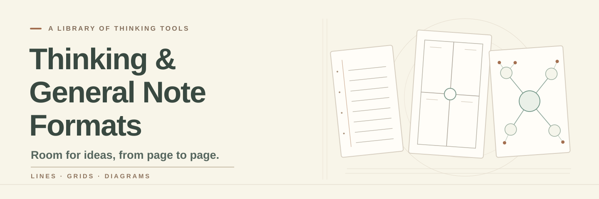

[繁體中文](README.md) · [English](README.en.md) · [日本語](README.ja.md)

線、格、圖。依用途找版型、看填寫示例，下載無字或附英文名稱的 PDF。

起因是手帳習慣。AI 時代，靈感跑進輸入框的速度比找筆還快，但我仍喜歡用線、格、圖整理思路。於是把這些工具畫成可列印、可修改的版型：替手帳留個紀念，也讓它繼續上班。

144 款可下載格式・127 種幾何。[共用幾何對照](docs/GEOMETRY-GROUPS.md)

## 開始使用

- [快速開始](QUICKSTART.md)
- [依用途選擇](docs/zh-TW/choose.md)
- [完整目錄](docs/zh-TW/catalog.md)
- [列印](docs/zh-TW/print.md)
- [修改](docs/zh-TW/customize.md)
- [貢獻](docs/zh-TW/contribute.md)
- [術語表](docs/zh-TW/glossary.md)

## 全部版型：依類別展開

展開類別瀏覽；點名稱看完整用法與來源，點圖片放大。

<strong>基本書寫</strong> · 8

### [全空白頁](templates/blank/README.zh-TW.md) · `blank`

讓文字、草圖與位置關係完全由使用者決定。

**實際填寫示例：** 示例是虛構的社區花園構想：把植物、工具與照料時間寫在不同位置，再以連線標出關聯；空白下載仍完全無字。

<a href="templates/blank/examples/zh-TW.svg">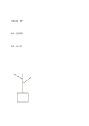</a>

[無字 PDF](templates/blank/exports/a5-draft/blank.pdf) · [英文名稱 PDF](templates/blank/exports/a5-draft/titled.pdf) · [SVG](templates/blank/exports/a5-draft/blank.svg) · [深色 PDF](templates/blank/exports/a5-contrast/blank.pdf)

### [窄行距橫線](templates/ruled-narrow/README.zh-TW.md) · `ruled-narrow`

<a href="templates/ruled-narrow/previews/a5-draft.png">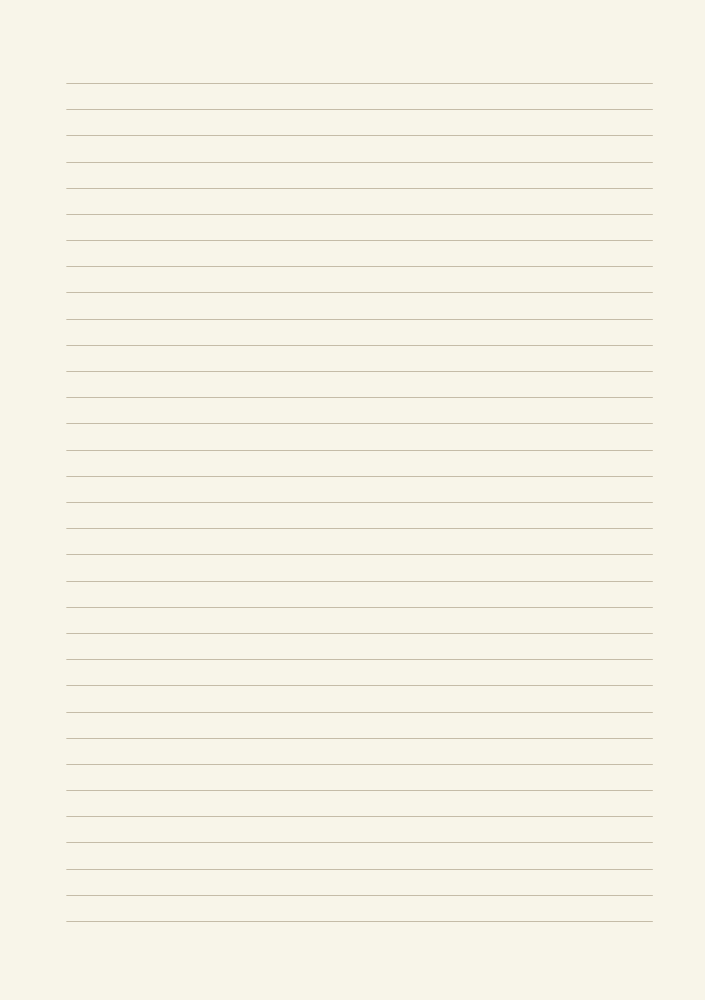</a>

以固定行距連續記錄句子，保留整頁自由書寫的空間。 本款的幾何變化： 橫線行距: 5.5 mm.

**實際填寫示例：** 示例記錄一次虛構的社區讀書會：先寫活動目標，再記場地、流程、尚待確認的設備，最後留下下一次討論的問題。 示例以虛構資料在對應區域放入短語，示意填寫位置；不是實測或完整研究結論。

<a href="templates/ruled-narrow/examples/zh-TW.svg">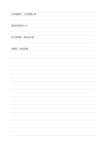</a>

[無字 PDF](templates/ruled-narrow/exports/a5-draft/blank.pdf) · [英文名稱 PDF](templates/ruled-narrow/exports/a5-draft/titled.pdf) · [SVG](templates/ruled-narrow/exports/a5-draft/blank.svg) · [深色 PDF](templates/ruled-narrow/exports/a5-contrast/blank.pdf)

### [橫線筆記](templates/ruled-standard/README.zh-TW.md) · `ruled-standard`

以固定行距連續記錄句子，保留整頁自由書寫的空間。

**實際填寫示例：** 示例記錄一次虛構的社區讀書會：先寫活動目標，再記場地、流程、尚待確認的設備，最後留下下一次討論的問題。

<a href="templates/ruled-standard/examples/zh-TW.svg">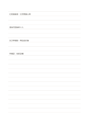</a>

[無字 PDF](templates/ruled-standard/exports/a5-draft/blank.pdf) · [英文名稱 PDF](templates/ruled-standard/exports/a5-draft/titled.pdf) · [SVG](templates/ruled-standard/exports/a5-draft/blank.svg) · [深色 PDF](templates/ruled-standard/exports/a5-contrast/blank.pdf)

### [寬行距橫線](templates/ruled-wide/README.zh-TW.md) · `ruled-wide`

<a href="templates/ruled-wide/previews/a5-draft.png">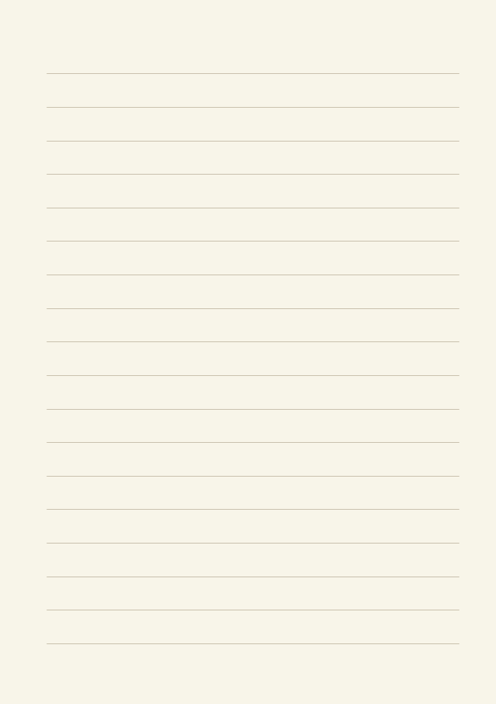</a>

以固定行距連續記錄句子，保留整頁自由書寫的空間。 本款的幾何變化： 橫線行距: 10 mm.

**實際填寫示例：** 示例記錄一次虛構的社區讀書會：先寫活動目標，再記場地、流程、尚待確認的設備，最後留下下一次討論的問題。 示例以虛構資料在對應區域放入短語，示意填寫位置；不是實測或完整研究結論。

<a href="templates/ruled-wide/examples/zh-TW.svg">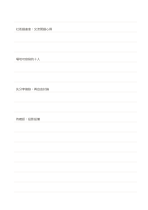</a>

[無字 PDF](templates/ruled-wide/exports/a5-draft/blank.pdf) · [英文名稱 PDF](templates/ruled-wide/exports/a5-draft/titled.pdf) · [SVG](templates/ruled-wide/exports/a5-draft/blank.svg) · [深色 PDF](templates/ruled-wide/exports/a5-contrast/blank.pdf)

### [雙線書寫紙](templates/ruled-double/README.zh-TW.md) · `ruled-double`

每組兩條橫線形成一個書寫帶，幫助控制字高與間距。

**實際填寫示例：** 示例以虛構植物觀察的三句短語練習等高書寫，逐行比較字高與行間。

<a href="templates/ruled-double/examples/zh-TW.svg">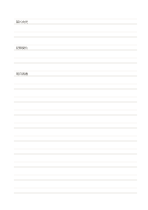</a>

[無字 PDF](templates/ruled-double/exports/a5-draft/blank.pdf) · [英文名稱 PDF](templates/ruled-double/exports/a5-draft/titled.pdf) · [SVG](templates/ruled-double/exports/a5-draft/blank.svg) · [深色 PDF](templates/ruled-double/exports/a5-contrast/blank.pdf)

### [三段短句橫線](templates/ruled-segmented/README.zh-TW.md) · `ruled-segmented`

把每一行拆成三個短寫區，方便並列記錄相關的短項目。

**實際填寫示例：** 以虛構的植物觀察為例，三段分別記時間、看到的現象和想追問的事。

<a href="templates/ruled-segmented/examples/zh-TW.svg">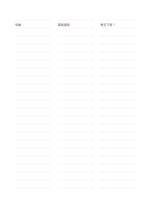</a>

[無字 PDF](templates/ruled-segmented/exports/a5-draft/blank.pdf) · [英文名稱 PDF](templates/ruled-segmented/exports/a5-draft/titled.pdf) · [SVG](templates/ruled-segmented/exports/a5-draft/blank.svg) · [深色 PDF](templates/ruled-segmented/exports/a5-contrast/blank.pdf)

### [側欄橫線筆記](templates/ruled-margin/README.zh-TW.md) · `ruled-margin`

保留一條窄側欄放索引或記號，主要區域仍可連續書寫。

**實際填寫示例：** 示例在側欄記虛構文章的頁次，主區記作者提出的觀察及自己待查的問題。

<a href="templates/ruled-margin/examples/zh-TW.svg">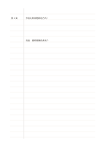</a>

[無字 PDF](templates/ruled-margin/exports/a5-draft/blank.pdf) · [英文名稱 PDF](templates/ruled-margin/exports/a5-draft/titled.pdf) · [SVG](templates/ruled-margin/exports/a5-draft/blank.svg) · [深色 PDF](templates/ruled-margin/exports/a5-contrast/blank.pdf)

### [上圖下文筆記](templates/ruled-sketch-top/README.zh-TW.md) · `ruled-sketch-top`

先在大留白區畫概念，再在下方橫線區說明。

**實際填寫示例：** 示例上方概略畫虛構雨水收集器，下方記入口、濾網與待測的容量問題。

<a href="templates/ruled-sketch-top/examples/zh-TW.svg">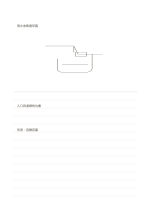</a>

[無字 PDF](templates/ruled-sketch-top/exports/a5-draft/blank.pdf) · [英文名稱 PDF](templates/ruled-sketch-top/exports/a5-draft/titled.pdf) · [SVG](templates/ruled-sketch-top/exports/a5-draft/blank.svg) · [深色 PDF](templates/ruled-sketch-top/exports/a5-contrast/blank.pdf)

<strong>方格與點陣</strong> · 8

### [細方格](templates/grid-fine/README.zh-TW.md) · `grid-fine`

<a href="templates/grid-fine/previews/a5-draft.png">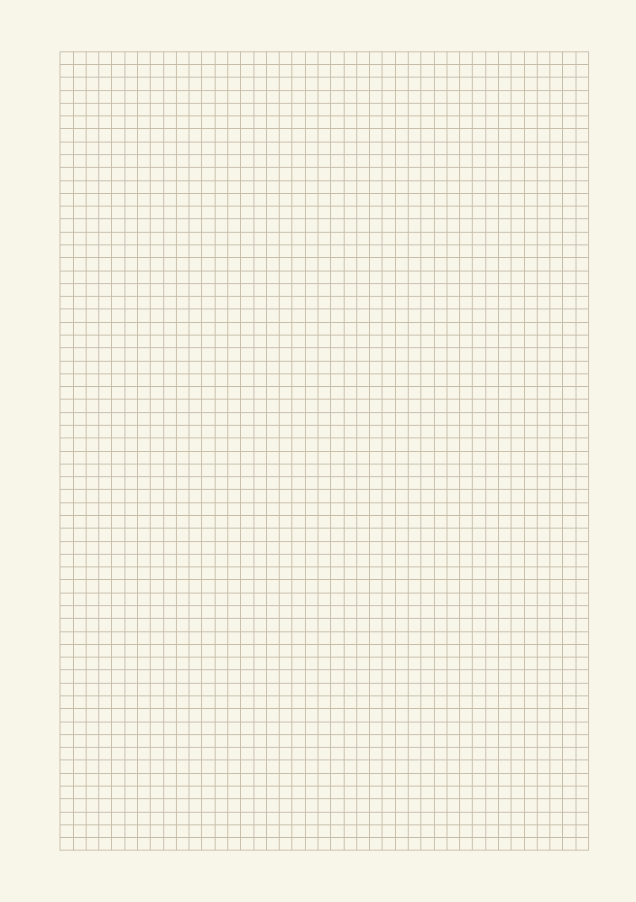</a>

用等距方格對齊短語、簡圖與比例草稿。 本款的幾何變化： 方格間距: 3 mm.

**實際填寫示例：** 示例用幾格表示虛構閱讀角的桌、椅與通道，旁邊記下要量測的寬度。 示例以虛構資料在對應區域放入短語，示意填寫位置；不是實測或完整研究結論。

<a href="templates/grid-fine/examples/zh-TW.svg">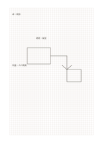</a>

[無字 PDF](templates/grid-fine/exports/a5-draft/blank.pdf) · [英文名稱 PDF](templates/grid-fine/exports/a5-draft/titled.pdf) · [SVG](templates/grid-fine/exports/a5-draft/blank.svg) · [深色 PDF](templates/grid-fine/exports/a5-contrast/blank.pdf)

### [方格筆記](templates/grid-standard/README.zh-TW.md) · `grid-standard`

用等距方格對齊短語、簡圖與比例草稿。

**實際填寫示例：** 示例用幾格表示虛構閱讀角的桌、椅與通道，旁邊記下要量測的寬度。

<a href="templates/grid-standard/examples/zh-TW.svg">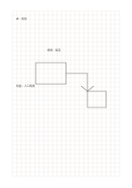</a>

[無字 PDF](templates/grid-standard/exports/a5-draft/blank.pdf) · [英文名稱 PDF](templates/grid-standard/exports/a5-draft/titled.pdf) · [SVG](templates/grid-standard/exports/a5-draft/blank.svg) · [深色 PDF](templates/grid-standard/exports/a5-contrast/blank.pdf)

### [大方格](templates/grid-large/README.zh-TW.md) · `grid-large`

用等距方格對齊短語、簡圖與比例草稿。 本款的幾何變化： 方格間距: 8 mm.

**實際填寫示例：** 示例用幾格表示虛構閱讀角的桌、椅與通道，旁邊記下要量測的寬度。 示例以虛構資料在對應區域放入短語，示意填寫位置；不是實測或完整研究結論。

<a href="templates/grid-large/examples/zh-TW.svg">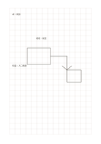</a>

[無字 PDF](templates/grid-large/exports/a5-draft/blank.pdf) · [英文名稱 PDF](templates/grid-large/exports/a5-draft/titled.pdf) · [SVG](templates/grid-large/exports/a5-draft/blank.svg) · [深色 PDF](templates/grid-large/exports/a5-contrast/blank.pdf)

### [細點陣](templates/dot-fine/README.zh-TW.md) · `dot-fine`

<a href="templates/dot-fine/previews/a5-draft.png">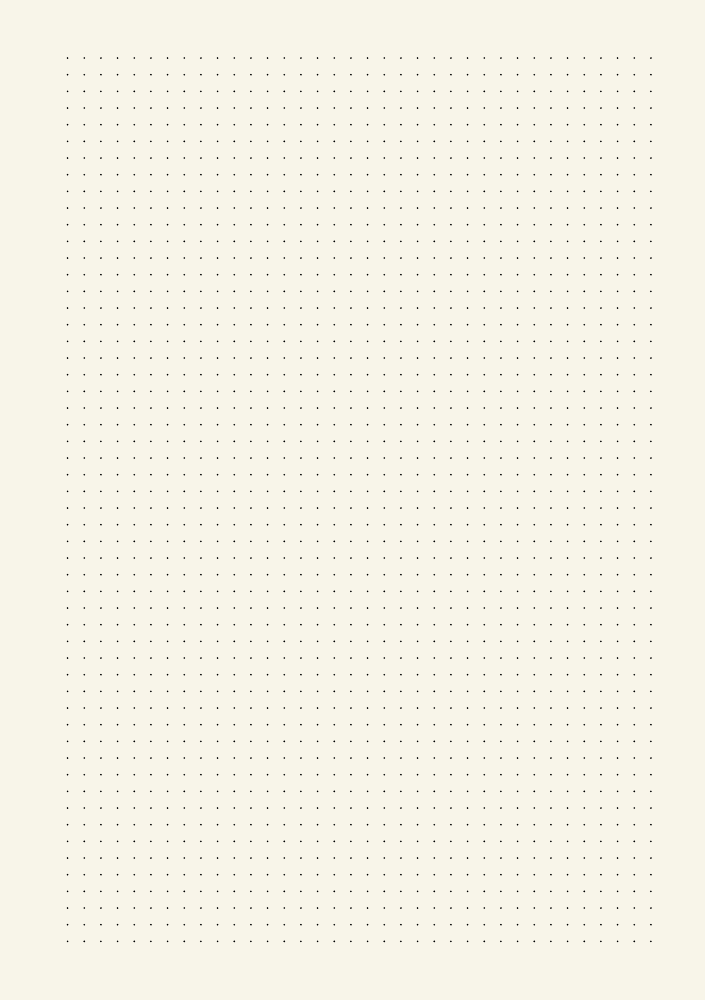</a>

以淡點輔助對齊，同時保留比方格更開放的書寫感。 本款的幾何變化： 點陣間距: 3.5 mm.

**實際填寫示例：** 示例把虛構社區活動的場地、材料與人員畫成三個對齊的短區塊。 示例以虛構資料在對應區域放入短語，示意填寫位置；不是實測或完整研究結論。

<a href="templates/dot-fine/examples/zh-TW.svg">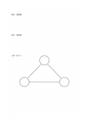</a>

[無字 PDF](templates/dot-fine/exports/a5-draft/blank.pdf) · [英文名稱 PDF](templates/dot-fine/exports/a5-draft/titled.pdf) · [SVG](templates/dot-fine/exports/a5-draft/blank.svg) · [深色 PDF](templates/dot-fine/exports/a5-contrast/blank.pdf)

### [等距點陣](templates/dot-standard/README.zh-TW.md) · `dot-standard`

以淡點輔助對齊，同時保留比方格更開放的書寫感。

**實際填寫示例：** 示例把虛構社區活動的場地、材料與人員畫成三個對齊的短區塊。

<a href="templates/dot-standard/examples/zh-TW.svg">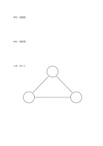</a>

[無字 PDF](templates/dot-standard/exports/a5-draft/blank.pdf) · [英文名稱 PDF](templates/dot-standard/exports/a5-draft/titled.pdf) · [SVG](templates/dot-standard/exports/a5-draft/blank.svg) · [深色 PDF](templates/dot-standard/exports/a5-contrast/blank.pdf)

### [交錯點陣](templates/dot-staggered/README.zh-TW.md) · `dot-staggered`

讓相鄰點列交錯，便於畫斜向與三角形配置。

**實際填寫示例：** 示例把虛構展場的三排展示台排成交錯列，再留一處通行缺口。

<a href="templates/dot-staggered/examples/zh-TW.svg">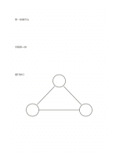</a>

[無字 PDF](templates/dot-staggered/exports/a5-draft/blank.pdf) · [英文名稱 PDF](templates/dot-staggered/exports/a5-draft/titled.pdf) · [SVG](templates/dot-staggered/exports/a5-draft/blank.svg) · [深色 PDF](templates/dot-staggered/exports/a5-contrast/blank.pdf)

### [總覽與細節方格](templates/grid-hierarchical/README.zh-TW.md) · `grid-hierarchical`

以大格規劃全局，再在中央細格區展開一個局部。

**實際填寫示例：** 示例把虛構閱讀角先分成座位、書架、通道，再在中央細格標出桌面配置。

<a href="templates/grid-hierarchical/examples/zh-TW.svg">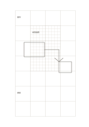</a>

[無字 PDF](templates/grid-hierarchical/exports/a5-draft/blank.pdf) · [英文名稱 PDF](templates/grid-hierarchical/exports/a5-draft/titled.pdf) · [SVG](templates/grid-hierarchical/exports/a5-draft/blank.svg) · [深色 PDF](templates/grid-hierarchical/exports/a5-contrast/blank.pdf)

### [左點右格](templates/dot-grid-split/README.zh-TW.md) · `dot-grid-split`

一頁同時保留自由連線的點陣與規整對齊的方格。

**實際填寫示例：** 示例左邊記虛構花園的植物關係，右邊把花盆數量與排列放到格上。

<a href="templates/dot-grid-split/examples/zh-TW.svg">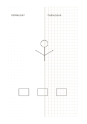</a>

[無字 PDF](templates/dot-grid-split/exports/a5-draft/blank.pdf) · [英文名稱 PDF](templates/dot-grid-split/exports/a5-draft/titled.pdf) · [SVG](templates/dot-grid-split/exports/a5-draft/blank.svg) · [深色 PDF](templates/dot-grid-split/exports/a5-contrast/blank.pdf)

<strong>幾何底紙</strong> · 8

### [三角網格](templates/triangular-grid/README.zh-TW.md) · `triangular-grid`

用三方向等距線條草擬斜向構造與三角分割。

**實際填寫示例：** 示例用三角網格標出虛構展架的三個支撐點和一條斜撐，旁邊保留待測尺寸。

<a href="templates/triangular-grid/examples/zh-TW.svg">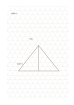</a>

[無字 PDF](templates/triangular-grid/exports/a5-draft/blank.pdf) · [英文名稱 PDF](templates/triangular-grid/exports/a5-draft/titled.pdf) · [SVG](templates/triangular-grid/exports/a5-draft/blank.svg) · [深色 PDF](templates/triangular-grid/exports/a5-contrast/blank.pdf)

### [等角三角格](templates/isometric-grid/README.zh-TW.md) · `isometric-grid`

利用三方向等距格線構思等角物件，尺寸仍須另行量測。

**實際填寫示例：** 依圖中填寫位置順序列出，每個編號是一筆示例條目：

1. 支撐點 A
2. 斜撐
3. 待測尺寸

[無字 PDF](templates/isometric-grid/exports/a5-draft/blank.pdf) · [英文名稱 PDF](templates/isometric-grid/exports/a5-draft/titled.pdf) · [SVG](templates/isometric-grid/exports/a5-draft/blank.svg) · [深色 PDF](templates/isometric-grid/exports/a5-contrast/blank.pdf)

### [六角蜂巢格](templates/hex-grid/README.zh-TW.md) · `hex-grid`

用相鄰六角格描述鄰接、群聚與路徑。

**實際填寫示例：** 示例把虛構展區的入口、展示台與休息處放入相鄰蜂巢格，再描出一條參觀路徑。

<a href="templates/hex-grid/examples/zh-TW.svg">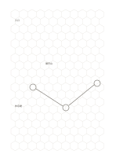</a>

[無字 PDF](templates/hex-grid/exports/a5-draft/blank.pdf) · [英文名稱 PDF](templates/hex-grid/exports/a5-draft/titled.pdf) · [SVG](templates/hex-grid/exports/a5-draft/blank.svg) · [深色 PDF](templates/hex-grid/exports/a5-contrast/blank.pdf)

### [菱形網格](templates/rhombus-grid/README.zh-TW.md) · `rhombus-grid`

以兩組交叉斜線形成菱形，方便觀察旋轉後的方格配置。

**實際填寫示例：** 示例用菱格草擬虛構地磚的斜向排列，標出入口與轉角位置。

<a href="templates/rhombus-grid/examples/zh-TW.svg">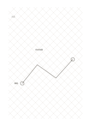</a>

[無字 PDF](templates/rhombus-grid/exports/a5-draft/blank.pdf) · [英文名稱 PDF](templates/rhombus-grid/exports/a5-draft/titled.pdf) · [SVG](templates/rhombus-grid/exports/a5-draft/blank.svg) · [深色 PDF](templates/rhombus-grid/exports/a5-contrast/blank.pdf)

### [分帶斜向導線](templates/diagonal-guides/README.zh-TW.md) · `diagonal-guides`

以四段寬帶中的斜線協助草擬方向、坡度與變化。

**實際填寫示例：** 示例在四段中比較虛構展場的四種引導路線，分別記起點與終點。

<a href="templates/diagonal-guides/examples/zh-TW.svg">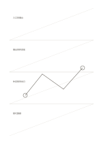</a>

[無字 PDF](templates/diagonal-guides/exports/a5-draft/blank.pdf) · [英文名稱 PDF](templates/diagonal-guides/exports/a5-draft/titled.pdf) · [SVG](templates/diagonal-guides/exports/a5-draft/blank.svg) · [深色 PDF](templates/diagonal-guides/exports/a5-contrast/blank.pdf)

### [放射極座標紙](templates/radial-polar/README.zh-TW.md) · `radial-polar`

用同心圓與放射線整理距離中心的層次及方向。

**實際填寫示例：** 示例以虛構小廣場為中心，標出入口、座位、植栽與周邊步道的大致方向。

<a href="templates/radial-polar/examples/zh-TW.svg">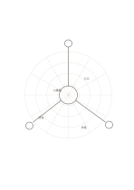</a>

[無字 PDF](templates/radial-polar/exports/a5-draft/blank.pdf) · [英文名稱 PDF](templates/radial-polar/exports/a5-draft/titled.pdf) · [SVG](templates/radial-polar/exports/a5-draft/blank.svg) · [深色 PDF](templates/radial-polar/exports/a5-contrast/blank.pdf)

### [無數字座標軸](templates/coordinate-grid/README.zh-TW.md) · `coordinate-grid`

用兩條中央軸與刻線觀察兩個量的方向和相對位置。

**實際填寫示例：** 示例以虛構活動的準備時間與參與人數為兩軸，暫放四個構想，之後再查數值。

[無字 PDF](templates/coordinate-grid/exports/a5-draft/blank.pdf) · [英文名稱 PDF](templates/coordinate-grid/exports/a5-draft/titled.pdf) · [SVG](templates/coordinate-grid/exports/a5-draft/blank.svg) · [深色 PDF](templates/coordinate-grid/exports/a5-contrast/blank.pdf)

### [工程主線方格](templates/engineering-grid/README.zh-TW.md) · `engineering-grid`

<a href="templates/engineering-grid/previews/a5-draft.png">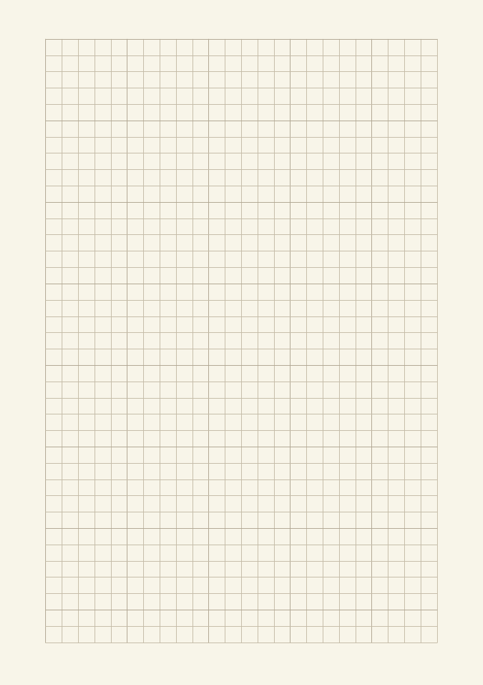</a>

用等距方格對齊短語、簡圖與比例草稿。 本款的幾何變化： 每五格有較明顯的主線。

**實際填寫示例：** 示例用幾格表示虛構閱讀角的桌、椅與通道，旁邊記下要量測的寬度。 示例以虛構資料在對應區域放入短語，示意填寫位置；不是實測或完整研究結論。

<a href="templates/engineering-grid/examples/zh-TW.svg">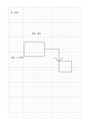</a>

[無字 PDF](templates/engineering-grid/exports/a5-draft/blank.pdf) · [英文名稱 PDF](templates/engineering-grid/exports/a5-draft/titled.pdf) · [SVG](templates/engineering-grid/exports/a5-draft/blank.svg) · [深色 PDF](templates/engineering-grid/exports/a5-contrast/blank.pdf)

<strong>分欄</strong> · 8

### [等寬雙欄](templates/two-equal-columns/README.zh-TW.md) · `two-equal-columns`

讓兩組同等重要的內容並排，逐行或整體對照。

**實際填寫示例：** 示例把虛構展覽的紙本導覽與口頭導覽並列，對照可取得的資訊與疑問。

[無字 PDF](templates/two-equal-columns/exports/a5-draft/blank.pdf) · [英文名稱 PDF](templates/two-equal-columns/exports/a5-draft/titled.pdf) · [SVG](templates/two-equal-columns/exports/a5-draft/blank.svg) · [深色 PDF](templates/two-equal-columns/exports/a5-contrast/blank.pdf)

### [窄左欄主筆記](templates/two-left-narrow/README.zh-TW.md) · `two-left-narrow`

窄欄放參照線索，寬欄保留大幅連續書寫或作圖空間。

**實際填寫示例：** 示例以虛構訪談為題，左欄放『場地』線索，右欄記受訪者描述的空間安排。

[無字 PDF](templates/two-left-narrow/exports/a5-draft/blank.pdf) · [英文名稱 PDF](templates/two-left-narrow/exports/a5-draft/titled.pdf) · [SVG](templates/two-left-narrow/exports/a5-draft/blank.svg) · [深色 PDF](templates/two-left-narrow/exports/a5-contrast/blank.pdf)

### [右窄欄筆記](templates/two-right-narrow/README.zh-TW.md) · `two-right-narrow`

將短來源與待查問題放在右側窄欄，左側留給連續筆記或草圖。

**實際填寫示例：** 依圖中填寫位置順序列出，每個編號是一筆示例條目：

1. 場地
2. 入口靠近書架，座位在窗邊。

[無字 PDF](templates/two-right-narrow/exports/a5-draft/blank.pdf) · [英文名稱 PDF](templates/two-right-narrow/exports/a5-draft/titled.pdf) · [SVG](templates/two-right-narrow/exports/a5-draft/blank.svg) · [深色 PDF](templates/two-right-narrow/exports/a5-contrast/blank.pdf)

### [等寬三欄](templates/three-columns/README.zh-TW.md) · `three-columns`

讓三組平行資訊同頁對照，保留各自的完整縱向脈絡。

**實際填寫示例：** 示例比較虛構讀書會的三種場地：圖書館、社區中心與戶外亭。

<a href="templates/three-columns/examples/zh-TW.svg">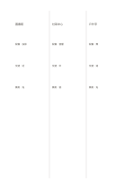</a>

[無字 PDF](templates/three-columns/exports/a5-draft/blank.pdf) · [英文名稱 PDF](templates/three-columns/exports/a5-draft/titled.pdf) · [SVG](templates/three-columns/exports/a5-draft/blank.svg) · [深色 PDF](templates/three-columns/exports/a5-contrast/blank.pdf)

### [康乃爾式筆記頁](templates/cornell/README.zh-TW.md) · `cornell`

把提示、詳細筆記與頁末摘要分開，方便回想與整理。

**實際填寫示例：** 虛構的植物觀察課：右欄記日照與葉片變化，左欄提出『日照如何影響葉色？』，底欄寫目前可支持的簡短結論。

<a href="templates/cornell/examples/zh-TW.svg">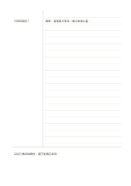</a>

[無字 PDF](templates/cornell/exports/a5-draft/blank.pdf) · [英文名稱 PDF](templates/cornell/exports/a5-draft/titled.pdf) · [SVG](templates/cornell/exports/a5-draft/blank.svg) · [深色 PDF](templates/cornell/exports/a5-contrast/blank.pdf)

### [康乃爾式筆記頁（右提示欄）](templates/cornell-mirrored/README.zh-TW.md) · `cornell-mirrored`

把康乃爾提示欄移到右側，左側保留主筆記，下方總結用於回想。

**實際填寫示例：** 依圖中填寫位置順序列出，每個編號是一筆示例條目：

1. 日照與葉色？
2. 觀察：窗邊葉片較深。需比較澆水量。
3. 目前只看到相關性，還不能確定原因。

<a href="templates/cornell-mirrored/examples/zh-TW.svg">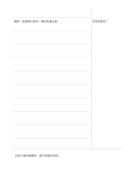</a>

[無字 PDF](templates/cornell-mirrored/exports/a5-draft/blank.pdf) · [英文名稱 PDF](templates/cornell-mirrored/exports/a5-draft/titled.pdf) · [SVG](templates/cornell-mirrored/exports/a5-draft/blank.svg) · [深色 PDF](templates/cornell-mirrored/exports/a5-contrast/blank.pdf)

### [左線右點筆記](templates/column-dot-main/README.zh-TW.md) · `column-dot-main`

左欄逐行列線索，右側用點陣畫對應結構。

**實際填寫示例：** 示例左欄列虛構花園的入口與座位，右側把兩處畫在點陣上，並標出動線。

<a href="templates/column-dot-main/examples/zh-TW.svg">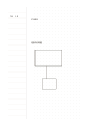</a>

[無字 PDF](templates/column-dot-main/exports/a5-draft/blank.pdf) · [英文名稱 PDF](templates/column-dot-main/exports/a5-draft/titled.pdf) · [SVG](templates/column-dot-main/exports/a5-draft/blank.svg) · [深色 PDF](templates/column-dot-main/exports/a5-contrast/blank.pdf)

### [雙欄加總結](templates/two-columns-summary/README.zh-TW.md) · `two-columns-summary`

先保留兩邊的不同觀點，再在底部寫一個整合結論。

**實際填寫示例：** 示例上方比較虛構讀書會的室內與戶外場地，底部寫出天候是選址的待查條件。

[無字 PDF](templates/two-columns-summary/exports/a5-draft/blank.pdf) · [英文名稱 PDF](templates/two-columns-summary/exports/a5-draft/titled.pdf) · [SVG](templates/two-columns-summary/exports/a5-draft/blank.svg) · [深色 PDF](templates/two-columns-summary/exports/a5-contrast/blank.pdf)

<strong>卡片</strong> · 8

### [上下雙卡](templates/two-stacked-cards/README.zh-TW.md) · `two-stacked-cards`

用上下兩張獨立卡片記錄兩個階段或兩種觀點。

**實際填寫示例：** 示例上卡記虛構展覽的進場觀察，下卡記離場後仍有的問題。

<a href="templates/two-stacked-cards/examples/zh-TW.svg">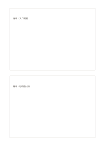</a>

[無字 PDF](templates/two-stacked-cards/exports/a5-draft/blank.pdf) · [英文名稱 PDF](templates/two-stacked-cards/exports/a5-draft/titled.pdf) · [SVG](templates/two-stacked-cards/exports/a5-draft/blank.svg) · [深色 PDF](templates/two-stacked-cards/exports/a5-contrast/blank.pdf)

### [上下三卡](templates/three-stacked-cards/README.zh-TW.md) · `three-stacked-cards`

將前、中、後三段資訊分開記錄，再檢查順序。 本款的幾何變化： 上下卡片數: 3.

**實際填寫示例：** 依圖中填寫位置順序列出，每個編號是一筆示例條目：

1. 入口：清楚指引
2. 活動中：找到書
3. 活動後：整理回饋

<a href="templates/three-stacked-cards/examples/zh-TW.svg">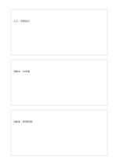</a>

[無字 PDF](templates/three-stacked-cards/exports/a5-draft/blank.pdf) · [英文名稱 PDF](templates/three-stacked-cards/exports/a5-draft/titled.pdf) · [SVG](templates/three-stacked-cards/exports/a5-draft/blank.svg) · [深色 PDF](templates/three-stacked-cards/exports/a5-contrast/blank.pdf)

### [四張獨立卡](templates/four-cards/README.zh-TW.md) · `four-cards`

將四個小主題各放入有留白間隔的獨立區塊。

**實際填寫示例：** 示例把虛構社區活動的場地、材料、邀請與流程分別放在四張卡。

<a href="templates/four-cards/examples/zh-TW.svg">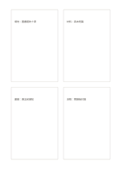</a>

[無字 PDF](templates/four-cards/exports/a5-draft/blank.pdf) · [英文名稱 PDF](templates/four-cards/exports/a5-draft/titled.pdf) · [SVG](templates/four-cards/exports/a5-draft/blank.svg) · [深色 PDF](templates/four-cards/exports/a5-contrast/blank.pdf)

### [六張獨立卡](templates/six-cards/README.zh-TW.md) · `six-cards`

<a href="templates/six-cards/previews/a5-draft.png">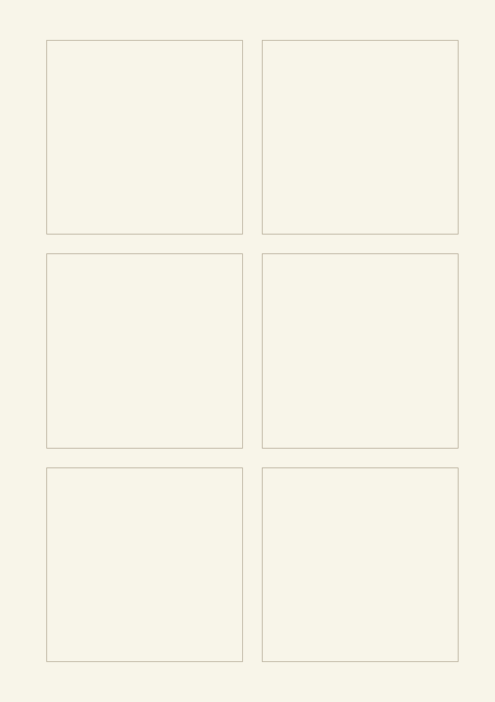</a>

將多個候選想法放進各自的獨立卡片，再比較或排序。 本款的幾何變化： 獨立卡片數: 6.

**實際填寫示例：** 依圖中填寫位置順序列出，每個編號是一筆示例條目：

1. 圖書館十席
2. 四本短篇
3. 週五前通知
4. 週六下午
5. 兩人引導
6. 收回饋卡

<a href="templates/six-cards/examples/zh-TW.svg">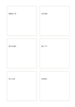</a>

[無字 PDF](templates/six-cards/exports/a5-draft/blank.pdf) · [英文名稱 PDF](templates/six-cards/exports/a5-draft/titled.pdf) · [SVG](templates/six-cards/exports/a5-draft/blank.svg) · [深色 PDF](templates/six-cards/exports/a5-contrast/blank.pdf)

### [八張獨立卡](templates/eight-cards/README.zh-TW.md) · `eight-cards`

將多個候選想法放進各自的獨立卡片，再比較或排序。 本款的幾何變化： 獨立卡片數: 8.

**實際填寫示例：** 依圖中填寫位置順序列出，每個編號是一筆示例條目：

1. 圖書館十席
2. 四本短篇
3. 週五前通知
4. 週六下午
5. 兩人引導
6. 預算待查
7. 通道留空
8. 收回饋卡

<a href="templates/eight-cards/examples/zh-TW.svg">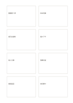</a>

[無字 PDF](templates/eight-cards/exports/a5-draft/blank.pdf) · [英文名稱 PDF](templates/eight-cards/exports/a5-draft/titled.pdf) · [SVG](templates/eight-cards/exports/a5-draft/blank.svg) · [深色 PDF](templates/eight-cards/exports/a5-contrast/blank.pdf)

### [中心與四衛星卡](templates/center-four-satellites/README.zh-TW.md) · `center-four-satellites`

把核心主題放中央，四個方向各記一種相連的因素。

**實際填寫示例：** 示例以虛構讀書會為中心，周圍列出場地、時間、選書與邀請。

<a href="templates/center-four-satellites/examples/zh-TW.svg">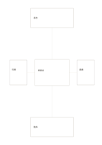</a>

[無字 PDF](templates/center-four-satellites/exports/a5-draft/blank.pdf) · [英文名稱 PDF](templates/center-four-satellites/exports/a5-draft/titled.pdf) · [SVG](templates/center-four-satellites/exports/a5-draft/blank.svg) · [深色 PDF](templates/center-four-satellites/exports/a5-contrast/blank.pdf)

### [主卡加三輔卡](templates/hero-three-cards/README.zh-TW.md) · `hero-three-cards`

上方給主要構想較大空間，下方保留三個支持面向。

**實際填寫示例：** 示例的大卡是虛構雨水收集器，下方分記材料、使用者與待測風險。

<a href="templates/hero-three-cards/examples/zh-TW.svg">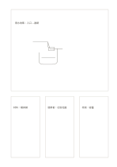</a>

[無字 PDF](templates/hero-three-cards/exports/a5-draft/blank.pdf) · [英文名稱 PDF](templates/hero-three-cards/exports/a5-draft/titled.pdf) · [SVG](templates/hero-three-cards/exports/a5-draft/blank.svg) · [深色 PDF](templates/hero-three-cards/exports/a5-contrast/blank.pdf)

### [不等比分格卡](templates/mosaic-cards/README.zh-TW.md) · `mosaic-cards`

用大小不同的四張卡區分主內容、補充資料與短註。

**實際填寫示例：** 示例以虛構閱讀角為主圖，其他卡分別記照明、座位和待測的動線。

<a href="templates/mosaic-cards/examples/zh-TW.svg">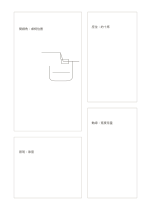</a>

[無字 PDF](templates/mosaic-cards/exports/a5-draft/blank.pdf) · [英文名稱 PDF](templates/mosaic-cards/exports/a5-draft/titled.pdf) · [SVG](templates/mosaic-cards/exports/a5-draft/blank.svg) · [深色 PDF](templates/mosaic-cards/exports/a5-contrast/blank.pdf)

<strong>比較</strong> · 8

### [T 形比較](templates/t-comparison/README.zh-TW.md) · `t-comparison`

先寫同一個問題，再把兩種答案分在下方左右。

**實際填寫示例：** 示例上方問虛構讀書會應在何處辦，左右比較圖書館與戶外亭。

[無字 PDF](templates/t-comparison/exports/a5-draft/blank.pdf) · [英文名稱 PDF](templates/t-comparison/exports/a5-draft/titled.pdf) · [SVG](templates/t-comparison/exports/a5-draft/blank.svg) · [深色 PDF](templates/t-comparison/exports/a5-contrast/blank.pdf)

### [三方比較](templates/three-way-comparison/README.zh-TW.md) · `three-way-comparison`

同一個問題下，把三種答案放到三個欄位對照。

**實際填寫示例：** 示例問虛構讀書會的場地，三欄比較圖書館、社區中心與戶外亭。

<a href="templates/three-way-comparison/examples/zh-TW.svg">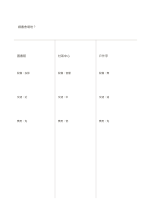</a>

[無字 PDF](templates/three-way-comparison/exports/a5-draft/blank.pdf) · [英文名稱 PDF](templates/three-way-comparison/exports/a5-draft/titled.pdf) · [SVG](templates/three-way-comparison/exports/a5-draft/blank.svg) · [深色 PDF](templates/three-way-comparison/exports/a5-contrast/blank.pdf)

### [雙圓交集圖](templates/venn-two/README.zh-TW.md) · `venn-two`

用兩個重疊圓區分各自特點與共同部分。

**實際填寫示例：** 示例比較虛構讀書會的室內與戶外活動：桌椅與遮蔭各在一側，共通的討論題在交集。

<a href="templates/venn-two/examples/zh-TW.svg">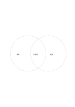</a>

[無字 PDF](templates/venn-two/exports/a5-draft/blank.pdf) · [英文名稱 PDF](templates/venn-two/exports/a5-draft/titled.pdf) · [SVG](templates/venn-two/exports/a5-draft/blank.svg) · [深色 PDF](templates/venn-two/exports/a5-contrast/blank.pdf)

### [三圓交集圖](templates/venn-three/README.zh-TW.md) · `venn-three`

同時查看三組內容的獨有、兩兩共通與三方共通部分。

**實際填寫示例：** 虛構的講座、工作坊與導覽：講者、工具、路線各自獨有；座位、問答、體驗屬兩兩交集；報名屬三方共通。

<a href="templates/venn-three/examples/zh-TW.svg">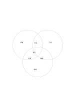</a>

[無字 PDF](templates/venn-three/exports/a5-draft/blank.pdf) · [英文名稱 PDF](templates/venn-three/exports/a5-draft/titled.pdf) · [SVG](templates/venn-three/exports/a5-draft/blank.svg) · [深色 PDF](templates/venn-three/exports/a5-contrast/blank.pdf)

### [雙核心氣泡比較](templates/double-bubble/README.zh-TW.md) · `double-bubble`

兩個中心主題連向共通與各自獨有的短特徵。

**實際填寫示例：** 示例比較紙本與口頭導覽；路線和資訊是共通點，可留存與可提問是各自特色。

<a href="templates/double-bubble/examples/zh-TW.svg">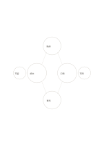</a>

[無字 PDF](templates/double-bubble/exports/a5-draft/blank.pdf) · [英文名稱 PDF](templates/double-bubble/exports/a5-draft/titled.pdf) · [SVG](templates/double-bubble/exports/a5-draft/blank.svg) · [深色 PDF](templates/double-bubble/exports/a5-contrast/blank.pdf)

### [橋接類比](templates/bridge-analogy/README.zh-TW.md) · `bridge-analogy`

把兩個不同主題放在橋的兩端，逐項說明可類比的部分。

**實際填寫示例：** 示例把圖書館借書和線上借閱放兩端，橋上記入口、查找與取得的對應。

<a href="templates/bridge-analogy/examples/zh-TW.svg">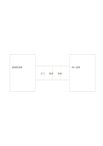</a>

[無字 PDF](templates/bridge-analogy/exports/a5-draft/blank.pdf) · [英文名稱 PDF](templates/bridge-analogy/exports/a5-draft/titled.pdf) · [SVG](templates/bridge-analogy/exports/a5-draft/blank.svg) · [深色 PDF](templates/bridge-analogy/exports/a5-contrast/blank.pdf)

### [成對比較卡](templates/mirrored-compare-cards/README.zh-TW.md) · `mirrored-compare-cards`

以四張卡成對比較兩個場地。

**實際填寫示例：** 依圖中填寫位置順序列出，每個編號是一筆示例條目：

1. 圖書館：免費
2. 戶外亭：開放
3. 圖書館：避雨
4. 戶外亭：易受天候影響

<a href="templates/mirrored-compare-cards/examples/zh-TW.svg">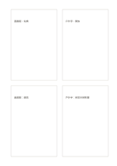</a>

[無字 PDF](templates/mirrored-compare-cards/exports/a5-draft/blank.pdf) · [英文名稱 PDF](templates/mirrored-compare-cards/exports/a5-draft/titled.pdf) · [SVG](templates/mirrored-compare-cards/exports/a5-draft/blank.svg) · [深色 PDF](templates/mirrored-compare-cards/exports/a5-contrast/blank.pdf)

### [交叉比較四區](templates/cross-compare/README.zh-TW.md) · `cross-compare`

以兩個選定標準把四個方案分入交叉區域，比較取捨。

**實際填寫示例：** 依圖中填寫位置順序列出，每個編號是一筆示例條目：

1. 提問：高價值低投入
2. 告示：低價值低投入
3. 互動練習：高價值高投入
4. 長講義：低價值高投入

[無字 PDF](templates/cross-compare/exports/a5-draft/blank.pdf) · [英文名稱 PDF](templates/cross-compare/exports/a5-draft/titled.pdf) · [SVG](templates/cross-compare/exports/a5-draft/blank.svg) · [深色 PDF](templates/cross-compare/exports/a5-contrast/blank.pdf)

<strong>矩陣與象限</strong> · 8

### [四象限筆記](templates/quadrant/README.zh-TW.md) · `quadrant`

用兩個自訂面向把想法分成四區，觀察分布與缺口。

**實際填寫示例：** 虛構的小型工作坊規劃：把現場示範、完整互動教材、提問時間與長篇講義依參與價值和準備投入暫時分區。

[無字 PDF](templates/quadrant/exports/a5-draft/blank.pdf) · [英文名稱 PDF](templates/quadrant/exports/a5-draft/titled.pdf) · [SVG](templates/quadrant/exports/a5-draft/blank.svg) · [深色 PDF](templates/quadrant/exports/a5-contrast/blank.pdf)

### [中心整合四象限](templates/quadrant-center-circle/README.zh-TW.md) · `quadrant-center-circle`

先分四區整理觀點，再把共同結論放進中央圓。

**實際填寫示例：** 示例把虛構讀書會的場地、材料、人員、時間放四區，中央寫共同的『先試辦』決定。

<a href="templates/quadrant-center-circle/examples/zh-TW.svg">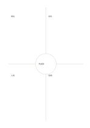</a>

[無字 PDF](templates/quadrant-center-circle/exports/a5-draft/blank.pdf) · [英文名稱 PDF](templates/quadrant-center-circle/exports/a5-draft/titled.pdf) · [SVG](templates/quadrant-center-circle/exports/a5-draft/blank.svg) · [深色 PDF](templates/quadrant-center-circle/exports/a5-contrast/blank.pdf)

### [二列三欄矩陣](templates/matrix-2x3/README.zh-TW.md) · `matrix-2x3`

用六個相連格記兩類條件與三種選項的交會。

**實際填寫示例：** 示例把虛構讀書會的圖書館、社區中心、戶外亭放三欄，設備與交通放兩列。

<a href="templates/matrix-2x3/examples/zh-TW.svg">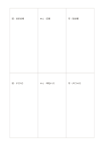</a>

[無字 PDF](templates/matrix-2x3/exports/a5-draft/blank.pdf) · [英文名稱 PDF](templates/matrix-2x3/exports/a5-draft/titled.pdf) · [SVG](templates/matrix-2x3/exports/a5-draft/blank.svg) · [深色 PDF](templates/matrix-2x3/exports/a5-contrast/blank.pdf)

### [二欄三行比較矩陣](templates/matrix-3x2/README.zh-TW.md) · `matrix-3x2`

<a href="templates/matrix-3x2/previews/a5-draft.png">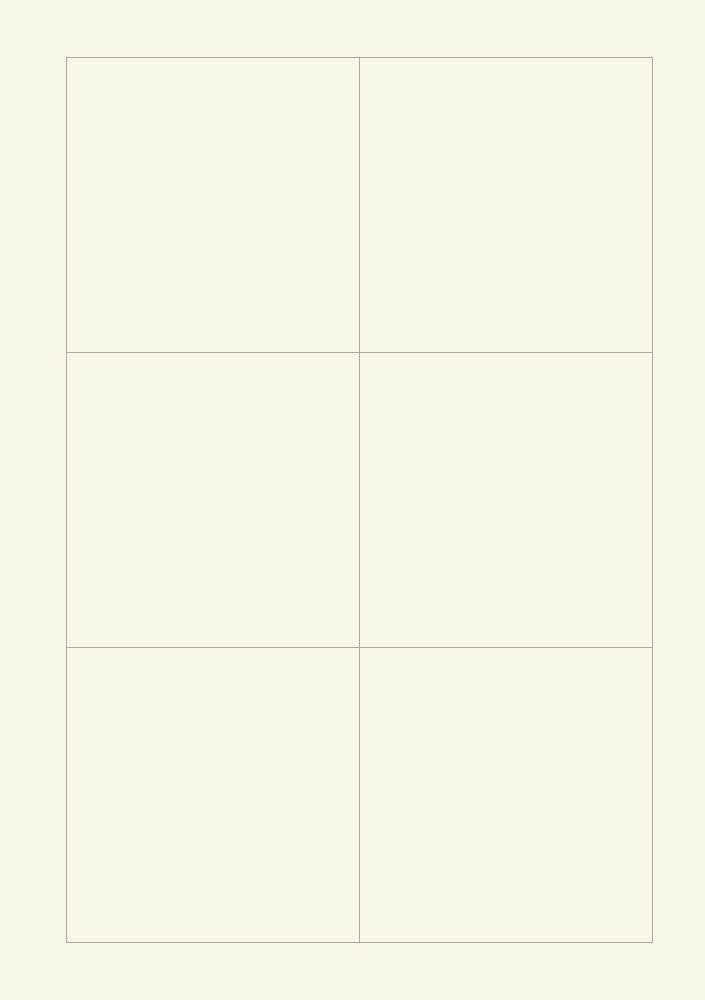</a>

先定義橫向方案與縱向條件，再逐格記錄交叉資訊。 本款的幾何變化： 矩陣的欄乘列: 2×3.

**實際填寫示例：** 依圖中填寫位置順序列出，每個編號是一筆示例條目：

1. 館：有投影
2. 中心：有音響
3. 館：步行5分
4. 中心：車程15分
5. 館：免費
6. 中心：低費用

[無字 PDF](templates/matrix-3x2/exports/a5-draft/blank.pdf) · [英文名稱 PDF](templates/matrix-3x2/exports/a5-draft/titled.pdf) · [SVG](templates/matrix-3x2/exports/a5-draft/blank.svg) · [深色 PDF](templates/matrix-3x2/exports/a5-contrast/blank.pdf)

### [三乘三比較矩陣](templates/matrix-3x3/README.zh-TW.md) · `matrix-3x3`

用九個等大連續儲存格，交叉記錄三個方案與三項條件；沒有九宮格的中心向外發想語意。

**實際填寫示例：** 虛構的圖書館、社區中心、戶外亭分別在設備、交通與費用三行留下待核對的短記。

[無字 PDF](templates/matrix-3x3/exports/a5-draft/blank.pdf) · [英文名稱 PDF](templates/matrix-3x3/exports/a5-draft/titled.pdf) · [SVG](templates/matrix-3x3/exports/a5-draft/blank.svg) · [深色 PDF](templates/matrix-3x3/exports/a5-contrast/blank.pdf)

### [座標軸比較](templates/axis-matrix/README.zh-TW.md) · `axis-matrix`

將方案放在有刻度的兩軸上，核對方向與相對位置。

**實際填寫示例：** 依圖中填寫位置順序列出，每個編號是一筆示例條目：

1. 小型導覽
2. 互動展板
3. 現場示範
4. 長篇講座

[無字 PDF](templates/axis-matrix/exports/a5-draft/blank.pdf) · [英文名稱 PDF](templates/axis-matrix/exports/a5-draft/titled.pdf) · [SVG](templates/axis-matrix/exports/a5-draft/blank.svg) · [深色 PDF](templates/axis-matrix/exports/a5-contrast/blank.pdf)

### [環帶四象限](templates/quadrant-rings/README.zh-TW.md) · `quadrant-rings`

同時用方向分區與距中心遠近兩層整理內容。

**實際填寫示例：** 示例把虛構社區花園的四方位分區，每區內圈記近期可做的事、外圈記待協調事項。

[無字 PDF](templates/quadrant-rings/exports/a5-draft/blank.pdf) · [英文名稱 PDF](templates/quadrant-rings/exports/a5-draft/titled.pdf) · [SVG](templates/quadrant-rings/exports/a5-draft/blank.svg) · [深色 PDF](templates/quadrant-rings/exports/a5-contrast/blank.pdf)

### [不等寬比較矩陣](templates/weighted-matrix/README.zh-TW.md) · `weighted-matrix`

以不同寬度保留較多書寫空間，但仍以同一條件比較方案。 本款的幾何變化： 三欄兩行，欄寬與行高改為不等比例。

**實際填寫示例：** 依圖中填寫位置順序列出，每個編號是一筆示例條目：

1. 館：有投影
2. 中心：有音響
3. 亭：無設備
4. 館：免費
5. 中心：低費用
6. 亭：免費

[無字 PDF](templates/weighted-matrix/exports/a5-draft/blank.pdf) · [英文名稱 PDF](templates/weighted-matrix/exports/a5-draft/titled.pdf) · [SVG](templates/weighted-matrix/exports/a5-draft/blank.svg) · [深色 PDF](templates/weighted-matrix/exports/a5-contrast/blank.pdf)

<strong>九宮與花形</strong> · 8

### [九宮概念展開](templates/mandala-3x3/README.zh-TW.md) · `mandala-3x3`

把核心問題放在中間，向八個方向展開不同切面。

**實際填寫示例：** 以虛構的社區讀書會為中心，周圍填入時間、場地、選書、邀請、討論、材料、無障礙與後續聯繫。

[無字 PDF](templates/mandala-3x3/exports/a5-draft/blank.pdf) · [英文名稱 PDF](templates/mandala-3x3/exports/a5-draft/titled.pdf) · [SVG](templates/mandala-3x3/exports/a5-draft/blank.svg) · [深色 PDF](templates/mandala-3x3/exports/a5-contrast/blank.pdf)

### [八十一格概念展開](templates/mandala-9x9/README.zh-TW.md) · `mandala-9x9`

用九組三乘三小格，從中心主題逐層分出短關鍵詞。

**實際填寫示例：** 示例以虛構社區讀書會為核心，八組先列場地、時間、選書、參與、材料、討論、預算、後續；只填代表性小格。

[無字 PDF](templates/mandala-9x9/exports/a5-draft/blank.pdf) · [英文名稱 PDF](templates/mandala-9x9/exports/a5-draft/titled.pdf) · [SVG](templates/mandala-9x9/exports/a5-draft/blank.svg) · [深色 PDF](templates/mandala-9x9/exports/a5-contrast/blank.pdf)

### [中心與八張分離卡](templates/center-eight-boxes/README.zh-TW.md) · `center-eight-boxes`

中心主題周圍留出八個互不相連的卡片，讓面向各自獨立。

**實際填寫示例：** 示例把虛構社區展覽放中央，外圍八卡依次記場地、作品、志工、導覽、交通、材料、時程與回饋。

[無字 PDF](templates/center-eight-boxes/exports/a5-draft/blank.pdf) · [英文名稱 PDF](templates/center-eight-boxes/exports/a5-draft/titled.pdf) · [SVG](templates/center-eight-boxes/exports/a5-draft/blank.svg) · [深色 PDF](templates/center-eight-boxes/exports/a5-contrast/blank.pdf)

### [菱心八向放射](templates/diamond-eight-rays/README.zh-TW.md) · `diamond-eight-rays`

從中央菱形向八方伸展，讓每條射線承擔一個短方向。

**實際填寫示例：** 示例以虛構公共閱讀角為核心，八端填入照明、座位、書、動線、噪音、維護、開放時間與標示。

[無字 PDF](templates/diamond-eight-rays/exports/a5-draft/blank.pdf) · [英文名稱 PDF](templates/diamond-eight-rays/exports/a5-draft/titled.pdf) · [SVG](templates/diamond-eight-rays/exports/a5-draft/blank.svg) · [深色 PDF](templates/diamond-eight-rays/exports/a5-contrast/blank.pdf)

### [八瓣想法花](templates/flower-eight/README.zh-TW.md) · `flower-eight`

用中央圓與八個花瓣泡泡收集主題周圍的短想法。

**實際填寫示例：** 示例圍繞虛構社區花園，填入種植、休息、學習、分享、維護、工具、雨水與步道。

[無字 PDF](templates/flower-eight/exports/a5-draft/blank.pdf) · [英文名稱 PDF](templates/flower-eight/exports/a5-draft/titled.pdf) · [SVG](templates/flower-eight/exports/a5-draft/blank.svg) · [深色 PDF](templates/flower-eight/exports/a5-contrast/blank.pdf)

### [六瓣發想花](templates/flower-six/README.zh-TW.md) · `flower-six`

從中心主題向周圍六個泡泡延伸不同想法。 本款的幾何變化： 中心外圈數: 6.

**實際填寫示例：** 依圖中填寫位置順序列出，每個編號是一筆示例條目：

1. 社區花園
2. 種植
3. 休息
4. 學習
5. 分享
6. 維護
7. 工具

[無字 PDF](templates/flower-six/exports/a5-draft/blank.pdf) · [英文名稱 PDF](templates/flower-six/exports/a5-draft/titled.pdf) · [SVG](templates/flower-six/exports/a5-draft/blank.svg) · [深色 PDF](templates/flower-six/exports/a5-contrast/blank.pdf)

### [雙環概念花](templates/flower-two-rings/README.zh-TW.md) · `flower-two-rings`

內圈寫六個主要方向，外圈各接一個更具體的短詞。

**實際填寫示例：** 示例以虛構讀書會為中心，內圈記場地、選書、時間、邀請、材料、討論，外圈各補一個短例。

[無字 PDF](templates/flower-two-rings/exports/a5-draft/blank.pdf) · [英文名稱 PDF](templates/flower-two-rings/exports/a5-draft/titled.pdf) · [SVG](templates/flower-two-rings/exports/a5-draft/blank.svg) · [深色 PDF](templates/flower-two-rings/exports/a5-contrast/blank.pdf)

### [九宮加四向延伸](templates/mandala-extended/README.zh-TW.md) · `mandala-extended`

先在中央九宮展開，再用四個外部小框保留下一輪方向。

**實際填寫示例：** 示例從虛構社區展覽出發，九宮列資源與人員，四外框留場地、預算、志工、宣傳供後續追查。

[無字 PDF](templates/mandala-extended/exports/a5-draft/blank.pdf) · [英文名稱 PDF](templates/mandala-extended/exports/a5-draft/titled.pdf) · [SVG](templates/mandala-extended/exports/a5-draft/blank.svg) · [深色 PDF](templates/mandala-extended/exports/a5-contrast/blank.pdf)

<strong>概念網絡</strong> · 8

### [六枝概念圖](templates/mindmap-six/README.zh-TW.md) · `mindmap-six`

從一個中心主題展開六個不同面向，先看想法的廣度。

**實際填寫示例：** 以虛構社區展覽為中心，依次寫下觀眾、場地、作品、預算、志工與宣傳，之後先追查場地限制。

[無字 PDF](templates/mindmap-six/exports/a5-draft/blank.pdf) · [英文名稱 PDF](templates/mindmap-six/exports/a5-draft/titled.pdf) · [SVG](templates/mindmap-six/exports/a5-draft/blank.svg) · [深色 PDF](templates/mindmap-six/exports/a5-contrast/blank.pdf)

### [八分枝心智圖](templates/mindmap-eight/README.zh-TW.md) · `mindmap-eight`

以中心主題連向八個不同面向，再檢查哪些需要次級概念。 本款的幾何變化： 心智圖分枝數: 8.

**實際填寫示例：** 依圖中填寫位置順序列出，每個編號是一筆示例條目：

1. 社區展覽
2. 觀眾
3. 場地
4. 作品
5. 預算
6. 協力
7. 宣傳
8. 動線
9. 時間

[無字 PDF](templates/mindmap-eight/exports/a5-draft/blank.pdf) · [英文名稱 PDF](templates/mindmap-eight/exports/a5-draft/titled.pdf) · [SVG](templates/mindmap-eight/exports/a5-draft/blank.svg) · [深色 PDF](templates/mindmap-eight/exports/a5-contrast/blank.pdf)

### [不對稱分枝圖](templates/asymmetric-branches/README.zh-TW.md) · `asymmetric-branches`

讓主題的三條路徑依實際需要分出不同數量的細節。

**實際填寫示例：** 虛構講座的準備分成內容、場地、宣傳；內容與場地各拆兩項，宣傳先記一項。

[無字 PDF](templates/asymmetric-branches/exports/a5-draft/blank.pdf) · [英文名稱 PDF](templates/asymmetric-branches/exports/a5-draft/titled.pdf) · [SVG](templates/asymmetric-branches/exports/a5-draft/blank.svg) · [深色 PDF](templates/asymmetric-branches/exports/a5-contrast/blank.pdf)

### [雙核心概念圖](templates/double-center-mindmap/README.zh-TW.md) · `double-center-mindmap`

並排看兩個相關主題的周邊想法，保留它們之間的連結。

**實際填寫示例：** 虛構工作坊把線上與現場作為雙核心，上方列平台、錄影、遠端互動、技術，下方列場地、座位、紙材、動線。

[無字 PDF](templates/double-center-mindmap/exports/a5-draft/blank.pdf) · [英文名稱 PDF](templates/double-center-mindmap/exports/a5-draft/titled.pdf) · [SVG](templates/double-center-mindmap/exports/a5-draft/blank.svg) · [深色 PDF](templates/double-center-mindmap/exports/a5-contrast/blank.pdf)

### [三核心關係網](templates/triple-core-network/README.zh-TW.md) · `triple-core-network`

同時檢視三個互相影響的核心因素及各自的外部條件。

**實際填寫示例：** 虛構讀書活動以內容、志工、空間為核心，外側記主題、主持、座位、時段及材料。

[無字 PDF](templates/triple-core-network/exports/a5-draft/blank.pdf) · [英文名稱 PDF](templates/triple-core-network/exports/a5-draft/titled.pdf) · [SVG](templates/triple-core-network/exports/a5-draft/blank.svg) · [深色 PDF](templates/triple-core-network/exports/a5-contrast/blank.pdf)

### [環形群組整理](templates/cluster-ring/README.zh-TW.md) · `cluster-ring`

把零散材料先聚成四群，再在中心寫共同主題。

**實際填寫示例：** 虛構社區活動的便條被聚為交通、空間、節目與餐食；中心暫寫『參與體驗』。

[無字 PDF](templates/cluster-ring/exports/a5-draft/blank.pdf) · [英文名稱 PDF](templates/cluster-ring/exports/a5-draft/titled.pdf) · [SVG](templates/cluster-ring/exports/a5-draft/blank.svg) · [深色 PDF](templates/cluster-ring/exports/a5-contrast/blank.pdf)

### [星座式關係網](templates/constellation-network/README.zh-TW.md) · `constellation-network`

不預設主次，記下多個元素之間不規則的連結。

**實際填寫示例：** 虛構故事將書店、讀者、作者、編輯、活動、圖書館、學生和教師連成可能的互動網。

[無字 PDF](templates/constellation-network/exports/a5-draft/blank.pdf) · [英文名稱 PDF](templates/constellation-network/exports/a5-draft/titled.pdf) · [SVG](templates/constellation-network/exports/a5-draft/blank.svg) · [深色 PDF](templates/constellation-network/exports/a5-contrast/blank.pdf)

### [雙集合連結圖](templates/bipartite-network/README.zh-TW.md) · `bipartite-network`

對照兩類不同元素之間的多對多關係，不在同類內連線。

**實際填寫示例：** 虛構的四場社區活動在左，四項資源在右；連線表示需要投影、桌椅、音響或志工。

[無字 PDF](templates/bipartite-network/exports/a5-draft/blank.pdf) · [英文名稱 PDF](templates/bipartite-network/exports/a5-draft/titled.pdf) · [SVG](templates/bipartite-network/exports/a5-draft/blank.svg) · [深色 PDF](templates/bipartite-network/exports/a5-contrast/blank.pdf)

<strong>層級</strong> · 8

### [由上而下的層級樹](templates/top-down-tree/README.zh-TW.md) · `top-down-tree`

從總題依兩層分解成較小的類別，保留父子關係。

**實際填寫示例：** 虛構展覽的總題分成內容與現場，前者含作品、說明，後者含動線、照明。

[無字 PDF](templates/top-down-tree/exports/a5-draft/blank.pdf) · [英文名稱 PDF](templates/top-down-tree/exports/a5-draft/titled.pdf) · [SVG](templates/top-down-tree/exports/a5-draft/blank.svg) · [深色 PDF](templates/top-down-tree/exports/a5-contrast/blank.pdf)

### [由下而上樹圖](templates/bottom-up-tree/README.zh-TW.md) · `bottom-up-tree`

從下方細項向上彙整為較高層的結論。 本款的幾何變化： 由下往上閱讀的鏡像層級。

**實際填寫示例：** 依圖中填寫位置順序列出，每個編號是一筆示例條目：

1. 社區展覽
2. 內容
3. 現場
4. 作品
5. 說明
6. 動線
7. 照明

[無字 PDF](templates/bottom-up-tree/exports/a5-draft/blank.pdf) · [英文名稱 PDF](templates/bottom-up-tree/exports/a5-draft/titled.pdf) · [SVG](templates/bottom-up-tree/exports/a5-draft/blank.svg) · [深色 PDF](templates/bottom-up-tree/exports/a5-contrast/blank.pdf)

### [階梯式層級筆記](templates/stepped-hierarchy/README.zh-TW.md) · `stepped-hierarchy`

把抽象想法逐階轉成更具體、可執行的層次。

**實際填寫示例：** 虛構讀書會從『交流閱讀』走到『每月聚會』『輪流提問』『先約場地』。

[無字 PDF](templates/stepped-hierarchy/exports/a5-draft/blank.pdf) · [英文名稱 PDF](templates/stepped-hierarchy/exports/a5-draft/titled.pdf) · [SVG](templates/stepped-hierarchy/exports/a5-draft/blank.svg) · [深色 PDF](templates/stepped-hierarchy/exports/a5-contrast/blank.pdf)

### [大括號拆解圖](templates/brace-decomposition/README.zh-TW.md) · `brace-decomposition`

用一個總項與三個子項，清楚表達整體的組成。

**實際填寫示例：** 虛構工作坊被拆為材料、空間與協助者，三項都是準備條件，沒有表示先後。

[無字 PDF](templates/brace-decomposition/exports/a5-draft/blank.pdf) · [英文名稱 PDF](templates/brace-decomposition/exports/a5-draft/titled.pdf) · [SVG](templates/brace-decomposition/exports/a5-draft/blank.svg) · [深色 PDF](templates/brace-decomposition/exports/a5-contrast/blank.pdf)

### [三層金字塔](templates/pyramid-three/README.zh-TW.md) · `pyramid-three`

把一個概念拆成底層基礎、中層做法與頂層目標等三層。

**實際填寫示例：** 虛構展覽在底層記作品與場地，中層記策展安排，頂層記讓社區交流的目標。

[無字 PDF](templates/pyramid-three/exports/a5-draft/blank.pdf) · [英文名稱 PDF](templates/pyramid-three/exports/a5-draft/titled.pdf) · [SVG](templates/pyramid-three/exports/a5-draft/blank.svg) · [深色 PDF](templates/pyramid-three/exports/a5-contrast/blank.pdf)

### [五層金字塔](templates/pyramid-five/README.zh-TW.md) · `pyramid-five`

把基礎條件、行動與上層目標分成五層，檢查支撐關係。 本款的幾何變化： 金字塔層數: 5.

**實際填寫示例：** 依圖中填寫位置順序列出，每個編號是一筆示例條目：

1. 交流
2. 企劃
3. 作品
4. 場地
5. 材料

[無字 PDF](templates/pyramid-five/exports/a5-draft/blank.pdf) · [英文名稱 PDF](templates/pyramid-five/exports/a5-draft/titled.pdf) · [SVG](templates/pyramid-five/exports/a5-draft/blank.svg) · [深色 PDF](templates/pyramid-five/exports/a5-contrast/blank.pdf)

### [同心矩形範圍圖](templates/nested-rectangles/README.zh-TW.md) · `nested-rectangles`

由外到內記錄四個包含關係，辨認範圍如何逐步縮小。

**實際填寫示例：** 虛構活動從城市、社區、圖書館縮到一間閱讀室，讓場地討論有清楚範圍。

[無字 PDF](templates/nested-rectangles/exports/a5-draft/blank.pdf) · [英文名稱 PDF](templates/nested-rectangles/exports/a5-draft/titled.pdf) · [SVG](templates/nested-rectangles/exports/a5-draft/blank.svg) · [深色 PDF](templates/nested-rectangles/exports/a5-contrast/blank.pdf)

### [八區分類輪](templates/classification-wheel/README.zh-TW.md) · `classification-wheel`

把一個主題周圍的八種分類放在同一圈，方便檢查遺漏。

**實際填寫示例：** 虛構社區講座的外圈寫講者、場地、座位、材料、宣傳、報名、設備及回饋。

[無字 PDF](templates/classification-wheel/exports/a5-draft/blank.pdf) · [英文名稱 PDF](templates/classification-wheel/exports/a5-draft/titled.pdf) · [SVG](templates/classification-wheel/exports/a5-draft/blank.svg) · [深色 PDF](templates/classification-wheel/exports/a5-contrast/blank.pdf)

<strong>流程</strong> · 8

### [四步橫向流程](templates/flow-four-horizontal/README.zh-TW.md) · `flow-four-horizontal`

把一件事寫成從左到右的四個連續動作。

**實際填寫示例：** 示例用虛構圖書館借書流程：查找、取書、辦理、帶走。

[無字 PDF](templates/flow-four-horizontal/exports/a5-draft/blank.pdf) · [英文名稱 PDF](templates/flow-four-horizontal/exports/a5-draft/titled.pdf) · [SVG](templates/flow-four-horizontal/exports/a5-draft/blank.svg) · [深色 PDF](templates/flow-four-horizontal/exports/a5-contrast/blank.pdf)

### [五步直向流程](templates/flow-five-vertical/README.zh-TW.md) · `flow-five-vertical`

由上到下追蹤五個連續步驟，留意每一步的輸入與結果。 本款的幾何變化： 垂直步驟數: 5.

**實際填寫示例：** 依圖中填寫位置順序列出，每個編號是一筆示例條目：

1. 查書
2. 找書
3. 登記
4. 借出
5. 歸還

[無字 PDF](templates/flow-five-vertical/exports/a5-draft/blank.pdf) · [英文名稱 PDF](templates/flow-five-vertical/exports/a5-draft/titled.pdf) · [SVG](templates/flow-five-vertical/exports/a5-draft/blank.svg) · [深色 PDF](templates/flow-five-vertical/exports/a5-contrast/blank.pdf)

### [六步折返流程](templates/flow-six-snake/README.zh-TW.md) · `flow-six-snake`

用上下兩排六個節點表示在頁面右側折返的連續過程。

**實際填寫示例：** 示例是虛構社區工作坊：提出想法、找場地、邀請、準備材料、舉辦、收集回饋。

[無字 PDF](templates/flow-six-snake/exports/a5-draft/blank.pdf) · [英文名稱 PDF](templates/flow-six-snake/exports/a5-draft/titled.pdf) · [SVG](templates/flow-six-snake/exports/a5-draft/blank.svg) · [深色 PDF](templates/flow-six-snake/exports/a5-contrast/blank.pdf)

### [四段循環](templates/cycle-four/README.zh-TW.md) · `cycle-four`

用四個節點表示會回到起點的反覆過程。

**實際填寫示例：** 示例是虛構社區活動的觀察、提案、試辦、回顧，再回到觀察。

[無字 PDF](templates/cycle-four/exports/a5-draft/blank.pdf) · [英文名稱 PDF](templates/cycle-four/exports/a5-draft/titled.pdf) · [SVG](templates/cycle-four/exports/a5-draft/blank.svg) · [深色 PDF](templates/cycle-four/exports/a5-contrast/blank.pdf)

### [六段循環](templates/cycle-six/README.zh-TW.md) · `cycle-six`

將六個階段排成可回到起點的循環，記錄每次調整。 本款的幾何變化： 循環節點數: 6.

**實際填寫示例：** 依圖中填寫位置順序列出，每個編號是一筆示例條目：

1. 觀察
2. 提案
3. 準備
4. 試辦
5. 回饋
6. 調整

[無字 PDF](templates/cycle-six/exports/a5-draft/blank.pdf) · [英文名稱 PDF](templates/cycle-six/exports/a5-draft/titled.pdf) · [SVG](templates/cycle-six/exports/a5-draft/blank.svg) · [深色 PDF](templates/cycle-six/exports/a5-contrast/blank.pdf)

### [二層決策樹](templates/decision-tree/README.zh-TW.md) · `decision-tree`

從一個問題分出兩個判斷，再抵達四個可能結果。

**實際填寫示例：** 示例以虛構戶外讀書會為根，先分天候，再分場地可用性，底端寫四種安排。

[無字 PDF](templates/decision-tree/exports/a5-draft/blank.pdf) · [英文名稱 PDF](templates/decision-tree/exports/a5-draft/titled.pdf) · [SVG](templates/decision-tree/exports/a5-draft/blank.svg) · [深色 PDF](templates/decision-tree/exports/a5-contrast/blank.pdf)

### [三泳道交接流程](templates/swimlane-flow/README.zh-TW.md) · `swimlane-flow`

把三個角色的工作放在不同橫帶，沿箭頭看交接。

**實際填寫示例：** 示例由虛構主辦者提出需求、場地確認時段、志工準備材料，依序交接。

[無字 PDF](templates/swimlane-flow/exports/a5-draft/blank.pdf) · [英文名稱 PDF](templates/swimlane-flow/exports/a5-draft/titled.pdf) · [SVG](templates/swimlane-flow/exports/a5-draft/blank.svg) · [深色 PDF](templates/swimlane-flow/exports/a5-contrast/blank.pdf)

### [三路匯流](templates/converging-flow/README.zh-TW.md) · `converging-flow`

把三項輸入收束到一個共同結果或決定。

**實際填寫示例：** 示例把虛構讀書會的人員、書目、場地匯入一次小型試辦計畫。

[無字 PDF](templates/converging-flow/exports/a5-draft/blank.pdf) · [英文名稱 PDF](templates/converging-flow/exports/a5-draft/titled.pdf) · [SVG](templates/converging-flow/exports/a5-draft/blank.svg) · [深色 PDF](templates/converging-flow/exports/a5-contrast/blank.pdf)

<strong>因果假設</strong> · 8

### [四組原因魚骨圖](templates/fishbone-four/README.zh-TW.md) · `fishbone-four`

把觀察到的問題和多組可能原因分開，逐條追問支因。 本款的幾何變化： 每側原因分枝數: 2.

**實際填寫示例：** 依圖中填寫位置順序列出，每個編號是一筆示例條目：

1. 時段
2. 通知
3. 流程
4. 地點
5. 報名偏少

[無字 PDF](templates/fishbone-four/exports/a5-draft/blank.pdf) · [英文名稱 PDF](templates/fishbone-four/exports/a5-draft/titled.pdf) · [SVG](templates/fishbone-four/exports/a5-draft/blank.svg) · [深色 PDF](templates/fishbone-four/exports/a5-contrast/blank.pdf)

### [魚骨因果圖](templates/fishbone/README.zh-TW.md) · `fishbone`

從一個待釐清的結果往回列可能原因，避免只盯著第一個解釋。

**實際填寫示例：** 以虛構活動報名偏少為結果，上下分枝暫記時段、通知、流程、地點、主題與報名頁，作為後續查證清單。

[無字 PDF](templates/fishbone/exports/a5-draft/blank.pdf) · [英文名稱 PDF](templates/fishbone/exports/a5-draft/titled.pdf) · [SVG](templates/fishbone/exports/a5-draft/blank.svg) · [深色 PDF](templates/fishbone/exports/a5-contrast/blank.pdf)

### [因果假設鏈](templates/causal-chain/README.zh-TW.md) · `causal-chain`

把四個待驗證的原因與結果假設串成單一路徑。

**實際填寫示例：** 依圖中填寫位置順序列出，每個編號是一筆示例條目：

1. 通知晚？
2. 看到的人少？
3. 報名偏少？
4. 到場偏少？

[無字 PDF](templates/causal-chain/exports/a5-draft/blank.pdf) · [英文名稱 PDF](templates/causal-chain/exports/a5-draft/titled.pdf) · [SVG](templates/causal-chain/exports/a5-draft/blank.svg) · [深色 PDF](templates/causal-chain/exports/a5-contrast/blank.pdf)

### [一題三解分岔](templates/problem-solution-three/README.zh-TW.md) · `problem-solution-three`

把一個觀察到的問題連向三種不同的處理方案，讓每條箭頭都表示可採取的下一步。

**實際填寫示例：** 虛構讀書會的報名偏少；右側列提早通知、調整時段與找合作夥伴三種待試方案。

[無字 PDF](templates/problem-solution-three/exports/a5-draft/blank.pdf) · [英文名稱 PDF](templates/problem-solution-three/exports/a5-draft/titled.pdf) · [SVG](templates/problem-solution-three/exports/a5-draft/blank.svg) · [深色 PDF](templates/problem-solution-three/exports/a5-contrast/blank.pdf)

### [五層追問鏈](templates/five-why-chain/README.zh-TW.md) · `five-why-chain`

由觀察到的問題連續追問為什麼，逐層記錄待查證的原因假設。

**實際填寫示例：** 依圖中填寫位置順序列出，每個編號是一筆示例條目：

1. 報名少
2. 通知晚？
3. 排程晚？
4. 資料晚？
5. 責任未定？

[無字 PDF](templates/five-why-chain/exports/a5-draft/blank.pdf) · [英文名稱 PDF](templates/five-why-chain/exports/a5-draft/titled.pdf) · [SVG](templates/five-why-chain/exports/a5-draft/blank.svg) · [深色 PDF](templates/five-why-chain/exports/a5-contrast/blank.pdf)

### [交叉因果網絡](templates/causal-network/README.zh-TW.md) · `causal-network`

把多個可能因素及其交叉影響畫成網絡，而非單一原因鏈。

**實際填寫示例：** 示例把虛構活動的通知、時段、報名頁、場地與報名量列成可能相連的因素，尚未宣稱因果成立。

[無字 PDF](templates/causal-network/exports/a5-draft/blank.pdf) · [英文名稱 PDF](templates/causal-network/exports/a5-draft/titled.pdf) · [SVG](templates/causal-network/exports/a5-draft/blank.svg) · [深色 PDF](templates/causal-network/exports/a5-contrast/blank.pdf)

### [假設與三項證據](templates/hypothesis-evidence/README.zh-TW.md) · `hypothesis-evidence`

先寫一個可檢驗的假設，再列三項支持或反對資料，最後更新判斷。

**實際填寫示例：** 示例假設『簡短提醒可提高虛構讀書會到場率』，中間放報名、到場、未回覆資料，底部寫仍需比較基準。

[無字 PDF](templates/hypothesis-evidence/exports/a5-draft/blank.pdf) · [英文名稱 PDF](templates/hypothesis-evidence/exports/a5-draft/titled.pdf) · [SVG](templates/hypothesis-evidence/exports/a5-draft/blank.svg) · [深色 PDF](templates/hypothesis-evidence/exports/a5-contrast/blank.pdf)

### [原因匯流樹](templates/root-cause-tree/README.zh-TW.md) · `root-cause-tree`

由四個原因候選經兩個類別匯向一個觀察結果，檢視哪些連結仍需查證。

**實際填寫示例：** 虛構活動的晚通知、資訊少、時段衝突及交通遠先歸為周知與參與門檻，最後指向報名偏少；全部仍是待驗證假設。

[無字 PDF](templates/root-cause-tree/exports/a5-draft/blank.pdf) · [英文名稱 PDF](templates/root-cause-tree/exports/a5-draft/titled.pdf) · [SVG](templates/root-cause-tree/exports/a5-draft/blank.svg) · [深色 PDF](templates/root-cause-tree/exports/a5-contrast/blank.pdf)

<strong>學習與回想</strong> · 8

### [Frayer 概念四分圖](templates/frayer/README.zh-TW.md) · `frayer`

中央寫概念，四區分開定義、特徵、例子與非例。

**實際填寫示例：** 依圖中填寫位置順序列出，每個編號是一筆示例條目：

1. 水循環
2. 定義：水的移動
3. 特徵：往復
4. 例：降雨
5. 非例：水管

[無字 PDF](templates/frayer/exports/a5-draft/blank.pdf) · [英文名稱 PDF](templates/frayer/exports/a5-draft/titled.pdf) · [SVG](templates/frayer/exports/a5-draft/blank.svg) · [深色 PDF](templates/frayer/exports/a5-contrast/blank.pdf)

### [線索與回答](templates/cue-answer/README.zh-TW.md) · `cue-answer`

窄欄放提問線索，寬欄放可查證的回答。

**實際填寫示例：** 依圖中填寫位置順序列出，每個編號是一筆示例條目：

1. 葉色與光照？
2. 窗邊葉較深；也須控制澆水量。

[無字 PDF](templates/cue-answer/exports/a5-draft/blank.pdf) · [英文名稱 PDF](templates/cue-answer/exports/a5-draft/titled.pdf) · [SVG](templates/cue-answer/exports/a5-draft/blank.svg) · [深色 PDF](templates/cue-answer/exports/a5-contrast/blank.pdf)

### [三組問答筆記](templates/question-answer-triples/README.zh-TW.md) · `question-answer-triples`

把三個可檢查的問題和較長的回答成對記錄。

**實際填寫示例：** 以虛構展覽簡介提問『何時開放』『誰可參加』『需要準備什麼』，右側寫可從簡介核對的回答。

[無字 PDF](templates/question-answer-triples/exports/a5-draft/blank.pdf) · [英文名稱 PDF](templates/question-answer-triples/exports/a5-draft/titled.pdf) · [SVG](templates/question-answer-triples/exports/a5-draft/blank.svg) · [深色 PDF](templates/question-answer-triples/exports/a5-contrast/blank.pdf)

### [康乃爾式筆記頁（附回想條）](templates/recall-strip/README.zh-TW.md) · `recall-strip`

在康乃爾筆記下方另設回想區，遮住答案後自我測試。 本款的幾何變化： 在康乃爾分區下方另留一條回想區。

**實際填寫示例：** 虛構的植物觀察課：右欄記日照與葉片變化，左欄提出『日照如何影響葉色？』，底欄寫目前可支持的簡短結論。 示例以虛構資料在對應區域放入短語，示意填寫位置；不是實測或完整研究結論。

[無字 PDF](templates/recall-strip/exports/a5-draft/blank.pdf) · [英文名稱 PDF](templates/recall-strip/exports/a5-draft/titled.pdf) · [SVG](templates/recall-strip/exports/a5-draft/blank.svg) · [深色 PDF](templates/recall-strip/exports/a5-contrast/blank.pdf)

### [概念、文字與圖像](templates/concept-text-diagram/README.zh-TW.md) · `concept-text-diagram`

用一個概念連結文字解釋與手繪示意，檢查兩種表達是否一致。

**實際填寫示例：** 以虛構『圖書流通』為題，左側寫借出與歸還規則，右側畫書從書架到讀者再回到書架的路徑。

[無字 PDF](templates/concept-text-diagram/exports/a5-draft/blank.pdf) · [英文名稱 PDF](templates/concept-text-diagram/exports/a5-draft/titled.pdf) · [SVG](templates/concept-text-diagram/exports/a5-draft/blank.svg) · [深色 PDF](templates/concept-text-diagram/exports/a5-contrast/blank.pdf)

### [縮排綱要筆記](templates/outline-notes/README.zh-TW.md) · `outline-notes`

用縮排顯示主題、子題與例子的三層關係。

**實際填寫示例：** 虛構講座的三個段落是背景、示範、討論；每段下再列一個要點和一個例子。

[無字 PDF](templates/outline-notes/exports/a5-draft/blank.pdf) · [英文名稱 PDF](templates/outline-notes/exports/a5-draft/titled.pdf) · [SVG](templates/outline-notes/exports/a5-draft/blank.svg) · [深色 PDF](templates/outline-notes/exports/a5-contrast/blank.pdf)

### [概念與六個例子](templates/concept-examples-six/README.zh-TW.md) · `concept-examples-six`

中央寫概念，六個外圈各放一個具體例子。

**實際填寫示例：** 依圖中填寫位置順序列出，每個編號是一筆示例條目：

1. 哺乳類
2. 貓
3. 犬
4. 鯨
5. 蝙蝠
6. 海豹
7. 人

[無字 PDF](templates/concept-examples-six/exports/a5-draft/blank.pdf) · [英文名稱 PDF](templates/concept-examples-six/exports/a5-draft/titled.pdf) · [SVG](templates/concept-examples-six/exports/a5-draft/blank.svg) · [深色 PDF](templates/concept-examples-six/exports/a5-contrast/blank.pdf)

### [概念與回想區](templates/concept-recall/README.zh-TW.md) · `concept-recall`

先記新概念與講解，最後隔開原文用自己的話回想。

**實際填寫示例：** 虛構講座的主題是『可近用設計』；中段記入口與資訊條件，底部回想『讓更多人能參與』並查核。

[無字 PDF](templates/concept-recall/exports/a5-draft/blank.pdf) · [英文名稱 PDF](templates/concept-recall/exports/a5-draft/titled.pdf) · [SVG](templates/concept-recall/exports/a5-draft/blank.svg) · [深色 PDF](templates/concept-recall/exports/a5-contrast/blank.pdf)

<strong>資料與研究</strong> · 8

### [引文與旁註](templates/quote-side-notes/README.zh-TW.md) · `quote-side-notes`

寬欄保留短引文，窄欄記來源或待查問題。

**實際填寫示例：** 依圖中填寫位置順序列出，每個編號是一筆示例條目：

1. 待核：日期
2. 虛構海報：『週六下午開放』。

[無字 PDF](templates/quote-side-notes/exports/a5-draft/blank.pdf) · [英文名稱 PDF](templates/quote-side-notes/exports/a5-draft/titled.pdf) · [SVG](templates/quote-side-notes/exports/a5-draft/blank.svg) · [深色 PDF](templates/quote-side-notes/exports/a5-contrast/blank.pdf)

### [摘錄與思考上下區](templates/top-excerpt-bottom-thoughts/README.zh-TW.md) · `top-excerpt-bottom-thoughts`

把引文或觀察放在上半，自己的疑問與解讀留在下半。

**實際填寫示例：** 用虛構展覽公告的一句『週末開放』作上區摘錄；下區寫『可能適合上班族，但需確認交通』。

[無字 PDF](templates/top-excerpt-bottom-thoughts/exports/a5-draft/blank.pdf) · [英文名稱 PDF](templates/top-excerpt-bottom-thoughts/exports/a5-draft/titled.pdf) · [SVG](templates/top-excerpt-bottom-thoughts/exports/a5-draft/blank.svg) · [深色 PDF](templates/top-excerpt-bottom-thoughts/exports/a5-contrast/blank.pdf)

### [引文與評論對照](templates/quote-comment-parallel/README.zh-TW.md) · `quote-comment-parallel`

左右並列虛構引文與自己的查證評論。

**實際填寫示例：** 依圖中填寫位置順序列出，每個編號是一筆示例條目：

1. 引文：『週六下午開放』
2. 評論：日期與來源待確認

[無字 PDF](templates/quote-comment-parallel/exports/a5-draft/blank.pdf) · [英文名稱 PDF](templates/quote-comment-parallel/exports/a5-draft/titled.pdf) · [SVG](templates/quote-comment-parallel/exports/a5-draft/blank.svg) · [深色 PDF](templates/quote-comment-parallel/exports/a5-contrast/blank.pdf)

### [觀察與解釋](templates/observation-interpretation/README.zh-TW.md) · `observation-interpretation`

一欄記直接觀察，另一欄記暫時解釋，避免混為事實。

**實際填寫示例：** 依圖中填寫位置順序列出，每個編號是一筆示例條目：

1. 觀察：三人遲到
2. 解釋：或與時段有關；應詢問

[無字 PDF](templates/observation-interpretation/exports/a5-draft/blank.pdf) · [英文名稱 PDF](templates/observation-interpretation/exports/a5-draft/titled.pdf) · [SVG](templates/observation-interpretation/exports/a5-draft/blank.svg) · [深色 PDF](templates/observation-interpretation/exports/a5-contrast/blank.pdf)

### [主張與四項資料](templates/claim-four-evidence/README.zh-TW.md) · `claim-four-evidence`

把一個可檢驗的主張與四項支持、反對或缺漏的資料分開。

**實際填寫示例：** 虛構提案主張『提前提醒會增加到場』；四卡分別記報名、到場、未回覆與未提醒組仍缺資料。

[無字 PDF](templates/claim-four-evidence/exports/a5-draft/blank.pdf) · [英文名稱 PDF](templates/claim-four-evidence/exports/a5-draft/titled.pdf) · [SVG](templates/claim-four-evidence/exports/a5-draft/blank.svg) · [深色 PDF](templates/claim-four-evidence/exports/a5-contrast/blank.pdf)

### [資料主卡與三註](templates/source-large-plus-cards/README.zh-TW.md) · `source-large-plus-cards`

主卡標示資料，三小卡記主張、依據與待查之處。

**實際填寫示例：** 依圖中填寫位置順序列出，每個編號是一筆示例條目：

1. 虛構活動海報
2. 主張：週六開放
3. 依據：海報文字
4. 待查：實際日期

[無字 PDF](templates/source-large-plus-cards/exports/a5-draft/blank.pdf) · [英文名稱 PDF](templates/source-large-plus-cards/exports/a5-draft/titled.pdf) · [SVG](templates/source-large-plus-cards/exports/a5-draft/blank.svg) · [深色 PDF](templates/source-large-plus-cards/exports/a5-contrast/blank.pdf)

### [多來源連結筆記](templates/source-network-notes/README.zh-TW.md) · `source-network-notes`

對照三個來源的筆記，標出兩個來源同時支援的觀察。

**實際填寫示例：** 虛構社區資料 A、B、C 都談使用空間；中間記開放時段、座位及借用規則，底部寫需確認不同來源的日期。

[無字 PDF](templates/source-network-notes/exports/a5-draft/blank.pdf) · [英文名稱 PDF](templates/source-network-notes/exports/a5-draft/titled.pdf) · [SVG](templates/source-network-notes/exports/a5-draft/blank.svg) · [深色 PDF](templates/source-network-notes/exports/a5-contrast/blank.pdf)

### [研究索引四卡](templates/research-index-cards/README.zh-TW.md) · `research-index-cards`

三卡記不同來源，第四卡記待核對的衝突。

**實際填寫示例：** 依圖中填寫位置順序列出，每個編號是一筆示例條目：

1. 來源 A：海報
2. 來源 B：訪談
3. 來源 C：網站
4. 待查：日期差異

[無字 PDF](templates/research-index-cards/exports/a5-draft/blank.pdf) · [英文名稱 PDF](templates/research-index-cards/exports/a5-draft/titled.pdf) · [SVG](templates/research-index-cards/exports/a5-draft/blank.svg) · [深色 PDF](templates/research-index-cards/exports/a5-contrast/blank.pdf)

<strong>發想</strong> · 8

### [八格快速發想](templates/crazy-eight/README.zh-TW.md) · `crazy-eight`

在八格各畫一個快速構想，先保留差異，之後才篩選。

**實際填寫示例：** 依圖中填寫位置順序列出，每個編號是一筆示例條目：

1. 展板
2. 音訊
3. 導覽
4. 書桌
5. 路線
6. 問答
7. 共讀
8. 線上

[無字 PDF](templates/crazy-eight/exports/a5-draft/blank.pdf) · [英文名稱 PDF](templates/crazy-eight/exports/a5-draft/titled.pdf) · [SVG](templates/crazy-eight/exports/a5-draft/blank.svg) · [深色 PDF](templates/crazy-eight/exports/a5-contrast/blank.pdf)

### [六泡發想圖](templates/idea-bubbles-six/README.zh-TW.md) · `idea-bubbles-six`

把同一主題周圍六個不同構想分開記錄，暫不排序。

**實際填寫示例：** 依圖中填寫位置順序列出，每個編號是一筆示例條目：

1. 社區花園
2. 種植
3. 休息
4. 學習
5. 分享
6. 維護
7. 工具

[無字 PDF](templates/idea-bubbles-six/exports/a5-draft/blank.pdf) · [英文名稱 PDF](templates/idea-bubbles-six/exports/a5-draft/titled.pdf) · [SVG](templates/idea-bubbles-six/exports/a5-draft/blank.svg) · [深色 PDF](templates/idea-bubbles-six/exports/a5-contrast/blank.pdf)

### [主構想與七變化](templates/hero-idea-seven-variations/README.zh-TW.md) · `hero-idea-seven-variations`

先畫中心主構想，再將七種變化分放周圍卡片。 本款的幾何變化： 中心外側變化數: 7.

**實際填寫示例：** 依圖中填寫位置順序列出，每個編號是一筆示例條目：

1. 場地
2. 作品
3. 志工
4. 導覽
5. 社區展覽
6. 交通
7. 材料
8. 時程

[無字 PDF](templates/hero-idea-seven-variations/exports/a5-draft/blank.pdf) · [英文名稱 PDF](templates/hero-idea-seven-variations/exports/a5-draft/titled.pdf) · [SVG](templates/hero-idea-seven-variations/exports/a5-draft/blank.svg) · [深色 PDF](templates/hero-idea-seven-variations/exports/a5-contrast/blank.pdf)

### [多想法收斂漏斗](templates/many-to-one-funnel/README.zh-TW.md) · `many-to-one-funnel`

先列六個想法，再分兩群，最後寫出一個可試的整合方向。

**實際填寫示例：** 虛構讀書會的六個活動點子先分成線上互動與現場交流兩群，底部提出一次混合試辦。

[無字 PDF](templates/many-to-one-funnel/exports/a5-draft/blank.pdf) · [英文名稱 PDF](templates/many-to-one-funnel/exports/a5-draft/titled.pdf) · [SVG](templates/many-to-one-funnel/exports/a5-draft/blank.svg) · [深色 PDF](templates/many-to-one-funnel/exports/a5-contrast/blank.pdf)

### [三案草圖與評估](templates/three-sketch-proposals/README.zh-TW.md) · `three-sketch-proposals`

同一頁畫三個方向，並在各圖旁記優點、疑問與下一步。

**實際填寫示例：** 虛構展場畫直線、環形、分岔三種參觀動線，旁邊分別記入口可見性與擁擠疑慮。

[無字 PDF](templates/three-sketch-proposals/exports/a5-draft/blank.pdf) · [英文名稱 PDF](templates/three-sketch-proposals/exports/a5-draft/titled.pdf) · [SVG](templates/three-sketch-proposals/exports/a5-draft/blank.svg) · [深色 PDF](templates/three-sketch-proposals/exports/a5-contrast/blank.pdf)

### [雙輸入綜合圖](templates/dual-input-synthesis/README.zh-TW.md) · `dual-input-synthesis`

由兩項不同輸入共同推向一個暫定綜合結果。 本款的幾何變化： 匯入來源數: 2.

**實際填寫示例：** 依圖中填寫位置順序列出，每個編號是一筆示例條目：

1. 人員
2. 書目
3. 小型試辦

[無字 PDF](templates/dual-input-synthesis/exports/a5-draft/blank.pdf) · [英文名稱 PDF](templates/dual-input-synthesis/exports/a5-draft/titled.pdf) · [SVG](templates/dual-input-synthesis/exports/a5-draft/blank.svg) · [深色 PDF](templates/dual-input-synthesis/exports/a5-contrast/blank.pdf)

### [七張發想卡](templates/seven-ideation-cards/README.zh-TW.md) · `seven-ideation-cards`

將多個候選想法放進各自的獨立卡片，再比較或排序。 本款的幾何變化： 獨立卡片數: 7.

**實際填寫示例：** 依圖中填寫位置順序列出，每個編號是一筆示例條目：

1. 展板
2. 音訊
3. 導覽
4. 書桌
5. 路線
6. 問答
7. 共讀

[無字 PDF](templates/seven-ideation-cards/exports/a5-draft/blank.pdf) · [英文名稱 PDF](templates/seven-ideation-cards/exports/a5-draft/titled.pdf) · [SVG](templates/seven-ideation-cards/exports/a5-draft/blank.svg) · [深色 PDF](templates/seven-ideation-cards/exports/a5-contrast/blank.pdf)

### [抽象階梯](templates/abstraction-ladder/README.zh-TW.md) · `abstraction-ladder`

在具體事例與抽象原則之間逐階往返，找出過度跳躍的推論。

**實際填寫示例：** 虛構讀書會從『椅子不夠』上推到『空間容量』再到『參與門檻』，回頭提出預約座位的做法。

[無字 PDF](templates/abstraction-ladder/exports/a5-draft/blank.pdf) · [英文名稱 PDF](templates/abstraction-ladder/exports/a5-draft/titled.pdf) · [SVG](templates/abstraction-ladder/exports/a5-draft/blank.svg) · [深色 PDF](templates/abstraction-ladder/exports/a5-contrast/blank.pdf)

<strong>故事板與草圖</strong> · 8

### [三格故事板](templates/storyboard-three/README.zh-TW.md) · `storyboard-three`

用連續畫格描繪同一事件的變化，並在每格留下動作提示。 本款的幾何變化： 故事板畫格數: 3.

**實際填寫示例：** 依圖中填寫位置順序列出，每個編號是一筆示例條目：

1. 入館
2. 找書
3. 討論

[無字 PDF](templates/storyboard-three/exports/a5-draft/blank.pdf) · [英文名稱 PDF](templates/storyboard-three/exports/a5-draft/titled.pdf) · [SVG](templates/storyboard-three/exports/a5-draft/blank.svg) · [深色 PDF](templates/storyboard-three/exports/a5-contrast/blank.pdf)

### [四格故事板](templates/storyboard-four/README.zh-TW.md) · `storyboard-four`

用連續畫格描繪同一事件的變化，並在每格留下動作提示。 本款的幾何變化： 故事板畫格數: 4.

**實際填寫示例：** 依圖中填寫位置順序列出，每個編號是一筆示例條目：

1. 入館
2. 找書
3. 閱讀
4. 討論

[無字 PDF](templates/storyboard-four/exports/a5-draft/blank.pdf) · [英文名稱 PDF](templates/storyboard-four/exports/a5-draft/titled.pdf) · [SVG](templates/storyboard-four/exports/a5-draft/blank.svg) · [深色 PDF](templates/storyboard-four/exports/a5-contrast/blank.pdf)

### [六格故事板](templates/storyboard-6/README.zh-TW.md) · `storyboard-6`

用六個連續畫面草擬事件順序，並在每格下方補一句描述。

**實際填寫示例：** 以虛構的借書流程為例：走進圖書館、找書、查看目錄、取書、借閱、離開，註解帶寫每一步的動作。

[無字 PDF](templates/storyboard-6/exports/a5-draft/blank.pdf) · [英文名稱 PDF](templates/storyboard-6/exports/a5-draft/titled.pdf) · [SVG](templates/storyboard-6/exports/a5-draft/blank.svg) · [深色 PDF](templates/storyboard-6/exports/a5-contrast/blank.pdf)

### [大小交錯八格故事板](templates/storyboard-eight-mixed/README.zh-TW.md) · `storyboard-eight-mixed`

用大畫面交代場景，中間四小格快速推進動作，再用大畫面收束。

**實際填寫示例：** 虛構短片先畫走進圖書館與找到書，中間四格畫翻頁、抄寫、提問、交換，最後畫討論與離場。

[無字 PDF](templates/storyboard-eight-mixed/exports/a5-draft/blank.pdf) · [英文名稱 PDF](templates/storyboard-eight-mixed/exports/a5-draft/titled.pdf) · [SVG](templates/storyboard-eight-mixed/exports/a5-draft/blank.svg) · [深色 PDF](templates/storyboard-eight-mixed/exports/a5-contrast/blank.pdf)

### [主草圖與側邊筆記](templates/main-sketch-side-notes/README.zh-TW.md) · `main-sketch-side-notes`

讓一張主要草圖保留寬幅畫面，右側集中記觀察與修改。

**實際填寫示例：** 虛構展場左側畫入口與桌位，右側記『輪椅通道寬度待查』『照明可能反光』。

[無字 PDF](templates/main-sketch-side-notes/exports/a5-draft/blank.pdf) · [英文名稱 PDF](templates/main-sketch-side-notes/exports/a5-draft/titled.pdf) · [SVG](templates/main-sketch-side-notes/exports/a5-draft/blank.svg) · [深色 PDF](templates/main-sketch-side-notes/exports/a5-contrast/blank.pdf)

### [雙草圖筆記](templates/two-sketch-notes/README.zh-TW.md) · `two-sketch-notes`

用連續畫格描繪同一事件的變化，並在每格留下動作提示。 本款的幾何變化： 故事板畫格數: 2.

**實際填寫示例：** 依圖中填寫位置順序列出，每個編號是一筆示例條目：

1. 入口草圖
2. 內部草圖

[無字 PDF](templates/two-sketch-notes/exports/a5-draft/blank.pdf) · [英文名稱 PDF](templates/two-sketch-notes/exports/a5-draft/titled.pdf) · [SVG](templates/two-sketch-notes/exports/a5-draft/blank.svg) · [深色 PDF](templates/two-sketch-notes/exports/a5-contrast/blank.pdf)

### [主圖與局部放大](templates/detail-sketch/README.zh-TW.md) · `detail-sketch`

畫整體草圖，再把一個需要討論的局部放大並加筆記。

**實際填寫示例：** 虛構展場左側畫全場，圈入口；右上放大入口指示牌，右下記『高度待量』與『轉角視線待查』。

[無字 PDF](templates/detail-sketch/exports/a5-draft/blank.pdf) · [英文名稱 PDF](templates/detail-sketch/exports/a5-draft/titled.pdf) · [SVG](templates/detail-sketch/exports/a5-draft/blank.svg) · [深色 PDF](templates/detail-sketch/exports/a5-contrast/blank.pdf)

### [大小交錯四格故事板](templates/mixed-storyboard/README.zh-TW.md) · `mixed-storyboard`

用一個大畫面建立場景，再以三個小畫格展示後續動作。 本款的幾何變化： 一個大畫面接三個較小的連續畫面。

**實際填寫示例：** 依圖中填寫位置順序列出，每個編號是一筆示例條目：

1. 入館全景
2. 找書
3. 閱讀
4. 討論

[無字 PDF](templates/mixed-storyboard/exports/a5-draft/blank.pdf) · [英文名稱 PDF](templates/mixed-storyboard/exports/a5-draft/titled.pdf) · [SVG](templates/mixed-storyboard/exports/a5-draft/blank.svg) · [深色 PDF](templates/mixed-storyboard/exports/a5-contrast/blank.pdf)

<strong>專用書寫紙</strong> · 8

### [空白五線譜](templates/music-staff/README.zh-TW.md) · `music-staff`

提供六組五線譜，供手寫音高、節奏與短樂句草稿。

**實際填寫示例：** 示例第一組畫出可編輯向量音符：四分音符、兩個連桿八分音符、二分音符與小節線。未標譜號，所以不指定音名；請依實際譜號核對音高。

[無字 PDF](templates/music-staff/exports/a5-draft/blank.pdf) · [英文名稱 PDF](templates/music-staff/exports/a5-draft/titled.pdf) · [SVG](templates/music-staff/exports/a5-draft/blank.svg) · [深色 PDF](templates/music-staff/exports/a5-contrast/blank.pdf)

### [六線吉他指板譜](templates/guitar-tablature/README.zh-TW.md) · `guitar-tablature`

用六條弦線記錄按弦位置與簡短樂句的把位草稿。

**實際填寫示例：** 示例第一段用 0、2、3 作虛構按格順序，僅示範數字放置，實際音高需依調弦核對。

[無字 PDF](templates/guitar-tablature/exports/a5-draft/blank.pdf) · [英文名稱 PDF](templates/guitar-tablature/exports/a5-draft/titled.pdf) · [SVG](templates/guitar-tablature/exports/a5-draft/blank.svg) · [深色 PDF](templates/guitar-tablature/exports/a5-contrast/blank.pdf)

### [田字格練字紙](templates/hanzi-tian/README.zh-TW.md) · `hanzi-tian`

用十字中心線協助觀察單字的左右與上下比例。

**實際填寫示例：** 示例前三格依次寫『永』『永』『永』，用來觀察同一字的中心位置；其餘格保持空白。

[無字 PDF](templates/hanzi-tian/exports/a5-draft/blank.pdf) · [英文名稱 PDF](templates/hanzi-tian/exports/a5-draft/titled.pdf) · [SVG](templates/hanzi-tian/exports/a5-draft/blank.svg) · [深色 PDF](templates/hanzi-tian/exports/a5-contrast/blank.pdf)

### [米字格練字紙](templates/hanzi-mi/README.zh-TW.md) · `hanzi-mi`

用十字與對角線輔助觀察筆畫傾斜與字形重心。

**實際填寫示例：** 示例前三格寫『大』『大』『大』，觀察撇捺向兩側延伸時的平衡。

[無字 PDF](templates/hanzi-mi/exports/a5-draft/blank.pdf) · [英文名稱 PDF](templates/hanzi-mi/exports/a5-draft/titled.pdf) · [SVG](templates/hanzi-mi/exports/a5-draft/blank.svg) · [深色 PDF](templates/hanzi-mi/exports/a5-contrast/blank.pdf)

### [九分格練字紙](templates/hanzi-nine/README.zh-TW.md) · `hanzi-nine`

把單字空間分成九區，觀察部件位置與字形比例。

**實際填寫示例：** 示例首三個大格重複『語』，觀察言字旁與右側部件的位置；不是把九個小格各填一字。

[無字 PDF](templates/hanzi-nine/exports/a5-draft/blank.pdf) · [英文名稱 PDF](templates/hanzi-nine/exports/a5-draft/titled.pdf) · [SVG](templates/hanzi-nine/exports/a5-draft/blank.svg) · [深色 PDF](templates/hanzi-nine/exports/a5-contrast/blank.pdf)

### [法式四線格草稿](templates/seyes-ruled/README.zh-TW.md) · `seyes-ruled`

用較密的輔助橫線練習字母高度與基線位置。

**實際填寫示例：** 示例在第一組輔助線寫可編輯的 a、b、g，對照字母的升部和降部。

[無字 PDF](templates/seyes-ruled/exports/a5-draft/blank.pdf) · [英文名稱 PDF](templates/seyes-ruled/exports/a5-draft/titled.pdf) · [SVG](templates/seyes-ruled/exports/a5-draft/blank.svg) · [深色 PDF](templates/seyes-ruled/exports/a5-contrast/blank.pdf)

### [兩點透視輔助線](templates/perspective-guides/README.zh-TW.md) · `perspective-guides`

用地平線與左右消失點構思物件的兩點透視草圖。

**實際填寫示例：** 示例在淡輔助線間以原創向量線條畫出虛構展桌的桌面、兩側與立面；只示意透視方向，不表示實際尺寸。

[無字 PDF](templates/perspective-guides/exports/a5-draft/blank.pdf) · [英文名稱 PDF](templates/perspective-guides/exports/a5-draft/titled.pdf) · [SVG](templates/perspective-guides/exports/a5-draft/blank.svg) · [深色 PDF](templates/perspective-guides/exports/a5-contrast/blank.pdf)

### [像素與針織方格](templates/pixel-stitch-grid/README.zh-TW.md) · `pixel-stitch-grid`

用格子記錄像素或針織色塊，另外標出材料問題。

**實際填寫示例：** 依圖中填寫位置順序列出，每個編號是一筆示例條目：

1. 藍色四格
2. 白色留空
3. 待查：線材數

[無字 PDF](templates/pixel-stitch-grid/exports/a5-draft/blank.pdf) · [英文名稱 PDF](templates/pixel-stitch-grid/exports/a5-draft/titled.pdf) · [SVG](templates/pixel-stitch-grid/exports/a5-draft/blank.svg) · [深色 PDF](templates/pixel-stitch-grid/exports/a5-contrast/blank.pdf)

<strong>混合版面</strong> · 8

### [上點陣下留白](templates/dot-and-blank/README.zh-TW.md) · `dot-and-blank`

先用點陣安排位置或比例，再在留白區寫自由補充。

**實際填寫示例：** 虛構展桌在上方以四個位置點排出草圖，下方記『電源位置與通道寬度待查』。

[無字 PDF](templates/dot-and-blank/exports/a5-draft/blank.pdf) · [英文名稱 PDF](templates/dot-and-blank/exports/a5-draft/titled.pdf) · [SVG](templates/dot-and-blank/exports/a5-draft/blank.svg) · [深色 PDF](templates/dot-and-blank/exports/a5-contrast/blank.pdf)

### [上線下圖筆記](templates/ruled-and-sketch/README.zh-TW.md) · `ruled-and-sketch`

上方先記重點，下方以草圖驗證位置與比例。 本款的幾何變化： 上方橫線、下方空白草圖區。

**實際填寫示例：** 依圖中填寫位置順序列出，每個編號是一筆示例條目：

1. 入口與濾網位置
2. 雨水收集器草圖

[無字 PDF](templates/ruled-and-sketch/exports/a5-draft/blank.pdf) · [英文名稱 PDF](templates/ruled-and-sketch/exports/a5-draft/titled.pdf) · [SVG](templates/ruled-and-sketch/exports/a5-draft/blank.svg) · [深色 PDF](templates/ruled-and-sketch/exports/a5-contrast/blank.pdf)

### [概念圖加橫線筆記](templates/mindmap-and-ruled/README.zh-TW.md) · `mindmap-and-ruled`

上半快速展開四個方向，下半把其中一個方向寫成可讀的說明。

**實際填寫示例：** 虛構講座主題是『地方故事』，四圈是訪談、照片、地圖、分享；下半寫一段訪談試辦方式。

[無字 PDF](templates/mindmap-and-ruled/exports/a5-draft/blank.pdf) · [英文名稱 PDF](templates/mindmap-and-ruled/exports/a5-draft/titled.pdf) · [SVG](templates/mindmap-and-ruled/exports/a5-draft/blank.svg) · [深色 PDF](templates/mindmap-and-ruled/exports/a5-contrast/blank.pdf)

### [中心主題與四區筆記](templates/center-with-notes/README.zh-TW.md) · `center-with-notes`

保留中心主題，四周各寫一種較長的觀察或解釋。

**實際填寫示例：** 虛構圖書館服務為中心，四角分別記讀者、開放時間、設備與維護的觀察。

[無字 PDF](templates/center-with-notes/exports/a5-draft/blank.pdf) · [英文名稱 PDF](templates/center-with-notes/exports/a5-draft/titled.pdf) · [SVG](templates/center-with-notes/exports/a5-draft/blank.svg) · [深色 PDF](templates/center-with-notes/exports/a5-contrast/blank.pdf)

### [三卡片加橫線總結](templates/three-cards-and-ruled/README.zh-TW.md) · `three-cards-and-ruled`

先並列三個短想法，再用下方文字寫出比較與選擇。

**實際填寫示例：** 虛構活動的三卡是短講、共讀、手作；下方寫先試共讀，理由是材料較容易準備，但需確認場地。

[無字 PDF](templates/three-cards-and-ruled/exports/a5-draft/blank.pdf) · [英文名稱 PDF](templates/three-cards-and-ruled/exports/a5-draft/titled.pdf) · [SVG](templates/three-cards-and-ruled/exports/a5-draft/blank.svg) · [深色 PDF](templates/three-cards-and-ruled/exports/a5-contrast/blank.pdf)

### [流程加自由補圖](templates/flow-and-free/README.zh-TW.md) · `flow-and-free`

上方固定四個主要步驟，下方補畫例外路徑與現場觀察。

**實際填寫示例：** 虛構借書流程寫找書、借出、閱讀、歸還；下方畫逾期或找不到書時的分支。

[無字 PDF](templates/flow-and-free/exports/a5-draft/blank.pdf) · [英文名稱 PDF](templates/flow-and-free/exports/a5-draft/titled.pdf) · [SVG](templates/flow-and-free/exports/a5-draft/blank.svg) · [深色 PDF](templates/flow-and-free/exports/a5-contrast/blank.pdf)

### [混合材質四象限](templates/mixed-quadrant/README.zh-TW.md) · `mixed-quadrant`

在四區中分別使用橫線、點陣與留白，讓文字與草圖並置。

**實際填寫示例：** 虛構工作坊在左上記到場觀察、右上畫桌位、左下畫互動示意、右下寫下一次要改的流程。

[無字 PDF](templates/mixed-quadrant/exports/a5-draft/blank.pdf) · [英文名稱 PDF](templates/mixed-quadrant/exports/a5-draft/titled.pdf) · [SVG](templates/mixed-quadrant/exports/a5-draft/blank.svg) · [深色 PDF](templates/mixed-quadrant/exports/a5-contrast/blank.pdf)

### [三卡、主圖與結論](templates/hybrid-multi-zone/README.zh-TW.md) · `hybrid-multi-zone`

先列三個條件，中間畫整體草圖，底部寫出由圖得出的結論。

**實際填寫示例：** 虛構展場的三卡記入口、座位、照明；中間畫桌位，底部寫『入口先保持開闊，照明需現場查』。

[無字 PDF](templates/hybrid-multi-zone/exports/a5-draft/blank.pdf) · [英文名稱 PDF](templates/hybrid-multi-zone/exports/a5-draft/titled.pdf) · [SVG](templates/hybrid-multi-zone/exports/a5-draft/blank.svg) · [深色 PDF](templates/hybrid-multi-zone/exports/a5-contrast/blank.pdf)

## 檔案與授權

無字 SVG／PDF 只含幾何；左上角英文名稱僅在標題版 PDF。暖黃用於預覽，列印 PDF 不印滿版底色。

[建置與驗證](docs/BUILD-AND-VERIFY.md) · [MIT](LICENSE) · [授權範圍](LICENSE-SCOPE.md) · [來源與權利](docs/SOURCES-AND-RIGHTS.md)

[貢獻指南](CONTRIBUTING.md) · [Security](SECURITY.md) · [Changelog](CHANGELOG.md)
