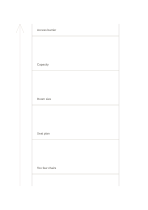

# Abstraction ladder

`abstraction-ladder` · `ideation` · `a5-draft`

[繁體中文](README.zh-TW.md) · [English](README.en.md) · [日本語](README.ja.md) · [Back to catalog](../../docs/en/catalog.md)

Move between concrete cases and general principles one rung at a time to catch jumps in reasoning.

## When to use it

- Infer a design principle from an event problem.
- Turn an abstract aim into observable action.

## How to use it

1. Start with an observable case on the lowest rung.
2. Generalize one level at a time, checking each rung against the one below.
3. Read downward again to see whether the principle points to a practical action.

## What the page helps you see

Multiple proposals with a basis for the next selection step.

## Worked example

A fictional reading group moves from too few chairs to seating capacity and participation barriers, then considers seat reservations.

[SVG](examples/en.svg)

## When not to use it

Five rungs are space, not a required number of reasoning steps; broad claims need more cases.

## Downloads

- [Wordless SVG](exports/a5-draft/blank.svg)
- [Wordless PDF](exports/a5-draft/blank.pdf)
- [PDF with English name at top left](exports/a5-draft/titled.pdf)
- [Darker-ink wordless PDF](exports/a5-contrast/blank.pdf)
- [Darker-ink SVG](exports/a5-contrast/blank.svg)

The English name appears only on the titled PDF; the wordless version remains available for free writing.

Page size: A5 (148 × 210 mm); profile: `a5-draft`.

## Provenance and status

Common geometry · Detailed source record: [manifest.json](manifest.json)  
[MIT license scope](../../LICENSE-SCOPE.md)

[Trilingual glossary](../../docs/en/glossary.md)

## Modify and rebuild

Change `profiles/a5-draft.json` or the corresponding builder in `src/noteformats/layouts/`, then run from the project root:

`python scripts/build.py --ids abstraction-ladder`
