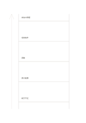

# 抽象化のはしご

`abstraction-ladder` · `ideation` · `a5-draft`

[繁體中文](README.zh-TW.md) · [English](README.en.md) · [日本語](README.ja.md) · [一覧へ戻る](../../docs/ja/catalog.md)

具体例と一般原則の間を一段ずつ行き来し、飛躍を見つけます。

## 向いている場面

- 催しの問題から設計原則を考えるとき。
- 抽象的な目標を観察できる行動に直すとき。

## 使い方

1. 最下段に観察できる具体例を書きます。
2. 一段ずつ一般化し、下段を本当に含むか確かめます。
3. 上から再び下へ読み、原則が行動につながるか見ます。

## 記入後に見えること

複数の案と、次に選ぶための基準が残ります。

## 記入例

架空の読書会で『椅子が不足』から席数、参加の障壁へ進み、席の予約案へ戻ります。

[SVG](examples/ja.svg)

## 向いていない場面

五段は必須の推論段数ではありません。一般化しすぎるときは事例を増やします。

## ダウンロード

- [文字なしSVG](exports/a5-draft/blank.svg)
- [文字なしPDF](exports/a5-draft/blank.pdf)
- [左上に英語名があるPDF](exports/a5-draft/titled.pdf)
- [濃い線の文字なしPDF](exports/a5-contrast/blank.pdf)
- [濃い線のSVG](exports/a5-contrast/blank.svg)

英語名は表題付きPDFだけに印刷され、文字なし版は自由な記入に使えます。

用紙サイズ：A5（148 × 210 mm）。設定ファイル：`a5-draft`。

## 由来と状態

一般的な幾何構造 · 詳しい由来の記録： [manifest.json](manifest.json)  
[MITライセンスの範囲](../../LICENSE-SCOPE.md)

[三言語の用語集](../../docs/ja/glossary.md)

## 変更と再生成

`profiles/a5-draft.json` または `src/noteformats/layouts/` の描画関数を変更し、プロジェクトのルートで実行します：

`python scripts/build.py --ids abstraction-ladder`
