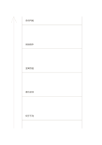

# 抽象階梯

`abstraction-ladder` · `ideation` · `a5-draft`

[繁體中文](README.zh-TW.md) · [English](README.en.md) · [日本語](README.ja.md) · [返回目錄](../../docs/zh-TW/catalog.md)

在具體事例與抽象原則之間逐階往返，找出過度跳躍的推論。

## 適合情境

- 從一場活動的具體問題推回一般設計原則。
- 把一句抽象目標拆成可觀察行動。

## 使用步驟

1. 先在最下階寫可觀察的具體事例。
2. 每上一階寫更一般的說法，檢查它是否真涵蓋下階。
3. 再往下讀一次，確認抽象原則能指回可做的事。

## 整理後可得到

保留多種方案並說明下一輪篩選依據。

## 實際填寫示例

虛構讀書會從『椅子不夠』上推到『空間容量』再到『參與門檻』，回頭提出預約座位的做法。

[SVG](examples/zh-TW.svg)

## 不適合情境

五階只是書寫空間，不表示推理必然五步；概括過度時須補更多事例。

## 下載

- [無字 SVG](exports/a5-draft/blank.svg)
- [無字 PDF](exports/a5-draft/blank.pdf)
- [左上角英文名稱 PDF](exports/a5-draft/titled.pdf)
- [深色墨線無字 PDF](exports/a5-contrast/blank.pdf)
- [深色墨線 SVG](exports/a5-contrast/blank.svg)

英文名稱只印在標題版 PDF；無字版仍適合自由列印與改作。

頁面尺寸：A5（148 × 210 mm）；設定檔：`a5-draft`。

## 來源與狀態

通用幾何結構 · 詳細來源紀錄見 [manifest.json](manifest.json)  
[MIT 授權範圍](../../LICENSE-SCOPE.md)

[三語術語表](../../docs/zh-TW/glossary.md)

## 修改與重新生成

修改 `profiles/a5-draft.json` 或 `src/noteformats/layouts/` 內對應的繪圖函式，再於專案根目錄執行：

`python scripts/build.py --ids abstraction-ladder`
