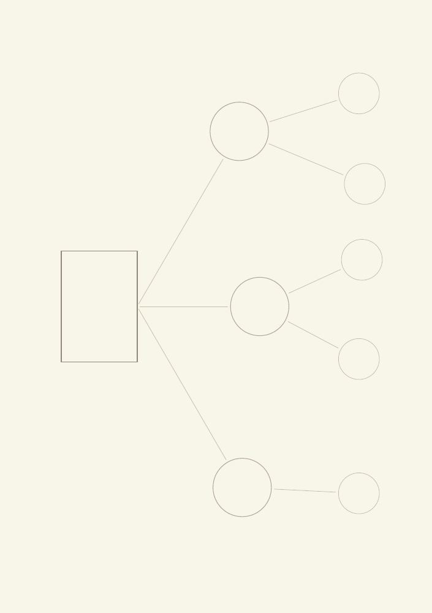
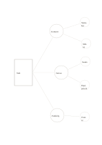

# Uneven branch map

`asymmetric-branches` · `concept-network` · `a5-draft`

[繁體中文](README.zh-TW.md) · [English](README.en.md) · [日本語](README.ja.md) · [Back to catalog](../../docs/en/catalog.md)

Let three lines of inquiry receive different numbers of details according to need.

## When to use it

- A venue needs more subquestions than catering in an event plan.
- Three claims in a reading have unequal numbers of examples.

## How to use it

1. Put the shared question at the left.
2. Name three distinct branches in the middle.
3. Fill the right leaves according to actual detail, without forcing symmetry.

## What the page helps you see

A map of topics, branches, and relationships still to verify.

## Worked example

A fictional talk splits into content, venue, and publicity; content and venue each get two details, while publicity starts with one.

[SVG](examples/en.svg)

## When not to use it

Small leaf circles fit short terms; continue elsewhere for more than five details or long explanations.

## Downloads

- [Wordless SVG](exports/a5-draft/blank.svg)
- [Wordless PDF](exports/a5-draft/blank.pdf)
- [PDF with English name at top left](exports/a5-draft/titled.pdf)
- [Darker-ink wordless PDF](exports/a5-contrast/blank.pdf)
- [Darker-ink SVG](exports/a5-contrast/blank.svg)

The English name appears only on the titled PDF; the wordless version remains available for free writing.

Page size: A5 (148 × 210 mm); profile: `a5-draft`.

## Provenance and status

Original layout · Detailed source record: [manifest.json](manifest.json)  
[MIT license scope](../../LICENSE-SCOPE.md)

[Trilingual glossary](../../docs/en/glossary.md)

## Modify and rebuild

Change `profiles/a5-draft.json` or the corresponding builder in `src/noteformats/layouts/`, then run from the project root:

`python scripts/build.py --ids asymmetric-branches`
