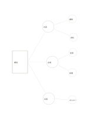

# 非対称の枝分かれ図

`asymmetric-branches` · `concept-network` · `a5-draft`

[繁體中文](README.zh-TW.md) · [English](README.en.md) · [日本語](README.ja.md) · [一覧へ戻る](../../docs/ja/catalog.md)

三つの方向に、必要に応じて異なる数の細目をつなぎます。

## 向いている場面

- 催しの準備で、会場の確認事項が飲食より多いとき。
- 読書メモで三つの主張に付く例の数が異なるとき。

## 使い方

1. 左に共通の問いを書きます。
2. 中段に重ならない三つの方向を置きます。
3. 右側は実際の細目の数に合わせて埋め、左右対称を求めません。

## 記入後に見えること

主題と枝、確かめ直す関係を一覧できます。

## 記入例

架空の講演準備を内容、会場、広報に分け、前二者に二項目ずつ、広報に一項目を書きます。

[SVG](examples/ja.svg)

## 向いていない場面

末端の小円は短語向けです。五項目を超える説明や長文は別紙へ続けます。

## ダウンロード

- [文字なしSVG](exports/a5-draft/blank.svg)
- [文字なしPDF](exports/a5-draft/blank.pdf)
- [左上に英語名があるPDF](exports/a5-draft/titled.pdf)
- [濃い線の文字なしPDF](exports/a5-contrast/blank.pdf)
- [濃い線のSVG](exports/a5-contrast/blank.svg)

英語名は表題付きPDFだけに印刷され、文字なし版は自由な記入に使えます。

用紙サイズ：A5（148 × 210 mm）。設定ファイル：`a5-draft`。

## 由来と状態

本プロジェクトの独自レイアウト · 詳しい由来の記録： [manifest.json](manifest.json)  
[MITライセンスの範囲](../../LICENSE-SCOPE.md)

[三言語の用語集](../../docs/ja/glossary.md)

## 変更と再生成

`profiles/a5-draft.json` または `src/noteformats/layouts/` の描画関数を変更し、プロジェクトのルートで実行します：

`python scripts/build.py --ids asymmetric-branches`
