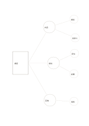

# 不對稱分枝圖

`asymmetric-branches` · `concept-network` · `a5-draft`

[繁體中文](README.zh-TW.md) · [English](README.en.md) · [日本語](README.ja.md) · [返回目錄](../../docs/zh-TW/catalog.md)

讓主題的三條路徑依實際需要分出不同數量的細節。

## 適合情境

- 規劃活動時，場地比餐點需要更多子問題。
- 整理閱讀時，三個論點的證據數量不一樣。

## 使用步驟

1. 左側寫共同問題。
2. 中間三節點寫互不重疊的路徑。
3. 右側按各路徑實際需要填入細節，不必強求平均。

## 整理後可得到

看見主題、分支及需要再確認的關係。

## 實際填寫示例

虛構講座的準備分成內容、場地、宣傳；內容與場地各拆兩項，宣傳先記一項。

[SVG](examples/zh-TW.svg)

## 不適合情境

末端小圈適合短詞；若細節超過五項或需要長句，另開一頁。

## 下載

- [無字 SVG](exports/a5-draft/blank.svg)
- [無字 PDF](exports/a5-draft/blank.pdf)
- [左上角英文名稱 PDF](exports/a5-draft/titled.pdf)
- [深色墨線無字 PDF](exports/a5-contrast/blank.pdf)
- [深色墨線 SVG](exports/a5-contrast/blank.svg)

英文名稱只印在標題版 PDF；無字版仍適合自由列印與改作。

頁面尺寸：A5（148 × 210 mm）；設定檔：`a5-draft`。

## 來源與狀態

本專案原創版面 · 詳細來源紀錄見 [manifest.json](manifest.json)  
[MIT 授權範圍](../../LICENSE-SCOPE.md)

[三語術語表](../../docs/zh-TW/glossary.md)

## 修改與重新生成

修改 `profiles/a5-draft.json` 或 `src/noteformats/layouts/` 內對應的繪圖函式，再於專案根目錄執行：

`python scripts/build.py --ids asymmetric-branches`
