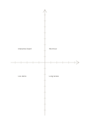

# Axis comparison matrix

`axis-matrix` · `matrix` · `a5-draft`

[繁體中文](README.zh-TW.md) · [English](README.en.md) · [日本語](README.ja.md) · [Back to catalog](../../docs/en/catalog.md)

Plot options on two ticked axes and check their direction and relative position.

## When to use it

**Geometry relationship:** `equivalent` · [coordinate-grid](../coordinate-grid/README.en.md)

- Define relative scales on two axes, then position several proposals to compare tradeoffs.
- Place tasks near ticks using two chosen ratings and record the basis for each rating separately.

## How to use it

1. Plot options on two ticked axes and check their direction and relative position.
2. Decide what each tick means, or state that the drawing is only relative.
3. Plot items and check that a rough sketch is not mistaken for measured data.

## What the page helps you see

Intersections, missing cells, and tradeoffs across chosen dimensions.

## Worked example

Entries in example-position order; each number identifies one entry:

1. Short tour
2. Interactive board
3. Live demo
4. Long lecture

[SVG](examples/en.svg)

## When not to use it

Without printed units or values this is not a precise data chart. For four simple categories, a quadrant page may be clearer. Small cells hold short phrases rather than long paragraphs.

## Downloads

- [Wordless SVG](exports/a5-draft/blank.svg)
- [Wordless PDF](exports/a5-draft/blank.pdf)
- [PDF with English name at top left](exports/a5-draft/titled.pdf)
- [Darker-ink wordless PDF](exports/a5-contrast/blank.pdf)
- [Darker-ink SVG](exports/a5-contrast/blank.svg)

The English name appears only on the titled PDF; the wordless version remains available for free writing.

Page size: A5 (148 × 210 mm); profile: `a5-draft`.

## Provenance and status

Adaptation of traditional writing paper · Detailed source record: [manifest.json](manifest.json)  
[MIT license scope](../../LICENSE-SCOPE.md)

[Trilingual glossary](../../docs/en/glossary.md)

## Modify and rebuild

Edit geometry in `src/noteformats/variants.py` or text in `src/noteformats/variant_content.py`, then run from the project root:

`python scripts/build.py --ids axis-matrix`
