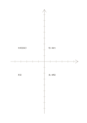

# 座標軸の比較表

`axis-matrix` · `matrix` · `a5-draft`

[繁體中文](README.zh-TW.md) · [English](README.en.md) · [日本語](README.ja.md) · [一覧へ戻る](../../docs/ja/catalog.md)

目盛りのある二軸に案を置き、方向と相対位置を確かめます。

## 向いている場面

**図形の対応:** `equivalent` · [coordinate-grid](../coordinate-grid/README.ja.md)

- 二軸の相対尺度を定め、複数案の位置から取捨を比べるとき。
- 自分で選んだ二つの評価値で作業を目盛り付近に置き、根拠を別記するとき。

## 使い方

1. 目盛りのある二軸に案を置き、方向と相対位置を確かめます。
2. 各目盛りの単位を決めるか、相対位置だけの図だと明記します。
3. 項目を置き、草図を実測データと誤認しないよう確かめます。

## 記入後に見えること

複数の観点が交わる場所と、空白や選択上の差が見えます。

## 記入例

図の記入位置の順に示します。番号一つが一つの記入例です：

1. 短い案内
2. 対話型展示
3. 実演
4. 長い講演

[SVG](examples/ja.svg)

## 向いていない場面

数字と単位がないため精密なグラフにはなりません。四分類だけなら4象限の方が明確です。 小さなマスは短い語句向けで、長い文章には向きません。

## ダウンロード

- [文字なしSVG](exports/a5-draft/blank.svg)
- [文字なしPDF](exports/a5-draft/blank.pdf)
- [左上に英語名があるPDF](exports/a5-draft/titled.pdf)
- [濃い線の文字なしPDF](exports/a5-contrast/blank.pdf)
- [濃い線のSVG](exports/a5-contrast/blank.svg)

英語名は表題付きPDFだけに印刷され、文字なし版は自由な記入に使えます。

用紙サイズ：A5（148 × 210 mm）。設定ファイル：`a5-draft`。

## 由来と状態

伝統的な練習紙の応用 · 詳しい由来の記録： [manifest.json](manifest.json)  
[MITライセンスの範囲](../../LICENSE-SCOPE.md)

[三言語の用語集](../../docs/ja/glossary.md)

## 変更と再生成

図形は `src/noteformats/variants.py`、文章は `src/noteformats/variant_content.py` を変更し、プロジェクトのルートで実行します：

`python scripts/build.py --ids axis-matrix`
