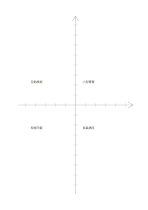

# 座標軸比較

`axis-matrix` · `matrix` · `a5-draft`

[繁體中文](README.zh-TW.md) · [English](README.en.md) · [日本語](README.ja.md) · [返回目錄](../../docs/zh-TW/catalog.md)

將方案放在有刻度的兩軸上，核對方向與相對位置。

## 適合情境

**幾何對照:** `equivalent` · [coordinate-grid](../coordinate-grid/README.zh-TW.md)

- 先定義兩軸的相對尺度，再標出多個提案的位置以比較取捨。
- 把待辦事項依兩項自訂評估值放在刻度附近，另記評估依據。

## 使用步驟

1. 將方案放在有刻度的兩軸上，核對方向與相對位置。
2. 決定每段刻線的單位，或註明只比較相對位置。
3. 標出項目，檢查是否誤把草圖當精確數據。

## 整理後可得到

看見兩個以上維度交叉處的資料缺口與取捨。

## 實際填寫示例

依圖中填寫位置順序列出，每個編號是一筆示例條目：

1. 小型導覽
2. 互動展板
3. 現場示範
4. 長篇講座

[SVG](examples/zh-TW.svg)

## 不適合情境

未印數字與單位，不能直接用於精密數據圖；若只要四類分組，可用四象限。 細小格子只宜短語，不適合長篇段落。

## 下載

- [無字 SVG](exports/a5-draft/blank.svg)
- [無字 PDF](exports/a5-draft/blank.pdf)
- [左上角英文名稱 PDF](exports/a5-draft/titled.pdf)
- [深色墨線無字 PDF](exports/a5-contrast/blank.pdf)
- [深色墨線 SVG](exports/a5-contrast/blank.svg)

英文名稱只印在標題版 PDF；無字版仍適合自由列印與改作。

頁面尺寸：A5（148 × 210 mm）；設定檔：`a5-draft`。

## 來源與狀態

傳統書寫紙改編 · 詳細來源紀錄見 [manifest.json](manifest.json)  
[MIT 授權範圍](../../LICENSE-SCOPE.md)

[三語術語表](../../docs/zh-TW/glossary.md)

## 修改與重新生成

調整 `src/noteformats/variants.py` 的幾何或 `src/noteformats/variant_content.py` 的文字，再於專案根目錄執行：

`python scripts/build.py --ids axis-matrix`
