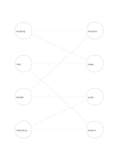

# Two-set link map

`bipartite-network` · `concept-network` · `a5-draft`

[繁體中文](README.zh-TW.md) · [English](README.en.md) · [日本語](README.ja.md) · [Back to catalog](../../docs/en/catalog.md)

Compare many-to-many relationships between two kinds of element, with no within-set links.

## When to use it

- Match four events to reusable venue resources.
- See which of four articles cover four central themes.

## How to use it

1. Put one kind of element on the left and another on the right.
2. Connect only across sets, one edge per confirmed relationship.
3. Inspect overloaded or isolated nodes and verify the source data.

## What the page helps you see

A map of topics, branches, and relationships still to verify.

## Worked example

Four fictional community events sit left, four resources right; edges show needs for projection, seating, audio, or helpers.

[SVG](examples/en.svg)

## When not to use it

Use a general network for within-set relations; crossing lines do not imply conflict.

## Downloads

- [Wordless SVG](exports/a5-draft/blank.svg)
- [Wordless PDF](exports/a5-draft/blank.pdf)
- [PDF with English name at top left](exports/a5-draft/titled.pdf)
- [Darker-ink wordless PDF](exports/a5-contrast/blank.pdf)
- [Darker-ink SVG](exports/a5-contrast/blank.svg)

The English name appears only on the titled PDF; the wordless version remains available for free writing.

Page size: A5 (148 × 210 mm); profile: `a5-draft`.

## Provenance and status

Common geometry · Detailed source record: [manifest.json](manifest.json)  
[MIT license scope](../../LICENSE-SCOPE.md)

[Trilingual glossary](../../docs/en/glossary.md)

## Modify and rebuild

Change `profiles/a5-draft.json` or the corresponding builder in `src/noteformats/layouts/`, then run from the project root:

`python scripts/build.py --ids bipartite-network`
