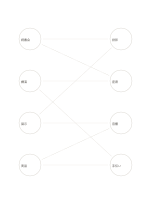

# 二集合の対応図

`bipartite-network` · `concept-network` · `a5-draft`

[繁體中文](README.zh-TW.md) · [English](README.en.md) · [日本語](README.ja.md) · [一覧へ戻る](../../docs/ja/catalog.md)

異なる二種類の要素の多対多対応を比べ、同じ種類同士は結びません。

## 向いている場面

- 四つの催しと共用できる会場備品を対応させるとき。
- 四つの記事が四つの主題を扱うか比べるとき。

## 使い方

1. 左に一種類、右に別の種類の要素を並べます。
2. 確認できた対応だけ左右間で線にします。
3. 線が集中する点や孤立する点を見つけ、資料を確かめます。

## 記入後に見えること

主題と枝、確かめ直す関係を一覧できます。

## 記入例

架空の読書会、講演、展示、実習を左に置き、投影、座席、音響、手伝いの必要性を右へ結びます。

[SVG](examples/ja.svg)

## 向いていない場面

同じ種類同士の関係には一般のネットワーク図を使います。線の交差は対立を意味しません。

## ダウンロード

- [文字なしSVG](exports/a5-draft/blank.svg)
- [文字なしPDF](exports/a5-draft/blank.pdf)
- [左上に英語名があるPDF](exports/a5-draft/titled.pdf)
- [濃い線の文字なしPDF](exports/a5-contrast/blank.pdf)
- [濃い線のSVG](exports/a5-contrast/blank.svg)

英語名は表題付きPDFだけに印刷され、文字なし版は自由な記入に使えます。

用紙サイズ：A5（148 × 210 mm）。設定ファイル：`a5-draft`。

## 由来と状態

一般的な幾何構造 · 詳しい由来の記録： [manifest.json](manifest.json)  
[MITライセンスの範囲](../../LICENSE-SCOPE.md)

[三言語の用語集](../../docs/ja/glossary.md)

## 変更と再生成

`profiles/a5-draft.json` または `src/noteformats/layouts/` の描画関数を変更し、プロジェクトのルートで実行します：

`python scripts/build.py --ids bipartite-network`
