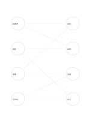

# 雙集合連結圖

`bipartite-network` · `concept-network` · `a5-draft`

[繁體中文](README.zh-TW.md) · [English](README.en.md) · [日本語](README.ja.md) · [返回目錄](../../docs/zh-TW/catalog.md)

對照兩類不同元素之間的多對多關係，不在同類內連線。

## 適合情境

- 列出四場活動各需哪些可共用的場地資源。
- 對照四篇文章與四個核心主題的涵蓋關係。

## 使用步驟

1. 左側放一類元素，右側放另一類。
2. 只在兩類之間連線，一條線代表一個已確認關係。
3. 找出負荷集中或尚無連結的節點，再核對資料。

## 整理後可得到

看見主題、分支及需要再確認的關係。

## 實際填寫示例

虛構的四場社區活動在左，四項資源在右；連線表示需要投影、桌椅、音響或志工。

[SVG](examples/zh-TW.svg)

## 不適合情境

若需要顯示同類之間的關係，改用一般網絡；線條交叉也不代表衝突。

## 下載

- [無字 SVG](exports/a5-draft/blank.svg)
- [無字 PDF](exports/a5-draft/blank.pdf)
- [左上角英文名稱 PDF](exports/a5-draft/titled.pdf)
- [深色墨線無字 PDF](exports/a5-contrast/blank.pdf)
- [深色墨線 SVG](exports/a5-contrast/blank.svg)

英文名稱只印在標題版 PDF；無字版仍適合自由列印與改作。

頁面尺寸：A5（148 × 210 mm）；設定檔：`a5-draft`。

## 來源與狀態

通用幾何結構 · 詳細來源紀錄見 [manifest.json](manifest.json)  
[MIT 授權範圍](../../LICENSE-SCOPE.md)

[三語術語表](../../docs/zh-TW/glossary.md)

## 修改與重新生成

修改 `profiles/a5-draft.json` 或 `src/noteformats/layouts/` 內對應的繪圖函式，再於專案根目錄執行：

`python scripts/build.py --ids bipartite-network`
