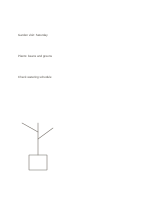

# Blank page

`blank` · `foundation` · `a5-draft`

[繁體中文](README.zh-TW.md) · [English](README.en.md) · [日本語](README.ja.md) · [Back to catalog](../../docs/en/catalog.md)

Leave every mark and spatial relationship to the writer or sketcher.

## When to use it

- Mix drawings and short phrases before an idea has a clear structure.
- Capture loose clues in a meeting and connect them afterward.

## How to use it

1. Choose a starting point without committing to a fixed reading order.
2. Use spacing, circles, or arrows to show relationships you notice.
3. Add short names to the important marks and move unresolved questions to another page.

## What the page helps you see

A continuous note or draft that can be revisited, with unresolved points marked.

## Worked example

A fictional community garden idea places plants, tools, and care times in separate areas, then connects them. The blank download itself has no words.

[SVG](examples/en.svg)

## When not to use it

The page gives too little guidance for consistent ruled writing, precise tables, or shared forms with fixed fields.

## Downloads

- [Wordless SVG](exports/a5-draft/blank.svg)
- [Wordless PDF](exports/a5-draft/blank.pdf)
- [PDF with English name at top left](exports/a5-draft/titled.pdf)
- [Darker-ink wordless PDF](exports/a5-contrast/blank.pdf)
- [Darker-ink SVG](exports/a5-contrast/blank.svg)

The English name appears only on the titled PDF; the wordless version remains available for free writing.

Page size: A5 (148 × 210 mm); profile: `a5-draft`.

## Provenance and status

Adaptation of traditional writing paper · Detailed source record: [manifest.json](manifest.json)  
[MIT license scope](../../LICENSE-SCOPE.md)

[Trilingual glossary](../../docs/en/glossary.md)

## Modify and rebuild

Change `profiles/a5-draft.json` or the corresponding builder in `src/noteformats/layouts/`, then run from the project root:

`python scripts/build.py --ids blank`
