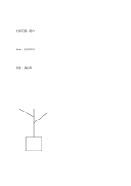

# 全空白頁

`blank` · `foundation` · `a5-draft`

[繁體中文](README.zh-TW.md) · [English](README.en.md) · [日本語](README.ja.md) · [返回目錄](../../docs/zh-TW/catalog.md)

讓文字、草圖與位置關係完全由使用者決定。

## 適合情境

- 在構想尚未成形時，混合畫圖與短句。
- 開會時先快速記下線索，再自行圈連重點。

## 使用步驟

1. 先在紙上選一個起點，不必遵循固定閱讀順序。
2. 用距離、圈線或箭頭表達你認為有關的內容。
3. 整理時替重要內容補上短語，再把未解決問題移到下一頁。

## 整理後可得到

留下可循序回看的筆記或草稿，標出仍待確認的部分。

## 實際填寫示例

示例是虛構的社區花園構想：把植物、工具與照料時間寫在不同位置，再以連線標出關聯；空白下載仍完全無字。

[SVG](examples/zh-TW.svg)

## 不適合情境

需要固定行距、工整表格或多人一致填寫欄位時，空白頁缺少必要的引導。

## 下載

- [無字 SVG](exports/a5-draft/blank.svg)
- [無字 PDF](exports/a5-draft/blank.pdf)
- [左上角英文名稱 PDF](exports/a5-draft/titled.pdf)
- [深色墨線無字 PDF](exports/a5-contrast/blank.pdf)
- [深色墨線 SVG](exports/a5-contrast/blank.svg)

英文名稱只印在標題版 PDF；無字版仍適合自由列印與改作。

頁面尺寸：A5（148 × 210 mm）；設定檔：`a5-draft`。

## 來源與狀態

傳統書寫紙改編 · 詳細來源紀錄見 [manifest.json](manifest.json)  
[MIT 授權範圍](../../LICENSE-SCOPE.md)

[三語術語表](../../docs/zh-TW/glossary.md)

## 修改與重新生成

修改 `profiles/a5-draft.json` 或 `src/noteformats/layouts/` 內對應的繪圖函式，再於專案根目錄執行：

`python scripts/build.py --ids blank`
