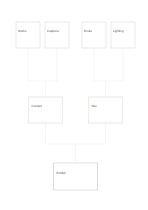

# Bottom-up tree

`bottom-up-tree` · `hierarchy` · `a5-draft`

[繁體中文](README.zh-TW.md) · [English](README.en.md) · [日本語](README.ja.md) · [Back to catalog](../../docs/en/catalog.md)

Build upward from details toward a broader conclusion. Geometry change: The hierarchy is mirrored for bottom-up reading.

## When to use it

**Geometry relationship:** `parameter` · [top-down-tree](../top-down-tree/README.en.md)

- Start with four observations at the top, group them in two middle boxes and synthesize one topic below.
- Combine four event needs through two intermediate categories and check whether they support one goal.

## How to use it

1. Put one specific observation or need in each of the four upper leaves.
2. Group related entries into the two middle categories and explain the grouping rule.
3. Write a synthesis supported by both groups at the bottom and check for overlooked counterexamples.

## What the page helps you see

Levels of a goal or topic, with gaps easier to notice.

## Worked example

Entries in example-position order; each number identifies one entry:

1. Exhibit
2. Content
3. Site
4. Works
5. Captions
6. Route
7. Lighting

[SVG](examples/en.svg)

## When not to use it

A tree only shows containment; use a network for cross-category links or loops. Small cells hold short phrases rather than long paragraphs.

## Downloads

- [Wordless SVG](exports/a5-draft/blank.svg)
- [Wordless PDF](exports/a5-draft/blank.pdf)
- [PDF with English name at top left](exports/a5-draft/titled.pdf)
- [Darker-ink wordless PDF](exports/a5-contrast/blank.pdf)
- [Darker-ink SVG](exports/a5-contrast/blank.svg)

The English name appears only on the titled PDF; the wordless version remains available for free writing.

Page size: A5 (148 × 210 mm); profile: `a5-draft`.

## Provenance and status

Common geometry · Detailed source record: [manifest.json](manifest.json)  
[MIT license scope](../../LICENSE-SCOPE.md)

[Trilingual glossary](../../docs/en/glossary.md)

## Modify and rebuild

Edit geometry in `src/noteformats/variants.py` or text in `src/noteformats/variant_content.py`, then run from the project root:

`python scripts/build.py --ids bottom-up-tree`
