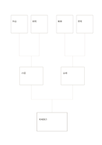

# 下から上への樹形図

`bottom-up-tree` · `hierarchy` · `a5-draft`

[繁體中文](README.zh-TW.md) · [English](README.en.md) · [日本語](README.ja.md) · [一覧へ戻る](../../docs/ja/catalog.md)

下の細部から上位のまとめへ組み立てます。 図形の変更： 下から上へ読むよう階層を反転しました。

## 向いている場面

**図形の対応:** `parameter` · [top-down-tree](../top-down-tree/README.ja.md)

- 上の四枠に観察を置き、中間の二群へまとめ、下に一つの総括テーマを作るとき。
- 四つの活動ニーズを二つの中間分類へまとめ、一つの目的を支えるか確かめるとき。

## 使い方

1. 上の四つの末端に、具体的な観察や必要事項を一つずつ置きます。
2. 関連する項目を中間の二分類へまとめ、分類の根拠を記します。
3. 下に両分類から支えられる総括を書き、反例の見落としがないか戻って確かめます。

## 記入後に見えること

目的や話題の階層と、抜けている要素が見えます。

## 記入例

図の記入位置の順に示します。番号一つが一つの記入例です：

1. 地域展示
2. 内容
3. 会場
4. 作品
5. 説明
6. 動線
7. 照明

[SVG](examples/ja.svg)

## 向いていない場面

樹は上下の所属を示すだけです。分類をまたぐ線や循環にはネットワーク図が向きます。 小さなマスは短い語句向けで、長い文章には向きません。

## ダウンロード

- [文字なしSVG](exports/a5-draft/blank.svg)
- [文字なしPDF](exports/a5-draft/blank.pdf)
- [左上に英語名があるPDF](exports/a5-draft/titled.pdf)
- [濃い線の文字なしPDF](exports/a5-contrast/blank.pdf)
- [濃い線のSVG](exports/a5-contrast/blank.svg)

英語名は表題付きPDFだけに印刷され、文字なし版は自由な記入に使えます。

用紙サイズ：A5（148 × 210 mm）。設定ファイル：`a5-draft`。

## 由来と状態

一般的な幾何構造 · 詳しい由来の記録： [manifest.json](manifest.json)  
[MITライセンスの範囲](../../LICENSE-SCOPE.md)

[三言語の用語集](../../docs/ja/glossary.md)

## 変更と再生成

図形は `src/noteformats/variants.py`、文章は `src/noteformats/variant_content.py` を変更し、プロジェクトのルートで実行します：

`python scripts/build.py --ids bottom-up-tree`
