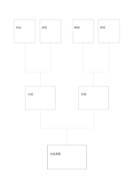

# 由下而上樹圖

`bottom-up-tree` · `hierarchy` · `a5-draft`

[繁體中文](README.zh-TW.md) · [English](README.en.md) · [日本語](README.ja.md) · [返回目錄](../../docs/zh-TW/catalog.md)

從下方細項向上彙整為較高層的結論。 本款的幾何變化： 由下往上閱讀的鏡像層級。

## 適合情境

**幾何對照:** `parameter` · [top-down-tree](../top-down-tree/README.zh-TW.md)

- 先把四條觀察寫在上方，歸納成兩組，再於下方形成一個總結主題。
- 把四項活動需求逐級合併，檢查兩個中間類別是否支持同一目標。

## 使用步驟

1. 上方四個末端各寫一條具體觀察或需求。
2. 把可歸在一起的項目合併成中間兩個類別，註明分類依據。
3. 在下方寫可由這兩類支持的總結，回查是否遺漏反例。

## 整理後可得到

區分上位目標與下位要素，檢查是否遺漏。

## 實際填寫示例

依圖中填寫位置順序列出，每個編號是一筆示例條目：

1. 社區展覽
2. 內容
3. 現場
4. 作品
5. 說明
6. 動線
7. 照明

[SVG](examples/zh-TW.svg)

## 不適合情境

樹只表示上下歸屬；跨類連結或循環關係需另用網絡圖。 細小格子只宜短語，不適合長篇段落。

## 下載

- [無字 SVG](exports/a5-draft/blank.svg)
- [無字 PDF](exports/a5-draft/blank.pdf)
- [左上角英文名稱 PDF](exports/a5-draft/titled.pdf)
- [深色墨線無字 PDF](exports/a5-contrast/blank.pdf)
- [深色墨線 SVG](exports/a5-contrast/blank.svg)

英文名稱只印在標題版 PDF；無字版仍適合自由列印與改作。

頁面尺寸：A5（148 × 210 mm）；設定檔：`a5-draft`。

## 來源與狀態

通用幾何結構 · 詳細來源紀錄見 [manifest.json](manifest.json)  
[MIT 授權範圍](../../LICENSE-SCOPE.md)

[三語術語表](../../docs/zh-TW/glossary.md)

## 修改與重新生成

調整 `src/noteformats/variants.py` 的幾何或 `src/noteformats/variant_content.py` 的文字，再於專案根目錄執行：

`python scripts/build.py --ids bottom-up-tree`
