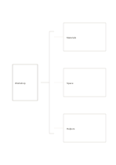

# Brace decomposition

`brace-decomposition` · `hierarchy` · `a5-draft`

[繁體中文](README.zh-TW.md) · [English](README.en.md) · [日本語](README.ja.md) · [Back to catalog](../../docs/en/catalog.md)

Show a whole and three distinct components in one concise view.

## When to use it

- Divide course resources into materials, space, and people.
- Summarize a system as input, process, and output.

## How to use it

1. Put the whole on the left.
2. Name three different components on the right without duplicating an item.
3. Check for missing components, then continue on another page if needed.

## What the page helps you see

Levels of a goal or topic, with gaps easier to notice.

## Worked example

A fictional workshop breaks into materials, space, and helpers as preparation needs, with no order implied.

[SVG](examples/en.svg)

## When not to use it

This is a one-level summary; use a tree for multiple levels or a flow for sequence.

## Downloads

- [Wordless SVG](exports/a5-draft/blank.svg)
- [Wordless PDF](exports/a5-draft/blank.pdf)
- [PDF with English name at top left](exports/a5-draft/titled.pdf)
- [Darker-ink wordless PDF](exports/a5-contrast/blank.pdf)
- [Darker-ink SVG](exports/a5-contrast/blank.svg)

The English name appears only on the titled PDF; the wordless version remains available for free writing.

Page size: A5 (148 × 210 mm); profile: `a5-draft`.

## Provenance and status

Common geometry · Detailed source record: [manifest.json](manifest.json)  
[MIT license scope](../../LICENSE-SCOPE.md)

[Trilingual glossary](../../docs/en/glossary.md)

## Modify and rebuild

Change `profiles/a5-draft.json` or the corresponding builder in `src/noteformats/layouts/`, then run from the project root:

`python scripts/build.py --ids brace-decomposition`
