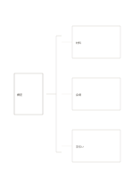

# 括弧で分ける構成図

`brace-decomposition` · `hierarchy` · `a5-draft`

[繁體中文](README.zh-TW.md) · [English](README.en.md) · [日本語](README.ja.md) · [一覧へ戻る](../../docs/ja/catalog.md)

一つの全体と三つの異なる構成要素を簡潔に示します。

## 向いている場面

- 講座の資源を教材、場所、人員に分けるとき。
- 仕組みを入力、処理、出力で要約するとき。

## 使い方

1. 左に分けたい全体を書きます。
2. 右の三枠に異なる構成要素を置き、同じ項目を重ねません。
3. 漏れがないか確認し、必要なら別紙でさらに分けます。

## 記入後に見えること

目的や話題の階層と、抜けている要素が見えます。

## 記入例

架空の講座を材料、会場、手伝いに分けます。三つは準備条件で、順序を示していません。

[SVG](examples/ja.svg)

## 向いていない場面

一段階・三項目の要約向けです。多階層には樹、順序には流れ図を使います。

## ダウンロード

- [文字なしSVG](exports/a5-draft/blank.svg)
- [文字なしPDF](exports/a5-draft/blank.pdf)
- [左上に英語名があるPDF](exports/a5-draft/titled.pdf)
- [濃い線の文字なしPDF](exports/a5-contrast/blank.pdf)
- [濃い線のSVG](exports/a5-contrast/blank.svg)

英語名は表題付きPDFだけに印刷され、文字なし版は自由な記入に使えます。

用紙サイズ：A5（148 × 210 mm）。設定ファイル：`a5-draft`。

## 由来と状態

一般的な幾何構造 · 詳しい由来の記録： [manifest.json](manifest.json)  
[MITライセンスの範囲](../../LICENSE-SCOPE.md)

[三言語の用語集](../../docs/ja/glossary.md)

## 変更と再生成

`profiles/a5-draft.json` または `src/noteformats/layouts/` の描画関数を変更し、プロジェクトのルートで実行します：

`python scripts/build.py --ids brace-decomposition`
