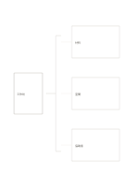

# 大括號拆解圖

`brace-decomposition` · `hierarchy` · `a5-draft`

[繁體中文](README.zh-TW.md) · [English](README.en.md) · [日本語](README.ja.md) · [返回目錄](../../docs/zh-TW/catalog.md)

用一個總項與三個子項，清楚表達整體的組成。

## 適合情境

- 將課程資源拆成教材、場地與人員。
- 摘要一個系統的輸入、處理與輸出。

## 使用步驟

1. 左側寫要拆解的整體。
2. 右側三框寫不同構成部分，不把同一項重複列入。
3. 檢查是否還有缺漏，再視需要另頁續分。

## 整理後可得到

區分上位目標與下位要素，檢查是否遺漏。

## 實際填寫示例

虛構工作坊被拆為材料、空間與協助者，三項都是準備條件，沒有表示先後。

[SVG](examples/zh-TW.svg)

## 不適合情境

只適合一層、三項的摘要；多層組織需用樹，流向需用流程圖。

## 下載

- [無字 SVG](exports/a5-draft/blank.svg)
- [無字 PDF](exports/a5-draft/blank.pdf)
- [左上角英文名稱 PDF](exports/a5-draft/titled.pdf)
- [深色墨線無字 PDF](exports/a5-contrast/blank.pdf)
- [深色墨線 SVG](exports/a5-contrast/blank.svg)

英文名稱只印在標題版 PDF；無字版仍適合自由列印與改作。

頁面尺寸：A5（148 × 210 mm）；設定檔：`a5-draft`。

## 來源與狀態

通用幾何結構 · 詳細來源紀錄見 [manifest.json](manifest.json)  
[MIT 授權範圍](../../LICENSE-SCOPE.md)

[三語術語表](../../docs/zh-TW/glossary.md)

## 修改與重新生成

修改 `profiles/a5-draft.json` 或 `src/noteformats/layouts/` 內對應的繪圖函式，再於專案根目錄執行：

`python scripts/build.py --ids brace-decomposition`
