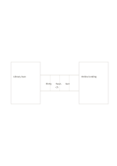

# Bridge analogy

`bridge-analogy` · `comparison` · `a5-draft`

[繁體中文](README.zh-TW.md) · [English](README.en.md) · [日本語](README.ja.md) · [Back to catalog](../../docs/en/catalog.md)

Put two domains at the ends of a bridge and map selected aspects between them.

## When to use it

- Use a familiar library process to understand a new database process.
- Compare the entry, steps, and feedback in two community services.

## How to use it

1. Name both domains and the reason for comparing them.
2. Use the three bridge spaces for corresponding aspects in order.
3. Check where the analogy fails instead of treating similarity as identity.

## What the page helps you see

Options compared against shared criteria rather than one impression.

## Worked example

Borrowing at a library and online lending sit at opposite ends; entry, search, and receipt are mapped between them.

[SVG](examples/en.svg)

## When not to use it

An analogy is not evidence, and the bridge spaces are too small for complex explanations.

## Downloads

- [Wordless SVG](exports/a5-draft/blank.svg)
- [Wordless PDF](exports/a5-draft/blank.pdf)
- [PDF with English name at top left](exports/a5-draft/titled.pdf)
- [Darker-ink wordless PDF](exports/a5-contrast/blank.pdf)
- [Darker-ink SVG](exports/a5-contrast/blank.svg)

The English name appears only on the titled PDF; the wordless version remains available for free writing.

Page size: A5 (148 × 210 mm); profile: `a5-draft`.

## Provenance and status

Original layout · Detailed source record: [manifest.json](manifest.json)  
[MIT license scope](../../LICENSE-SCOPE.md)

[Trilingual glossary](../../docs/en/glossary.md)

## Modify and rebuild

Change `profiles/a5-draft.json` or the corresponding builder in `src/noteformats/layouts/`, then run from the project root:

`python scripts/build.py --ids bridge-analogy`
