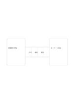

# 橋渡しの類比

`bridge-analogy` · `comparison` · `a5-draft`

[繁體中文](README.zh-TW.md) · [English](README.en.md) · [日本語](README.ja.md) · [一覧へ戻る](../../docs/ja/catalog.md)

異なる二つの主題を橋の両端に置き、対応する部分を順に考えます。

## 向いている場面

- 慣れた図書館の手順で新しいデータベースを理解するとき。
- 二つの地域サービスの入口、手順、反応を比べるとき。

## 使い方

1. 左右の主題と比べる理由を決めます。
2. 橋の三つの区画に対応する観点を順に書きます。
3. 似ていない部分も確かめ、同一だと決めつけません。

## 記入後に見えること

同じ条件で選択肢を見比べ、一つの印象だけで決めることを避けられます。

## 記入例

図書館での貸出とオンライン貸出を両端に置き、入口、検索、受け取りを橋に並べます。

[SVG](examples/ja.svg)

## 向いていない場面

類比は証拠の代わりにならず、橋の区画は長い説明には狭いものです。

## ダウンロード

- [文字なしSVG](exports/a5-draft/blank.svg)
- [文字なしPDF](exports/a5-draft/blank.pdf)
- [左上に英語名があるPDF](exports/a5-draft/titled.pdf)
- [濃い線の文字なしPDF](exports/a5-contrast/blank.pdf)
- [濃い線のSVG](exports/a5-contrast/blank.svg)

英語名は表題付きPDFだけに印刷され、文字なし版は自由な記入に使えます。

用紙サイズ：A5（148 × 210 mm）。設定ファイル：`a5-draft`。

## 由来と状態

本プロジェクトの独自レイアウト · 詳しい由来の記録： [manifest.json](manifest.json)  
[MITライセンスの範囲](../../LICENSE-SCOPE.md)

[三言語の用語集](../../docs/ja/glossary.md)

## 変更と再生成

`profiles/a5-draft.json` または `src/noteformats/layouts/` の描画関数を変更し、プロジェクトのルートで実行します：

`python scripts/build.py --ids bridge-analogy`
