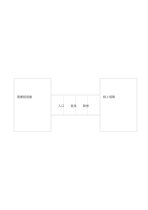

# 橋接類比

`bridge-analogy` · `comparison` · `a5-draft`

[繁體中文](README.zh-TW.md) · [English](README.en.md) · [日本語](README.ja.md) · [返回目錄](../../docs/zh-TW/catalog.md)

把兩個不同主題放在橋的兩端，逐項說明可類比的部分。

## 適合情境

- 用熟悉的圖書館流程理解新的資料庫流程。
- 比較兩種社區服務的入口、步驟與回饋。

## 使用步驟

1. 左右各寫一個主題，先確定比較的目的。
2. 在橋上三格依序記對應面向。
3. 逐項檢查類比在哪裡失效，避免把相似當成相同。

## 整理後可得到

用同一組條件逐一比較選項，避免只憑單一印象。

## 實際填寫示例

示例把圖書館借書和線上借閱放兩端，橋上記入口、查找與取得的對應。

[SVG](examples/zh-TW.svg)

## 不適合情境

類比不能代替證據；橋格很小，不宜寫複雜解釋。

## 下載

- [無字 SVG](exports/a5-draft/blank.svg)
- [無字 PDF](exports/a5-draft/blank.pdf)
- [左上角英文名稱 PDF](exports/a5-draft/titled.pdf)
- [深色墨線無字 PDF](exports/a5-contrast/blank.pdf)
- [深色墨線 SVG](exports/a5-contrast/blank.svg)

英文名稱只印在標題版 PDF；無字版仍適合自由列印與改作。

頁面尺寸：A5（148 × 210 mm）；設定檔：`a5-draft`。

## 來源與狀態

本專案原創版面 · 詳細來源紀錄見 [manifest.json](manifest.json)  
[MIT 授權範圍](../../LICENSE-SCOPE.md)

[三語術語表](../../docs/zh-TW/glossary.md)

## 修改與重新生成

修改 `profiles/a5-draft.json` 或 `src/noteformats/layouts/` 內對應的繪圖函式，再於專案根目錄執行：

`python scripts/build.py --ids bridge-analogy`
