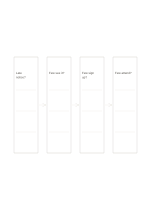

# Causal hypothesis chain

`causal-chain` · `causal` · `a5-draft`

[繁體中文](README.zh-TW.md) · [English](README.en.md) · [日本語](README.ja.md) · [Back to catalog](../../docs/en/catalog.md)

Link four untested cause-and-effect hypotheses in one path.

## When to use it

**Geometry relationship:** `equivalent` · [flow-four-horizontal](../flow-four-horizontal/README.en.md)

- Examine whether late notice could lead to fewer views, sign-ups and attendees, marking each link to check.
- Arrange causal hypotheses preceding an outcome in a short chain and seek evidence for every step.

## How to use it

1. Link four untested cause-and-effect hypotheses in one path.
2. Fill the two middle boxes so the arrows reflect actual order.
3. Read the sequence once to find a missing necessary step.

## What the page helps you see

Observed outcomes separated from causal hypotheses and unsupported links.

## Worked example

Entries in example-position order; each number identifies one entry:

1. Late notice?
2. Few see it?
3. Few sign up?
4. Few attend?

[SVG](examples/en.svg)

## When not to use it

A one-way chain can hide common causes, feedback and counterexamples; arrows record causal hypotheses, and temporal order alone does not establish one event caused another.

## Downloads

- [Wordless SVG](exports/a5-draft/blank.svg)
- [Wordless PDF](exports/a5-draft/blank.pdf)
- [PDF with English name at top left](exports/a5-draft/titled.pdf)
- [Darker-ink wordless PDF](exports/a5-contrast/blank.pdf)
- [Darker-ink SVG](exports/a5-contrast/blank.svg)

The English name appears only on the titled PDF; the wordless version remains available for free writing.

Page size: A5 (148 × 210 mm); profile: `a5-draft`.

## Provenance and status

Generic geometry · Detailed source record: [manifest.json](manifest.json)  
[MIT license scope](../../LICENSE-SCOPE.md)

[Trilingual glossary](../../docs/en/glossary.md)

## Modify and rebuild

Edit geometry in `src/noteformats/variants.py` or text in `src/noteformats/variant_content.py`, then run from the project root:

`python scripts/build.py --ids causal-chain`
