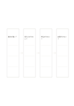

# 因果仮説の連鎖

`causal-chain` · `causal` · `a5-draft`

[繁體中文](README.zh-TW.md) · [English](README.en.md) · [日本語](README.ja.md) · [一覧へ戻る](../../docs/ja/catalog.md)

四つの未確認の因果仮説を一つの経路に並べます。

## 向いている場面

**図形の対応:** `equivalent` · [flow-four-horizontal](../flow-four-horizontal/README.ja.md)

- 案内の遅れが閲覧・申込・出席の減少につながるか、各関係を仮説として並べるとき。
- 結果に先立つ原因候補を短い鎖にし、一段ずつ根拠を探すとき。

## 使い方

1. 四つの未確認の因果仮説を一つの経路に並べます。
2. 途中の二段階を枠に入れ、矢印が実際の順序を示すようにします。
3. 通して読み、必要な手順が抜けていないか確かめます。

## 記入後に見えること

観察結果と原因の仮説を分け、根拠のない関係を示せます。

## 記入例

図の記入位置の順に示します。番号一つが一つの記入例です：

1. 案内が遅い？
2. 見る人が少ない？
3. 申込が少ない？
4. 出席が少ない？

[SVG](examples/ja.svg)

## 向いていない場面

一方向の鎖では共通原因・フィードバック・反例を見落としやすくなります。矢印は因果の仮説で、出来事の前後だけでは原因を証明できません。

## ダウンロード

- [文字なしSVG](exports/a5-draft/blank.svg)
- [文字なしPDF](exports/a5-draft/blank.pdf)
- [左上に英語名があるPDF](exports/a5-draft/titled.pdf)
- [濃い線の文字なしPDF](exports/a5-contrast/blank.pdf)
- [濃い線のSVG](exports/a5-contrast/blank.svg)

英語名は表題付きPDFだけに印刷され、文字なし版は自由な記入に使えます。

用紙サイズ：A5（148 × 210 mm）。設定ファイル：`a5-draft`。

## 由来と状態

一般的な幾何構造 · 詳しい由来の記録： [manifest.json](manifest.json)  
[MITライセンスの範囲](../../LICENSE-SCOPE.md)

[三言語の用語集](../../docs/ja/glossary.md)

## 変更と再生成

図形は `src/noteformats/variants.py`、文章は `src/noteformats/variant_content.py` を変更し、プロジェクトのルートで実行します：

`python scripts/build.py --ids causal-chain`
