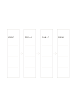

# 因果假設鏈

`causal-chain` · `causal` · `a5-draft`

[繁體中文](README.zh-TW.md) · [English](README.en.md) · [日本語](README.ja.md) · [返回目錄](../../docs/zh-TW/catalog.md)

把四個待驗證的原因與結果假設串成單一路徑。

## 適合情境

**幾何對照:** `equivalent` · [flow-four-horizontal](../flow-four-horizontal/README.zh-TW.md)

- 整理通知太晚是否可能導致看到的人少、報名少與到場少，逐段標出待查連結。
- 將一個結果前的原因假設串成短鏈，另找資料檢查每一步是否成立。

## 使用步驟

1. 把四個待驗證的原因與結果假設串成單一路徑。
2. 把中間兩步填入方框，讓箭頭代表實際先後。
3. 通讀一次，確認是否有跳過的必要步驟。

## 整理後可得到

分開觀察結果與原因假設，標出尚無證據的連結。

## 實際填寫示例

依圖中填寫位置順序列出，每個編號是一筆示例條目：

1. 通知晚？
2. 看到的人少？
3. 報名偏少？
4. 到場偏少？

[SVG](examples/zh-TW.svg)

## 不適合情境

單向鏈容易漏掉共同原因、回饋與反例；箭頭只能記錄待查的因果假設，先後發生也不足以證明前者造成後者。

## 下載

- [無字 SVG](exports/a5-draft/blank.svg)
- [無字 PDF](exports/a5-draft/blank.pdf)
- [左上角英文名稱 PDF](exports/a5-draft/titled.pdf)
- [深色墨線無字 PDF](exports/a5-contrast/blank.pdf)
- [深色墨線 SVG](exports/a5-contrast/blank.svg)

英文名稱只印在標題版 PDF；無字版仍適合自由列印與改作。

頁面尺寸：A5（148 × 210 mm）；設定檔：`a5-draft`。

## 來源與狀態

通用幾何結構 · 詳細來源紀錄見 [manifest.json](manifest.json)  
[MIT 授權範圍](../../LICENSE-SCOPE.md)

[三語術語表](../../docs/zh-TW/glossary.md)

## 修改與重新生成

調整 `src/noteformats/variants.py` 的幾何或 `src/noteformats/variant_content.py` 的文字，再於專案根目錄執行：

`python scripts/build.py --ids causal-chain`
