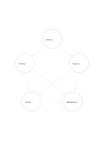

# Cross-linked cause network

`causal-network` · `causal` · `a5-draft`

[繁體中文](README.zh-TW.md) · [English](README.en.md) · [日本語](README.ja.md) · [Back to catalog](../../docs/en/catalog.md)

Map several possible factors and their cross-influences instead of forcing one cause chain.

## When to use it

- Explore how publicity, timing, and sign-up steps may interact in low event registration.
- Inspect how materials and workflow might combine in repeated errors.

## How to use it

1. Put one testable factor in each circle.
2. Follow arrows as proposed directions of influence, not proof of causation.
3. Check the most central or consequential links first and remove unsupported ones.

## What the page helps you see

Observed outcomes separated from causal hypotheses and unsupported links.

## Worked example

A fictional event links notices, timing, sign-up page, venue, and attendance as candidates, without claiming the causes are established.

[SVG](examples/en.svg)

## When not to use it

Lines can make guesses look certain; without evidence this remains a map of hypotheses.

## Downloads

- [Wordless SVG](exports/a5-draft/blank.svg)
- [Wordless PDF](exports/a5-draft/blank.pdf)
- [PDF with English name at top left](exports/a5-draft/titled.pdf)
- [Darker-ink wordless PDF](exports/a5-contrast/blank.pdf)
- [Darker-ink SVG](exports/a5-contrast/blank.svg)

The English name appears only on the titled PDF; the wordless version remains available for free writing.

Page size: A5 (148 × 210 mm); profile: `a5-draft`.

## Provenance and status

Original layout · Detailed source record: [manifest.json](manifest.json)  
[MIT license scope](../../LICENSE-SCOPE.md)

[Trilingual glossary](../../docs/en/glossary.md)

## Modify and rebuild

Change `profiles/a5-draft.json` or the corresponding builder in `src/noteformats/layouts/`, then run from the project root:

`python scripts/build.py --ids causal-network`
