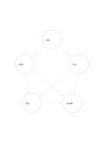

# 交差する要因ネットワーク

`causal-network` · `causal` · `a5-draft`

[繁體中文](README.zh-TW.md) · [English](README.en.md) · [日本語](README.ja.md) · [一覧へ戻る](../../docs/ja/catalog.md)

複数の要因と相互の影響を、一本の原因列ではなく網として考えます。

## 向いている場面

- 申込の少なさに周知、時間、手続きがどう関係するか探るとき。
- 繰り返す誤りで材料と工程が共同で働く可能性を考えるとき。

## 使い方

1. 各円に調べられる要因を一つ書きます。
2. 矢印は仮の影響方向として読み、相関を因果と決めつけません。
3. 重要な線から検証し、支持されない線は消したり直したりします。

## 記入後に見えること

観察結果と原因の仮説を分け、根拠のない関係を示せます。

## 記入例

架空の催しの周知、時間、申込ページ、会場、参加数を候補として結び、因果は未確認としています。

[SVG](examples/ja.svg)

## 向いていない場面

線が推測を確実に見せることがあります。根拠がなければ仮説の地図にとどまります。

## ダウンロード

- [文字なしSVG](exports/a5-draft/blank.svg)
- [文字なしPDF](exports/a5-draft/blank.pdf)
- [左上に英語名があるPDF](exports/a5-draft/titled.pdf)
- [濃い線の文字なしPDF](exports/a5-contrast/blank.pdf)
- [濃い線のSVG](exports/a5-contrast/blank.svg)

英語名は表題付きPDFだけに印刷され、文字なし版は自由な記入に使えます。

用紙サイズ：A5（148 × 210 mm）。設定ファイル：`a5-draft`。

## 由来と状態

本プロジェクトの独自レイアウト · 詳しい由来の記録： [manifest.json](manifest.json)  
[MITライセンスの範囲](../../LICENSE-SCOPE.md)

[三言語の用語集](../../docs/ja/glossary.md)

## 変更と再生成

`profiles/a5-draft.json` または `src/noteformats/layouts/` の描画関数を変更し、プロジェクトのルートで実行します：

`python scripts/build.py --ids causal-network`
