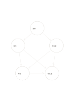

# 交叉因果網絡

`causal-network` · `causal` · `a5-draft`

[繁體中文](README.zh-TW.md) · [English](README.en.md) · [日本語](README.ja.md) · [返回目錄](../../docs/zh-TW/catalog.md)

把多個可能因素及其交叉影響畫成網絡，而非單一原因鏈。

## 適合情境

- 討論活動報名偏少時，宣傳、時間與入口流程可能互相影響。
- 分析反覆錯誤時，材料與工作步驟可能共同作用。

## 使用步驟

1. 每個圓只寫一個可查證的因素。
2. 沿箭頭寫下你認為的影響方向，別把相關性直接當因果。
3. 優先查證連線最多或最關鍵的假設，必要時刪改錯線。

## 整理後可得到

分開觀察結果與原因假設，標出尚無證據的連結。

## 實際填寫示例

示例把虛構活動的通知、時段、報名頁、場地與報名量列成可能相連的因素，尚未宣稱因果成立。

[SVG](examples/zh-TW.svg)

## 不適合情境

線條會讓推測看起來過度確定；缺乏資料時只能當作待驗證地圖。

## 下載

- [無字 SVG](exports/a5-draft/blank.svg)
- [無字 PDF](exports/a5-draft/blank.pdf)
- [左上角英文名稱 PDF](exports/a5-draft/titled.pdf)
- [深色墨線無字 PDF](exports/a5-contrast/blank.pdf)
- [深色墨線 SVG](exports/a5-contrast/blank.svg)

英文名稱只印在標題版 PDF；無字版仍適合自由列印與改作。

頁面尺寸：A5（148 × 210 mm）；設定檔：`a5-draft`。

## 來源與狀態

本專案原創版面 · 詳細來源紀錄見 [manifest.json](manifest.json)  
[MIT 授權範圍](../../LICENSE-SCOPE.md)

[三語術語表](../../docs/zh-TW/glossary.md)

## 修改與重新生成

修改 `profiles/a5-draft.json` 或 `src/noteformats/layouts/` 內對應的繪圖函式，再於專案根目錄執行：

`python scripts/build.py --ids causal-network`
