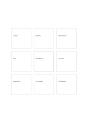

# Center with eight separate cards

`center-eight-boxes` · `mandala` · `a5-draft`

[繁體中文](README.zh-TW.md) · [English](README.en.md) · [日本語](README.ja.md) · [Back to catalog](../../docs/en/catalog.md)

Keep eight independent aspects around one stronger central topic card.

## When to use it

- List eight event resources without implying they connect.
- Branch a research question into eight avenues to investigate.

## How to use it

1. Write the topic in the emphasized middle card.
2. Give each surrounding card one separate aspect.
3. If two aspects relate, draw that link yourself or move to a network page.

## What the page helps you see

Several directions to explore from a central topic.

## Worked example

A fictional neighborhood exhibition is surrounded by venue, works, volunteers, tour, access, materials, schedule, and feedback.

[SVG](examples/en.svg)

## When not to use it

The cards have no built-in sequence; position alone should not imply dependencies.

## Downloads

- [Wordless SVG](exports/a5-draft/blank.svg)
- [Wordless PDF](exports/a5-draft/blank.pdf)
- [PDF with English name at top left](exports/a5-draft/titled.pdf)
- [Darker-ink wordless PDF](exports/a5-contrast/blank.pdf)
- [Darker-ink SVG](exports/a5-contrast/blank.svg)

The English name appears only on the titled PDF; the wordless version remains available for free writing.

Page size: A5 (148 × 210 mm); profile: `a5-draft`.

## Provenance and status

Original layout · Detailed source record: [manifest.json](manifest.json)  
[MIT license scope](../../LICENSE-SCOPE.md)

[Trilingual glossary](../../docs/en/glossary.md)

## Modify and rebuild

Change `profiles/a5-draft.json` or the corresponding builder in `src/noteformats/layouts/`, then run from the project root:

`python scripts/build.py --ids center-eight-boxes`
