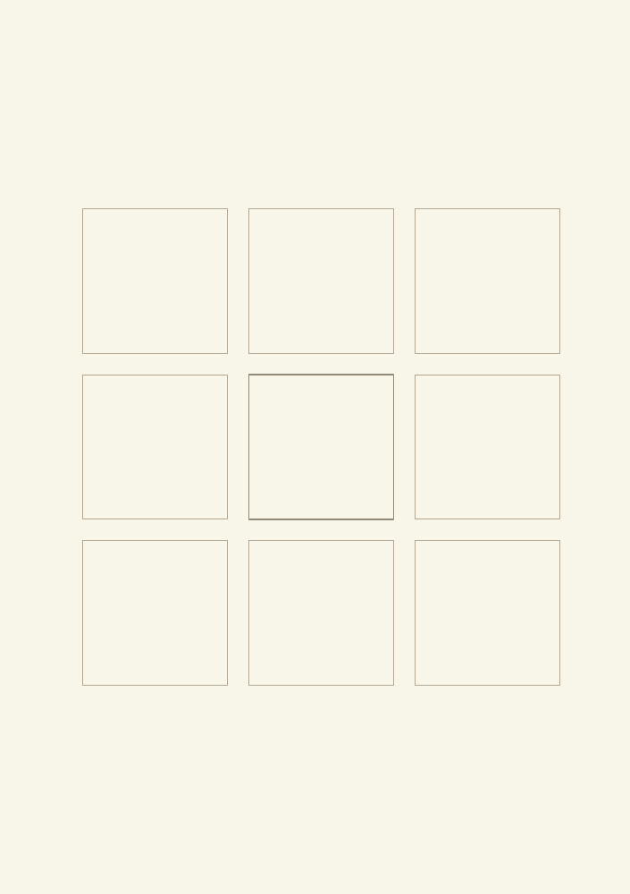
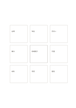

# 中心と八枚の独立カード

`center-eight-boxes` · `mandala` · `a5-draft`

[繁體中文](README.zh-TW.md) · [English](README.en.md) · [日本語](README.ja.md) · [一覧へ戻る](../../docs/ja/catalog.md)

強調した中心の主題の周りに、離れた八つの観点を置きます。

## 向いている場面

- 催しの八種類の資源を、関係を決めずに列挙するとき。
- 研究の問いから八つの調査方向を考えるとき。

## 使い方

1. 中央の強い枠に主題を書きます。
2. 周囲の各枠には独立した観点を一つ置きます。
3. 二つが関係するなら自分で線を引くか関係図に移します。

## 記入後に見えること

中心のテーマから次に調べる方向を広げられます。

## 記入例

架空の地域展示会を中心に、会場、作品、手伝い、案内、交通、材料、日程、意見を周囲に置きます。

[SVG](examples/ja.svg)

## 向いていない場面

枠に順序はありません。位置だけで依存関係を推測しないでください。

## ダウンロード

- [文字なしSVG](exports/a5-draft/blank.svg)
- [文字なしPDF](exports/a5-draft/blank.pdf)
- [左上に英語名があるPDF](exports/a5-draft/titled.pdf)
- [濃い線の文字なしPDF](exports/a5-contrast/blank.pdf)
- [濃い線のSVG](exports/a5-contrast/blank.svg)

英語名は表題付きPDFだけに印刷され、文字なし版は自由な記入に使えます。

用紙サイズ：A5（148 × 210 mm）。設定ファイル：`a5-draft`。

## 由来と状態

本プロジェクトの独自レイアウト · 詳しい由来の記録： [manifest.json](manifest.json)  
[MITライセンスの範囲](../../LICENSE-SCOPE.md)

[三言語の用語集](../../docs/ja/glossary.md)

## 変更と再生成

`profiles/a5-draft.json` または `src/noteformats/layouts/` の描画関数を変更し、プロジェクトのルートで実行します：

`python scripts/build.py --ids center-eight-boxes`
