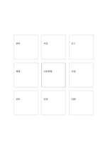

# 中心與八張分離卡

`center-eight-boxes` · `mandala` · `a5-draft`

[繁體中文](README.zh-TW.md) · [English](README.en.md) · [日本語](README.ja.md) · [返回目錄](../../docs/zh-TW/catalog.md)

中心主題周圍留出八個互不相連的卡片，讓面向各自獨立。

## 適合情境

- 列出活動的八種資源而不預設彼此相連。
- 從一個研究問題分出八個待查方向。

## 使用步驟

1. 先把主題寫在中央較強的框內。
2. 周圍每卡只寫一個獨立面向。
3. 若兩卡有關係，再由自己畫連線或另開關係圖。

## 整理後可得到

從中心主題展開多個可再追問的面向。

## 實際填寫示例

示例把虛構社區展覽放中央，外圍八卡依次記場地、作品、志工、導覽、交通、材料、時程與回饋。

[SVG](examples/zh-TW.svg)

## 不適合情境

卡片之間沒有預設流程；需要順序或依賴關係時不應只靠位置推斷。

## 下載

- [無字 SVG](exports/a5-draft/blank.svg)
- [無字 PDF](exports/a5-draft/blank.pdf)
- [左上角英文名稱 PDF](exports/a5-draft/titled.pdf)
- [深色墨線無字 PDF](exports/a5-contrast/blank.pdf)
- [深色墨線 SVG](exports/a5-contrast/blank.svg)

英文名稱只印在標題版 PDF；無字版仍適合自由列印與改作。

頁面尺寸：A5（148 × 210 mm）；設定檔：`a5-draft`。

## 來源與狀態

本專案原創版面 · 詳細來源紀錄見 [manifest.json](manifest.json)  
[MIT 授權範圍](../../LICENSE-SCOPE.md)

[三語術語表](../../docs/zh-TW/glossary.md)

## 修改與重新生成

修改 `profiles/a5-draft.json` 或 `src/noteformats/layouts/` 內對應的繪圖函式，再於專案根目錄執行：

`python scripts/build.py --ids center-eight-boxes`
