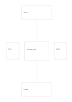

# Center with four satellites

`center-four-satellites` · `cards` · `a5-draft`

[繁體中文](README.zh-TW.md) · [English](README.en.md) · [日本語](README.ja.md) · [Back to catalog](../../docs/en/catalog.md)

Place one central topic among four linked directional factors.

## When to use it

- Organize a gathering around venue, people, materials, and timing.
- Explore four constraints around one product idea.

## How to use it

1. Write a single core topic in the center.
2. Give the top, bottom, left, and right cards different aspects.
3. Follow each link back to the core and mark aspects that still lack information.

## What the page helps you see

Separate units that can be reordered, compared, or selected.

## Worked example

A fictional reading group sits at the center with venue, time, books, and invitations around it.

[SVG](examples/en.svg)

## When not to use it

Small outer cards cannot carry long explanations, and complex dependencies may need a network instead of one center.

## Downloads

- [Wordless SVG](exports/a5-draft/blank.svg)
- [Wordless PDF](exports/a5-draft/blank.pdf)
- [PDF with English name at top left](exports/a5-draft/titled.pdf)
- [Darker-ink wordless PDF](exports/a5-contrast/blank.pdf)
- [Darker-ink SVG](exports/a5-contrast/blank.svg)

The English name appears only on the titled PDF; the wordless version remains available for free writing.

Page size: A5 (148 × 210 mm); profile: `a5-draft`.

## Provenance and status

Original layout · Detailed source record: [manifest.json](manifest.json)  
[MIT license scope](../../LICENSE-SCOPE.md)

[Trilingual glossary](../../docs/en/glossary.md)

## Modify and rebuild

Change `profiles/a5-draft.json` or the corresponding builder in `src/noteformats/layouts/`, then run from the project root:

`python scripts/build.py --ids center-four-satellites`
