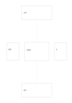

# 中心と四つの衛星カード

`center-four-satellites` · `cards` · `a5-draft`

[繁體中文](README.zh-TW.md) · [English](README.en.md) · [日本語](README.ja.md) · [一覧へ戻る](../../docs/ja/catalog.md)

中心の主題に対して四方向に異なる要素を置きます。

## 向いている場面

- 催しの会場、人、材料、時間を整理するとき。
- 製品案の周りにある四つの制約を探るとき。

## 使い方

1. 中央には一つの主題を書きます。
2. 上下左右の枠に異なる観点を置きます。
3. 各線をたどって主題との関係を確かめ、情報が足りないものに印を付けます。

## 記入後に見えること

項目を分けて、並べ替えや比較、選択ができます。

## 記入例

架空の読書会を中心に置き、会場、時間、本、案内を周囲に配置しています。

[SVG](examples/ja.svg)

## 向いていない場面

外側の枠は小さく長文を載せられません。複雑な依存関係にはネットワーク図が適します。

## ダウンロード

- [文字なしSVG](exports/a5-draft/blank.svg)
- [文字なしPDF](exports/a5-draft/blank.pdf)
- [左上に英語名があるPDF](exports/a5-draft/titled.pdf)
- [濃い線の文字なしPDF](exports/a5-contrast/blank.pdf)
- [濃い線のSVG](exports/a5-contrast/blank.svg)

英語名は表題付きPDFだけに印刷され、文字なし版は自由な記入に使えます。

用紙サイズ：A5（148 × 210 mm）。設定ファイル：`a5-draft`。

## 由来と状態

本プロジェクトの独自レイアウト · 詳しい由来の記録： [manifest.json](manifest.json)  
[MITライセンスの範囲](../../LICENSE-SCOPE.md)

[三言語の用語集](../../docs/ja/glossary.md)

## 変更と再生成

`profiles/a5-draft.json` または `src/noteformats/layouts/` の描画関数を変更し、プロジェクトのルートで実行します：

`python scripts/build.py --ids center-four-satellites`
