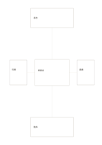

# 中心與四衛星卡

`center-four-satellites` · `cards` · `a5-draft`

[繁體中文](README.zh-TW.md) · [English](README.en.md) · [日本語](README.ja.md) · [返回目錄](../../docs/zh-TW/catalog.md)

把核心主題放中央，四個方向各記一種相連的因素。

## 適合情境

- 整理一個活動的場地、人員、材料與時間。
- 探索一個產品構想周圍的四種限制。

## 使用步驟

1. 先在中央寫唯一的核心主題。
2. 在上下左右卡片各填一個不同面向。
3. 沿連線檢查每個面向如何影響核心，再圈出仍缺資料者。

## 整理後可得到

把可移動的事項分開，方便排序、比較或選擇。

## 實際填寫示例

示例以虛構讀書會為中心，周圍列出場地、時間、選書與邀請。

[SVG](examples/zh-TW.svg)

## 不適合情境

四個外圍卡較小，不能承載長篇說明；多層依賴也不宜硬塞進單一中心。

## 下載

- [無字 SVG](exports/a5-draft/blank.svg)
- [無字 PDF](exports/a5-draft/blank.pdf)
- [左上角英文名稱 PDF](exports/a5-draft/titled.pdf)
- [深色墨線無字 PDF](exports/a5-contrast/blank.pdf)
- [深色墨線 SVG](exports/a5-contrast/blank.svg)

英文名稱只印在標題版 PDF；無字版仍適合自由列印與改作。

頁面尺寸：A5（148 × 210 mm）；設定檔：`a5-draft`。

## 來源與狀態

本專案原創版面 · 詳細來源紀錄見 [manifest.json](manifest.json)  
[MIT 授權範圍](../../LICENSE-SCOPE.md)

[三語術語表](../../docs/zh-TW/glossary.md)

## 修改與重新生成

修改 `profiles/a5-draft.json` 或 `src/noteformats/layouts/` 內對應的繪圖函式，再於專案根目錄執行：

`python scripts/build.py --ids center-four-satellites`
