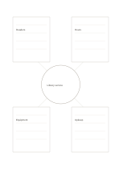

# Center with four note regions

`center-with-notes` · `hybrid` · `a5-draft`

[繁體中文](README.zh-TW.md) · [English](README.en.md) · [日本語](README.ja.md) · [Back to catalog](../../docs/en/catalog.md)

Keep one topic at the center while giving four surrounding angles room for longer notes.

## When to use it

- Discuss users, hours, equipment, and upkeep of a public space.
- Explain a concept from four different angles after reading.

## How to use it

1. Name a precise topic in the center.
2. Give each broad outer area a different angle and write a short note.
3. Compare the areas and mark any conflict or link still needing evidence.

## What the page helps you see

A drawing, short notes, and a conclusion kept separate but connected.

## Worked example

A fictional library service sits at the center, with notes about readers, hours, equipment, and upkeep around it.

[SVG](examples/en.svg)

## When not to use it

Directions have no preset meaning; use a network when many causal cross-links matter.

## Downloads

- [Wordless SVG](exports/a5-draft/blank.svg)
- [Wordless PDF](exports/a5-draft/blank.pdf)
- [PDF with English name at top left](exports/a5-draft/titled.pdf)
- [Darker-ink wordless PDF](exports/a5-contrast/blank.pdf)
- [Darker-ink SVG](exports/a5-contrast/blank.svg)

The English name appears only on the titled PDF; the wordless version remains available for free writing.

Page size: A5 (148 × 210 mm); profile: `a5-draft`.

## Provenance and status

Original layout · Detailed source record: [manifest.json](manifest.json)  
[MIT license scope](../../LICENSE-SCOPE.md)

[Trilingual glossary](../../docs/en/glossary.md)

## Modify and rebuild

Change `profiles/a5-draft.json` or the corresponding builder in `src/noteformats/layouts/`, then run from the project root:

`python scripts/build.py --ids center-with-notes`
