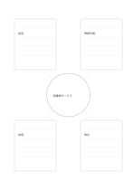

# 中心テーマと四つのメモ欄

`center-with-notes` · `hybrid` · `a5-draft`

[繁體中文](README.zh-TW.md) · [English](README.en.md) · [日本語](README.ja.md) · [一覧へ戻る](../../docs/ja/catalog.md)

中心の題材を保ちながら、周囲の四観点に少し長いメモを書きます。

## 向いている場面

- 公共空間の利用者、時間、設備、維持を分けて考えるとき。
- 読後に一つの概念を四方向から説明するとき。

## 使い方

1. 中心に明確な題材を一つ書きます。
2. 四つの広い欄に異なる観点を置き、短い説明を書きます。
3. 欄の間の食い違いや未確認の関係を見つけます。

## 記入後に見えること

図、短い記録、結論を分けながら関係づけられます。

## 記入例

架空の図書館サービスを中心に、読者、開館時間、設備、維持のメモを周囲に置きます。

[SVG](examples/ja.svg)

## 向いていない場面

四方向には固定の意味がありません。交差する因果が多い場合はネットワーク図を使います。

## ダウンロード

- [文字なしSVG](exports/a5-draft/blank.svg)
- [文字なしPDF](exports/a5-draft/blank.pdf)
- [左上に英語名があるPDF](exports/a5-draft/titled.pdf)
- [濃い線の文字なしPDF](exports/a5-contrast/blank.pdf)
- [濃い線のSVG](exports/a5-contrast/blank.svg)

英語名は表題付きPDFだけに印刷され、文字なし版は自由な記入に使えます。

用紙サイズ：A5（148 × 210 mm）。設定ファイル：`a5-draft`。

## 由来と状態

本プロジェクトの独自レイアウト · 詳しい由来の記録： [manifest.json](manifest.json)  
[MITライセンスの範囲](../../LICENSE-SCOPE.md)

[三言語の用語集](../../docs/ja/glossary.md)

## 変更と再生成

`profiles/a5-draft.json` または `src/noteformats/layouts/` の描画関数を変更し、プロジェクトのルートで実行します：

`python scripts/build.py --ids center-with-notes`
