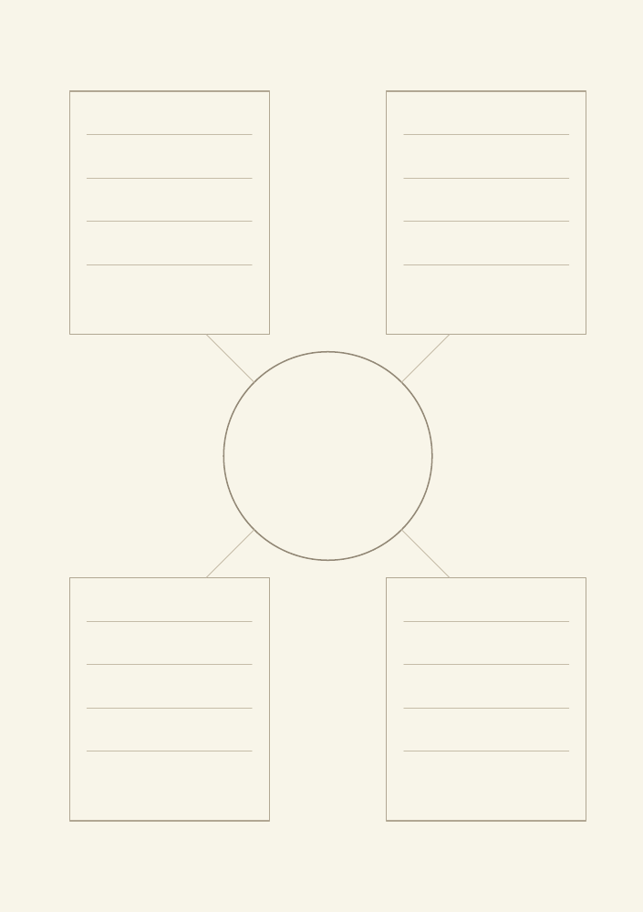
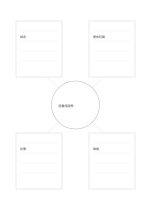

# 中心主題與四區筆記

`center-with-notes` · `hybrid` · `a5-draft`

[繁體中文](README.zh-TW.md) · [English](README.en.md) · [日本語](README.ja.md) · [返回目錄](../../docs/zh-TW/catalog.md)

保留中心主題，四周各寫一種較長的觀察或解釋。

## 適合情境

- 討論一個公共空間時分記使用者、時間、設備、維護。
- 閱讀一個概念後寫四個不同角度的解釋。

## 使用步驟

1. 中心只寫一個明確主題。
2. 四個大框各選一個不同觀察角度，寫成短段落。
3. 比較四區是否有衝突，必要時在框外標記待查連結。

## 整理後可得到

把圖、短記與結論放在各自區域，再檢查關係。

## 實際填寫示例

虛構圖書館服務為中心，四角分別記讀者、開放時間、設備與維護的觀察。

[SVG](examples/zh-TW.svg)

## 不適合情境

四框的方向沒有預設意義；當大量交叉因果重要時應改用網絡圖。

## 下載

- [無字 SVG](exports/a5-draft/blank.svg)
- [無字 PDF](exports/a5-draft/blank.pdf)
- [左上角英文名稱 PDF](exports/a5-draft/titled.pdf)
- [深色墨線無字 PDF](exports/a5-contrast/blank.pdf)
- [深色墨線 SVG](exports/a5-contrast/blank.svg)

英文名稱只印在標題版 PDF；無字版仍適合自由列印與改作。

頁面尺寸：A5（148 × 210 mm）；設定檔：`a5-draft`。

## 來源與狀態

本專案原創版面 · 詳細來源紀錄見 [manifest.json](manifest.json)  
[MIT 授權範圍](../../LICENSE-SCOPE.md)

[三語術語表](../../docs/zh-TW/glossary.md)

## 修改與重新生成

修改 `profiles/a5-draft.json` 或 `src/noteformats/layouts/` 內對應的繪圖函式，再於專案根目錄執行：

`python scripts/build.py --ids center-with-notes`
