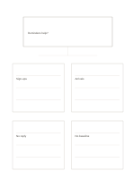

# One claim, four evidence areas

`claim-four-evidence` · `research` · `a5-draft`

[繁體中文](README.zh-TW.md) · [English](README.en.md) · [日本語](README.ja.md) · [Back to catalog](../../docs/en/catalog.md)

Separate a testable claim from four supporting, opposing, or missing pieces of information.

## When to use it

- Check what supports an article's central claim.
- List observations still needed for a fictional event proposal.

## How to use it

1. State one clear, disconfirmable claim above.
2. Record one item and its source in each card, including counterexamples.
3. Compare the quality of evidence rather than treating four filled cards as proof.

## What the page helps you see

Sources, quotations, claims, and open checks kept distinct.

## Worked example

A fictional plan claims reminders improve attendance; cards record sign-ups, arrivals, nonresponses, and the missing no-reminder comparison.

[SVG](examples/en.svg)

## When not to use it

Four cards are not a formal literature review, and fictional examples are not research results.

## Downloads

- [Wordless SVG](exports/a5-draft/blank.svg)
- [Wordless PDF](exports/a5-draft/blank.pdf)
- [PDF with English name at top left](exports/a5-draft/titled.pdf)
- [Darker-ink wordless PDF](exports/a5-contrast/blank.pdf)
- [Darker-ink SVG](exports/a5-contrast/blank.svg)

The English name appears only on the titled PDF; the wordless version remains available for free writing.

Page size: A5 (148 × 210 mm); profile: `a5-draft`.

## Provenance and status

Original layout · Detailed source record: [manifest.json](manifest.json)  
[MIT license scope](../../LICENSE-SCOPE.md)

[Trilingual glossary](../../docs/en/glossary.md)

## Modify and rebuild

Change `profiles/a5-draft.json` or the corresponding builder in `src/noteformats/layouts/`, then run from the project root:

`python scripts/build.py --ids claim-four-evidence`
