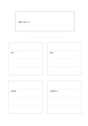

# 一つの主張と四つの資料

`claim-four-evidence` · `research` · `a5-draft`

[繁體中文](README.zh-TW.md) · [English](README.en.md) · [日本語](README.ja.md) · [一覧へ戻る](../../docs/ja/catalog.md)

検証できる主張と、支持・反対・不足を示す四項目を分けます。

## 向いている場面

- 記事の中心の主張に根拠があるか見るとき。
- 架空の催しの企画に必要な観察を挙げるとき。

## 使い方

1. 上に反証可能な主張を一つ書きます。
2. 各枠に資料と出典を一件ずつ記し、反例も含めます。
3. 四枠を埋めた数ではなく、資料の質を比べます。

## 記入後に見えること

資料、引用、主張、未確認事項を分けられます。

## 記入例

架空の案『通知で出席が増える』について、申込、出席、未回答、比較群の欠如を分けて考えます。

[SVG](examples/ja.svg)

## 向いていない場面

四枠では正式な文献調査はできません。架空の例を研究結果として扱わないでください。

## ダウンロード

- [文字なしSVG](exports/a5-draft/blank.svg)
- [文字なしPDF](exports/a5-draft/blank.pdf)
- [左上に英語名があるPDF](exports/a5-draft/titled.pdf)
- [濃い線の文字なしPDF](exports/a5-contrast/blank.pdf)
- [濃い線のSVG](exports/a5-contrast/blank.svg)

英語名は表題付きPDFだけに印刷され、文字なし版は自由な記入に使えます。

用紙サイズ：A5（148 × 210 mm）。設定ファイル：`a5-draft`。

## 由来と状態

本プロジェクトの独自レイアウト · 詳しい由来の記録： [manifest.json](manifest.json)  
[MITライセンスの範囲](../../LICENSE-SCOPE.md)

[三言語の用語集](../../docs/ja/glossary.md)

## 変更と再生成

`profiles/a5-draft.json` または `src/noteformats/layouts/` の描画関数を変更し、プロジェクトのルートで実行します：

`python scripts/build.py --ids claim-four-evidence`
