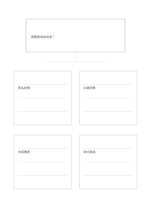

# 主張與四項資料

`claim-four-evidence` · `research` · `a5-draft`

[繁體中文](README.zh-TW.md) · [English](README.en.md) · [日本語](README.ja.md) · [返回目錄](../../docs/zh-TW/catalog.md)

把一個可檢驗的主張與四項支持、反對或缺漏的資料分開。

## 適合情境

- 閱讀一篇文章時檢查其核心主張有何依據。
- 討論虛構活動提案時列出尚需核對的觀察。

## 使用步驟

1. 上方只寫一個清楚、可被反駁的主張。
2. 四卡各記一項資料及來源，包含可能的反例。
3. 最後比較資料品質，別用四格數量取代證據強度。

## 整理後可得到

分開來源、引文、主張與待查問題。

## 實際填寫示例

虛構提案主張『提前提醒會增加到場』；四卡分別記報名、到場、未回覆與未提醒組仍缺資料。

[SVG](examples/zh-TW.svg)

## 不適合情境

四卡並非正式文獻審查，也不能把虛構示例當成真實研究結果。

## 下載

- [無字 SVG](exports/a5-draft/blank.svg)
- [無字 PDF](exports/a5-draft/blank.pdf)
- [左上角英文名稱 PDF](exports/a5-draft/titled.pdf)
- [深色墨線無字 PDF](exports/a5-contrast/blank.pdf)
- [深色墨線 SVG](exports/a5-contrast/blank.svg)

英文名稱只印在標題版 PDF；無字版仍適合自由列印與改作。

頁面尺寸：A5（148 × 210 mm）；設定檔：`a5-draft`。

## 來源與狀態

本專案原創版面 · 詳細來源紀錄見 [manifest.json](manifest.json)  
[MIT 授權範圍](../../LICENSE-SCOPE.md)

[三語術語表](../../docs/zh-TW/glossary.md)

## 修改與重新生成

修改 `profiles/a5-draft.json` 或 `src/noteformats/layouts/` 內對應的繪圖函式，再於專案根目錄執行：

`python scripts/build.py --ids claim-four-evidence`
