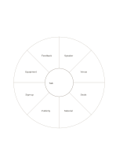

# Eight-sector classification wheel

`classification-wheel` · `hierarchy` · `a5-draft`

[繁體中文](README.zh-TW.md) · [English](README.en.md) · [日本語](README.ja.md) · [Back to catalog](../../docs/en/catalog.md)

Place up to eight categories around one subject to notice gaps and overlap.

## When to use it

- Inventory the preparation areas of a small event.
- Organize eight related angles after reading about a concept.

## How to use it

1. Write the subject in the center.
2. Fill distinct outer sectors, leaving unused sectors empty.
3. Check for duplicates and gaps without inventing categories just to fill eight.

## What the page helps you see

Levels of a goal or topic, with gaps easier to notice.

## Worked example

A fictional community talk considers speaker, venue, seats, material, publicity, sign-ups, equipment, and feedback.

[SVG](examples/en.svg)

## When not to use it

Narrow sectors fit brief terms; eight is a layout capacity, not a required number of categories.

## Downloads

- [Wordless SVG](exports/a5-draft/blank.svg)
- [Wordless PDF](exports/a5-draft/blank.pdf)
- [PDF with English name at top left](exports/a5-draft/titled.pdf)
- [Darker-ink wordless PDF](exports/a5-contrast/blank.pdf)
- [Darker-ink SVG](exports/a5-contrast/blank.svg)

The English name appears only on the titled PDF; the wordless version remains available for free writing.

Page size: A5 (148 × 210 mm); profile: `a5-draft`.

## Provenance and status

Common geometry · Detailed source record: [manifest.json](manifest.json)  
[MIT license scope](../../LICENSE-SCOPE.md)

[Trilingual glossary](../../docs/en/glossary.md)

## Modify and rebuild

Change `profiles/a5-draft.json` or the corresponding builder in `src/noteformats/layouts/`, then run from the project root:

`python scripts/build.py --ids classification-wheel`
