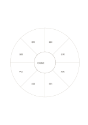

# 八区分の分類輪

`classification-wheel` · `hierarchy` · `a5-draft`

[繁體中文](README.zh-TW.md) · [English](README.en.md) · [日本語](README.ja.md) · [一覧へ戻る](../../docs/ja/catalog.md)

一つの題材の周囲に最大八種類を置き、抜けや重複を見つけます。

## 向いている場面

- 小さな催しの準備項目を洗い出すとき。
- 読後に概念の周辺要素を整理するとき。

## 使い方

1. 中心に整理する題材を書きます。
2. 外側には異なる分類を置き、余る区画は空けます。
3. 重複と抜けを確認し、八区画を埋めるためだけの項目は作りません。

## 記入後に見えること

目的や話題の階層と、抜けている要素が見えます。

## 記入例

架空の地域講座で、講師、会場、座席、資料、広報、申込、設備、感想を外側に置きます。

[SVG](examples/ja.svg)

## 向いていない場面

扇形は狭く、短語向けです。分類が必ず八つあるという意味ではありません。

## ダウンロード

- [文字なしSVG](exports/a5-draft/blank.svg)
- [文字なしPDF](exports/a5-draft/blank.pdf)
- [左上に英語名があるPDF](exports/a5-draft/titled.pdf)
- [濃い線の文字なしPDF](exports/a5-contrast/blank.pdf)
- [濃い線のSVG](exports/a5-contrast/blank.svg)

英語名は表題付きPDFだけに印刷され、文字なし版は自由な記入に使えます。

用紙サイズ：A5（148 × 210 mm）。設定ファイル：`a5-draft`。

## 由来と状態

一般的な幾何構造 · 詳しい由来の記録： [manifest.json](manifest.json)  
[MITライセンスの範囲](../../LICENSE-SCOPE.md)

[三言語の用語集](../../docs/ja/glossary.md)

## 変更と再生成

`profiles/a5-draft.json` または `src/noteformats/layouts/` の描画関数を変更し、プロジェクトのルートで実行します：

`python scripts/build.py --ids classification-wheel`
