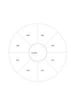

# 八區分類輪

`classification-wheel` · `hierarchy` · `a5-draft`

[繁體中文](README.zh-TW.md) · [English](README.en.md) · [日本語](README.ja.md) · [返回目錄](../../docs/zh-TW/catalog.md)

把一個主題周圍的八種分類放在同一圈，方便檢查遺漏。

## 適合情境

- 盤點小型活動可能涉及的八種準備項目。
- 閱讀後整理一個概念的八個相關面向。

## 使用步驟

1. 中心寫要盤點的主題。
2. 沿外圈八區填入互相區分的類別，必要時留空。
3. 回頭檢查重複與缺項，別因格數而湊足八項。

## 整理後可得到

區分上位目標與下位要素，檢查是否遺漏。

## 實際填寫示例

虛構社區講座的外圈寫講者、場地、座位、材料、宣傳、報名、設備及回饋。

[SVG](examples/zh-TW.svg)

## 不適合情境

扇區狹窄，只能寫短詞；格數不表示類別必須剛好八個。

## 下載

- [無字 SVG](exports/a5-draft/blank.svg)
- [無字 PDF](exports/a5-draft/blank.pdf)
- [左上角英文名稱 PDF](exports/a5-draft/titled.pdf)
- [深色墨線無字 PDF](exports/a5-contrast/blank.pdf)
- [深色墨線 SVG](exports/a5-contrast/blank.svg)

英文名稱只印在標題版 PDF；無字版仍適合自由列印與改作。

頁面尺寸：A5（148 × 210 mm）；設定檔：`a5-draft`。

## 來源與狀態

通用幾何結構 · 詳細來源紀錄見 [manifest.json](manifest.json)  
[MIT 授權範圍](../../LICENSE-SCOPE.md)

[三語術語表](../../docs/zh-TW/glossary.md)

## 修改與重新生成

修改 `profiles/a5-draft.json` 或 `src/noteformats/layouts/` 內對應的繪圖函式，再於專案根目錄執行：

`python scripts/build.py --ids classification-wheel`
