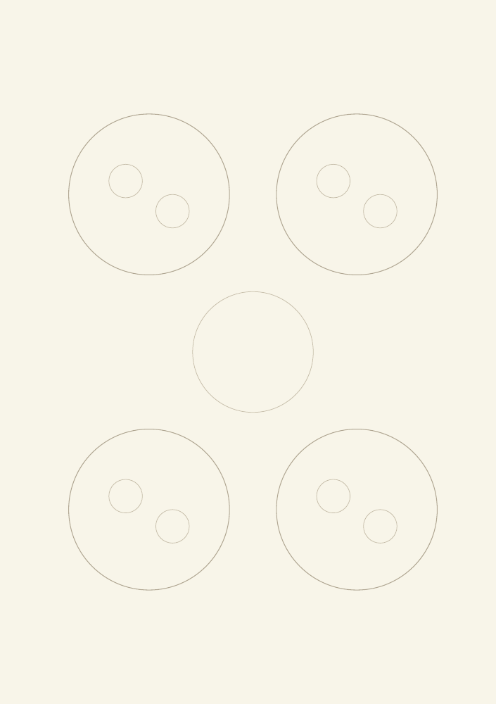
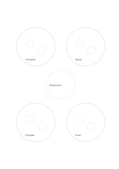

# Cluster ring

`cluster-ring` · `concept-network` · `a5-draft`

[繁體中文](README.zh-TW.md) · [English](README.en.md) · [日本語](README.ja.md) · [Back to catalog](../../docs/en/catalog.md)

Gather loose material into four clusters before naming their shared theme.

## When to use it

- Sort interview notes into provisional groups.
- Group a travel proposal into transport, lodging, activities, and food.

## How to use it

1. Place similar items within each outer cluster, using small circles for examples.
2. Look across clusters and write a shared question in the center.
3. Draw an extra link for an item spanning groups instead of forcing a choice.

## What the page helps you see

A map of topics, branches, and relationships still to verify.

## Worked example

Fictional community-event notes form transport, space, program, and food clusters, with 'participant experience' at the center.

[SVG](examples/en.svg)

## When not to use it

Four groups are a provisional aid, not a statistical classification or the only valid taxonomy.

## Downloads

- [Wordless SVG](exports/a5-draft/blank.svg)
- [Wordless PDF](exports/a5-draft/blank.pdf)
- [PDF with English name at top left](exports/a5-draft/titled.pdf)
- [Darker-ink wordless PDF](exports/a5-contrast/blank.pdf)
- [Darker-ink SVG](exports/a5-contrast/blank.svg)

The English name appears only on the titled PDF; the wordless version remains available for free writing.

Page size: A5 (148 × 210 mm); profile: `a5-draft`.

## Provenance and status

Original layout · Detailed source record: [manifest.json](manifest.json)  
[MIT license scope](../../LICENSE-SCOPE.md)

[Trilingual glossary](../../docs/en/glossary.md)

## Modify and rebuild

Change `profiles/a5-draft.json` or the corresponding builder in `src/noteformats/layouts/`, then run from the project root:

`python scripts/build.py --ids cluster-ring`
