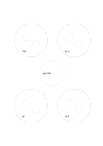

# 輪状のグループ分け

`cluster-ring` · `concept-network` · `a5-draft`

[繁體中文](README.zh-TW.md) · [English](README.en.md) · [日本語](README.ja.md) · [一覧へ戻る](../../docs/ja/catalog.md)

散らばった材料を四群にまとめてから、共通の主題を中心に置きます。

## 向いている場面

- 聞き取りのメモを似た内容で仮にまとめるとき。
- 旅行案を交通、宿泊、活動、食事に分けるとき。

## 使い方

1. 外側の大円に近い項目を集め、小円に代表例を記します。
2. 四群に共通する問いを中心へ書きます。
3. 二群にまたがる項目は無理に一方へ入れず、線を足します。

## 記入後に見えること

主題と枝、確かめ直す関係を一覧できます。

## 記入例

架空の地域催事のメモを交通、会場、催し、食事に分け、中央に『参加体験』と書きます。

[SVG](examples/ja.svg)

## 向いていない場面

四群は仮の整理です。精密な統計分類や唯一の分類法にはしないでください。

## ダウンロード

- [文字なしSVG](exports/a5-draft/blank.svg)
- [文字なしPDF](exports/a5-draft/blank.pdf)
- [左上に英語名があるPDF](exports/a5-draft/titled.pdf)
- [濃い線の文字なしPDF](exports/a5-contrast/blank.pdf)
- [濃い線のSVG](exports/a5-contrast/blank.svg)

英語名は表題付きPDFだけに印刷され、文字なし版は自由な記入に使えます。

用紙サイズ：A5（148 × 210 mm）。設定ファイル：`a5-draft`。

## 由来と状態

本プロジェクトの独自レイアウト · 詳しい由来の記録： [manifest.json](manifest.json)  
[MITライセンスの範囲](../../LICENSE-SCOPE.md)

[三言語の用語集](../../docs/ja/glossary.md)

## 変更と再生成

`profiles/a5-draft.json` または `src/noteformats/layouts/` の描画関数を変更し、プロジェクトのルートで実行します：

`python scripts/build.py --ids cluster-ring`
