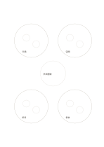

# 環形群組整理

`cluster-ring` · `concept-network` · `a5-draft`

[繁體中文](README.zh-TW.md) · [English](README.en.md) · [日本語](README.ja.md) · [返回目錄](../../docs/zh-TW/catalog.md)

把零散材料先聚成四群，再在中心寫共同主題。

## 適合情境

- 將訪談便條按相似內容初步分群。
- 整理旅行提案時分出交通、住宿、活動與餐食。

## 使用步驟

1. 先在外側四個大圈各放相近項目，小圈記代表例子。
2. 看四群的共同問題，再寫入中心。
3. 若某項橫跨兩群，在旁邊另畫連線，不必硬塞。

## 整理後可得到

看見主題、分支及需要再確認的關係。

## 實際填寫示例

虛構社區活動的便條被聚為交通、空間、節目與餐食；中心暫寫『參與體驗』。

[SVG](examples/zh-TW.svg)

## 不適合情境

四群是討論用的暫時分類，不適合當精密統計或唯一分類法。

## 下載

- [無字 SVG](exports/a5-draft/blank.svg)
- [無字 PDF](exports/a5-draft/blank.pdf)
- [左上角英文名稱 PDF](exports/a5-draft/titled.pdf)
- [深色墨線無字 PDF](exports/a5-contrast/blank.pdf)
- [深色墨線 SVG](exports/a5-contrast/blank.svg)

英文名稱只印在標題版 PDF；無字版仍適合自由列印與改作。

頁面尺寸：A5（148 × 210 mm）；設定檔：`a5-draft`。

## 來源與狀態

本專案原創版面 · 詳細來源紀錄見 [manifest.json](manifest.json)  
[MIT 授權範圍](../../LICENSE-SCOPE.md)

[三語術語表](../../docs/zh-TW/glossary.md)

## 修改與重新生成

修改 `profiles/a5-draft.json` 或 `src/noteformats/layouts/` 內對應的繪圖函式，再於專案根目錄執行：

`python scripts/build.py --ids cluster-ring`
